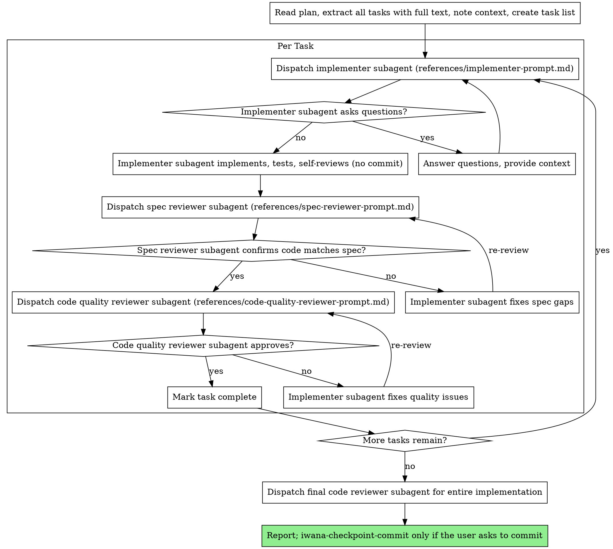

# Executing Plans

## Overview

Load plan, review critically, execute all tasks, report when complete. Two modes:

- **Secuencial:** you execute the tasks yourself, in this session.
- **Con subagentes:** a fresh subagent per task, with two-stage review (spec compliance, then code quality). Prefer it whenever the platform supports subagents and the tasks are mostly independent; the quality of the work is significantly higher. Details in [Modo con subagentes](#modo-con-subagentes).

**Announce at start:** "I'm using the executing-plans skill to implement this plan."

## The Process

### Step 1: Load and Review Plan
1. Read plan file
2. Review critically - identify any questions or concerns about the plan
3. If concerns: Raise them with your human partner before starting
4. If no concerns: Create the task list and proceed

### Step 2: Execute Tasks

For each task:
1. Mark as in_progress
2. Follow each step exactly (plan has bite-sized steps)
3. Run verifications as specified
4. Mark as completed

### Step 3: Complete Development

After all tasks complete and verified:
- Report the result with verification evidence (`verification-before-completion`)
- **REQUIRED SUB-SKILL:** Use `iwana-checkpoint-commit` when the user asks to commit (it is user-invoked: never commit on your own)
- Work stays on `main`: no branch merge or cleanup step

## Modo con subagentes

**Core principle:** Fresh subagent per task + two-stage review (spec then quality) = high quality, fast iteration. Subagents never inherit your session's history: you construct exactly the context they need, which also preserves your own context for coordination.

**Continuous execution:** Do not pause to check in with your human partner between tasks. The only reasons to stop are: BLOCKED status you cannot resolve, ambiguity that genuinely prevents progress, or all tasks complete.

### Cuándo usarlo

- Hay un plan, las tareas son mayormente independientes y te quedas en esta sesión → modo con subagentes.
- Las tareas están fuertemente acopladas → ejecución secuencial, o `brainstorming` si el plan no está claro.

### Flujo por tarea

El implementador **implementa, prueba y se autorrevisa; no commitea**. El commit es de `iwana-checkpoint-commit` y solo a pedido del usuario. Como no hay commit por tarea, los revisores trabajan sobre el diff del árbol de trabajo.

### Estados del implementador

- **DONE:** proceed to spec compliance review.
- **DONE_WITH_CONCERNS:** read the concerns first. If they are about correctness or scope, address them before review; if they are observations (e.g. "this file is getting large"), note them and proceed.
- **NEEDS_CONTEXT:** provide the missing context and re-dispatch.
- **BLOCKED:** assess the blocker: (1) context problem → more context, same model; (2) needs more reasoning → more capable model; (3) task too large → split it; (4) the plan itself is wrong → escalate to the human.

**Never** ignore an escalation or force the same model to retry without changes.

### Implementadores en paralelo

Nunca: Dispatch multiple implementation subagents in parallel (conflicts).

### Orden de las revisiones

Spec compliance primero; solo con ✅ se despacha la revisión de calidad. Ninguna tarea avanza con issues abiertos en alguna de las dos. Ningún subagente commitea, hace stash ni crea ramas.

### Plantillas de prompt

- [`references/implementer-prompt.md`](references/implementer-prompt.md) — implementador
- [`references/spec-reviewer-prompt.md`](references/spec-reviewer-prompt.md) — revisor de cumplimiento del spec
- [`references/code-quality-reviewer-prompt.md`](references/code-quality-reviewer-prompt.md) — revisor de calidad (o el revisor del repo que aplique, según `requesting-code-review`)

## When to Stop and Ask for Help

**STOP executing immediately when:**
- Hit a blocker (missing dependency, test fails, instruction unclear)
- Plan has critical gaps preventing starting
- You don't understand an instruction
- Verification fails repeatedly

**Ask for clarification rather than guessing.**

## When to Revisit Earlier Steps

**Return to Review (Step 1) when:**
- Partner updates the plan based on your feedback
- Fundamental approach needs rethinking

**Don't force through blockers** - stop and ask.

## Remember
- Review plan critically first
- Follow plan steps exactly
- Don't skip verifications
- Reference skills when plan says to
- Stop when blocked, don't guess

## Integration

**Required workflow skills:**
- **writing-plans** - Creates the plan this skill executes
- **requesting-code-review** - Routes each diff to the right reviewer
- **iwana-checkpoint-commit** - Commit the wave on `main` after all tasks, when the user asks

**Subagents should use:**
- **test-driven-development** - Subagents follow TDD for each task
