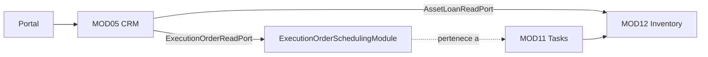

# HLD — MOD05 Fase 05: ciclo de vida y avisos de terminación

**Versión:** 1.1  
**Estado:** Aprobado  
**Fecha:** 2026-10-19  
**Historial:** v1.1 (2026-10-19) precisa el módulo estrecho de lectura MOD11 y añade el control de notas cifradas y acceso al historial de titulares bloqueados, conforme a V2/V3.  
**Modo activo:** Architect  
**Autor:** AI-EM-ARCH  
**Complementa:** [HLD-MOD05 Arquitectura v2.2](HLD-MOD05-ARQUITECTURA-v2.0.md)  
**PRD:** [PRD-MOD05 CRM Suscriptores Fase 05 v1.2](../prds/PRD-MOD05-CRM-SUBSCRIBERS-FASE-05-v1.2.md)  
**ADR:** [ADR-097 — Puertos de lectura para avisos de terminación](../adrs/ADR-097-Puertos-de-lectura-para-avisos-de-terminacion-MOD05.md)
**ADRs relacionados:** ADR-058 (cifrado y rotación de PII), ADR-094 (acceso a datos bloqueados)

## 1. Alcance arquitectónico

La Fase 05 mantiene en MOD05 la autoridad sobre el estado del suscriptor, los contratos, sus transiciones y el historial. El diálogo de terminación agrega avisos de equipos y órdenes pendientes. La lectura pertenece a los módulos que poseen esos datos.

MOD05 consulta MOD12 y MOD11 mediante interfaces tipadas exportadas por módulos estrechos. En MOD11, `SubscribersModule` importa `ExecutionOrderSchedulingModule`, que exporta `ExecutionOrderReadPort` sin importar `TasksModule`, `AssuranceModule` ni CRM. Así se evita el ciclo que se formaría al importar el módulo completo de tareas. Los servicios CRM no importan las entidades ni repositorios de MOD12 o MOD11. MOD11 ya depende de MOD12; la nueva dependencia de MOD05 no cierra un ciclo.

## 2. Contratos de lectura

| Puerto (dueño) | Consulta mínima | Regla de tenant |
| --- | --- | --- |
| `AssetLoanReadPort` (MOD12) | Recibe los contratos seleccionados y devuelve IDs con al menos una asignación de comodato abierta (`removed_at IS NULL`). | Adaptador obtiene `tenantId` y `schemaName` de `TenantContext`; CRM no los provee. |
| `ExecutionOrderReadPort` (MOD11) | Recibe `subscriberId` y devuelve si existe una OT de tipo `RETIREMENT`, no anulada y en estado `CREATED`, `ASSIGNED`, `EN_ROUTE`, `IN_PROGRESS` o `BLOCKED`. | Adaptador obtiene el contexto vigente del tenant; no hay filtro de tenant arbitrario. |

Las interfaces devuelven IDs de contrato o un booleano. No publican datos personales, entidades, repositorios ni acceso al `EntityManager` del proveedor.

## 3. Flujo de vista previa

1. MOD05 valida `action` y los campos del acto; para `TERMINATE`, valida los contratos elegibles y calcula el resultado de estado sin escribir.
2. MOD05 consulta ambos puertos. `EQUIPMENT_ON_LOAN` relaciona los contratos afectados por la lectura de MOD12. `OPEN_WITHDRAWAL_ORDERS` es general al suscriptor (`contractIds: []`) porque MOD11 no vincula una OT a un contrato.
3. Si una lectura falla, la API responde error; no omite el aviso ni lo sustituye por un resultado vacío.
4. Confirmar termina siendo una operación separada. La vista previa no retira activos ni cambia el estado de órdenes.

## 4. Seguridad y consistencia

- Todos los reads usan el tenant resuelto en el contexto de la petición y el patrón aprobado de ejecución en schema tenant.
- Los puertos son de solo lectura y aplican el aislamiento del módulo propietario.
- Las consultas son de existencia/proyección mínima; no cargan filas completas para el consumidor.
- La vista previa es informativa y no reserva recursos. Una orden o asignación puede cambiar después; la operación de terminación no automatiza esos procesos.
- La nota del historial se cifra con AES-256-GCM según ADR-058. Las filas son append-only desde los flujos de negocio; el CLI de rotación solo puede reescribir el ciphertext, sin cambiar la nota lógica ni otros campos.
- Para un suscriptor con `DATOS_BLOQUEADOS`, la lectura del historial requiere `PRIVACY_READ` o `CRM_BLOCKED_DATA_READ` y se audita. Sin ese permiso la API responde 403 antes de consultar el historial. La nota además requiere `CRM_SUBSCRIBERS_MANAGE`, incluso para un lector de privacidad.

## 5. Referencias

- PRD Fase 05 v1.2: RF-LC-11, RF-LC-18, RF-LC-22, RF-LC-26 y §9.3.
- ADR-097: decisión y alternativas de integración.
- ADR-058: cifrado y rotación de claves PII.
- ADR-094: permisos y auditoría para datos bloqueados.
- HLD-MOD05 Arquitectura v2.2: boundaries y patrón de puertos existente.
