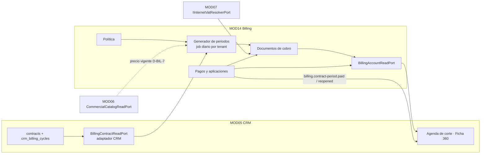
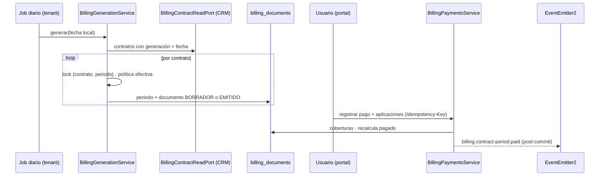

# HLD-MOD14 — Facturación · Fase 01: Cartera interna y política de facturación

**Versión:** 1.0
**Estado:** Aprobado — contrato **congelado** desde G0 (CTO, 2026-10-31). Cualquier cambio entra por un re-sync versionado.
**Fecha:** 2026-10-31
**Emisor:** AI-EM-ARCH
**PRD:** [PRD-MOD14-FACTURACION-FASE-01-v1.0](../prds/PRD-MOD14-FACTURACION-FASE-01-v1.0.md) · **ADR:** [ADR-103](../adrs/ADR-103-Modulo-Facturacion-MOD14.md)
**Base verificada:** `main` en `1ce4f263`, más el árbol sin commitear de MOD05 Fase 09; última migración tenant: `168_crm_contract_alias_readable`

---

## 1. Vista general





**Estados del documento:** `BORRADOR` → `EMITIDO` → `ANULADO`; un borrador también puede descartarse. El estado de pago (`BillingPeriodPaymentState`: `SIN_DOCUMENTO`, `PAGADO`, `VENCIDO`, `PARCIAL`, `PENDIENTE`, §4) se calcula y no se persiste.

## 2. Estructura de código

```
apps/api/src/modules/billing/
  billing.module.ts
  policy/            billing-policy.service.ts · billing-policy.controller.ts
  generation/        billing-generation.service.ts · billing-generation.processor.ts (cola)
  documents/         billing-documents.service.ts · billing-documents.controller.ts · billing-document-pdf.service.ts · billing-document.layout.ts
  payments/          billing-payments.service.ts · billing-payments.controller.ts · allocation.ts (puro)
  accounts/          billing-account-read.adapter.ts · billing-accounts.controller.ts
  ports/             billing-account-read.port.ts · billing-contract-read.port.ts (token; lo implementa CRM)
  events/            billing.events.ts · contract-period-paid.event.ts
  dto/ · tests/
apps/api/src/modules/crm/contracts/billing-contract-read.adapter.ts   (implementa BillingContractReadPort)
apps/api/src/common/pdf/pdf-branding.ts                               (se sube desde inventory, sin cambiar su API)
packages/database/src/entities/billing-*.entity.ts
packages/shared/src/contracts/billing/                                 (Zod + tipos, contract-first)
packages/shared/src/calendar/billing-calendar.ts                       (reutiliza computeCutoffDate de billing-cutoff.ts, sin cambiarlo)
```

- **Patrón de módulo:** el de MOD13, `network/network.module.ts`. El puerto es una clase abstracta usada como token, con `useExisting` sobre el adaptador.
- **Dependencia con CRM:** `BillingModule` importa `BillingContractReadModule`, un módulo pequeño de CRM que exporta solo el adaptador. **No importa `SubscribersModule` ni `ContractsModule`**, y tampoco se crea un ciclo de imports.
- **Dependencia inversa:** CRM consume `BillingAccountReadPort` a través de un módulo de lectura que exporta Billing.

## 3. Modelo de datos (schema del tenant)

- Todos los montos se guardan en `numeric(14,2)` y la entidad los mapea a `string`.
- Todas las tablas llevan `tenant_id uuid NOT NULL` y las marcas de tiempo `timestamptz`.

### 3.1 Migración `169_billing_core`

```sql
CREATE TABLE billing_policy (
  tenant_id uuid PRIMARY KEY,
  period_timing varchar(12) NOT NULL DEFAULT 'ANTICIPADO' CHECK (period_timing IN ('ANTICIPADO','VENCIDO')),
  generation_lead_days smallint NOT NULL DEFAULT 0 CHECK (generation_lead_days BETWEEN 0 AND 15),
  cutoff_mode varchar(24) NOT NULL DEFAULT 'DIA_FIJO_CICLO' CHECK (cutoff_mode IN ('DIA_FIJO_CICLO','VENCIMIENTO_MAS_GRACIA')),
  payment_term_days smallint NOT NULL DEFAULT 14 CHECK (payment_term_days BETWEEN 0 AND 60),
  grace_days smallint NOT NULL DEFAULT 0 CHECK (grace_days BETWEEN 0 AND 30),
  cutoff_enabled boolean NOT NULL DEFAULT true,
  minimum_unpaid_for_cutoff numeric(14,2) NOT NULL DEFAULT 0 CHECK (minimum_unpaid_for_cutoff >= 0),
  proration_method varchar(12) NOT NULL DEFAULT 'DIAS_REALES' CHECK (proration_method IN ('DIAS_REALES','MES_30')),
  first_period_mode varchar(20) NOT NULL DEFAULT 'SEPARADO' CHECK (first_period_mode IN ('SEPARADO','JUNTO_AL_SIGUIENTE')),
  automatic_generation boolean NOT NULL DEFAULT false,
  approval_mode varchar(12) NOT NULL DEFAULT 'BORRADOR' CHECK (approval_mode IN ('BORRADOR','AUTOMATICA')),
  auto_apply_credit boolean NOT NULL DEFAULT true,
  generation_hour smallint NOT NULL DEFAULT 6 CHECK (generation_hour BETWEEN 0 AND 23),
  document_prefix varchar(10) NOT NULL DEFAULT 'DC',
  updated_by uuid NULL,
  updated_at timestamptz NOT NULL DEFAULT now(),
  CHECK (NOT (cutoff_mode = 'DIA_FIJO_CICLO' AND period_timing = 'VENCIDO'))
);
-- Se siembra una fila por tenant con los valores por defecto (D-BIL-3 a D-BIL-5).

CREATE TABLE billing_contract_policy (
  contract_id uuid PRIMARY KEY REFERENCES contracts(id) ON DELETE CASCADE,
  tenant_id uuid NOT NULL,
  period_timing varchar(12) NULL, generation_lead_days smallint NULL,
  payment_term_days smallint NULL, grace_days smallint NULL,
  cutoff_enabled boolean NULL, first_period_mode varchar(20) NULL,
  billing_start_date date NULL,
  updated_by uuid NULL, updated_at timestamptz NOT NULL DEFAULT now()
  -- mismos CHECK de rango que billing_policy; la incompatibilidad de modos la valida el servicio
);

CREATE TABLE billing_periods (
  id uuid PRIMARY KEY DEFAULT gen_random_uuid(),
  tenant_id uuid NOT NULL,
  contract_id uuid NOT NULL REFERENCES contracts(id),
  subscriber_id uuid NOT NULL,
  period_start date NOT NULL, period_end date NOT NULL,
  covered_start date NOT NULL,              -- < period_start si absorbe la prorrata (JUNTO_AL_SIGUIENTE)
  generation_date date NOT NULL, due_date date NOT NULL, cutoff_date date NULL,
  effective_policy jsonb NOT NULL,          -- política congelada (ADR-103 D4 regla 2)
  created_at timestamptz NOT NULL DEFAULT now(),
  UNIQUE (contract_id, period_start)
);

CREATE TABLE billing_documents (
  id uuid PRIMARY KEY DEFAULT gen_random_uuid(),
  tenant_id uuid NOT NULL,
  period_id uuid NOT NULL REFERENCES billing_periods(id),
  contract_id uuid NOT NULL, subscriber_id uuid NOT NULL,
  status varchar(10) NOT NULL CHECK (status IN ('BORRADOR','EMITIDO','ANULADO')),
  number varchar(30) NULL,                  -- se asigna al emitir
  issue_date date NULL, due_date date NOT NULL,
  subtotal numeric(14,2) NOT NULL, tax_total numeric(14,2) NOT NULL, total numeric(14,2) NOT NULL,
  blocking_reason varchar(60) NULL,         -- RF-FAC-15: motivo que impide emitir
  buyer_snapshot jsonb NULL, issuer_snapshot jsonb NULL,  -- se congelan al emitir; PII mínima
  void_reason_code varchar(40) NULL, void_note varchar(500) NULL, voided_at timestamptz NULL, voided_by uuid NULL,
  created_by uuid NULL, created_at timestamptz NOT NULL DEFAULT now(), updated_at timestamptz NOT NULL DEFAULT now(),
  UNIQUE (tenant_id, number)
);
CREATE UNIQUE INDEX uq_billing_documents_period_live ON billing_documents (period_id) WHERE status <> 'ANULADO';
CREATE INDEX idx_billing_documents_subscriber ON billing_documents (subscriber_id, status);

CREATE TABLE billing_document_lines (
  id uuid PRIMARY KEY DEFAULT gen_random_uuid(),
  tenant_id uuid NOT NULL,
  document_id uuid NOT NULL REFERENCES billing_documents(id) ON DELETE CASCADE,
  kind varchar(16) NOT NULL CHECK (kind IN ('PLAN','ADICIONAL','PRORRATEO')),
  description varchar(200) NOT NULL,
  quantity numeric(10,4) NOT NULL, unit_price numeric(14,2) NOT NULL,
  base_amount numeric(14,2) NOT NULL, tax_amount numeric(14,2) NOT NULL, total numeric(14,2) NOT NULL,
  vat_treatment varchar(16) NOT NULL, vat_rate numeric(7,4) NOT NULL, vat_legal_basis varchar(60) NULL,
  position smallint NOT NULL
);

CREATE TABLE billing_payments (
  id uuid PRIMARY KEY DEFAULT gen_random_uuid(),
  tenant_id uuid NOT NULL,
  subscriber_id uuid NOT NULL,
  method varchar(20) NOT NULL CHECK (method IN ('EFECTIVO','TRANSFERENCIA','CONSIGNACION','DATAFONO','OTRO')),
  amount numeric(14,2) NOT NULL CHECK (amount > 0),
  paid_at date NOT NULL, reference varchar(80) NULL, note varchar(500) NULL,
  idempotency_key varchar(80) NOT NULL,
  status varchar(10) NOT NULL DEFAULT 'REGISTRADO' CHECK (status IN ('REGISTRADO','ANULADO')),
  void_reason_code varchar(40) NULL, void_note varchar(500) NULL, voided_at timestamptz NULL, voided_by uuid NULL,
  created_by uuid NOT NULL, created_at timestamptz NOT NULL DEFAULT now(),
  UNIQUE (tenant_id, idempotency_key)
);

CREATE TABLE billing_payment_allocations (
  id uuid PRIMARY KEY DEFAULT gen_random_uuid(),
  tenant_id uuid NOT NULL,
  payment_id uuid NOT NULL REFERENCES billing_payments(id),
  document_id uuid NOT NULL REFERENCES billing_documents(id),
  amount numeric(14,2) NOT NULL CHECK (amount > 0),
  reversed_at timestamptz NULL, reversed_by uuid NULL,
  created_by uuid NOT NULL, created_at timestamptz NOT NULL DEFAULT now()
);
CREATE INDEX idx_billing_allocations_document ON billing_payment_allocations (document_id) WHERE reversed_at IS NULL;
CREATE INDEX idx_billing_allocations_payment ON billing_payment_allocations (payment_id) WHERE reversed_at IS NULL;

CREATE TABLE billing_period_signals (            -- idempotencia de la señal P1
  period_id uuid PRIMARY KEY REFERENCES billing_periods(id),
  tenant_id uuid NOT NULL,
  paid boolean NOT NULL, changed_at timestamptz NOT NULL DEFAULT now()
);
```

- El **saldo a favor** se calcula: suma de los pagos `REGISTRADO` menos la suma de sus coberturas vigentes. No se persiste.
- El `down` elimina las tablas en orden inverso. La migración no toca `contracts` ni `crm_billing_cycles`.

### 3.2 Migración `170_seed_billing_permissions`

Sigue el patrón de `162_seed_network_permissions.ts`:
- upsert de las 4 claves `billing.*`, de `RESERVED` a `ASSIGNABLE`, más `billing.policy.manage`, en el catálogo `MOD14_BILLING_V1`;
- asignación según §7 a los perfiles «Acceso estándar» existentes;
- `down` reversible.

### 3.3 Migración `171_billing_contract_price_backfill`

Aprobada en G0 (D-BIL-7 (b)); la escribe D1 en la Ola 1. Completa `plan_snapshot_json.monthlyPrice` en los contratos convertidos desde expediente, que hoy guardan `{id, source}`:
- toma el precio vigente del catálogo y el segmento del contrato;
- respalda el valor anterior para el `down` (patrón de la 168);
- informa el conteo de contratos corregidos.

## 4. Contratos compartidos (`packages/shared/src/contracts/billing/`)

- **Esquemas Zod `.strict()`:**
  - `BillingPolicySchema` y `BillingPolicyUpdateSchema`, que incluye `expectedUpdatedAt` y rechaza la combinación incompatible con el código `BILLING_POLICY_INCOMPATIBLE`;
  - `BillingContractPolicyUpdateSchema`;
  - `BillingPolicyPreviewQuerySchema`;
  - `GenerateDocumentsCommandSchema`: `{ contractId?, date? }`;
  - `IssueDocumentsCommandSchema`: `{ documentIds: uuid[1..100] }`;
  - `VoidDocumentCommandSchema` y `VoidPaymentCommandSchema`: `{ reasonCode, note? }`;
  - `RegisterPaymentCommandSchema`: `{ subscriberId, method, amount, paidAt, reference?, note?, allocations?: {documentId, amount}[] }`, con la clave de idempotencia en la cabecera;
  - `AllocateCreditCommandSchema`.
- **Respuestas:** `BillingDocumentResponse`, `BillingPaymentResponse`, `BillingAccountStatement`, `BillingPeriodPaymentState` y `BillingPolicyPreview` (próximas tres fechas).
- **Listas as const:**
  - `BILLING_PERIOD_TIMINGS`, `BILLING_CUTOFF_MODES`, `BILLING_PAYMENT_METHODS`;
  - `BILLING_DOCUMENT_VOID_REASONS`: `ERROR_DE_VALOR`, `ERROR_DE_ADQUIRENTE`, `DUPLICADO`, `SERVICIO_NO_PRESTADO`;
  - `BILLING_PAYMENT_VOID_REASONS`: `ERROR_DE_REGISTRO`, `PAGO_RECHAZADO`, `DUPLICADO`;
  - `BILLING_PERIOD_PAYMENT_STATES`: `SIN_DOCUMENTO`, `PAGADO`, `VENCIDO`, `PARCIAL`, `PENDIENTE`. Es el tipo `BillingPeriodPaymentState`, con el orden de evaluación de ADR-103 D3; documento, puerto y agenda usan el mismo vocabulario;
  - `BILLING_BLOCKING_REASONS` (valores de `blocking_reason`): `SIN_PRECIO`, `SIN_TRATAMIENTO_IVA`, `SIN_DATOS_FISCALES`, `CONTRATO_SIN_CICLO`;
  - `BILLING_ERROR_CODES`:

    | Código | HTTP | Cuándo |
    | --- | --- | --- |
    | `BILLING_POLICY_INCOMPATIBLE` | 422 | Corte en día fijo con cobro vencido |
    | `BILLING_POLICY_CHANGED` | 409 | `expectedUpdatedAt` desactualizado |
    | `BILLING_DOCUMENT_BLOCKED` | 422 | Emitir un borrador con `blocking_reason` |
    | `BILLING_DOCUMENT_NOT_DRAFT` | 409 | Emitir o descartar un documento que no está en borrador |
    | `BILLING_DOCUMENT_NOT_ISSUED` | 409 | Anular o aplicar sobre un documento no emitido |
    | `BILLING_ALLOCATION_EXCEEDS_BALANCE` | 422 | La aplicación supera el saldo del documento o el remanente del pago |
    | `BILLING_PAYMENT_VOIDED` | 409 | Operar sobre un pago anulado |
    | `IDEMPOTENCY_KEY_REUSED` | 409 | Misma clave con otro cuerpo; código ya usado por `subscriber-lifecycle.service.ts` |
- **Calendario**, en `calendar/billing-calendar.ts`. Es el único módulo de fechas de facturación (ADR-103 D5). Son funciones puras que reutilizan `computeCutoffDate` de `billing-cutoff.ts` sin cambiarlo:
  - `computeBillingPeriod(cycleDay, year, month)`;
  - `computeGenerationDate(period, timing, leadDays)`;
  - `computeDueAndCutoff(period, policy, issueDate, cutoffDay)`;
  - `prorate(price, coveredDays, periodDays, method)`;
  - `nextBillingDates(input, n)` para la vista previa.

  Las pruebas en tabla cubren PRD §6, febrero 28/29, meses de 30/31 y diciembre → enero.
- **Payload de cola** en `contracts/queue-payloads.ts`: `BillingGenerationJobPayload { tenantId, schemaName, localDate }`. El contexto del tenant viaja explícito en el payload (AGENTS.md).

## 5. Puertos

```ts
// ports/billing-contract-read.port.ts — lo implementa CRM
export interface BillableContract {
  contractId: string; subscriberId: string; status: 'ACTIVE' | 'SUSPENDED' | 'TERMINATED';
  cycleDay: number | null; cutoffDay: number | null;           // del catálogo vigente
  activatedAt: string | null; endDate: string | null;
  planName: string | null; monthlyPrice: string | null;        // null → D-BIL-7
  vatSnapshot: ContractVatSnapshot | null;
  additionalItems: Array<{ itemId: string; description: string; monthlyPrice: string | null; vatConcept: string | null }>;
  buyer: { displayName: string; documentType: string | null; documentNumber: string | null; address: string | null; rutResponsibilities: string[] };
}
export abstract class BillingContractReadPort {
  abstract findBillableForDate(localDate: string, page: { afterContractId?: string; limit: number }): Promise<BillableContract[]>;
  abstract findByContractId(contractId: string): Promise<BillableContract | null>;
}

// ports/billing-account-read.port.ts — lo implementa Billing
export abstract class BillingAccountReadPort {
  abstract periodStates(contractIds: string[], localDate: string): Promise<Record<string, BillingPeriodPaymentState>>;
  abstract statementForSubscriber(subscriberId: string): Promise<BillingAccountStatement>;
}
```

- **`buyer`:** el adaptador de CRM descifra el documento solo para el snapshot de emisión. Si la lista RUT está vacía, la traduce a `R-99-PN` (ADR-100). Billing guarda en `buyer_snapshot` solo lo necesario para el documento y no lo registra en logs.
- **`findBillableForDate`:** pagina por cursor, con lotes de 200 como máximo.

## 6. Servicios y comandos

### 6.1 Generación

1. Al arrancar, `BillingGenerationProcessor` programa un job repetible por tenant `ACTIVE`, con `jobId = billing-generation:<schema>` y `repeat: { pattern: '0 <generation_hour> * * *', tz }`. Es el patrón de `network-provisioning-reconciler.processor.ts:93-120` y de `apps/api/src/modules/privacy/alerts/privacy-due-alerts.processor.ts`.
2. Si `automatic_generation = false`, el job termina sin efecto. La generación manual (`POST /billing/documents/generate`) usa el mismo servicio.
3. **Por cada contrato**, dentro de `runInTenantSchema`:
   1. toma `pg_advisory_xact_lock(hashtextextended('billing:'||contract_id||':'||period_start, 0))`;
   2. si el periodo ya existe, lo omite;
   3. calcula la política efectiva (tenant + contrato) y la congela en el periodo;
   4. construye las líneas: plan, adicionales y prorrata;
   5. resuelve el IVA desde `vatSnapshot`. Si no hay tratamiento o falta el precio, el documento queda `BORRADOR` con `blocking_reason`;
   6. emite si `approval_mode = AUTOMATICA` y no hay bloqueo.
4. Un fallo en un contrato no aborta el lote. Se registra en el resumen del job sin PII.

### 6.2 Emisión y consecutivo

- **Emisión:** `pg_advisory_xact_lock(hashtextextended('billing-number:'||tenant_id, 0))`; toma el `MAX` del sufijo numérico con el prefijo vigente y suma 1. Es el patrón de `wfm/services/work-orders.service.ts:68-185`, con savepoint y reintento ante el error 23505.
- Al emitir se congelan `buyer_snapshot` e `issuer_snapshot`: razón social, NIT y DV del tenant.
- Con `auto_apply_credit`, el saldo a favor del suscriptor se aplica en la misma transacción.

### 6.3 Pagos

- **Registro:** `INSERT` con `UNIQUE (tenant_id, idempotency_key)`. Un reintento con la misma clave devuelve el pago existente; con la misma clave y otro cuerpo devuelve 409 `IDEMPOTENCY_KEY_REUSED`.
- **Aplicaciones:** ninguna puede superar el saldo pendiente del documento ni el remanente del pago. Se validan con `SELECT ... FOR UPDATE` sobre el documento y el pago.
- **Sugerencia FIFO:** `allocation.ts` reparte por fecha de vencimiento ascendente. Es una función pura con pruebas.
- **Recalcular la señal:** en la misma transacción se recalcula «pagado» para cada documento afectado y se hace upsert en `billing_period_signals`. Solo si el valor cambia, se encola el evento para después del commit.
- **Anulación:** marca `ANULADO`, pone `reversed_at` en las coberturas y recalcula la señal.

### 6.4 Eventos

| Evento | Payload | Cuándo |
| --- | --- | --- |
| `billing.contract-period.paid` | `{ tenantId, contractId, periodId, periodStart, occurredAt }` | El periodo pasa a pagado |
| `billing.contract-period.reopened` | ídem | El periodo deja de estar pagado |

- Se emiten con `EventEmitter2.emitAsync` **después del commit**, con el patrón de `network-provisioning-reconciler.processor.ts:164`.
- En la Fase 01 no hay consumidor que cambie estados (ADR-103 D7). La agenda lee el estado por puerto.

### 6.5 Endpoints (prefijo `/api/v1`, con `JwtAuthGuard`, `RolesGuard` y `PermissionsGuard`)

| Método y ruta | Permiso | Notas |
| --- | --- | --- |
| `GET /billing/policy` · `PUT /billing/policy` | `BILLING_INVOICES_READ` · `BILLING_POLICY_MANAGE` | `expectedUpdatedAt`; 409 `BILLING_POLICY_CHANGED` |
| `GET /billing/policy/preview?contractId=` | `BILLING_INVOICES_READ` | Próximas 3 fechas |
| `GET/PUT /billing/contracts/:contractId/policy` | `BILLING_INVOICES_READ` · `BILLING_POLICY_MANAGE` | Sobrescrituras |
| `POST /billing/documents/generate` | `BILLING_INVOICES_MANAGE` | Un contrato o el día completo; devuelve un resumen |
| `GET /billing/documents` · `GET /billing/documents/:id` | `BILLING_INVOICES_READ` | `ListResponse` (ADR-065), `limit` ≤ 100 |
| `POST /billing/documents/issue` | `BILLING_INVOICES_MANAGE` | Lote de 1 a 100 borradores |
| `POST /billing/documents/:id/void` | `BILLING_INVOICES_MANAGE` | Motivo de catálogo |
| `DELETE /billing/documents/:id` | `BILLING_INVOICES_MANAGE` | Solo borradores |
| `GET /billing/documents/:id/pdf` | `BILLING_INVOICES_READ` | `application/pdf` |
| `POST /billing/payments` | `BILLING_PAYMENTS_REGISTER` | `Idempotency-Key` obligatoria |
| `GET /billing/payments` · `GET /billing/payments/:id` | `BILLING_PAYMENTS_READ` | — |
| `POST /billing/payments/:id/void` | `BILLING_PAYMENTS_REGISTER` | — |
| `POST /billing/payments/:id/allocations` | `BILLING_PAYMENTS_REGISTER` | Aplica el remanente |
| `GET /billing/subscribers/:subscriberId/statement` | `BILLING_INVOICES_READ` | Estado de cuenta |

Todos los endpoints:
- validan con Zod;
- usan `ParseUUIDPipe` en los identificadores;
- documentan OpenAPI con DTOs;
- auditan las mutaciones con `AuditService.logWithin` dentro de su transacción, con la lista cerrada de campos y sin PII;
- la guarda de titular bloqueado (`GuardBlockedTitular`) aplica a `POST /billing/payments`.

### 6.6 PDF

- Usa `pdfkit` (ADR-051) y `qrcode` queda reservado para la Fase 02.
- `pdf-branding.ts` se mueve de `inventory/services` a `common/pdf`; inventario importa la ruta nueva, sin cambiar su comportamiento.
- El layout pagina con el patrón de `inventory/tests/pdf-layout-pagination.spec.ts`.
- La leyenda de D-BIL-2 es obligatoria.

## 7. Permisos (`AccessPermissionKey`, catálogo `MOD14_BILLING_V1`)

| Clave | ADMIN | Contable | Soporte | Comercial | Auditoría |
| --- | --- | --- | --- | --- | --- |
| `billing.invoices.read` | ✓ | ✓ | ✓ | ✓ | ✓ |
| `billing.invoices.manage` | ✓ | ✓ | — | — | — |
| `billing.payments.read` | ✓ | ✓ | ✓ | ✓ | ✓ |
| `billing.payments.register` | ✓ | ✓ | — (D-BIL-11 (b)) | — | — |
| `billing.policy.manage` (**nueva**) | ✓ | — | — | — | — |

- D-BIL-11 (b), aprobada en G0: Soporte no registra pagos en la Fase 01. S0 puede proponer cambiarlo con justificación.
- La clave nueva se añade a `packages/shared/src/enums/access-control/access-permission-key.enum.ts` y a `access-control.constants.ts`.

## 8. Integración con CRM

- **`BillingContractReadAdapter`**, en `crm/contracts`. Implementa §5 con una consulta propia sobre `contracts`, `crm_billing_cycles` y `subscribers`:
  - la proyección es mínima;
  - el descifrado se hace con el servicio de cripto fiscal existente;
  - incluye prueba contra Postgres real.
- **Agenda de corte:** `getCutoffAgenda` (`contracts.service.ts`) añade `paymentState` por contrato desde `BillingAccountReadPort.periodStates`, y el contrato `CutoffAgendaResponse` gana ese campo, opcional para no romper consumidores.
- **Ficha 360:** el portal pide el estado de cuenta al endpoint de Billing. El payload de la 360 no cambia.

## 9. Portal (`apps/portal`)

- **Configuración → Facturación:** formulario de la política con vista previa de fechas. La combinación incompatible se deshabilita y explica.
- **`/dashboard/billing/documents`:** lista con filtros, emisión en lote, anulación y PDF.
- **`/dashboard/billing/payments`:** lista y registro de pago con sugerencia FIFO.
- **Ficha del suscriptor:** pestaña «Facturación» con estado de cuenta, registro de pago y sobrescrituras del contrato.
- **Agenda de corte:** columna de estado de pago.
- **Barra lateral:** grupo «Facturación» con `permission` en cada ítem (`Sidebar.tsx`).
- El cliente es `billingApi` en `api-client.ts`, con tipos desde `@iwana/shared` e `Idempotency-Key` en las mutaciones.

La forma visual la fija la spec UX (G2). Este HLD solo fija rutas, datos y permisos.

## 10. Pruebas obligatorias

- **Calendario:** pruebas en tabla según PRD §6 y CA-FAC-01.
- **Contra Postgres real**, con conteo y sin omisiones:
  - migraciones 169–171 de ida y vuelta;
  - generación concurrente (CA-FAC-03);
  - consecutivo concurrente con 20 emisiones (CA-FAC-04);
  - idempotencia del pago (CA-FAC-06);
  - señal y reapertura (CA-FAC-07);
  - adaptador de CRM.
- **HTTP:** permisos (CA-FAC-11) y la combinación incompatible (CA-FAC-02).
- **E2E del portal** contra la API real: política → generación → emisión → pago → agenda en pagado.
- **Cobertura** ≥80 % en `apps/api/src/modules/billing`.

## 11. Preguntas abiertas del diseño

| # | Pregunta | Cierra |
| --- | --- | --- |
| Q1 | ¿El saldo a favor se aplica entre contratos del mismo suscriptor o solo dentro del contrato? Recomendación: entre contratos, porque UISP lo maneja por cliente | **Cerrada en G0** (D-BIL-12 (a)): entre contratos del mismo suscriptor |
| Q2 | Retención de 10 años (ADR-094): ¿la anonimización de un titular conserva los documentos emitidos con el snapshot redactado? | `sec-eng` en S0 |
| Q3 | ¿El job corre en `apps/api`, como MOD13, o en `apps/worker`? Recomendación: en `apps/api`, como el reconciliador de MOD13 | `sr-backend` en el dictamen G3 |
