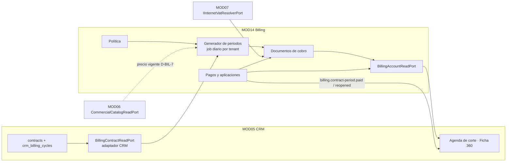
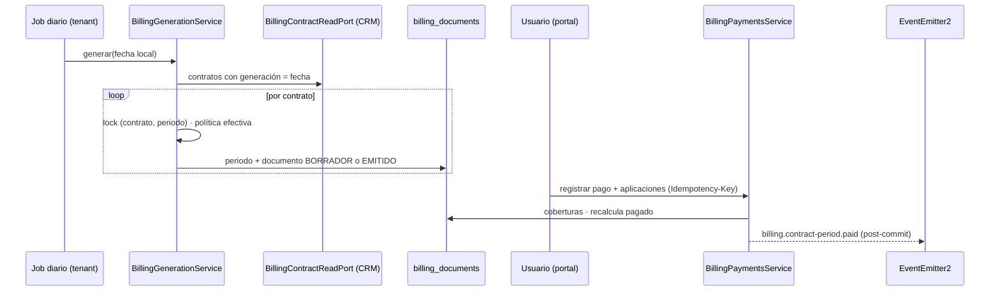

# HLD-MOD14 — Facturación · Fase 01: Cartera interna y política de facturación

**Versión:** 1.1 (re-sync de [v1.0](HLD-MOD14-FACTURACION-v1.0.md))
**Estado:** Aprobado. G0 del re-sync del CTO el 2026-11-03, con RS-1 a RS-8. Es el contrato **congelado** y sustituye a la v1.0. **Enmienda RS-9** (cifrado en reposo del documento del adquirente), aprobada por el CTO el 2026-11-03 tras el G1, antes de publicar esta versión: opción (a) de SEC-MOD14-03. **Enmiendas RS-10 a RS-12**, aprobadas por el CTO el 2026-11-04 tras el NO-GO de G2 **Enmiendas RS-13 a RS-16**, aprobadas por el CTO el 2026-11-05 tras la Ola 3, antes de publicar. **Enmiendas RS-17 y RS-18**, aprobadas por el CTO el 2026-11-05 tras revisar B2-R y B3-R, antes de publicar. **Enmiendas RS-19 y RS-20**, aprobadas por el CTO el 2026-11-05 tras los revisores de G3, antes de publicar. **Enmiendas RS-21 y RS-22**, aprobadas por el CTO el 2026-11-05 tras el `[BLOQUEO]` de F2, antes de publicar. **Enmienda RS-23**, aprobada por el CTO el 2026-11-06 tras la revisión de specs de G6, antes de publicar.
**Fecha:** 2026-11-03
**Emisor:** AI-EM-ARCH
**PRD:** [PRD-MOD14-FACTURACION-FASE-01-v1.0](../prds/PRD-MOD14-FACTURACION-FASE-01-v1.0.md) · **ADR:** [ADR-103](../adrs/ADR-103-Modulo-Facturacion-MOD14.md)
**Base verificada:** `main` en `45046b56`; última migración tenant: `172_privacy_denuncia_operador` (`runner.ts:341`).

> **Por qué hay re-sync.** La v1.0 se congeló el 31-10 sobre `1ce4f263`. Después se publicaron el clúster MOD05, DT-3 (migración 169), O-1 (170 y 171) y la denuncia del operador (172). Eso dejó la v1.0 con migraciones ocupadas, sin integración con privacidad (retención fiscal de 10 años y supresión), sin la fecha de terminación inmutable de los contratos y sin las reglas de suplantación de la Ley 2573. Los cambios se resumen en §12; el resto del contrato no cambia.

---

## 1. Vista general





**Estados del documento:** `BORRADOR` → `EMITIDO` → `ANULADO`; un borrador también puede descartarse. El estado de pago (`BillingPeriodPaymentState`: `SIN_DOCUMENTO`, `PAGADO`, `VENCIDO`, `PARCIAL`, `PENDIENTE`, §4) se calcula y no se persiste.

## 2. Estructura de código

```
apps/api/src/modules/billing/
  billing.module.ts
  policy/            billing-policy.service.ts · billing-policy.controller.ts
  generation/        billing-generation.service.ts · billing-generation.processor.ts (cola)
  documents/         billing-documents.service.ts · billing-documents.controller.ts · billing-document-pdf.service.ts · billing-document.layout.ts
  payments/          billing-payments.service.ts · billing-payments.controller.ts · allocation.ts (puro)
  accounts/          billing-account-read.adapter.ts · billing-accounts.controller.ts
  ports/             billing-account-read.port.ts · billing-contract-read.port.ts (token; lo implementa CRM) · billing-issuer-read.port.ts (RS-13)
  privacy/           billing-privacy.module.ts · billing-titular-erasure.participant.ts · billing-standing-read.adapter.ts   (v1.1, §8.1)
  events/            billing.events.ts · contract-period-paid.event.ts
  dto/ · tests/
apps/api/src/modules/crm/contracts/billing-contract-read.adapter.ts   (implementa BillingContractReadPort)
apps/api/src/modules/privacy/requests/ports/billing-standing-read.port.ts   (v1.1: lo declara privacy y lo implementa Billing, §8.1)
apps/api/src/common/pdf/pdf-branding.ts                               (se sube desde inventory, sin cambiar su API)
packages/database/src/entities/billing-*.entity.ts
packages/shared/src/contracts/billing/                                 (Zod + tipos, contract-first)
packages/shared/src/calendar/billing-calendar.ts                       (reutiliza computeCutoffDate de billing-cutoff.ts, sin cambiarlo)
```

- **Patrón de módulo:** el de MOD13, `network/network.module.ts`. El puerto es una clase abstracta usada como token, con `useExisting` sobre el adaptador.
- **Dependencia con CRM:** `BillingModule` importa `BillingContractReadModule`, un módulo pequeño de CRM que exporta solo el adaptador. **No importa `SubscribersModule` ni `ContractsModule`**, y tampoco se crea un ciclo de imports.
- **Dependencia inversa:** CRM consume `BillingAccountReadPort` a través de un módulo de lectura que exporta Billing.

## 3. Modelo de datos (schema del tenant)

- Todos los montos se guardan en `numeric(14,2)` y la entidad los mapea a `string`.
- Todas las tablas llevan `tenant_id uuid NOT NULL` y las marcas de tiempo `timestamptz`.

### 3.1 Migración `173_billing_core`

```sql
CREATE TABLE billing_policy (
  tenant_id uuid PRIMARY KEY,
  period_timing varchar(12) NOT NULL DEFAULT 'ANTICIPADO' CHECK (period_timing IN ('ANTICIPADO','VENCIDO')),
  generation_lead_days smallint NOT NULL DEFAULT 0 CHECK (generation_lead_days BETWEEN 0 AND 15),
  cutoff_mode varchar(24) NOT NULL DEFAULT 'DIA_FIJO_CICLO' CHECK (cutoff_mode IN ('DIA_FIJO_CICLO','VENCIMIENTO_MAS_GRACIA')),
  payment_term_days smallint NOT NULL DEFAULT 14 CHECK (payment_term_days BETWEEN 0 AND 60),
  grace_days smallint NOT NULL DEFAULT 0 CHECK (grace_days BETWEEN 0 AND 30),
  cutoff_enabled boolean NOT NULL DEFAULT true,
  minimum_unpaid_for_cutoff numeric(14,2) NOT NULL DEFAULT 0 CHECK (minimum_unpaid_for_cutoff >= 0),
  proration_method varchar(12) NOT NULL DEFAULT 'DIAS_REALES' CHECK (proration_method IN ('DIAS_REALES','MES_30')),
  first_period_mode varchar(20) NOT NULL DEFAULT 'SEPARADO' CHECK (first_period_mode IN ('SEPARADO','JUNTO_AL_SIGUIENTE')),
  automatic_generation boolean NOT NULL DEFAULT false,
  approval_mode varchar(12) NOT NULL DEFAULT 'BORRADOR' CHECK (approval_mode IN ('BORRADOR','AUTOMATICA')),
  auto_apply_credit boolean NOT NULL DEFAULT true,
  generation_hour smallint NOT NULL DEFAULT 6 CHECK (generation_hour BETWEEN 0 AND 23),
  document_prefix varchar(10) NOT NULL DEFAULT 'DC',
  updated_by uuid NULL,
  updated_at timestamptz NOT NULL DEFAULT now(),
  CHECK (NOT (cutoff_mode = 'DIA_FIJO_CICLO' AND period_timing = 'VENCIDO'))
);
-- Se siembra una fila por tenant con los valores por defecto (D-BIL-3 a D-BIL-5).

CREATE TABLE billing_contract_policy (
  contract_id uuid PRIMARY KEY REFERENCES contracts(id) ON DELETE CASCADE,
  tenant_id uuid NOT NULL,
  period_timing varchar(12) NULL, generation_lead_days smallint NULL,
  payment_term_days smallint NULL, grace_days smallint NULL,
  cutoff_enabled boolean NULL, first_period_mode varchar(20) NULL,
  billing_start_date date NULL,
  updated_by uuid NULL, updated_at timestamptz NOT NULL DEFAULT now()
  -- mismos CHECK de rango que billing_policy; la incompatibilidad de modos la valida el servicio
);

CREATE TABLE billing_periods (
  id uuid PRIMARY KEY DEFAULT gen_random_uuid(),
  tenant_id uuid NOT NULL,
  contract_id uuid NOT NULL REFERENCES contracts(id),
  subscriber_id uuid NOT NULL,
  period_start date NOT NULL, period_end date NOT NULL,
  covered_start date NOT NULL,              -- < period_start si absorbe la prorrata (JUNTO_AL_SIGUIENTE)
  generation_date date NOT NULL, due_date date NOT NULL, cutoff_date date NULL,
  effective_policy jsonb NOT NULL,          -- política congelada (ADR-103 D4 regla 2)
  created_at timestamptz NOT NULL DEFAULT now(),
  UNIQUE (contract_id, period_start)
);

CREATE TABLE billing_documents (
  id uuid PRIMARY KEY DEFAULT gen_random_uuid(),
  tenant_id uuid NOT NULL,
  period_id uuid NOT NULL REFERENCES billing_periods(id),
  contract_id uuid NOT NULL, subscriber_id uuid NOT NULL,
  status varchar(10) NOT NULL CHECK (status IN ('BORRADOR','EMITIDO','ANULADO')),
  number varchar(30) NULL,                  -- se asigna al emitir
  issue_date date NULL, due_date date NOT NULL,
  subtotal numeric(14,2) NOT NULL, tax_total numeric(14,2) NOT NULL, total numeric(14,2) NOT NULL,
  blocking_reason varchar(60) NULL,         -- RF-FAC-15: motivo que impide emitir
  buyer_snapshot jsonb NULL, issuer_snapshot jsonb NULL,  -- se congelan al emitir; PII mínima
  buyer_document_encrypted varchar(500) NULL,  -- RS-9: número de documento del adquirente, AES-256-GCM (ADR-058)
  unbilled_additional_count smallint NOT NULL DEFAULT 0 CHECK (unbilled_additional_count >= 0),  -- RS-12: adicionales del contrato que este documento no cobra
  CHECK (buyer_snapshot IS NULL OR NOT (buyer_snapshot ? 'documentNumber')),  -- RS-9: nunca en claro en el jsonb
  void_reason_code varchar(40) NULL, void_note varchar(500) NULL, voided_at timestamptz NULL, voided_by uuid NULL,
  created_by uuid NULL, created_at timestamptz NOT NULL DEFAULT now(), updated_at timestamptz NOT NULL DEFAULT now(),
  UNIQUE (tenant_id, number)
);
CREATE UNIQUE INDEX uq_billing_documents_period_live ON billing_documents (period_id) WHERE status <> 'ANULADO';
CREATE INDEX idx_billing_documents_subscriber ON billing_documents (subscriber_id, status);

CREATE TABLE billing_document_lines (
  id uuid PRIMARY KEY DEFAULT gen_random_uuid(),
  tenant_id uuid NOT NULL,
  document_id uuid NOT NULL REFERENCES billing_documents(id) ON DELETE CASCADE,
  kind varchar(16) NOT NULL CHECK (kind IN ('PLAN','ADICIONAL','PRORRATEO')),
  description varchar(200) NOT NULL,
  quantity numeric(10,4) NOT NULL, unit_price numeric(14,2) NOT NULL,
  base_amount numeric(14,2) NOT NULL, tax_amount numeric(14,2) NOT NULL, total numeric(14,2) NOT NULL,
  vat_treatment varchar(16) NOT NULL, vat_rate numeric(7,4) NOT NULL, vat_legal_basis varchar(60) NULL,
  position smallint NOT NULL
);

CREATE TABLE billing_payments (
  id uuid PRIMARY KEY DEFAULT gen_random_uuid(),
  tenant_id uuid NOT NULL,
  subscriber_id uuid NOT NULL,
  method varchar(20) NOT NULL CHECK (method IN ('EFECTIVO','TRANSFERENCIA','CONSIGNACION','DATAFONO','OTRO')),
  amount numeric(14,2) NOT NULL CHECK (amount > 0),
  paid_at date NOT NULL, reference varchar(80) NULL, note varchar(500) NULL,
  idempotency_key varchar(80) NOT NULL,
  allocations_fingerprint char(64) NULL,  -- RS-16: SHA-256 de las aplicaciones del cuerpo; NULL si el cuerpo no las trae. Sin datos personales
  status varchar(10) NOT NULL DEFAULT 'REGISTRADO' CHECK (status IN ('REGISTRADO','ANULADO')),
  void_reason_code varchar(40) NULL, void_note varchar(500) NULL, voided_at timestamptz NULL, voided_by uuid NULL,
  created_by uuid NOT NULL, created_at timestamptz NOT NULL DEFAULT now(),
  UNIQUE (tenant_id, idempotency_key)
);

CREATE TABLE billing_payment_allocations (
  id uuid PRIMARY KEY DEFAULT gen_random_uuid(),
  tenant_id uuid NOT NULL,
  payment_id uuid NOT NULL REFERENCES billing_payments(id),
  document_id uuid NOT NULL REFERENCES billing_documents(id),
  amount numeric(14,2) NOT NULL CHECK (amount > 0),
  reversed_at timestamptz NULL, reversed_by uuid NULL,
  created_by uuid NULL, created_at timestamptz NOT NULL DEFAULT now()  -- RS-17: NULL = aplicación hecha por el sistema
);
CREATE INDEX idx_billing_allocations_document ON billing_payment_allocations (document_id) WHERE reversed_at IS NULL;
CREATE INDEX idx_billing_allocations_payment ON billing_payment_allocations (payment_id) WHERE reversed_at IS NULL;

CREATE TABLE billing_period_signals (            -- idempotencia de la señal P1
  period_id uuid PRIMARY KEY REFERENCES billing_periods(id),
  tenant_id uuid NOT NULL,
  paid boolean NOT NULL, changed_at timestamptz NOT NULL DEFAULT now()
);
```

- El **saldo a favor** se calcula: suma de los pagos `REGISTRADO` menos la suma de sus coberturas vigentes. No se persiste.
- El `down` elimina las tablas en orden inverso. La migración no toca `contracts` ni `crm_billing_cycles`.
- **Sufijos (v1.1):** cada migración lleva un sufijo de 13 dígitos que no se repite: lo exige `runner.suffixes.spec.ts`. Por ejemplo, `…1730000000173`, `…1740000000174` y `…1750000000175`. Si al implementar ya están ocupados, se toman los siguientes libres y se informa.
- **PII en Billing (v1.1):** `buyer_snapshot` (nombre o razón social, tipo de documento, dirección), `buyer_document_encrypted` y los campos libres `billing_payments.reference` y `billing_payments.note` pueden contener datos personales. Los redacta el participante de supresión (§8.1).
- **Cifrado en reposo (RS-9):** el número de documento del adquirente se guarda **solo** en `buyer_document_encrypted`, cifrado con `encryptAes256Gcm` y la clave activa de `loadPiiAesGcmKeyPair` (`common/crypto/aes-gcm.util`), como `contracts.fiscal_document_encrypted` (migración 155). El `CHECK` impide que la clave `documentNumber` llegue al `jsonb`. Nombre y dirección quedan en claro, igual que en CRM. Va en columna propia y no dentro del `jsonb` porque el CLI de recifrado PII de ADR-058 (`cli/reencrypt-aes.pii.ts`) recorre columnas; la columna se añade a `PII_ENCRYPTED_TARGETS`, con su prueba en `reencrypt-aes.pii.postgres.integration.spec.ts`. Billing no guarda HMAC: no busca por documento.

### 3.2 Migración `174_seed_billing_permissions`

Sigue el patrón de `162_seed_network_permissions.ts`:
- upsert de las 4 claves `billing.*`, de `RESERVED` a `ASSIGNABLE`, más `billing.policy.manage`, en el catálogo `MOD14_BILLING_V1`;
- asignación según §7 a los perfiles «Acceso estándar» existentes;
- `down` reversible.

### 3.3 Migración `175_billing_contract_price_backfill`

Aprobada en G0 (D-BIL-7 (b)); la escribe D1 en la Ola 1. Completa `plan_snapshot_json.monthlyPrice` en los contratos convertidos desde expediente, que hoy guardan `{id, source}`:
- toma el precio vigente del catálogo y el segmento del contrato;
- respalda el valor anterior para el `down` (patrón de la 168);
- informa el conteo de contratos corregidos;
- **(v1.1) excluye los contratos de suscriptores anonimizados.** El trigger de la 169 (DT-3) rechaza cualquier `UPDATE` sobre ellos, y la migración no puede fijar `iwana.titular_erasure`, que está reservado al adaptador de supresión y al CLI. Esos contratos están terminados y no se facturan. La exclusión se cuenta aparte en la salida;
- no cambia `status` ni `terminated_at`, así que no dispara la guarda de la 170.

## 4. Contratos compartidos (`packages/shared/src/contracts/billing/`)

- **Esquemas Zod `.strict()`:**
  - `BillingPolicySchema` y `BillingPolicyUpdateSchema`, que incluye `expectedUpdatedAt` y rechaza la combinación incompatible con el código `BILLING_POLICY_INCOMPATIBLE`;
  - `BillingContractPolicyUpdateSchema`;
  - `BillingPolicyPreviewQuerySchema`;
  - `GenerateDocumentsCommandSchema`: `{ contractId?, date? }`;
  - `IssueDocumentsCommandSchema`: `{ documentIds: uuid[1..100] }`;
  - `VoidDocumentCommandSchema` y `VoidPaymentCommandSchema`: `{ reasonCode, note? }`;
  - `RegisterPaymentCommandSchema`: `{ subscriberId, method, amount, paidAt, reference?, note?, allocations?: {documentId, amount}[] }`, con la clave de idempotencia en la cabecera;
  - `AllocateCreditCommandSchema`.
- **Respuestas:** `BillingDocumentResponse`, `BillingPaymentResponse`, `BillingAccountStatement`, `BillingPeriodPaymentState` y `BillingPolicyPreview` (próximas tres fechas).
- **Listas as const:**
  - `BILLING_PERIOD_TIMINGS`, `BILLING_CUTOFF_MODES`, `BILLING_PAYMENT_METHODS`;
  - `BILLING_DOCUMENT_VOID_REASONS`: `ERROR_DE_VALOR`, `ERROR_DE_ADQUIRENTE`, `DUPLICADO`, `SERVICIO_NO_PRESTADO`, **`SUPLANTACION`** (v1.1: documento de un producto contratado con suplantación, Ley 2573, art. 8);
  - `BILLING_PAYMENT_VOID_REASONS`: `ERROR_DE_REGISTRO`, `PAGO_RECHAZADO`, `DUPLICADO`;
  - `BILLING_PERIOD_PAYMENT_STATES`: `SIN_DOCUMENTO`, `PAGADO`, `VENCIDO`, `PARCIAL`, `PENDIENTE`. Es el tipo `BillingPeriodPaymentState`, con el orden de evaluación de ADR-103 D3; documento, puerto y agenda usan el mismo vocabulario;
  - `BILLING_BLOCKING_REASONS` (valores de `blocking_reason`): `SIN_PRECIO`, `SIN_TRATAMIENTO_IVA`, `SIN_DATOS_FISCALES`. **(RS-20)** Se retira `CONTRATO_SIN_CICLO`: sin ciclo no hay periodo, y `period_id` es obligatorio;
  - `BILLING_ERROR_CODES`:

    | Código | HTTP | Cuándo |
    | --- | --- | --- |
    | `BILLING_POLICY_INCOMPATIBLE` | 422 | Corte en día fijo con cobro vencido |
    | `BILLING_POLICY_CHANGED` | 409 | `expectedUpdatedAt` desactualizado |
    | `BILLING_DOCUMENT_BLOCKED` | 422 | Emitir un borrador con `blocking_reason` |
    | `BILLING_DOCUMENT_NOT_DRAFT` | 409 | Emitir o descartar un documento que no está en borrador |
    | `BILLING_DOCUMENT_NOT_ISSUED` | 409 | Anular o aplicar sobre un documento no emitido |
    | `BILLING_ALLOCATION_EXCEEDS_BALANCE` | 422 | La aplicación supera el saldo del documento o el remanente del pago |
    | `BILLING_PAYMENT_VOIDED` | 409 | Operar sobre un pago anulado |
    | `IDEMPOTENCY_KEY_REUSED` | 409 | Misma clave con otro cuerpo; código ya usado por `subscriber-lifecycle.service.ts` |
    | `PRIVACY_TITULAR_ANONYMIZED` | 409 | (v1.1) Registrar un pago o aplicar saldo para un suscriptor anonimizado. Es el código existente de DT-3; no se crea uno nuevo |
    | `BILLING_ISSUER_INCOMPLETE` | 422 | (RS-13) Emitir sin razón social o NIT del tenant |
    | `BILLING_SUBSCRIBER_NOT_FOUND` | 404 | (RS-14) Pago o estado de cuenta de un suscriptor inexistente en el tenant |
- **Calendario**, en `calendar/billing-calendar.ts`. Es el único módulo de fechas de facturación (ADR-103 D5). Son funciones puras que reutilizan `computeCutoffDate` de `billing-cutoff.ts` sin cambiarlo:
  - `computeBillingPeriod(cycleDay, year, month)`;
  - `computeGenerationDate(period, timing, leadDays)`;
  - `computeDueAndCutoff(period, policy, issueDate, cutoffDay)`;
  - `prorate(price, coveredDays, periodDays, method)`;
  - `nextBillingDates(input, n)` para la vista previa;
  - **(RS-11)** `resolveGenerationTarget(cycleDay, policy, localDate)`: devuelve el periodo más reciente cuya fecha de generación ya llegó (`computeGenerationDate(...) <= localDate`), con `periodTiming` y `generationLeadDays` efectivos del contrato;
  - **(RS-11)** `BILLING_TERMINATED_LOOKBACK_DAYS = 62`: cota de la distancia entre `localDate` y el inicio de ese periodo (el peor caso es `VENCIDO` sin anticipación con dos meses de 31 días). Una prueba en tabla lo comprueba para todos los ciclos.

  Las pruebas en tabla cubren PRD §6, febrero 28/29, meses de 30/31 y diciembre → enero.
- **Vista previa (RS-10):** `BillingPolicyPreviewRequestSchema` (estricto) lleva `contractId` opcional y `policy` opcional, con `periodTiming`, `generationLeadDays`, `cutoffMode`, `paymentTermDays`, `graceDays` y `cutoffEnabled`, todos opcionales. `BillingPolicyPreviewSchema` pasa a `{ cycles: Array<{ cycleDay, cutoffDay, items: BillingPolicyPreviewItem[] }> }`, con tres `items` por ciclo. Sustituye a `BillingPolicyPreviewQuerySchema`.
- **Payload de cola** en `contracts/queue-payloads.ts`: `BillingGenerationJobPayload { tenantId, schemaName, localDate }`. El contexto del tenant viaja explícito en el payload (AGENTS.md).

## 5. Puertos

```ts
// ports/billing-contract-read.port.ts — lo implementa CRM
export interface BillableContract {
  contractId: string; subscriberId: string; partyId: string | null;
  status: 'ACTIVE' | 'SUSPENDED' | 'TERMINATED' | 'ARCHIVED';
  statusReasonCode: string | null;                             // v1.1: 'SUPLANTACION' si lo suspendió el puerto de suplantación
  terminatedAt: string | null;                                 // v1.1: contracts.terminated_at (O-1), fecha civil del tenant
  cycleDay: number | null; cutoffDay: number | null;           // del catálogo vigente
  activatedAt: string | null; endDate: string | null;
  planName: string | null; monthlyPrice: string | null;        // null → D-BIL-7
  vatSnapshot: ContractVatSnapshot | null;
  unbilledAdditionalCount: number;                             // RS-12: contracts.additional_product_ids + additional_service_ids; la Fase 01 no los cobra
  // RS-23: hasDocumentNumber dice si hay documento sin descifrarlo; revealDocumentNumber solo existe en findByContractId sin revealDocument: true
  buyer: { displayName: string; documentType: string | null; documentNumber: string | null; hasDocumentNumber: boolean; revealDocumentNumber?: () => string | null; address: string | null; rutResponsibilities: string[] };
}
export abstract class BillingContractReadPort {
  abstract findBillableForDate(localDate: string, page: { afterContractId?: string; limit: number }): Promise<BillableContract[]>;
  // RS-23: por defecto no descifra; { revealDocument: true } lo descifra al leer
  abstract findByContractId(contractId: string, options?: { revealDocument?: boolean }): Promise<BillableContract | null>;
  // RS-10: ciclos activos de crm_billing_cycles, para la vista previa de la política
  abstract listBillingCycles(): Promise<Array<{ cycleDay: number; cutoffDay: number }>>;
  // RS-22: máximo 200 IDs, sin bloqueo; nulo para anonimizado. Billing oculta al titular bloqueado
  abstract findTitularDisplayNames(subscriberIds: string[]): Promise<Array<{ subscriberId: string; displayName: string | null }>>;
  // RS-20: ciclo de un contrato, sin PII; usa el catálogo completo, también ciclos inactivos (ADR-102 D2)
  abstract findBillingCycleByContractId(contractId: string): Promise<{ cycleDay: number | null; cutoffDay: number | null } | null>;
  // v1.1: estado del titular con la fila de subscribers bloqueada FOR SHARE, dentro de la transacción de Billing (DT-3 D-RER-3)
  abstract lockTitularForBillingWrite(subscriberId: string, ctx: { manager: EntityManager }): Promise<{ exists: boolean; partyId: string | null; anonymized: boolean }>; // RS-14: exists
  // RS-14: lectura sin bloqueo y sin PII, hasta 200 ids; un id ausente del resultado no existe en el tenant
  abstract findTitularRefs(subscriberIds: string[]): Promise<Array<{ subscriberId: string; partyId: string | null; anonymized: boolean }>>;
}

// ports/billing-issuer-read.port.ts — RS-13; lo implementa Billing con TenantService, como TenantContactPort de inventario
export abstract class BillingIssuerReadPort {
  abstract getIssuerIdentity(tenantId: string): Promise<{ legalName: string | null; nit: string | null; verificationDigit: string | null }>;
}

// ports/billing-account-read.port.ts — lo implementa Billing
export abstract class BillingAccountReadPort {
  // RS-19: por contrato, el periodo más reciente con generation_date <= localDate; sin periodo, SIN_DOCUMENTO
  // RS-22: importes nulos en SIN_DOCUMENTO
  abstract periodStates(contractIds: string[], localDate: string): Promise<Record<string, { state: BillingPeriodPaymentState; paidAmount: string | null; totalAmount: string | null }>>;
  abstract statementForSubscriber(subscriberId: string): Promise<BillingAccountStatement>;
}
```

- **`buyer`:** el adaptador de CRM descifra el documento solo para el snapshot de emisión. Si la lista RUT está vacía, la traduce a `R-99-PN` (ADR-100). Billing guarda en `buyer_snapshot` solo lo necesario para el documento y no lo registra en logs. **(RS-9)** Billing vuelve a cifrar el número de documento en `buyer_document_encrypted` en la misma transacción de emisión; el texto claro no sale de memoria. **(RS-23)** `findBillableForDate` nunca descifra: entrega `documentNumber: null` y `hasDocumentNumber`. `findByContractId` tampoco descifra por defecto; `revealDocumentNumber()` lo hace en memoria, sin consultar la base, solo para el documento que de verdad se emite.
- **`findBillableForDate`:** pagina por cursor, con lotes de 200 como máximo. **(v1.1)** No devuelve contratos de suscriptores anonimizados. **(RS-11)** Devuelve **candidatos**: CRM no conoce la política, así que no calcula periodos. Solo descarta los contratos con `terminatedAt` anterior a `localDate - BILLING_TERMINATED_LOOKBACK_DAYS`. El paso 2c de §6.1 es la única regla que decide si se genera un contrato terminado.

## 6. Servicios y comandos

### 6.1 Generación

1. Al arrancar, `BillingGenerationProcessor` programa un job repetible por tenant `ACTIVE`, con `jobId = billing-generation:<schema>` y `repeat: { pattern: '0 <generation_hour> * * *', tz }`. Es el patrón de `network-provisioning-reconciler.processor.ts:93-120` y de `apps/api/src/modules/privacy/alerts/privacy-due-alerts.processor.ts`.
2. Si `automatic_generation = false`, el job termina sin efecto. La generación manual (`POST /billing/documents/generate`) usa el mismo servicio.
3. **Por cada contrato**, dentro de `runInTenantSchema`:
   0. **(RS-11)** calcula la política efectiva (tenant + contrato) y resuelve el periodo con `resolveGenerationTarget`. Un día sin job se recupera al día siguiente; si se pierde un ciclo completo, solo se genera el periodo más reciente;
   1. toma `pg_advisory_xact_lock(hashtextextended('billing:'||contract_id||':'||period_start, 0))`;
   2. si el periodo ya existe, lo omite. **(RS-18)** Excepción: en la generación manual de un contrato (`contractId`), un periodo sin documento vivo (ni `BORRADOR` ni `EMITIDO`) se reutiliza con su política congelada y recibe un borrador nuevo, con el precio y los datos actuales. El job automático y la generación manual del día completo siempre lo omiten: no recrean lo que alguien anuló o descartó. Un periodo con documento vivo devuelve `existing`. El paso 2b aplica igual;
   2b. **(v1.1) suplantación (Ley 2573, art. 8):** si el titular tiene la marca activa `VICTIMA_FALSEDAD_PERSONAL` (`IPrivacyMarksReadPort.activeMarks`) o el contrato está suspendido con `statusReasonCode = 'SUPLANTACION'`, **no genera** el periodo. Lo registra en el resumen del job como `OMITIDO_SUPLANTACION`, sin PII. Los documentos ya emitidos no se anulan solos: se anulan a mano con el motivo `SUPLANTACION`;
   2c. **(v1.1) terminación:** si `terminatedAt` cae dentro del periodo, el periodo se cubre solo hasta esa fecha civil (`prorate`). Si es anterior al inicio del periodo, no se genera;
   3. congela en el periodo la política efectiva del paso 0;
   4. construye las líneas: plan y prorrata. **(RS-12)** Los adicionales no generan línea en la Fase 01: guarda `unbilledAdditionalCount` en `unbilled_additional_count`, y el resumen del job cuenta esos documentos como `CON_ADICIONALES_SIN_COBRAR`, sin PII. No bloquea la emisión, porque el contrato no tiene un precio de adicionales que se pueda corregir;
   5. resuelve el IVA desde `vatSnapshot`. Si no hay tratamiento o falta el precio, el documento queda `BORRADOR` con `blocking_reason`;
   6. emite si `approval_mode = AUTOMATICA` y no hay bloqueo.
4. Un fallo en un contrato no aborta el lote. Se registra en el resumen del job sin PII. **(RS-20)** Un contrato sin ciclo no genera periodo ni documento: el resumen lo cuenta como `withoutCycle`.

### 6.2 Emisión y consecutivo

- **Emisión:** `pg_advisory_xact_lock(hashtextextended('billing-number:'||tenant_id, 0))`; toma el `MAX` del sufijo numérico con el prefijo vigente y suma 1. Es el patrón de `wfm/services/work-orders.service.ts:68-185`, con savepoint y reintento ante el error 23505.
- Al emitir se congelan `buyer_snapshot` e `issuer_snapshot`: razón social, NIT y DV del tenant. **(RS-13)** Se leen con `BillingIssuerReadPort`; `BillingIssuerSnapshotSchema` no cambia. Sin razón social o NIT, la emisión responde 422 `BILLING_ISSUER_INCOMPLETE` y no consume consecutivo. El DV puede faltar.
- **(RS-9)** El número de documento del adquirente se cifra en `buyer_document_encrypted`. La respuesta (`BillingBuyerSnapshotSchema`, sin cambios) lo trae descifrado **solo** en el detalle y en el PDF, con las reglas de ocultación de §6.5; las listas no descifran y devuelven `documentNumber: null`.
- Con `auto_apply_credit` en la política congelada del periodo, el saldo a favor del suscriptor se aplica en la misma transacción. **(RS-17)** Toma el remanente de sus pagos `REGISTRADO`, del más antiguo al más nuevo, con los bloqueos de §6.3, y recalcula la señal; el evento sale después del commit. `created_by` es el actor de la emisión, o `NULL` si emite el job. Se audita con `AuditService.logWithin`.

### 6.3 Pagos

- **Registro:** `INSERT` con `UNIQUE (tenant_id, idempotency_key)`. Un reintento con la misma clave devuelve el pago existente; con la misma clave y otro cuerpo devuelve 409 `IDEMPOTENCY_KEY_REUSED`. **(RS-16)** Se comparan las columnas del pago y `allocations_fingerprint`: SHA-256 en hexadecimal del JSON de las aplicaciones del cuerpo, ordenadas por `documentId` y monto, con dos decimales; `NULL` si el cuerpo no trae `allocations`. No se compara contra las aplicaciones vigentes, porque pueden haberse reversado. **(RS-14)** Si `lockTitularForBillingWrite` da `exists: false`, responde 404 `BILLING_SUBSCRIBER_NOT_FOUND`.
- **Aplicaciones:** ninguna puede superar el saldo pendiente del documento ni el remanente del pago. Se validan con `SELECT ... FOR UPDATE` sobre el documento y el pago.
- **Sugerencia FIFO:** `allocation.ts` reparte por fecha de vencimiento ascendente. Es una función pura con pruebas. **(RS-22)** Vive en `packages/shared/src/contracts/billing/`, para que la API y el portal repartan igual.
- **Recalcular la señal:** en la misma transacción se recalcula «pagado» para cada documento afectado y se hace upsert en `billing_period_signals`. Solo si el valor cambia, se encola el evento para después del commit.
- **Anulación:** marca `ANULADO`, pone `reversed_at` en las coberturas y recalcula la señal.

### 6.4 Eventos

| Evento | Payload | Cuándo |
| --- | --- | --- |
| `billing.contract-period.paid` | `{ tenantId, contractId, periodId, periodStart, occurredAt }` | El periodo pasa a pagado |
| `billing.contract-period.reopened` | ídem | El periodo deja de estar pagado |

- Se emiten con `EventEmitter2.emitAsync` **después del commit**, con el patrón de `network-provisioning-reconciler.processor.ts:164`.
- En la Fase 01 no hay consumidor que cambie estados (ADR-103 D7). La agenda lee el estado por puerto.

### 6.5 Endpoints (prefijo `/api/v1`, con `JwtAuthGuard`, `RolesGuard` y `PermissionsGuard`)

| Método y ruta | Permiso | Notas |
| --- | --- | --- |
| `GET /billing/policy` · `PUT /billing/policy` | `BILLING_INVOICES_READ` · `BILLING_POLICY_MANAGE` | `expectedUpdatedAt`; 409 `BILLING_POLICY_CHANGED` |
| `POST /billing/policy/preview` (RS-10) | `BILLING_INVOICES_READ` | Solo lectura, sin efectos: no exige `Idempotency-Key`. Tres fechas por ciclo, con la fecha civil del tenant. Con `contractId`: solo su ciclo, con tenant + contrato + `policy`; si no tiene ciclo, `cycles: []`. Sin `contractId`: cada ciclo de `listBillingCycles`, con tenant + `policy`. Combinación incompatible: 422 `BILLING_POLICY_INCOMPATIBLE`. Contrato inexistente o anonimizado: 404 `BILLING_CONTRACT_NOT_FOUND` |
| `GET/PUT /billing/contracts/:contractId/policy` | `BILLING_INVOICES_READ` · `BILLING_POLICY_MANAGE` | Sobrescrituras |
| `POST /billing/documents/generate` | `BILLING_INVOICES_MANAGE` | Un contrato o el día completo; devuelve un resumen |
| `GET /billing/documents` · `GET /billing/documents/:id` | `BILLING_INVOICES_READ` | `ListResponse` (ADR-065), `limit` ≤ 100. **(RS-22)** Filtros `status`, `paymentState`, `cycleDay` (día de `period_start`), `subscriberId`, `from`, `to`; sin campos ordenables. Cada documento trae `periodStart`, `periodEnd`, `coveredStart` y `paymentState`, nulo si no está `EMITIDO` |
| `POST /billing/documents/issue` | `BILLING_INVOICES_MANAGE` | Lote de 1 a 100 borradores |
| `POST /billing/documents/:id/void` | `BILLING_INVOICES_MANAGE` | Motivo de catálogo |
| `DELETE /billing/documents/:id` | `BILLING_INVOICES_MANAGE` | Solo borradores |
| `GET /billing/documents/:id/pdf` | `BILLING_INVOICES_READ` | `application/pdf` |
| `POST /billing/payments` | `BILLING_PAYMENTS_REGISTER` | `Idempotency-Key` obligatoria |
| `GET /billing/payments` · `GET /billing/payments/:id` | `BILLING_PAYMENTS_READ` | **(RS-22)** `ListResponse`; la lista añade `subscriberDisplayName` y `subscriberProtected`, sigue RS-21 para un titular bloqueado y da nulo para un anonimizado |
| `POST /billing/payments/:id/void` | `BILLING_PAYMENTS_REGISTER` | — |
| `POST /billing/payments/:id/allocations` | `BILLING_PAYMENTS_REGISTER` | Aplica el remanente |
| `GET /billing/subscribers/:subscriberId/statement` | `BILLING_INVOICES_READ` | Estado de cuenta. **(RS-21, RS-22)** Añade `buyerProtected` e `impersonationHold`, con la condición del paso 2b de §6.1 |

Todos los endpoints:
- validan con Zod;
- usan `ParseUUIDPipe` en los identificadores;
- documentan OpenAPI con DTOs;
- auditan las mutaciones con `AuditService.logWithin` dentro de su transacción, con la lista cerrada de campos y sin PII;
- **(v1.1, sustituye a la regla de v1.0 que aplicaba `GuardBlockedTitular` a `POST /billing/payments`):**
  - **Titular anonimizado:** `POST /billing/payments` y `POST /billing/payments/:id/allocations` responden 409 `PRIVACY_TITULAR_ANONYMIZED`. La comprobación se hace dentro de la transacción, con `lockTitularForBillingWrite` (bloqueo `FOR SHARE`, DT-3 D-RER-3), no con una guarda HTTP previa.
  - **Titular bloqueado (`DATOS_BLOQUEADOS`):** **se puede registrarle pagos.** Pagar no edita datos personales, y el bloqueo suele venir de un deber de conservación, como una deuda vigente. Billing no importa la guarda de CRM: el boundary lo impide.
  - **Lectura de un titular bloqueado (RS-21):** con `crm.blocked_data.read` o `privacy.read`, los datos del adquirente (`buyer_snapshot` y nombre) se entregan directamente, como en CRM (HLD Privacy, D-1B-6). El acceso se audita **antes** de responder: `RECORD_ACCESS` en detalle, PDF y estado de cuenta, y un solo `LIST_ACCESS` por listado, con el conteo de bloqueados servidos. Si la auditoría falla, la respuesta es 503 `PRIVACY_AUDIT_UNAVAILABLE`, con el patrón de HLD Privacy §6.7. Sin permiso, los datos se ocultan y la respuesta lleva `buyerProtected: true`. El perfil «Facturación y cobro» ya tiene `crm.blocked_data.read`.

### 6.6 PDF

- Usa `pdfkit` (ADR-051) y `qrcode` queda reservado para la Fase 02.
- `pdf-branding.ts` se mueve de `inventory/services` a `common/pdf`; inventario importa la ruta nueva, sin cambiar su comportamiento.
- El layout pagina con el patrón de `inventory/tests/pdf-layout-pagination.spec.ts`.
- La leyenda de D-BIL-2 es obligatoria.

## 7. Permisos (`AccessPermissionKey`, catálogo `MOD14_BILLING_V1`)

| Clave | ADMIN | Contable | Soporte | Comercial | Auditoría |
| --- | --- | --- | --- | --- | --- |
| `billing.invoices.read` | ✓ | ✓ | ✓ | ✓ | ✓ |
| `billing.invoices.manage` | ✓ | ✓ | — | — | — |
| `billing.payments.read` | ✓ | ✓ | ✓ | ✓ | ✓ |
| `billing.payments.register` | ✓ | ✓ | — (D-BIL-11 (b)) | — | — |
| `billing.policy.manage` (**nueva**) | ✓ | — | — | — | — |

- D-BIL-11 (b), aprobada en G0: Soporte no registra pagos en la Fase 01. S0 puede proponer cambiarlo con justificación.
- La clave nueva se añade a `packages/shared/src/enums/access-control/access-permission-key.enum.ts` y a `access-control.constants.ts`.

## 8. Integración con CRM

- **`BillingContractReadAdapter`**, en `crm/contracts`. Implementa §5 con una consulta propia sobre `contracts`, `crm_billing_cycles` y `subscribers`:
  - la proyección es mínima;
  - el descifrado se hace con el servicio de cripto fiscal existente;
  - incluye prueba contra Postgres real.
- **Agenda de corte:** `getCutoffAgenda` (`contracts.service.ts`) añade `paymentState` por contrato desde `BillingAccountReadPort.periodStates`, y el contrato `CutoffAgendaResponse` gana ese campo, opcional para no romper consumidores. **(RS-22)** También `paymentPaidAmount` y `paymentTotalAmount`, opcionales.
- **Ficha 360:** el portal pide el estado de cuenta al endpoint de Billing. El payload de la 360 no cambia.

## 8.1 Integración con privacidad (v1.1, cierra la Q2)

**(a) Deber de conservación fiscal: 10 años.**
- `privacy` declara `IBillingStandingReadPort` (`privacy/requests/ports/billing-standing-read.port.ts`):

  ```ts
  export abstract class IBillingStandingReadPort {
    abstract lastFiscalDocumentAt(subscriberIds: string[], ctx: { manager: EntityManager }): Promise<string | null>;
  }
  ```

  El método devuelve la fecha civil del último documento `EMITIDO` o `ANULADO` de esos suscriptores. Los anulados también son soporte.
- Lo implementa Billing (`billing/privacy/billing-standing-read.adapter.ts`) y lo exporta `BillingPrivacyModule`, un módulo ligero como los `*PrivacyModule` de HLD Privacy §2.
- **(RS-15)** `IContractStandingReadPort.standing` devuelve además `subscriberIds: string[]`, todos los suscriptores de ese `partyId`, sin filtrar por contrato.
- `requests.service.conservationDuty` añade una tercera causa de deber: `lastFiscalDocumentAt(subscriberIds) + years(FACTURACION_SOPORTES_CONTABLES)` es posterior a hoy. La categoría ya está sembrada (10 años, `ULTIMO_ASIENTO_O_DOCUMENTO`; migración 146, ADR-094 D7 y H10).
- Se evalúa **dentro** de la transacción de supresión, con su `manager`, después de bloquear las filas del titular (DT-3 D-RER-4). Sin esto, la supresión podría borrar los datos de un adquirente con documentos fiscales vigentes.

**(b) Participante de supresión.**
- `BillingTitularErasureParticipant` (`billing/privacy/`) se añade como **octavo** participante de `CrmPersonalDataErasureAdapter`, después de `media`. Solo actúa cuando la supresión procede, es decir, sin deber fiscal vigente. Hace tres cosas:
  - redacta en `billing_documents.buyer_snapshot` las claves personales (nombre, tipo de documento, dirección) con el marcador de supresión, pone en `NULL` `buyer_document_encrypted` (RS-9) y conserva número, fechas y montos;
  - pone en `NULL` `billing_payments.reference` y `billing_payments.note`;
  - **borra** los documentos `BORRADOR` del titular y sus líneas, que no tienen valor fiscal.
- Verifica residuales como los demás participantes y reporta las categorías `FISCAL` y `COMERCIAL`.
- Usa el `manager` de la transacción de supresión y no toca tablas de CRM.

**(c) Boundary.**
- `privacy` → Billing, solo por `IBillingStandingReadPort`.
- Supresión → Billing, por el participante exportado.
- Billing → CRM, por `BillingContractReadPort`.
- Billing → privacidad, por `IPrivacyMarksReadPort`.
- No hay `forwardRef` nuevo; si hiciera falta, `[BLOQUEO]` y consulta a AI-EM-ARCH. Lo verifica `boundary-reviewer`.

## 9. Portal (`apps/portal`)

- **Configuración → Facturación:** formulario de la política con vista previa de fechas. La combinación incompatible se deshabilita y explica.
- **`/dashboard/billing/documents`:** lista con filtros, emisión en lote, anulación y PDF.
- **`/dashboard/billing/payments`:** lista y registro de pago con sugerencia FIFO.
- **Ficha del suscriptor:** pestaña «Facturación» con estado de cuenta, registro de pago y sobrescrituras del contrato.
- **Agenda de corte:** columna de estado de pago.
- **Barra lateral:** grupo «Facturación» con `permission` en cada ítem (`Sidebar.tsx`).
- El cliente es `billingApi` en `api-client.ts`, con tipos desde `@iwana/shared` e `Idempotency-Key` en las mutaciones.

La forma visual la fija la spec UX (G2). Este HLD solo fija rutas, datos y permisos.

## 10. Pruebas obligatorias

- **Calendario:** pruebas en tabla según PRD §6 y CA-FAC-01.
- **Contra Postgres real**, con conteo y sin omisiones:
  - migraciones 173–175 de ida y vuelta, incluida la exclusión de anonimizados en la 175;
  - generación concurrente (CA-FAC-03);
  - consecutivo concurrente con 20 emisiones (CA-FAC-04);
  - idempotencia del pago (CA-FAC-06);
  - señal y reapertura (CA-FAC-07);
  - adaptador de CRM, con `terminatedAt` y `lockTitularForBillingWrite`;
  - **(v1.1) privacidad:**
    - conservación con un documento emitido hace 9 años: `resolve` de SUPRIMIR se rechaza; hace 11 años: procede;
    - el participante redacta el snapshot, la referencia y la nota, borra los borradores y deja 0 residuales;
    - pago para un titular anonimizado → 409; para un titular bloqueado → 201;
    - la lectura de un titular bloqueado oculta los datos del adquirente y audita al usar `crm.blocked_data.read`;
  - **(v1.1) suplantación:** la generación omite el contrato de un titular con la marca de víctima o suspendido por suplantación;
  - **(v1.1) terminación:** el periodo con `terminatedAt` dentro se prorratea hasta esa fecha.
- **HTTP:** permisos (CA-FAC-11) y la combinación incompatible (CA-FAC-02).
- **E2E del portal** contra la API real: política → generación → emisión → pago → agenda en pagado.
- **Cobertura** ≥80 % en `apps/api/src/modules/billing`.

## 11. Preguntas abiertas del diseño

| # | Pregunta | Cierra |
| --- | --- | --- |
| Q1 | ¿El saldo a favor se aplica entre contratos del mismo suscriptor o solo dentro del contrato? Recomendación: entre contratos, porque UISP lo maneja por cliente | **Cerrada en G0** (D-BIL-12 (a)): entre contratos del mismo suscriptor |
| Q2 | Retención de 10 años (ADR-094): ¿la anonimización de un titular conserva los documentos emitidos con el snapshot redactado? | **Cerrada por diseño en v1.1 (§8.1).** Mientras haya un documento fiscal vigente, la supresión no procede. Después, se conservan número, fechas y montos, y se redacta lo personal. S0 revisa el diseño |
| Q3 | ¿El job corre en `apps/api`, como MOD13, o en `apps/worker`? Recomendación: en `apps/api`, como el reconciliador de MOD13 | `sr-backend` en el dictamen G3 |

## 12. Re-sync v1.1 (2026-11-03): resumen de cambios

| # | Cambio | Motivo | Sección |
| --- | --- | --- | --- |
| RS-1 | Migraciones 169–171 → **173–175**, con sufijos únicos de 13 dígitos | 169–172 las ocuparon DT-3, O-1 y la denuncia del operador; hay una prueba invariante de sufijos | §3 |
| RS-2 | La 175 excluye los contratos de titulares anonimizados | El trigger de la 169 rechazaría el `UPDATE` | §3.3 |
| RS-3 | `BillableContract` añade `partyId`, `statusReasonCode`, `terminatedAt` y `ARCHIVED`; la generación respeta la terminación | O-1: `contracts.terminated_at` es la fecha de fin, y no cambia | §5, §6.1 |
| RS-4 | Retención fiscal de 10 años como deber de conservación (`IBillingStandingReadPort`) | Supresión sin ese deber borraría datos de soportes fiscales vigentes (HLD Privacy §10: «cuando exista facturación») | §8.1 (a) |
| RS-5 | Participante de supresión de Billing | `buyer_snapshot`, referencia y nota tienen PII; cada módulo anonimiza sus tablas (HLD Privacy §2) | §8.1 (b) |
| RS-6 | Pagos: 409 para un titular anonimizado, comprobado bajo bloqueo; **se permiten** para un titular bloqueado; la lectura de un bloqueado se oculta y se audita | DT-3 y HLD Privacy §6.7. La v1.0 bloqueaba los pagos de titulares bloqueados, lo que impediría cobrar deudas que justifican el bloqueo | §6.5 |
| RS-7 | Suplantación: la generación omite al titular víctima; nuevo motivo de anulación `SUPLANTACION` | Ley 2573, art. 8 (suspensión inmediata del cobro) y C-413 (art. 9: hasta un pronunciamiento judicial) | §4, §6.1 |
| RS-8 | Q2 cerrada por diseño | RS-4 y RS-5 | §11 |
| RS-10 | **Enmienda tras G2.** Vista previa con `POST`, política sin guardar y fechas por ciclo; puerto `listBillingCycles` | RF-FAC-04 y la spec UX piden calcular con el formulario y los ciclos 1 y 15; el contrato solo aceptaba `contractId` | §4, §5, §6.5 |
| RS-11 | **Enmienda tras G2.** El periodo objetivo lo calcula Billing (`resolveGenerationTarget`); el puerto solo aplica una ventana de 62 días | El filtro por «periodo que contiene hoy» dejaba sin cobrar el último periodo de un contrato `VENCIDO` terminado. CRM no conoce la política ni sus sobrescrituras | §4, §5, §6.1 |
| RS-12 | **Enmienda tras G2.** D-BIL-6 (a): la Fase 01 no factura adicionales y avisa; `unbilledAdditionalCount` sustituye a `additionalItems` | Nadie escribe `plan_snapshot_json.additionalItems`; el contrato solo guarda IDs, sin precio congelado ni periodicidad. RF-FAC-14 se cumple solo con la línea del plan: ningún adicional tiene precio | §3.1, §5, §6.1 |
| RS-13 | **Enmienda tras la Ola 3.** `issuer_snapshot` sale de `public.tenants` (`legal_name`, `nit`, `nit_dv`) por `BillingIssuerReadPort`; si falta razón social o NIT, 422 `BILLING_ISSUER_INCOMPLETE` | El HLD nombraba los datos, no el camino de lectura; Billing no puede leer la tabla de otro módulo | §2, §4, §5, §6.2 |
| RS-14 | **Enmienda tras la Ola 3.** `findTitularRefs` da `partyId` y estado sin PII y sin bloqueo; `lockTitularForBillingWrite` añade `exists`; suscriptor inexistente: 404 `BILLING_SUBSCRIBER_NOT_FOUND` | Documento, PDF y estado de cuenta deben ocultar al titular bloqueado, y el bloqueo no distinguía una fila inexistente | §4, §5, §6.3 |
| RS-15 | **Enmienda tras la Ola 3.** `IContractStandingReadPort.standing` añade `subscriberIds` | `conservationDuty` conoce al titular por `partyId`, y `lastFiscalDocumentAt` necesita sus suscriptores | §8.1 (a) |
| RS-16 | **Enmienda tras la Ola 3.** `billing_payments.allocations_fingerprint` | Comparar columnas no revela si el cuerpo original traía aplicaciones, y las aplicaciones pueden reversarse después | §3.1, §6.3 |
| RS-17 | **Enmienda tras B3-R.** `billing_payment_allocations.created_by` admite `NULL` y §6.2 fija cómo se autoaplica el crédito | El job de generación no tiene actor. `NULL` es la convención de `billing_documents.created_by`, y evita inventar un usuario de sistema | §3.1, §6.2 |
| RS-18 | **Enmienda tras B2-R.** La generación manual de un contrato reutiliza un periodo sin documento vivo | ADR-103 D3 ordena corregir anulando y reemitiendo, y la 173 lo permite con `uq_billing_documents_period_live`; §6.1 lo impedía. Sin esto, un borrador bloqueado o un documento anulado no se rehacen nunca | §6.1 |
| RS-19 | **Enmienda tras los revisores de G3.** `periodStates` evalúa el periodo más reciente del contrato con `generation_date` ≤ fecha, en lugar de `cutoff_date` = fecha | ADR-103 pide el «periodo vigente» sin definirlo. `cutoff_date` solo coincide con la agenda en `DIA_FIJO_CICLO` con corte activo. El periodo en curso no sirve: con cobro vencido aún no tiene documento | §5 |
| RS-20 | **Enmienda tras los revisores de G3.** Se retira `CONTRATO_SIN_CICLO`, el resumen cuenta `withoutCycle` y `findBillingCycleByContractId` entra en §5 | El literal no puede producirse: `billing_documents.period_id` es obligatorio y sin ciclo no hay periodo. El método del puerto ya se usaba sin estar congelado | §4, §5, §6.1 |
| RS-21 | **Enmienda tras el `[BLOQUEO]` de F2, corregida por el CTO el 2026-11-05.** Billing sigue el patrón de CRM: con permiso, el dato llega directo y auditado; sin permiso, se oculta y `buyerProtected` lo señala. Un listado audita una sola vez. La spec UX §4.1 deja el botón «Consultar datos protegidos» | La primera versión, con `revealProtected`, se retiró: en la ficha el mismo usuario veía el nombre en CRM y la máscara en Facturación, y se apartaba de D-1B-6 | §6.5 |
| RS-22 | **Enmienda tras el `[BLOQUEO]` de F2.** Periodo y estado por documento, filtros `paymentState` y `cycleDay`, importes en la agenda, nombre en la lista de pagos, `impersonationHold` y FIFO en `@iwana/shared` | La spec UX, congelada, pide datos que la API no entregaba; el HLD no los trazó | §5, §6.3, §6.5, §8 |
| RS-23 | **Enmienda tras la revisión de specs de G6.** §5 recoge `hasDocumentNumber`, `revealDocumentNumber` y la opción `revealDocument` de `findByContractId` | Se añadieron al corregir el descifrado anticipado en la emisión (P3 de RS-9) y el HLD no los trazó. El puerto y el adaptador ya los implementan: esta enmienda no cambia código | §5 |
| RS-9 | **Enmienda tras G1.** Número de documento del adquirente cifrado en reposo en la columna `buyer_document_encrypted`, con `CHECK` contra el texto claro en el `jsonb`; objetivo nuevo del CLI de recifrado; el participante lo pone en `NULL` | SEC-MOD14-03 (P1 del S0): sin esto, Billing guardaría en claro lo que CRM cifra (ADR-058). Opción (a) del CTO: paridad con CRM; nombre y dirección siguen en claro como en CRM | §3.1, §5, §6.2, §8.1 (b) |

**Decisiones que pide el re-sync al CTO (G0 v1.1):** RS-4 a RS-7. Las dos más sensibles son **RS-6** (cobrar a un titular bloqueado) y **RS-7** (no generar cobro mientras dure la suplantación). RS-1 a RS-3 y RS-8 son de consistencia técnica.
