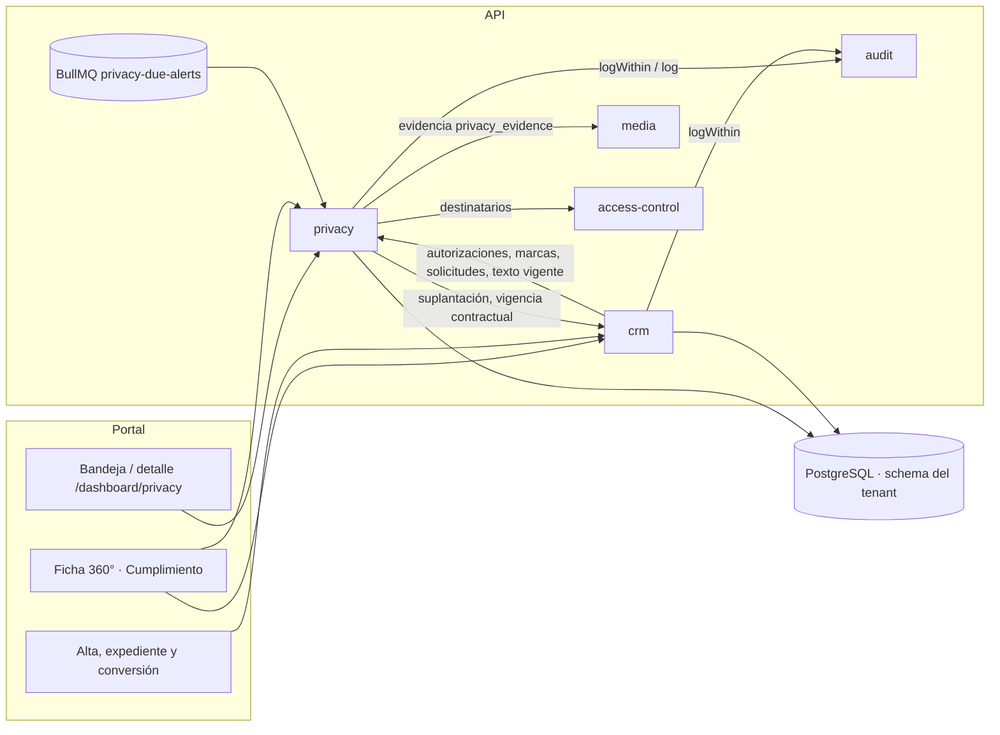

# HLD — `privacy` · Protección de datos personales (Habeas Data)

**Versión:** 1.0
**Estado:** Aprobado por el CTO el 2026-10-15 · Reemplazado por [v1.1](HLD-PRIVACY-HABEAS-DATA-v1.1.md) (2026-10-17, Fase 1b)
**Fecha:** 2026-10-15
**Modo activo:** Architect
**Autor:** AI-EM-ARCH
**Decisión de referencia:** [ADR-094](../adrs/ADR-094-Modelo-Proteccion-Datos-Personales-Habeas-Data.md) (Aprobado). No hay PRD propio: es la excepción documental de la Fase 1 (prompt v1.1 §3), y **este HLD la cierra**, como el `HLD-PRIVACY-v1.0` que ese prompt exigía para G7.
**Artefactos:**
- [plan Fase 1 v1.6](../plans/2026-10-14-privacy-habeas-data-fase-1.md);
- contratos: [prompt v1.3](../prompts/PROMPT-PRIVACY-HABEAS-DATA-FASE-1-v1.3.md) (cadena v1.0 → v1.3, adendas A1–A26);
- [spec UX v1.2](../specs/2026-10-14-privacy-fase-1-ux-spec.md);
- [cierre G6 y G6.5 de la Fase 1a](../informes/INFORME-PRIVACY-FASE-1A-CIERRE-G6-v1.0.md).

**ADRs aplicables:** 030 (Party como identidad), 058 (cifrado de PII), 065 (paginación), 067 (proyección PII), 093 (IVA, por el contrato que comparte) y 094.
**Número de módulo:** pendiente del CTO (roadmap). El nombre técnico es `privacy`.

> Describe lo **construido** en `main` (`365eb0fb`), no lo planeado. Lo pendiente está en §10.

## 1. Contexto de negocio

El ISP es el **Responsable del tratamiento** (Ley 1581 de 2012). El módulo cubre cinco frentes:
1. La **autorización** por finalidad, con su prueba (Decreto 1377 arts. 7 y 9).
2. La atención de **consultas, reclamos y suplantaciones**, con plazos en días hábiles (Ley 1581 arts. 14 y 15; Ley 2573 de 2026, vigente desde el 19-11-2026).
3. Las **marcas** sobre el titular: reclamo en trámite, víctima de suplantación y datos bloqueados.
4. Las **políticas de retención**: suscriptor 5 años (Decreto 1704), facturación 10 años (Ley 962), prospectos 24 meses.
5. La gestión de **incidentes** y el **inventario** declarativo para el RNBD.

El **titular** es el `Party` (ADR-030). `subscriberId` y `expedienteId` son contexto, no identidad.

## 2. Bounded context y boundary

| Regla | Aplicación |
| --- | --- |
| `privacy` no lee ni escribe tablas de otros módulos | Los efectos sobre CRM van por puertos. La única lectura cruzada sobre CRM es la de la migración 146, para el backfill único |
| CRM y la ficha 360° leen privacidad solo por puertos | Lectura y escritura de autorizaciones, lectura de marcas, solicitudes y texto legal |
| Dependencia circular CRM ↔ `privacy` | Un solo `forwardRef` (`privacy.module.ts:64`) hacia `CrmPrivacyAdaptersModule`. Lo validó `boundary-reviewer` (Fase 1a, BOUNDARY v1.1) |
| Auditoría transaccional | `AuditService.logWithin(entry, manager)` (A25). Ningún módulo fuera de `audit` crea `AuditLog` |
| Media | Uso propio `privacy_evidence` (migración pública 027). Los endpoints genéricos lo rechazan o dan 404; firma dedicada de 300 s |

### Puertos

| Puerto | Declara | Implementa | Consumidor |
| --- | --- | --- | --- |
| `IPrivacyAuthorizationReadPort` (`hasActive`, `listForParty`) | `privacy` | `privacy` | CRM (alta, contrato, 360°) |
| `IPrivacyAuthorizationWritePort` (`record`, idempotente por `sourceRef`, A15) | `privacy` | `privacy` | CRM (alta directa y conversión) |
| `IPrivacyLegalTextReadPort` (`current`, `findByVersion`, A14) | `privacy` | `privacy` | CRM (expediente, potencial, conversión) |
| `IPrivacyMarksReadPort` (`activeMarks(partyIds)`, por lote) | `privacy` | `privacy` | CRM (360° y listados) |
| `IPrivacyRequestsReadPort` (`RequestSummary`, `dueCounts`) | `privacy/requests` | `privacy/requests` | CRM (360°), alertas |
| `IContractImpersonationPort` (`suspendForImpersonation`, con `manager`, A17) | `privacy` | **CRM** (`crm/privacy-adapters`) | Solicitudes de suplantación |
| `IContractStandingReadPort` (`openContractIds`, `lastTerminatedAt`, A4) | `privacy/requests` | **CRM** | Reglas R3 y R4 |
| `IPermissionHoldersReadPort` (A19) | `access-control` | `access-control` | Alertas |
| `IPersonalDataBlockPort`, `IPersonalDataErasurePort` | `privacy` | **Sin implementar** (adaptadores `Unavailable`) | Fase 1b |

## 3. Componentes

| Carpeta (`apps/api/src/modules/privacy/`) | Responsabilidad |
| --- | --- |
| `authorizations/` | Captura, lista y prueba (`proof` con `no-store` y auditoría); adaptadores de los puertos de autorización |
| `legal-texts/` | Versiones inmutables y `current` por tipo (vigente = `published_at` más reciente) |
| `requests/` | Radicación, las 6 transiciones, la verificación de identidad, tareas, lectura de evidencia, proyección por permiso (A23) y puertos de lectura |
| `marks/` | Marcas por Party y su adaptador por lote |
| `retention/` | Catálogo de retención; `PATCH` solo puede alargar el plazo (trigger) |
| `incidents/` | Registro y reporte único a la SIC (A12) |
| `inventory/` | Inventario declarativo para el RNBD, sin conteos (A7) |
| `evidence/` | Carga de evidencia `privacy_evidence` (A16) |
| `alerts/` | Procesador BullMQ `privacy-due-alerts` dentro de la API (A19) |
| `ports/` | Puertos y adaptadores `Unavailable` |

**Fuera del módulo:**
- **Contratos:** `@iwana/shared` (`schemas/privacy/**`).
- **Calendario C-CAL-1:** `packages/shared/src/calendar/`, con Ley 51 de 1983, Pascua y la Ley 2578 de 2026.
- **Portal:** `apps/portal/src/components/privacy/**`, `/dashboard/privacy` y Cumplimiento en la ficha 360°.

## 4. Diagrama

## 5. Modelo de datos (migración tenant 146)

| Tabla | Clave del diseño | Protección en BD |
| --- | --- | --- |
| `legal_texts` | Único `(type, version)`; `sha256` | Inmutable (`trg_legal_texts_append_only`) |
| `data_authorizations` | Una fila por evento: `GRANT`, `REVOCATION` o `LEGACY_IMPORT`. `channel` = medio del titular (A24) y `source_ref` único | Solo-anexar |
| `data_subject_requests` | Identidad del solicitante cifrada con HMAC; `disputed_contract_ids` y `suspended_contract_ids`; `transferred_to` es texto (A10). Fechas civiles | Identidad congelada tras verificarse. CHECK de identidad por estado (A22). CHECK de suplantación (A17) |
| `data_subject_request_events` | Historial de transiciones | Solo-anexar |
| `data_subject_request_tasks` | `SUSPENDER_COBRO_EXTERNO` y `ENTREGAR_COPIA_DOCUMENTOS` | Sin reapertura |
| `party_privacy_marks` | Apertura y cierre por evento | Solo-anexar |
| `retention_policies` | Años por categoría | Solo se alarga |
| `privacy_incidents` | `sic_report_due_at`; `reported_at` (fecha civil) con `external_reference` | Se reporta una sola vez (A12) |

**Otras migraciones:**
- **147:** permisos `privacy.read` y `privacy.manage`.
- **Pública 027:** uso de Media `privacy_evidence`.
- **Backfill de la 146:** pasa `consent_records`, `habeas_data_consents` y `arco_requests` a las tablas nuevas, conserva las de origen e informa los conteos sin PII.

## 6. Flujos principales

1. **Captura de la autorización (A18 y A24)**
   - En el expediente o el potencial, sin Party, el registro queda en la tabla local con la versión vigente y el medio del titular.
   - En la conversión, dentro de la transacción del alta: `ensurePartyWithRole` → traspaso idempotente con la fecha y el medio originales (`LEGACY_IMPORT` si no resuelve) → exigir `TRATAMIENTO_CONTRACTUAL`; si falta, 422 y rollback.
   - En el alta directa, `authorizations[]` llega con `authorizationChannel`.
   - El alta de contrato exige la autorización vigente.
2. **Solicitud del titular**
   - Radicación: la identidad puede verificarse después (A13), y el plazo corre desde que se recibe.
   - Transiciones: `require-info`, `complete` (exige identidad y abre la marca R1 en la misma transacción), `extend`, `resolve` o `reject` (R3 y R4 por vigencia y retención) y `transfer` (sin exigir identidad, A22).
   - Cada transición escribe un evento y una auditoría sin PII.
3. **Suplantación (Ley 2573)**
   - Exige Party, identidad verificada y de 1 a 20 contratos impugnados.
   - En una sola transacción: solicitud, marca `VICTIMA_FALSEDAD_PERSONAL`, suspensión `ACTIVE → SUSPENDED` de los contratos del Party (si alguno no es suyo, 422 y rollback total), auditoría con `logWithin` y dos tareas.
   - Los eventos de dominio se emiten después del commit.
   - La fecha de denuncia se muestra como **estimada**.
4. **Alerta diaria**
   - Un repeatable global a las 07:00 America/Bogota genera un job por tenant y por día, sin repetirse.
   - Aplica R2 (`markDesisted`) y calcula `dueCounts`.
   - Envía un correo a quienes tienen `privacy.manage`, solo con conteos y el enlace; sin PII en el payload ni en el correo.
5. **Detalle por permiso (A23)**
   - `identityStatus` y `hasRequesterEvidence` van siempre.
   - `requester`, descifrado, solo con `privacy.manage`, con `no-store` y la auditoría `REQUEST_IDENTITY_VIEWED`.

## 7. Seguridad y PII

| Control | Implementación |
| --- | --- |
| Cifrado | AES-256-GCM con IV aleatorio (ADR-058) para la identidad del solicitante. HMAC (`PII_HASH_KEY`) **resuelto desde `ConfigService`** (R8) |
| Autorización | `privacy.read` y `privacy.manage` con `EffectivePermissionsService`, nunca por rol |
| Evidencia | Bytes mágicos, 10 MiB, firma de 300 s y `no-store`; la lectura queda auditada (A11 y SEC-01) |
| Auditoría | Explícita y sin PII; dentro de la transacción cuando el efecto es atómico (A25) |
| Cachés | `no-store` en las respuestas que llevan identidad o evidencia |
| Revisión | SEC-ENG GO (Fase 1a, SEC v1.1). Deuda: SEC-02, URL local sin vencimiento, solo con storage local (P2, `plat-ops`) |

## 8. Multi-tenant y operación

- Todas las tablas están en el schema del tenant (`runInTenantSchema`) y el procesador reconstruye el `TenantContext` por tenant.
- **Requisito por empresa:** publicar el texto `AUTORIZACION`. Sin él, la captura responde 422 `PRIVACY_LEGAL_TEXT_NOT_PUBLISHED`.
- **Métrica:** `privacy_due_alerts_no_recipients_total`, por ahora solo en logs (P2).

## 9. Calidad

- Cobertura de `privacy`: 96,50 % de statements y 87,53 % de branches.
- 3/3 E2E contra la API real.
- 53 criterios UX con su test.
- Integraciones en PASS en el CI [`38735918857`](https://github.com/Sleybc/iWana-neXt/actions/runs/38735918857).

## 10. Pendiente y desalineaciones conocidas

| Tema | Estado |
| --- | --- |
| Bloqueo y anonimización (`IPersonalDataBlockPort`, `IPersonalDataErasurePort`) | **No implementados** (Fase 1b). `DATOS_BLOQUEADOS` se marca, pero no se aplica. Decisión D-1B ([re-auditoría MOD05](../informes/INFORME-MOD05-SUBSCRIBERS-REAUDITORIA-v1.0.md) §5) |
| Plazo de traslado | Sin `transferDueAt` ni marca de traslado extemporáneo (Fase 1b, P2) |
| Dictámenes de ADR-094 §7.3 | Pendientes; bloquean producción |
| Nombres de contrato y de actores en el detalle; limpieza de evidencias huérfanas | Fase 2 |
| Centrales de riesgo y Ley 2300 | Fase 3 |
| Conciliación del backfill de la 146 por tenant | G7 |

## 11. Decisión de salida

**G6 y G6.5: GO (Fase 1a).**

**G7 queda condicionado a:**
1. D-1B;
2. los dictámenes de ADR-094 §7.3;
3. la ejecución por tenant: migraciones 146, 147 y 027, conciliación del backfill y publicación del texto de autorización;
4. ~~este HLD aprobado por el CTO~~ ✅ aprobado el 2026-10-15.

**D-1B (CTO, 2026-10-15):** la Fase 1b va **después** de producción. Mientras tanto, el bloqueo y la supresión se operan con el [runbook manual con SLA](../runbooks/RUNBOOK-PRIVACY-BLOQUEO-SUPRESION-MANUAL-v1.0.md), precondición de G7 junto con su Anexo A (`data-eng`).

**Defecto conocido (P2, Fase 1b):** `reject` de SUPRIMIR abre `DATOS_BLOQUEADOS` también con `DEBER_CONTRACTUAL` (`requests.service.ts:776-804`). Con contrato vigente, los datos se necesitan para operar y no deben bloquearse. El runbook (§4.2) lo mitiga; la Fase 1b debe abrir el bloqueo solo con `DEBER_LEGAL_CONSERVACION`, o diferirlo hasta la terminación.
