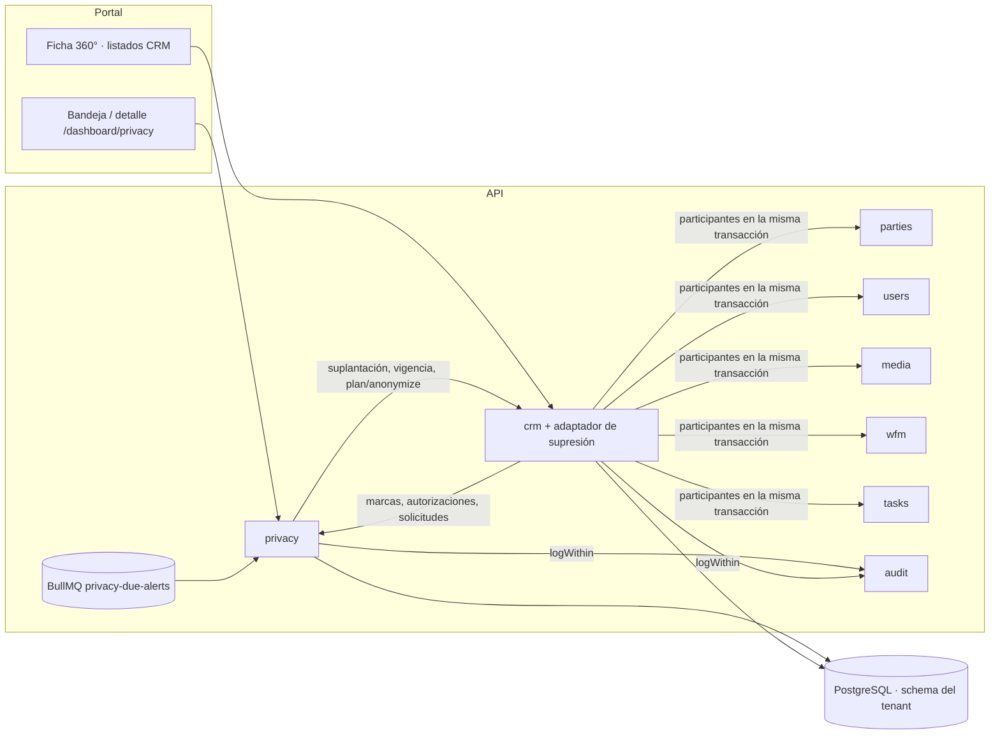

# HLD — `privacy` · Protección de datos personales (Habeas Data)

**Versión:** 1.1 (reemplaza a [v1.0](HLD-PRIVACY-HABEAS-DATA-v1.0.md))
**Estado:** Propuesto (pendiente de aprobación del CTO)
**Fecha:** 2026-10-17
**Modo activo:** Architect
**Autor:** AI-EM-ARCH
**Decisión de referencia:** [ADR-094](../adrs/ADR-094-Modelo-Proteccion-Datos-Personales-Habeas-Data.md) (Aprobado). Decisiones del CTO de la Fase 1b: D-1B-1 a D-1B-7 ([plan v1.6](../plans/2026-10-16-privacy-fase-1b-bloqueo-anonimizacion.md) §1, v1.1 y v1.2).
**Artefactos:**
- Fase 1a: [plan v1.6](../plans/2026-10-14-privacy-habeas-data-fase-1.md), [prompt v1.3](../prompts/PROMPT-PRIVACY-HABEAS-DATA-FASE-1-v1.3.md) (A1–A26), [spec UX v1.2](../specs/2026-10-14-privacy-fase-1-ux-spec.md), [cierre](../informes/INFORME-PRIVACY-FASE-1A-CIERRE-G6-v1.0.md).
- Fase 1b: [plan](../plans/2026-10-16-privacy-fase-1b-bloqueo-anonimizacion.md), contratos [v1.0](../prompts/PROMPT-PRIVACY-FASE-1B-v1.0.md) → [v1.4](../prompts/PROMPT-PRIVACY-FASE-1B-v1.4.md), [cierre G6 y G6.5](../informes/INFORME-PRIVACY-FASE-1B-CIERRE-G6-v1.0.md).

**ADRs aplicables:** 030 (Party como identidad), 058 (cifrado de PII), 065 (paginación), 067 (proyección PII), 093 (IVA) y 094.
**Número de módulo:** pendiente del CTO (roadmap). El nombre técnico es `privacy`.

> Describe lo **construido** en `main` (`34e66adc`), no lo planeado. Lo pendiente está en §10.

**Cambios respecto a v1.0:**
- se agregan la supresión por anonimización y la aplicación del bloqueo (Fase 1b);
- se retira `IPersonalDataBlockPort` (D-1B-3);
- `IPersonalDataErasurePort` queda implementado por CRM, con un participante por módulo dueño;
- se agrega el plazo de traslado;
- se corrige el defecto de `DEBER_CONTRACTUAL`.

## 1. Contexto de negocio

El ISP es el **Responsable del tratamiento** (Ley 1581 de 2012) e iWana el **Encargado**. El módulo cubre seis frentes:
1. La **autorización** por finalidad, con su prueba (Decreto 1377 arts. 7 y 9).
2. La atención de **consultas, reclamos y suplantaciones**, con plazos en días hábiles (Ley 1581 arts. 14 y 15; Ley 2573 de 2026, vigente desde el 19-11-2026).
3. Las **marcas** sobre el titular: reclamo en trámite, víctima de suplantación y datos bloqueados.
4. La **supresión** de los datos personales por anonimización, cuando no hay deber de conservación, y el **bloqueo** cuando sí lo hay.
5. Las **políticas de retención**: suscriptor 5 años (Decreto 1704), facturación 10 años (Ley 962), prospectos 24 meses.
6. La gestión de **incidentes** y el **inventario** declarativo para el RNBD.

El **titular** es el `Party` (ADR-030). `subscriberId` y `expedienteId` son contexto, no identidad. Un prospecto sin Party se identifica por el HMAC de su documento.

## 2. Bounded context y boundary

| Regla | Aplicación |
| --- | --- |
| `privacy` no lee ni escribe tablas de otros módulos | Los efectos sobre CRM van por puertos. La única lectura cruzada sobre CRM es la de la migración 146, para el backfill único |
| Cada módulo anonimiza **sus** tablas | La supresión la ejecutan siete participantes, uno por módulo dueño (§3). `privacy` solo orquesta a través de `IPersonalDataErasurePort`. Los módulos ligeros `*PrivacyModule` exportan solo su participante, sin arrastrar el módulo completo (V3: sin violaciones de boundary) |
| CRM y la ficha 360° leen privacidad solo por puertos | Autorizaciones, marcas, solicitudes y texto legal |
| Dependencia circular CRM ↔ `privacy` | Un solo `forwardRef` (`privacy.module.ts`) hacia `CrmPrivacyAdaptersModule`, que provee y reexporta los puertos que implementa CRM |
| Auditoría transaccional | `AuditService.logWithin(entry, manager)`. La supresión audita dentro de su transacción (C2), y un fallo de auditoría la revierte |
| Media | Uso propio `privacy_evidence` (migración pública 027). Los endpoints genéricos lo rechazan o dan 404; firma dedicada de 300 s |

### Puertos

| Puerto | Declara | Implementa | Consumidor |
| --- | --- | --- | --- |
| `IPrivacyAuthorizationReadPort` (`hasActive`, `listForParty`) | `privacy` | `privacy` | CRM (alta, contrato, 360°) |
| `IPrivacyAuthorizationWritePort` (`record`, idempotente por `sourceRef`) | `privacy` | `privacy` | CRM (alta directa y conversión) |
| `IPrivacyLegalTextReadPort` (`current`, `findByVersion`) | `privacy` | `privacy` | CRM (expediente y conversión) |
| `IPrivacyMarksReadPort` (`activeMarks(partyIds)` por lote; `partyIdsWithActiveMark(mark)`) | `privacy` | `privacy` | CRM: 360°, listados, búsqueda y guardas de mutación |
| `IPrivacyRequestsReadPort` (`RequestSummary`, `dueCounts`) | `privacy/requests` | `privacy/requests` | CRM (360°), alertas |
| `IContractImpersonationPort` (`suspendForImpersonation`, con `manager`) | `privacy` | **CRM** (`crm/privacy-adapters`) | Solicitudes de suplantación |
| `IContractStandingReadPort` (`openContractIds`, `lastTerminatedAt`) | `privacy/requests` | **CRM** | Deber de conservación |
| `IPersonalDataErasurePort` (`plan`, `anonymize`, con `ctx: { manager }`) | `privacy` | **CRM** (`CrmPersonalDataErasureAdapter`) | `resolve` de SUPRIMIR y su vista previa |
| `IPermissionHoldersReadPort` | `access-control` | `access-control` | Alertas |

`IPersonalDataBlockPort` **se retiró** (D-1B-3). El bloqueo se aplica en la lectura, desde las marcas (§6.7).

## 3. Componentes

| Carpeta | Responsabilidad |
| --- | --- |
| `privacy/authorizations/` | Captura, lista y prueba (`proof` con `no-store` y auditoría) |
| `privacy/legal-texts/` | Versiones inmutables y `current` por tipo |
| `privacy/requests/` | Radicación, transiciones, identidad, tareas, evidencia, proyección por permiso, **vista previa y ejecución de la supresión**, plazo de traslado y errores de dominio (`erasure-errors.ts`) |
| `privacy/marks/` | Marcas por Party y lectura por lote |
| `privacy/retention/`, `incidents/`, `inventory/`, `evidence/`, `alerts/` | Sin cambios respecto a v1.0 |
| `crm/privacy-adapters/` | `CrmPersonalDataErasureAdapter` (orquesta los participantes en la transacción de la solicitud) y el participante CRM (`titular-erasure/`) |
| `parties/privacy/`, `users/privacy/`, `media/privacy/`, `wfm/privacy/`, `tasks/privacy/` | Los otros seis participantes: Party, cuentas de usuario dadas de baja, Media, WFM, órdenes de ejecución y tareas operativas |
| `crm/{subscribers,contracts,expedientes}/guards/` | Guardas de mutación sobre titulares bloqueados (decorador más guard de Nest) |
| `apps/api/src/cli/anonymize-titular.ts` | Vía de emergencia: usa los mismos participantes (R13) y conserva `--confirm-unmatched` |

**Fuera del módulo:**
- **Contratos:** `@iwana/shared` (`schemas/privacy/**`, `subscriber.schema.ts`, `contract.schema.ts`, `AccessPermissionKey.CRM_BLOCKED_DATA_READ`).
- **Calendario C-CAL-1:** `packages/shared/src/calendar/`.
- **Portal:** `apps/portal/src/components/privacy/**` (detalle de solicitud, diálogo de supresión, insignia «Anonimizado») y la redacción en suscriptores, expedientes y contratos.

## 4. Diagrama

## 5. Modelo de datos

**Migración tenant 146 (Fase 1a):** `legal_texts`, `data_authorizations`, `data_subject_requests`, `data_subject_request_events`, `data_subject_request_tasks`, `party_privacy_marks`, `retention_policies` y `privacy_incidents`. Sin cambios de diseño: ver [v1.0](HLD-PRIVACY-HABEAS-DATA-v1.0.md) §5.

**Fase 1b:**

| Migración | Cambio | Protección en BD |
| --- | --- | --- |
| 149 | `data_subject_requests.erased_at` y `erasure_categories` (lista cerrada de 9 categorías) | CHECK de alcance (solo SUPRIMIR resuelta) y trigger que impide reescribir la supresión |
| 150 | `anonymized_at` y `anonymized_request_id` en `party`, `subscribers` y `expediente_records` | CHECK de pareja y trigger que impide reescribir o borrar la marca |
| 151 | Permiso `crm.blocked_data.read` y perfil de sistema «Facturación y cobro» (rol base `ACCOUNTANT`) | Catálogo con test invariante |
| 152 (WFM) | `TASKS` en el enum `work_order_source_context`, que la supresión consulta | Test de paridad entre el contrato y `pg_enum` |

**Otras:** 147 (permisos `privacy.read` y `privacy.manage`) y pública 027 (uso de Media `privacy_evidence`).

## 6. Flujos principales

1. **Captura de la autorización:** sin cambios respecto a v1.0 §6.1.
2. **Solicitud del titular:** `require-info`, `complete`, `extend`, `resolve`, `reject` y `transfer`, con evento y auditoría sin PII en cada una.
3. **Suplantación (Ley 2573):** sin cambios respecto a v1.0 §6.3.
4. **Alerta diaria:** sin cambios respecto a v1.0 §6.4.
5. **Detalle por permiso:** sin cambios. Además, el detalle expone `transferDueAt`, `transferredLate`, `erasedAt` y `erasureCategories`.
6. **Supresión procedente (R2 a R7, R13 a R15)**
   - **Vista previa** (`GET …/erasure-preview`, `privacy.manage`): el adaptador calcula los expedientes candidatos (por HMAC del documento si no hay Party), los conteos por categoría y los bloqueos. Los bloqueos posibles son identidad sin verificar, estado inválido, deber de conservación, titular sin conciliar, cuenta de usuario activa y más de 500 candidatos.
   - **`resolve`** exige `erasure.confirm = true` y la lista exacta de candidatos (concurrencia optimista: 409 si cambió). En **una sola transacción**: plan → anonimización por los siete participantes → verificación de residuales → `erased_at` y categorías → cierre de `RECLAMO_EN_TRAMITE` y de `DATOS_BLOQUEADOS` → auditoría con `logWithin`. Cualquier fallo revierte todo.
   - **Lo que se conserva (R6 y D-1B-7):** la solicitud y sus eventos, las autorizaciones **con su evidencia**, las marcas, la auditoría y los registros, sin sus campos personales. Los contratos se anonimizan y se conservan, con la marca visible (D-1B-5).
   - **Errores:** de dominio, con `code`. Un fallo de esquema esperable de un participante responde 503 `PRIVACY_ERASURE_PARTICIPANT_UNAVAILABLE`.
7. **Bloqueo (R1, R8 a R10, R16)**
   - `reject` de SUPRIMIR abre `DATOS_BLOQUEADOS` **solo** con `DEBER_LEGAL_CONSERVACION` (D-1B-1).
   - **Lectura:** para un titular bloqueado, CRM oculta los datos personales en listados, detalle, 360°, contratos y los seis subrecursos del expediente (403), y lo excluye de la búsqueda. Lo ven completo `privacy.read` (Oficial) y `crm.blocked_data.read` (facturación, D-1B-6). La auditoría de esa lectura se escribe **antes** de responder: si falla, 503 `PRIVACY_AUDIT_UNAVAILABLE` sin datos.
   - **Mutación:** toda ruta `POST`, `PATCH`, `PUT` o `DELETE` de los controllers de suscriptores, contratos y expedientes sobre un bloqueado responde 409 `PRIVACY_DATA_BLOCKED` antes de escribir, con cualquier permiso. Excepciones cerradas: la búsqueda y la creación de registros nuevos. Un test de arquitectura por reflexión falla si aparece una ruta de mutación sin guarda.
8. **Traslado (R11):** `transferDueAt` es la radicación más 2 días hábiles, calculado en la lectura. `transferredLate` se deriva del evento de traslado y no bloquea la transición.

## 7. Seguridad y PII

| Control | Implementación |
| --- | --- |
| Cifrado | AES-256-GCM (ADR-058) con `PII_ENCRYPTION_KEY`. HMAC (`PII_HASH_KEY`) **resuelto desde `ConfigService`** |
| Autorización | `privacy.read`, `privacy.manage` y `crm.blocked_data.read` con `EffectivePermissionsService`, nunca por rol. `crm.blocked_data.read` es solo de lectura |
| Irreversibilidad | Una sola transacción con verificación de residuales; triggers que impiden reescribir `erased_at` y `anonymized_at` |
| Evidencia | Bytes mágicos, 10 MiB, firma de 300 s y `no-store`; lectura auditada |
| Auditoría | Explícita y sin PII; dentro de la transacción en los efectos atómicos; antes de responder en la lectura de datos bloqueados |
| Cachés | `no-store` en las respuestas con identidad o evidencia |
| Revisión | SEC-ENG GO: Fase 1a (SEC v1.1) y Fase 1b ([V2″](../informes/INFORME-PRIVACY-FASE-1B-V2-SEC-v1.2.md), 32 rutas de mutación) |

## 8. Multi-tenant y operación

- Todas las tablas están en el schema del tenant (`runInTenantSchema`), y la supresión corre en la transacción de `withPrivacyTenant`.
- **Requisito por empresa:** publicar el texto `AUTORIZACION`. Sin él, la captura responde 422 `PRIVACY_LEGAL_TEXT_NOT_PUBLISHED`.
- **Vía de emergencia:** el [runbook manual](../runbooks/RUNBOOK-PRIVACY-BLOQUEO-SUPRESION-MANUAL-v1.0.md) con el CLI, para más de 500 expedientes o un participante no disponible.
- **Asignación:** el administrador del ISP asigna el perfil «Facturación y cobro».
- **Métrica:** `privacy_due_alerts_no_recipients_total`, por ahora solo en logs (P2).

## 9. Calidad

- **Cobertura de `privacy/**`:** 94,61 % de statements y 82,73 % de branches. `crm/subscribers` no baja de su línea base.
- **E2E contra la API real:** Fase 1a 3/3; Fase 1b **4/4** con `--retries=0` ([V1 v1.8](../informes/INFORME-PRIVACY-FASE-1B-V1-QA-v1.8.md)).
- **Integraciones Postgres:** supresión por la API con el adaptador real y el schema creado por migraciones reales; CLI de emergencia; migraciones 149 a 152.
- **G6.5:** CI [`38992139163`](https://github.com/Sleybc/iWana-neXt/actions/runs/38992139163) sobre `34e66adc`, verde con todos sus pasos ejecutados.

## 10. Pendiente y desalineaciones conocidas

| Tema | Estado |
| --- | --- |
| Crear un registro nuevo con el documento de un titular bloqueado no se detecta (D-H15) | Fase 2, P2 |
| Cierre de `DATOS_BLOQUEADOS` al vencer la retención | Fase 2, P3 |
| Soporte fiscal de 10 años como deber de conservación propio | Cuando exista facturación, P2 |
| `contracts.fiscal_document` en claro | Deuda MOD05, P2 |
| El log global de Nest puede imprimir parámetros (HMAC) de un `QueryFailedError` | P2, `sec-eng` + backend |
| Dictámenes de ADR-094 §7.3 ([cuestionario jurídico](../informes/INFORME-CONSULTA-JURIDICA-PROTECCION-DATOS-v1.0.md)) | Pendientes; bloquean producción |
| Centrales de riesgo y Ley 2300 | Fase 3 |
| Conciliación del backfill de la 146 por tenant | G7 |

## 11. Decisión de salida

**Fase 1a:** G6 y G6.5 GO. **Fase 1b:** G4, G6 y G6.5 **GO** (2026-10-17).

**G7 queda condicionado a:**
1. la beta mínima ([ADR-095](../adrs/ADR-095-Topologia-Productiva-Dominio-TLS-Hosting.md));
2. los dictámenes de ADR-094 §7.3;
3. la ejecución por tenant: migraciones 146 a 152, conciliación del backfill y publicación del texto de autorización;
4. la aprobación de este HLD v1.1 por el CTO.

**D-1B queda cumplida antes de producción:** la supresión y el bloqueo ya no dependen del runbook manual, que pasa a vía de emergencia.

**Defecto de v1.0 §11 cerrado:** `reject` con `DEBER_CONTRACTUAL` ya no abre `DATOS_BLOQUEADOS` (D-1B-1).
