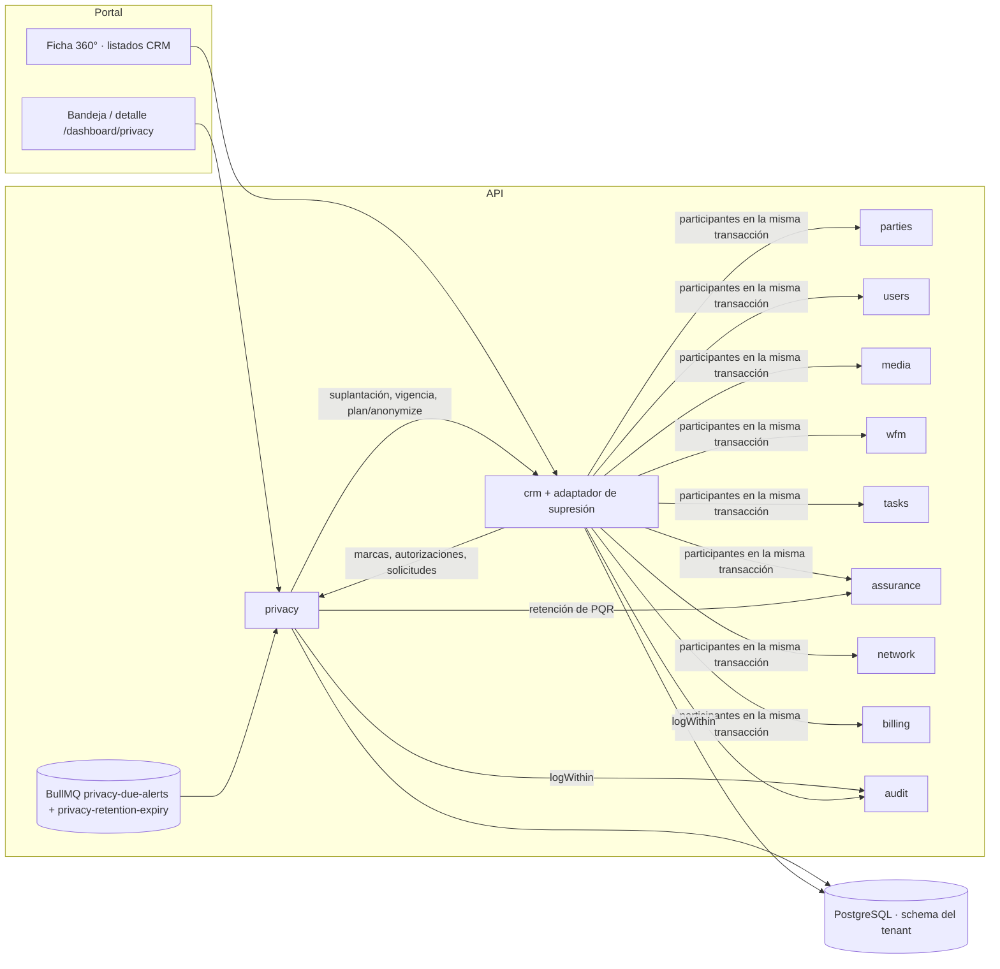

# HLD — `privacy` · Protección de datos personales (Habeas Data)

**Versión:** 1.6 (reemplaza a [v1.5](HLD-PRIVACY-HABEAS-DATA-v1.5.md))
**Estado:** Aprobado. Recoge decisiones ya aprobadas por el CTO: G0 del barrido de texto libre (2026-11-07, D-BT-11), [ADR-104](../adrs/ADR-104-Enmienda-ADR-094-D7-Retencion-PQR-y-Veracidad.md) (2026-11-07), G0 de H-EXP Fase 1 (2026-11-07, spec §10 puntos 1 a 4, con [ADR-105](../adrs/ADR-105-Jobs-de-Dominio-Procesados-en-la-API.md)) y su G6/G6.5 (2026-11-08)
**Fecha:** 2026-11-09
**Modo activo:** Architect
**Autor:** AI-DOCS
**Decisión de referencia:** [ADR-094](../adrs/ADR-094-Modelo-Proteccion-Datos-Personales-Habeas-Data.md) (Aprobado). Decisiones del CTO de la Fase 1b: D-1B-1 a D-1B-7 ([plan v1.6](../plans/2026-10-16-privacy-fase-1b-bloqueo-anonimizacion.md) §1, v1.1 y v1.2).
**Artefactos:**
- Fase 1a: [plan v1.6](../plans/2026-10-14-privacy-habeas-data-fase-1.md), [prompt v1.3](../prompts/PROMPT-PRIVACY-HABEAS-DATA-FASE-1-v1.3.md) (A1–A26), [spec UX v1.2](../specs/2026-10-14-privacy-fase-1-ux-spec.md), [cierre](../informes/INFORME-PRIVACY-FASE-1A-CIERRE-G6-v1.0.md).
- Fase 1b: [plan](../plans/2026-10-16-privacy-fase-1b-bloqueo-anonimizacion.md), contratos [v1.0](../prompts/PROMPT-PRIVACY-FASE-1B-v1.0.md) → [v1.4](../prompts/PROMPT-PRIVACY-FASE-1B-v1.4.md), [cierre G6 y G6.5](../informes/INFORME-PRIVACY-FASE-1B-CIERRE-G6-v1.0.md).
- DT-3 «R-ER»: [spec v1.2](../specs/2026-11-01-privacy-dt3-mutaciones-titular-anonimizado-spec.md), [plan](../plans/2026-11-01-privacy-dt3-rer-orquestacion.md), [prompt](../prompts/PROMPT-PRIVACY-DT3-RER-v1.0.md), [cierre](../informes/INFORME-PRIVACY-DT3-RER-CIERRE-v1.0.md).
- O-1, reloj de retención: [spec](../specs/2026-11-02-privacy-o1-reloj-retencion-spec.md), [plan](../plans/2026-11-02-privacy-o1-retencion-orquestacion.md), [prompt](../prompts/PROMPT-PRIVACY-O1-RETENCION-v1.0.md), [cierre](../informes/INFORME-PRIVACY-O1-RETENCION-CIERRE-v1.0.md).
- Ley 2573 de 2026, verificada en fuente oficial: [informe](../informes/INFORME-PRIVACY-LEY-2573-VERIFICACION-v1.0.md).
- Denuncia del operador (Sentencia C-413 de 2025): [spec](../specs/2026-11-03-privacy-suplantacion-denuncia-operador-spec.md), [plan](../plans/2026-11-03-privacy-denuncia-operador-orquestacion.md), [cierre](../informes/INFORME-PRIVACY-DENUNCIA-OPERADOR-CIERRE-v1.0.md). Consulta jurídica abierta: [v1.1](../informes/INFORME-CONSULTA-JURIDICA-PROTECCION-DATOS-v1.1.md).

- Barrido de texto libre y retención de PQR: [spec v1.2](../specs/2026-11-03-privacy-barrido-texto-libre-supresion-spec.md), [plan v1.3](../plans/2026-11-03-privacy-barrido-texto-libre-orquestacion.md), [cierre](../informes/INFORME-PRIVACY-BARRIDO-TEXTO-LIBRE-CIERRE-v1.0.md).
- H-EXP Fase 1 (anonimizar al vencer la retención): [spec v1.1](../specs/2026-11-07-privacy-h-exp-retencion-spec.md), [plan](../plans/2026-11-07-privacy-h-exp-fase-1-orquestacion.md), [cierre](../informes/INFORME-PRIVACY-H-EXP-FASE-1-CIERRE-v1.0.md).

**ADRs aplicables:** 030 (Party como identidad), 058 (cifrado de PII), 065 (paginación), 067 (proyección PII), 093 (IVA), 094 y 104 (enmienda de 094 D7), 105 (jobs de dominio en la API).
**Número de módulo:** pendiente del CTO (roadmap). El nombre técnico es `privacy`.

> Describe lo **construido** en `main` hasta `b48b2ba7` (2026-11-08), no lo planeado. Lo pendiente está en §10.

**Cambios respecto a v1.5 (H-EXP Fase 1):**
- el vencimiento de la retención deja de ser manual: motor transaccional en `privacy/retention/` que anonimiza titulares con `DATOS_BLOQUEADOS`, prospectos descartados y minimiza solicitudes terminales (§6.9);
- relojes con fecha civil de Bogotá y fallo cerrado ante dato ausente (D-EXP-1); `ConservationDutyService` extraído de `requests.service.ts` y compartido por API, job y CLI;
- ledger `privacy_retention_expiry_runs` como garantía de idempotencia y job diario procesado en la propia API (ADR-105), más CLI `privacy:expire-retention` con dry-run por defecto;
- migración tenant 179 (§5): ledger, `closed_at`/clasificación de traslado/marcas de minimización, reglas R1–R4 y guardas `BEFORE TRUNCATE`;
- se cierra el bloqueo de G7 del barrido (§10): la fila de H-EXP pasa a implementada y el recurso PQR pendiente queda cubierto por H-EXP.

**Cambios de v1.4 a v1.5 (barrido de texto libre, H-2, MOD14 y ADR-104):**
- la supresión pasa de siete a nueve participantes, más Billing: entran `assurance` (tickets, comentarios, eventos, vínculos y notas de PQR) y `network` (motivo de regularización) (§2, §3 y §6.6);
- el alcance cubre órdenes directas por suscriptor y trabajo ligado solo por contrato o ticket;
- un titular suprimido no admite tickets, comentarios, vínculos de OT, trabajo de campo ni regularizaciones nuevas (409); cerrar un ticket sigue permitido (§6.7);
- el deber de conservación suma la PQR del titular: 3 años desde su respuesta, o sin respuesta (ADR-104 E1, §6.6);
- vista previa con el bloqueante `SUPPLIER_PROFILE_LINKED` cuando el titular también es proveedor;
- el estrato anonimizado es `NULL`, nunca `1` (ADR-104 E3);
- la auditoría ya no recibe motivos en texto libre (`reasonProvided`);
- un manifiesto clasifica toda columna textual tenant y una prueba en CI lo compara con el esquema migrado (§9);
- migración tenant 177 (§5).

**Cambios de v1.3 a v1.4 (denuncia del operador):**
- la suplantación crea dos tareas más: «Formular la denuncia penal de la empresa» y «Comunicar al titular el plazo para denunciar» (§6.3), por la Sentencia C-413 de 2025;
- migración tenant 172 (§5).

**Cambios de v1.2 a v1.3 (O-1):**
- el deber de conservación se ancla en `contracts.terminated_at`, que es inmutable, y tiene en cuenta los contratos archivados (§6.6); se cierra O-1;
- migraciones tenant 170 y 171 (§5);
- verificación de la Ley 2573 en fuente oficial (§1 y §10).

**Cambios de v1.1 a v1.2 (DT-3):**
- un titular anonimizado es de **solo lectura** para CRM, con una única excepción: archivar un contrato terminado (§6.7);
- las escrituras de CRM deciden con la fila bloqueada y releída, en el orden `expediente_records → subscribers → contracts`;
- la supresión avanza la versión de forma monótona y relee el deber de conservación dentro de su transacción (§6.6);
- migración tenant 169: triggers de respaldo (§5);
- nuevo pendiente O-1 (§10).

**Cambios de v1.0 a v1.1:**
- se agregan la supresión por anonimización y la aplicación del bloqueo (Fase 1b);
- se retira `IPersonalDataBlockPort` (D-1B-3);
- `IPersonalDataErasurePort` queda implementado por CRM, con un participante por módulo dueño;
- se agrega el plazo de traslado;
- se corrige el defecto de `DEBER_CONTRACTUAL`.

## 1. Contexto de negocio

El ISP es el **Responsable del tratamiento** (Ley 1581 de 2012) e iWana el **Encargado**. El módulo cubre seis frentes:
1. La **autorización** por finalidad, con su prueba (Decreto 1377 arts. 7 y 9).
2. La atención de **consultas, reclamos y suplantaciones**, con plazos en días hábiles (Ley 1581 arts. 14 y 15; Ley 2573 de 2026, verificada en el normograma de MinTIC: rige seis meses después de su promulgación del 20-05-2026, salvo el art. 5, pars. 1 y 2, que ya rigen; fecha interna conservadora, 19-11-2026).
3. Las **marcas** sobre el titular: reclamo en trámite, víctima de suplantación y datos bloqueados.
4. La **supresión** de los datos personales por anonimización, cuando no hay deber de conservación, y el **bloqueo** cuando sí lo hay.
5. Las **políticas de retención**: suscriptor 5 años desde la terminación del último contrato (Decreto 1704; ancla `contracts.terminated_at`, O-1), facturación 10 años (Ley 962), prospectos 24 meses.
6. La gestión de **incidentes** y el **inventario** declarativo para el RNBD.

El **titular** es el `Party` (ADR-030). `subscriberId` y `expedienteId` son contexto, no identidad. Un prospecto sin Party se identifica por el HMAC de su documento.

## 2. Bounded context y boundary

| Regla | Aplicación |
| --- | --- |
| `privacy` no lee ni escribe tablas de otros módulos | Los efectos sobre CRM van por puertos. La única lectura cruzada sobre CRM es la de la migración 146, para el backfill único. El motor de vencimiento (§6.9) lee CRM, Billing y Assurance solo por sus puertos de lectura, con `manager` explícito |
| Cada módulo anonimiza **sus** tablas | La supresión la ejecutan nueve participantes, uno por módulo dueño, más Billing al final (§3). `inventory` solo aporta una lectura (¿el Party es proveedor?) y `assurance` también implementa el puerto de retención de PQR. `privacy` solo orquesta a través de `IPersonalDataErasurePort`. Los módulos ligeros `*PrivacyModule` exportan solo su participante, sin arrastrar el módulo completo (V3: sin violaciones de boundary) |
| CRM y la ficha 360° leen privacidad solo por puertos | Autorizaciones, marcas, solicitudes y texto legal |
| Dependencia circular CRM ↔ `privacy` | Un solo `forwardRef` (`privacy.module.ts`) hacia `CrmPrivacyAdaptersModule`, que provee y reexporta los puertos que implementa CRM |
| Auditoría transaccional | `AuditService.logWithin(entry, manager)`. La supresión audita dentro de su transacción (C2), y un fallo de auditoría la revierte. El vencimiento registra además su ledger en la misma transacción |
| Media | Uso propio `privacy_evidence` (migración pública 027). Los endpoints genéricos lo rechazan o dan 404; firma dedicada de 300 s |

### Puertos

| Puerto | Declara | Implementa | Consumidor |
| --- | --- | --- | --- |
| `IPrivacyAuthorizationReadPort` (`hasActive`, `listForParty`) | `privacy` | `privacy` | CRM (alta, contrato, 360°) |
| `IPrivacyAuthorizationWritePort` (`record`, idempotente por `sourceRef`) | `privacy` | `privacy` | CRM (alta directa y conversión) |
| `IPrivacyLegalTextReadPort` (`current`, `findByVersion`) | `privacy` | `privacy` | CRM (expediente y conversión) |
| `IPrivacyMarksReadPort` (`activeMarks(partyIds)` por lote; `partyIdsWithActiveMark(mark)`) | `privacy` | `privacy` | CRM: 360°, listados, búsqueda y guardas de mutación |
| `IPrivacyRequestsReadPort` (`RequestSummary`, `dueCounts`) | `privacy/requests` | `privacy/requests` | CRM (360°), alertas |
| `IContractImpersonationPort` (`suspendForImpersonation`, con `manager`) | `privacy` | **CRM** (`crm/privacy-adapters`) | Solicitudes de suplantación |
| `IContractStandingReadPort` (`openContractIds`, `lastTerminatedAt`, `unreconciledContractClock` obligatorio; `standing(partyId, { manager })`; `listProspectDiscard` y `findProspectDiscard` abstractos) | `privacy/requests` | **CRM** | Deber de conservación y motor de vencimiento. `lastTerminatedAt` = `max(terminated_at)` de los contratos `TERMINATED` y `ARCHIVED` no borrados (O-1). `unreconciledContractClock` es `true` si algún contrato terminal no tiene fecha. La revalidación del prospecto bloquea su fila con `FOR UPDATE` |
| `IBillingStandingReadPort` (`lastFiscalDocumentAt`, `hasUnreconciledFiscalClock`, ambos abstractos) | `privacy/requests` | **Billing** | Reloj fiscal de 10 años desde `issue_date`; un documento `EMITIDO` o `ANULADO` sin fecha falla cerrado con `FISCAL_UNRECONCILED` |
| `IPqrRetentionReadPort` | `privacy/requests` | **Assurance** (`PqrRetentionReadAdapter`) | Reloj `PQR_SOPORTES` (ADR-104), también para prospectos |
| `IPersonalDataErasurePort` (`plan`, `anonymize`, con `ctx: { manager }`) | `privacy` | **CRM** (`CrmPersonalDataErasureAdapter`) | `resolve` de SUPRIMIR, su vista previa y el motor de vencimiento |
| `IPermissionHoldersReadPort` | `access-control` | `access-control` | Alertas |

`IPersonalDataBlockPort` **se retiró** (D-1B-3). El bloqueo se aplica en la lectura, desde las marcas (§6.7).

## 3. Componentes

| Carpeta | Responsabilidad |
| --- | --- |
| `privacy/authorizations/` | Captura, lista y prueba (`proof` con `no-store` y auditoría) |
| `privacy/legal-texts/` | Versiones inmutables y `current` por tipo |
| `privacy/requests/` | Radicación, transiciones, identidad, tareas, evidencia, proyección por permiso, **vista previa y ejecución de la supresión**, plazo de traslado y errores de dominio (`erasure-errors.ts`) |
| `privacy/marks/` | Marcas por Party y lectura por lote |
| `privacy/retention/` | Motor de vencimiento H-EXP (§6.9): `retention-expiry.service.ts` (`previewTenant`, `runTenantBatch`, `verifyTenant`), `ConservationDutyService` extraído de `requests.service.ts`, `@Processor` de la cola `privacy-retention-expiry` (ADR-105) y ledger `privacy_retention_expiry_runs` |
| `privacy/incidents/`, `privacy/inventory/`, `privacy/evidence/`, `privacy/alerts/` | Sin cambios respecto a v1.0 |
| `crm/privacy-adapters/` | `CrmPersonalDataErasureAdapter` (orquesta los participantes en la transacción de la solicitud) y el participante CRM (`titular-erasure/`) |
| `parties/privacy/`, `users/privacy/`, `assurance/privacy/`, `wfm/privacy/`, `tasks/privacy/`, `network/privacy/`, `media/privacy/` | Los otros ocho participantes, en este orden: Party, cuentas de usuario dadas de baja, `assurance`, WFM, órdenes de ejecución, tareas operativas, `network` y Media |
| `billing/privacy/` | Participante fiscal, que actúa al final, y lectura de la situación fiscal para el deber de conservación |
| `inventory/privacy/` | Lectura de `supplier_profiles` para el bloqueante `SUPPLIER_PROFILE_LINKED` |
| `crm/{subscribers,contracts,expedientes}/guards/` | Guardas de mutación sobre titulares bloqueados (decorador más guard de Nest) |
| `apps/api/src/cli/anonymize-titular.ts` | Vía de emergencia: usa los mismos participantes (R13) y conserva `--confirm-unmatched` |
| `apps/api/src/cli/expire-retention.ts` | CLI del vencimiento (`privacy:expire-retention`, §6.9): dry-run por defecto, `--apply` y `--verify-only` excluyentes |

**Fuera del módulo:**
- **Contratos:** `@iwana/shared` (`schemas/privacy/**`, `subscriber.schema.ts`, `contract.schema.ts`, `AccessPermissionKey.CRM_BLOCKED_DATA_READ`).
- **Calendario C-CAL-1:** `packages/shared/src/calendar/`.
- **Portal:** `apps/portal/src/components/privacy/**` (detalle de solicitud, diálogo de supresión, insignia «Anonimizado») y la redacción en suscriptores, expedientes y contratos.

## 4. Diagrama

## 5. Modelo de datos

**Migración tenant 146 (Fase 1a):** `legal_texts`, `data_authorizations`, `data_subject_requests`, `data_subject_request_events`, `data_subject_request_tasks`, `party_privacy_marks`, `retention_policies` y `privacy_incidents`. Sin cambios de diseño: ver [v1.0](HLD-PRIVACY-HABEAS-DATA-v1.0.md) §5.

**Fase 1b:**

| Migración | Cambio | Protección en BD |
| --- | --- | --- |
| 149 | `data_subject_requests.erased_at` y `erasure_categories` (lista cerrada de 9 categorías) | CHECK de alcance (solo SUPRIMIR resuelta) y trigger que impide reescribir la supresión |
| 150 | `anonymized_at` y `anonymized_request_id` en `party`, `subscribers` y `expediente_records` | CHECK de pareja y trigger que impide reescribir o borrar la marca |
| 151 | Permiso `crm.blocked_data.read` y perfil de sistema «Facturación y cobro» (rol base `ACCOUNTANT`) | Catálogo con test invariante |
| 152 (WFM) | `TASKS` en el enum `work_order_source_context`, que la supresión consulta | Test de paridad entre el contrato y `pg_enum` |
| 170 (O-1) | `contracts.terminated_at`: la primera entrada en `TERMINATED` o `ARCHIVED`. Backfill por candidatos, que en la duda alarga la retención; los contratos de titulares anonimizados quedan en `NULL` | Trigger `BEFORE UPDATE`: la fecha es inmutable y obligatoria al pasar a estado terminal (`23514`) |
| 171 (O-1) | Guarda de `INSERT` | Trigger `BEFORE INSERT`: un contrato que entra ya terminal sin fecha se rechaza (`23514`) |
| 172 (denuncia del operador) | `ck_data_subject_request_tasks_kind` con 4 tipos. Backfill de las dos tareas nuevas en las SUPLANTACION abiertas | El `down` se bloquea si existen tareas nuevas; no borra filas |
| 169 (DT-3) | Función `titular_prevent_anonymized_mutation()` y triggers `BEFORE UPDATE OR DELETE` en `subscribers`, `expediente_records` y `contracts` | Rechaza toda escritura sobre un titular anonimizado (`55000`, `HINT` `PRIVACY_TITULAR_ANONYMIZED`, que la API traduce a 409), salvo el archivo `TERMINATED → ARCHIVED` de 4 columnas. Solo la deja pasar la transacción que fija `iwana.titular_erasure`: el adaptador de supresión y el CLI |

| 177 (barrido v1.2, ADR-104) | `contracts.anonymized_at`; `chk_contract_residential_stratum` y `chk_subscriber_person_fields` admiten estrato `NULL` solo con `anonymized_at`; siembra `PQR_SOPORTES` (3) y `SOLICITUDES_TITULAR` (5) | El `down` restaura los CHECK con `NOT VALID` y no inventa estratos |
| 179 (H-EXP Fase 1) | Ledger `privacy_retention_expiry_runs` (unicidad por tipo, objetivo y versión de reglas); `closed_at` con backfill determinista, clasificación de traslado (`transfer_destination_kind/code`) y `minimized_at`/`retention_closed_at` en solicitudes; reglas R1–R4 sobre `data_subject_request_events` | Triggers de fila con `search_path` fijo: `reason` y `requester_evidence_media_id` solo hacia `NULL` bajo minimización, `minimized_at` monótono en estado terminal, columnas minimizadas solo hacia `NULL`. Guardas `BEFORE TRUNCATE` en las cuatro tablas. El `down` falla si hay actos de minimización confirmados |

**Otras:** 147 (permisos `privacy.read` y `privacy.manage`) y pública 027 (uso de Media `privacy_evidence`).

## 6. Flujos principales

1. **Captura de la autorización:** sin cambios respecto a v1.0 §6.1.
2. **Solicitud del titular:** `require-info`, `complete`, `extend`, `resolve`, `reject` y `transfer`, con evento y auditoría sin PII en cada una.
3. **Suplantación (Ley 2573 y Sentencia C-413 de 2025):** igual que en v1.0 §6.3 (suspensión inmediata, marca de víctima y respuesta en 10 días hábiles), con **cuatro** tareas al radicar:
   - `SUSPENDER_COBRO_EXTERNO`, que vence el día de la radicación;
   - `ENTREGAR_COPIA_DOCUMENTOS`, que vence con la solicitud;
   - **`COMUNICAR_PLAZO_DENUNCIA`**, que vence el día de la radicación; si se completa después, el detalle muestra «Comunicación tardía»;
   - **`FORMULAR_DENUNCIA_OPERADOR`**, que vence en `impersonation_complaint_due_at` (radicación + 20 días hábiles) y se cierra con el número de radicado de la denuncia, una nota de hasta 120 caracteres que no va a la auditoría.

   El sistema nunca exige a la víctima copia de su denuncia, conforme con la C-413 (art. 5 num. 7, inexequible).
4. **Alerta diaria:** sin cambios respecto a v1.0 §6.4.
5. **Detalle por permiso:** sin cambios. Además, el detalle expone `transferDueAt`, `transferredLate`, `erasedAt` y `erasureCategories`.
6. **Supresión procedente (R2 a R7, R13 a R15)**
   - **Vista previa** (`GET …/erasure-preview`, `privacy.manage`): el adaptador calcula los expedientes candidatos (por HMAC del documento si no hay Party), los conteos por categoría y los bloqueos. Los bloqueos posibles son identidad sin verificar, estado inválido, deber de conservación, titular sin conciliar, cuenta de usuario activa, titular que también es proveedor (`SUPPLIER_PROFILE_LINKED`) y más de 500 candidatos.
   - **`resolve`** exige `erasure.confirm = true` y la lista exacta de candidatos (concurrencia optimista: 409 si cambió). En **una sola transacción**: plan → anonimización por los nueve participantes y Billing → verificación de residuales → `erased_at` y categorías → cierre de `RECLAMO_EN_TRAMITE` y de `DATOS_BLOQUEADOS` → auditoría con `logWithin`. Cualquier fallo revierte todo.
   - **Lo que se conserva (R6 y D-1B-7):** la solicitud y sus eventos, las autorizaciones **con su evidencia**, las marcas, la auditoría y los registros, sin sus campos personales. Los contratos se anonimizan y se conservan, con la marca visible (D-1B-5).
   - **Errores:** de dominio, con `code`. Un fallo de esquema esperable de un participante responde 503 `PRIVACY_ERASURE_PARTICIPANT_UNAVAILABLE`.
   - **Deber de conservación (O-1):**
     - hay contrato abierto si existe uno sin borrar que no está en `TERMINATED` ni en `ARCHIVED`;
     - la retención corre desde el `terminated_at` más reciente de los contratos terminales sin borrar, que es la primera entrada del contrato en estado terminal y no cambia después;
     - archivar ya no borra el reloj, y una edición posterior ya no lo mueve;
     - una PQR del titular (`support_tickets.type = PQR`) respondida hace menos de 3 años, o sin respuesta definitiva, también lo impone (ADR-104 E1, `PQR_SOPORTES`). `privacy` la lee por `IPqrRetentionReadPort`, que implementa `assurance`.
   - **Veracidad (ADR-104 E3):** el estrato del suscriptor y del contrato anonimizados queda en `NULL`; la migración 177 lo admite solo con `anonymized_at`.
   - **Concurrencia (DT-3):**
     - el deber de conservación se evalúa dentro de la transacción, después de bloquear las filas del titular (`IContractStandingReadPort.standing(partyId, { manager })`);
     - toda fila que la supresión cambia, aunque solo sea por la marca, avanza `updated_at` con `GREATEST(date_trunc('milliseconds', clock_timestamp()), date_trunc('milliseconds', updated_at) + 1 ms)`;
     - un reintento sobre un titular limpio no avanza la versión;
     - una escritura de CRM que bloqueó antes se suprime al confirmar; una que llega después recibe 409.
   - **Verificación:** `anonymize-titular --verify-only` lista, por tenant y sin PII, a los titulares anonimizados con campos redactados que ya no tienen el valor esperado.
7. **Bloqueo (R1, R8 a R10, R16)**
   - `reject` de SUPRIMIR abre `DATOS_BLOQUEADOS` **solo** con `DEBER_LEGAL_CONSERVACION` (D-1B-1).
   - **Lectura:** para un titular bloqueado, CRM oculta los datos personales en listados, detalle, 360°, contratos y los seis subrecursos del expediente (403), y lo excluye de la búsqueda. Lo ven completo `privacy.read` (Oficial) y `crm.blocked_data.read` (facturación, D-1B-6). La auditoría de esa lectura se escribe **antes** de responder: si falla, 503 `PRIVACY_AUDIT_UNAVAILABLE` sin datos.
   - **Mutación:** toda ruta `POST`, `PATCH`, `PUT` o `DELETE` de los controllers de suscriptores, contratos, expedientes y `subscriber-tax` sobre un bloqueado responde 409 `PRIVACY_DATA_BLOCKED` antes de escribir, con cualquier permiso. Excepciones cerradas: la búsqueda y la creación de registros nuevos. Un test de arquitectura por reflexión falla si aparece una ruta de mutación sin guarda.
   - **Titular anonimizado (DT-3):** sus registros son de solo lectura. Toda mutación, incluida la creación de contratos ligados al titular y la baja lógica, responde 409 `PRIVACY_TITULAR_ANONYMIZED` con cualquier permiso.
     - **Única excepción:** archivar un contrato `TERMINATED`, con `UPDATE` de `status`, `status_reason_code`, `status_changed_at` y `updated_at`. Por HTTP la deja pasar `allowAnonymized`, que solo lleva `POST crm/contracts/:id/archive`; el test de arquitectura falla si aparece en otra ruta.
     - **Garantía:** la guarda HTTP es un rechazo temprano, no la garantía. Cada escritor de CRM, incluido `ResponsibilitiesService`, bloquea en el orden `expediente_records → subscribers → contracts` y relee `anonymized_at`. Nunca guarda una entidad leída antes del bloqueo. La migración 169 actúa de respaldo para escritores sin ruta HTTP.
     - **Orden de errores:** 401/403 → 404 → 409 anonimizado → 409 bloqueado → 409 de versión → 422 de dominio. También rige en la creación.
     - **Fuera de CRM (barrido, D-BT-7):** `assurance` y `network` consultan el puerto de lectura de CRM, que bloquea las filas del titular en la misma transacción. Crear o editar un ticket, añadir un comentario, vincular una OT, pedir trabajo de campo o regularizar un aprovisionamiento sobre un titular suprimido responde 409 `PRIVACY_TITULAR_ANONYMIZED`. Cerrar un ticket sigue permitido: sus notas de cierre quedan en claro y `--verify-only` las delata.
8. **Traslado (R11):** `transferDueAt` es la radicación más 2 días hábiles, calculado en la lectura. `transferredLate` se deriva del evento de traslado y no bloquea la transición.
9. **Vencimiento de la retención — H-EXP Fase 1 (D-EXP-1 a D-EXP-3)**
   - **Relojes:** `today` en fecha civil de Bogotá (`bogotaCivilDate`, años calendario con regla de fin de mes), vencimiento inclusivo (`expiresOn <= today`). Categorías: contrato abierto (nunca elegible), identificación/contrato (5 años desde `lastTerminatedAt`), `FACTURACION_SOPORTES_CONTABLES` (10 años por puerto Billing), `PQR_SOPORTES` (3 años desde notificación o respuesta; toda PQR o recurso definitivo pendiente impide empezar el reloj), prospecto descartado (24 meses desde descarte verificable), `SOLICITUDES_TITULAR` (5 años desde cierre terminal) y `AUTORIZACIONES_EVIDENCIA` (ancla finita, Fase 2). Rige el mayor plazo.
   - **Fallo cerrado:** dato ausente, categoría faltante, puerto no disponible, alcance sin conciliar o esquema incompatible producen tarea operativa (`ATTENTION_REQUIRED` con `reasonCode`: `CONTRACT_UNRECONCILED`, `FISCAL_UNRECONCILED`, `PROSPECT_UNRECONCILED`, `MISSING_REQUEST_CLOSURE`), nunca plazo cero. Un contrato abierto o un deber vigente conservan por sí mismos, sin marcar incidencia.
   - **Ledger:** `privacy_retention_expiry_runs` (tipo, objetivo, elegibilidad, versión de reglas, estado, conteos, `reason_code`). Unicidad por tipo, objetivo y versión; efecto no-op ante reintento; transacción por objetivo con `SAVEPOINT`. Lotes de 100 con cursor persistido y orden `(eligible_on, id)`; exclusión mutua por tenant.
   - **Job (ADR-105):** cola `privacy-retention-expiry`, productor en `onApplicationBootstrap` (diario 04:00 Bogotá, uno por tenant ACTIVE), `@Processor` con concurrencia 1 que llama a `runTenantBatch` en el mismo proceso. Payload Zod estricto `{ version, tenantId, runId }`: sin schema, slug, titular, HMAC, fecha ni secretos. El job no elige objetivo: el servicio revalida todos los deberes en cada transacción.
   - **CLI:** `privacy:expire-retention --tenant <uuid|slug>`; dry-run por defecto (separa `eligible` de `unreconciled`); `--apply` y `--verify-only` excluyentes. `--apply` sale con código distinto de 0 si queda algo en `ATTENTION_REQUIRED` o `FAILED`.
   - **Minimización de solicitudes:** tras 5 años efectivos conserva radicado, tipo, fechas, resultado y canal; limpia a `NULL` identidad cifrada, HMAC, evidencia, textos de respuesta y notas libres. `transferred_to` solo conserva código institucional y nombre público; legado `UNCLASSIFIED` crea tarea con SLA de 5 días hábiles y bloquea la conciliación si vence.

## 7. Seguridad y PII

| Control | Implementación |
| --- | --- |
| Cifrado | AES-256-GCM (ADR-058) con `PII_ENCRYPTION_KEY`. HMAC (`PII_HASH_KEY`) **resuelto desde `ConfigService`** |
| Autorización | `privacy.read`, `privacy.manage` y `crm.blocked_data.read` con `EffectivePermissionsService`, nunca por rol. `crm.blocked_data.read` es solo de lectura |
| Irreversibilidad | Una sola transacción con verificación de residuales; triggers que impiden reescribir `erased_at` y `anonymized_at` (149 y 150), cualquier campo de un titular anonimizado (169) y la minimización fuera de regla (179, R1–R4) |
| Evidencia | Bytes mágicos, 10 MiB, firma de 300 s y `no-store`; lectura auditada |
| Auditoría | Explícita y sin PII; dentro de la transacción en los efectos atómicos; antes de responder en la lectura de datos bloqueados. El job responde solo con conteos y códigos |
| Cachés | `no-store` en las respuestas con identidad o evidencia |
| Job y CLI | Payload sin PII ni secretos; schema resuelto desde `public.tenants` por ID con estado ACTIVE; `SET LOCAL search_path` por transacción; motivos saneados; CLI sin esquema, fecha arbitraria ni flag para ignorar deberes |
| Revisión | SEC-ENG GO: Fase 1a (SEC v1.1), Fase 1b ([V2″](../informes/INFORME-PRIVACY-FASE-1B-V2-SEC-v1.2.md), 32 rutas de mutación), DT-3 (B4: sin P0 ni P1; el P2 se corrigió en B1-G) e H-EXP Fase 1 (B4: sin Crítico ni Alto; M-1 y M-2 cerrados en B4-R2) |

## 8. Multi-tenant y operación

- Todas las tablas están en el schema del tenant (`runInTenantSchema`), y la supresión corre en la transacción de `withPrivacyTenant`. El job resuelve el schema desde `public.tenants` por ID y exige estado ACTIVE.
- **Requisito por empresa:** publicar el texto `AUTORIZACION`. Sin él, la captura responde 422 `PRIVACY_LEGAL_TEXT_NOT_PUBLISHED`.
- **Vía de emergencia:** el [runbook manual](../runbooks/RUNBOOK-PRIVACY-BLOQUEO-SUPRESION-MANUAL-v1.1.md) con el CLI, para más de 500 expedientes o un participante no disponible. El vencimiento programado lo ejecuta el job diario; el CLI `privacy:expire-retention` es la vía operativa y de recuperación.
- **Asignación:** el administrador del ISP asigna el perfil «Facturación y cobro».
- **Métrica:** `privacy_due_alerts_no_recipients_total`, por ahora solo en logs (P2). El vencimiento expone por tenant: pendientes vencidos, fallos por código, antigüedad del más antiguo, tareas vencidas, Media pendiente y última corrida completa.

## 9. Calidad

- **Cobertura de `privacy/**`:** 94,61 % de statements y 82,73 % de branches. `crm/subscribers` no baja de su línea base.
- **E2E contra la API real:** Fase 1a 3/3; Fase 1b **4/4** con `--retries=0` ([V1 v1.8](../informes/INFORME-PRIVACY-FASE-1B-V1-QA-v1.8.md)).
- **Integraciones Postgres:** supresión por la API con el adaptador real y el schema creado por migraciones reales; CLI de emergencia; migraciones 149 a 152.
- **G6.5:** CI [`38992139163`](https://github.com/Sleybc/iWana-neXt/actions/runs/38992139163) sobre `34e66adc`, verde con todos sus pasos ejecutados.
- **Barrido de texto libre:** manifiesto de 704 columnas textuales tenant (`text-erasure-manifest.ts`) comparado en CI con el esquema migrado (`text-erasure-coverage.postgres.integration.spec.ts`); corrida de canarios por la API real (`text-erasure-sweep.postgres.integration.spec.ts`). Integración completa de `apps/api` en CI: 74 suites. G6.5: CI 42398209146 sobre `c1b56c83` y 42430741410 sobre `9219bbed`.
- **DT-3:** 12 criterios de aceptación en PASS. Las carreras se prueban contra PostgreSQL real con dos conexiones y orden forzado (20 iteraciones sin deadlocks). En el G1 conjunto con MOD05 (C4d), 13 suites PG con 116 tests y 0 omitidas. G6.5: CI [`41449913367`](https://github.com/Sleybc/iWana-neXt/actions/runs/41449913367) y E2E Web Admin Smoke [`41449913339`](https://github.com/Sleybc/iWana-neXt/actions/runs/41449913339) sobre `3200cf9a`, los dos en `success`.
- **H-EXP Fase 1:** CA-EXP-01 a 09 y 12 a 16 en verde contra PostgreSQL real (suites `retention-expiry`, `retention-expiry-b3`, `retention-expiry-b4r2`, `crm-personal-data-erasure.prospect`, reloj mixto y carreras de dos conexiones). Integración de `apps/api` en CI: 82 suites pasadas y 3 omitidas (lista esperada); 569 pruebas pasadas, 19 omitidas, 0 fallos. G6.5: CI 42548805100 sobre `b48b2ba7` y E2E Web Admin Smoke 42548805121, ambos en `success`.

## 10. Pendiente y desalineaciones conocidas

| Tema | Estado |
| --- | --- |
| ~~Mutaciones sobre titulares anonimizados (R-ER, DT-3)~~ | ✅ Cerrado el 2026-11-02 ([cierre](../informes/INFORME-PRIVACY-DT3-RER-CIERRE-v1.0.md)) |
| ~~**O-1:** reloj de retención anclado a `updated_at` y contratos archivados ignorados~~ | ✅ Cerrado en G6 y G6.5 el 2026-11-03 ([cierre](../informes/INFORME-PRIVACY-O1-RETENCION-CIERRE-v1.0.md)) |
| Ley 2573 y C-413: desde cuándo corren los 20 días, si el cobro sigue suspendido después de la denuncia del operador y qué evidencia de identidad se conserva | Consulta jurídica [v1.1](../informes/INFORME-CONSULTA-JURIDICA-PROTECCION-DATOS-v1.1.md), pregunta 3, **abierta**. El texto de IA del 2026-11-03 no es dictamen |
| `anonymize-titular --verify-only` por tenant | G7 |
| Crear un registro nuevo con el documento de un titular bloqueado no se detecta (D-H15) | Fase 2, P2 |
| ~~Cierre de `DATOS_BLOQUEADOS` al vencer la retención~~ | ✅ Implementado en Fase 1 (H-EXP, [spec v1.1](../specs/2026-11-07-privacy-h-exp-retencion-spec.md), [cierre](../informes/INFORME-PRIVACY-H-EXP-FASE-1-CIERRE-v1.0.md), G6/G6.5 2026-11-08). Autorizaciones y borrado físico en Media van en Fase 2 |
| Firma del abogado sobre la respuesta del 2026-11-07 (PQR, motivo tributario y estrato) | Cerrada por confirmación del responsable del proyecto el 2026-11-07; [acta sin PII y custodia externa](../legal/ACTA-PRIVACY-RETENCION-IWANA-2026-11-07.md). No cierra los demás dictámenes |
| Un recurso sin respuesta en un ticket ya respondido no cuenta como pendiente | ✅ Cerrado por H-EXP: toda PQR o recurso definitivo pendiente impide empezar el reloj (D-EXP-1); un recurso sin respuesta no queda oculto por otro `FINAL_RESOLUTION` respondido (CA-EXP-02) |
| Columnas de MOD14 marcadas `PENDIENTE-MOD14` en el manifiesto | MOD14, antes de su G7 |
| Soporte fiscal de 10 años como deber de conservación propio | Cuando exista facturación, P2 |
| `contracts.fiscal_document` en claro | Deuda MOD05, P2 |
| El log global de Nest puede imprimir parámetros (HMAC) de un `QueryFailedError` | P2, `sec-eng` + backend |
| Dictámenes de ADR-094 §7.3 ([cuestionario jurídico](../informes/INFORME-CONSULTA-JURIDICA-PROTECCION-DATOS-v1.0.md)) | Pendientes; bloquean producción |
| Centrales de riesgo y Ley 2300 | Fase 3 |
| Conciliación del backfill de la 146 por tenant | G7 |
| H-EXP Fase 2: enmienda restringida de ADR-094 D2 (minimizar prueba de autorización) y borrado físico confirmado en Media (CA-EXP-10 y 11) | Antes del primer vencimiento posible de una autorización |
| Deuda B-6 preexistente (ver [cierre](../informes/INFORME-PRIVACY-H-EXP-FASE-1-CIERRE-v1.0.md) §6): `PqrRetentionReadAdapter` en «sin PQR» ante esquema incompatible, contratos con `deleted_at` ignorados, `anonymize-titular.ts` solo con deber PQR, guardas `TRUNCATE` sin cubrir `party_privacy_marks` y otras tres tablas, R4 sin proteger `closed_at`/`retention_closed_at`/`resolved_at`/`legal_basis` | P2; fuera de la Fase 1 |

## 11. Decisión de salida

**Fase 1a:** G6 y G6.5 GO. **Fase 1b:** G4, G6 y G6.5 **GO** (2026-10-17). **DT-3:** G0 (2026-11-02), G6 y G6.5 **GO** (2026-11-02). **O-1:** G0 (2026-11-02), G6 y G6.5 **GO** (2026-11-03; CI 41638769340 en `success` sobre `5a855ae8`). **Denuncia del operador:** G0, G6 y G6.5 **GO** (2026-11-03; CI 41706485845 en `success` sobre `350842af`). **Barrido de texto libre:** G0 (2026-11-07), Olas 1 a 4 y 6 con G6 y G6.5 **GO** (CI 42398209146 sobre `c1b56c83` y 42430741410 sobre `9219bbed`). **H-EXP Fase 1:** G6 y G6.5 **GO** (2026-11-08; CI 42548805100 sobre `b48b2ba7` y E2E Web Admin Smoke 42548805121).

**G7 queda condicionado a:**
1. la beta mínima ([ADR-095](../adrs/ADR-095-Topologia-Productiva-Dominio-TLS-Hosting.md));
2. los dictámenes de ADR-094 §7.3;
3. la ejecución por tenant: migraciones 146 a 152, 169 a 171, 177 y 179 (incluido el conteo de backfill de la 170), conciliación del backfill, `anonymize-titular --verify-only` y publicación del texto de autorización;
4. ~~la aprobación de este HLD v1.1 por el CTO~~ ✅ aprobado el 2026-10-17.

**D-1B queda cumplida antes de producción:** la supresión y el bloqueo ya no dependen del runbook manual, que pasa a vía de emergencia.

**Defecto de v1.0 §11 cerrado:** `reject` con `DEBER_CONTRACTUAL` ya no abre `DATOS_BLOQUEADOS` (D-1B-1).
