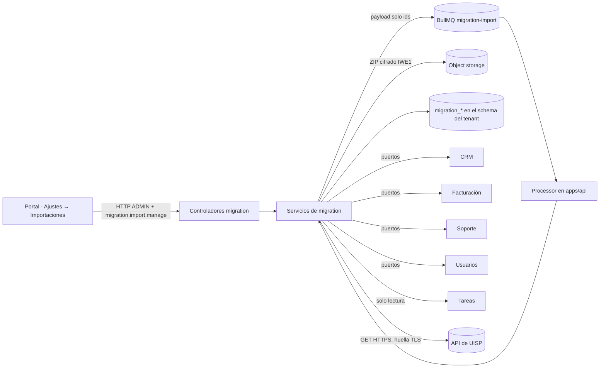
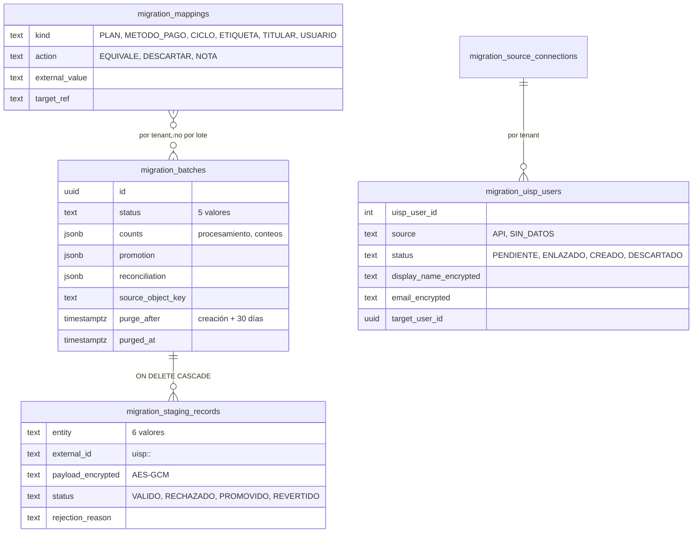
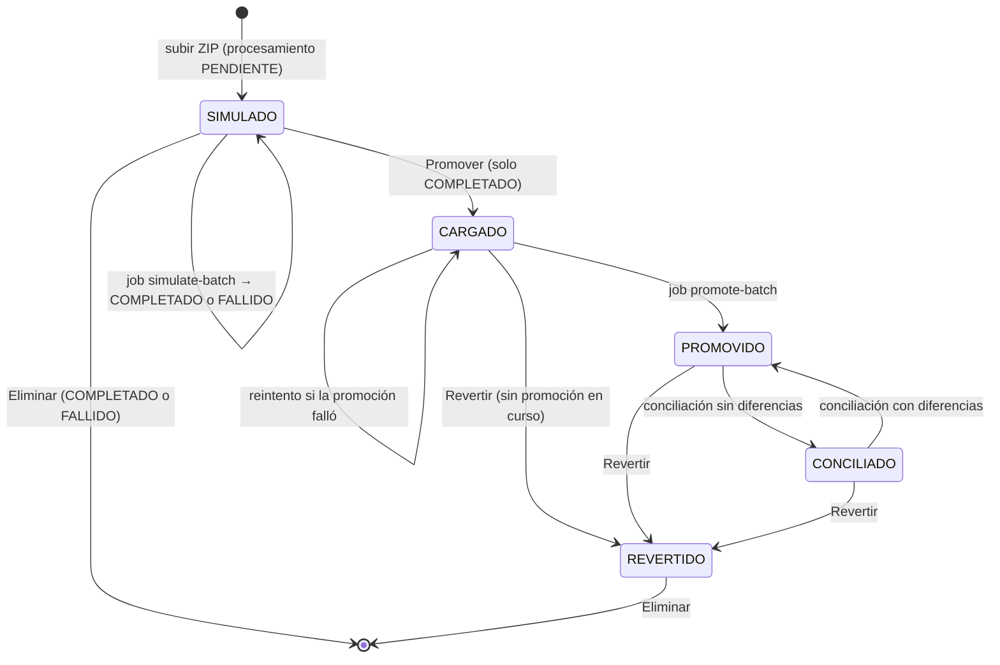
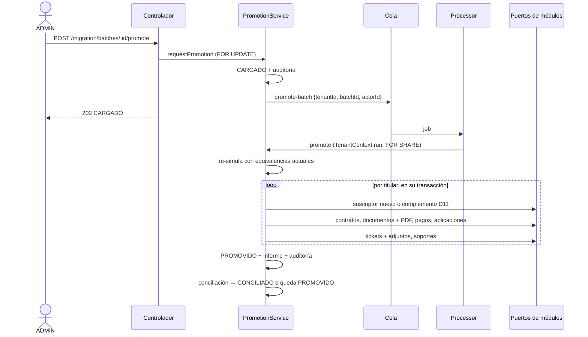
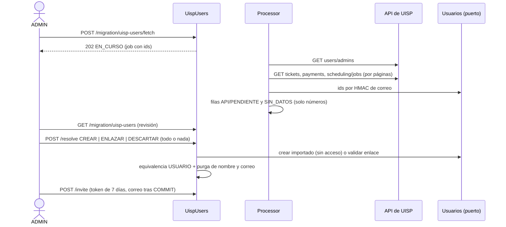
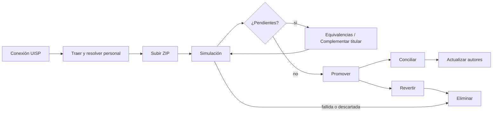

# HLD — Transversal · Importación desde UISP · v1.0 (tal como está construido)

**Versión:** 1.0
**Estado:** Borrador
**Alcance:** documenta lo construido; no aprueba cambios. Los hallazgos de §16 esperan decisión del CTO.
**Fecha:** 2026-11-28
**Autor:** Claude Code, con cinco investigaciones paralelas (lotes, promoción, conector y personal, portal, sec-eng)
**Línea base:** `main` en `301cfb51` (2026-11-26); las citas `ruta:línea` son de ese commit.
**Decisiones:** [ADR-110](../adrs/ADR-110-Importacion-por-Lotes-desde-UISP-y-Portabilidad.md) v1.4 (Aprobado) · [ADR-111 (propuesto)](../adrs/ADR-111-Importacion-Multi-Fuente.md) v1.0, fuera de este HLD

## 0. Fuentes

| Tipo | Documento | Qué fija |
| --- | --- | --- |
| Spec base | [2026-11-10 exportación e importación del suscriptor](../specs/2026-11-10-transversal-exportacion-importacion-suscriptor-uisp.md) v1.1 | Alcance del lote ZIP |
| Spec | [2026-11-15 complementar titular](../specs/2026-11-15-transversal-importacion-uisp-complementar-titular.md) v1.0 | D11 |
| Spec | [2026-11-15 usuarios](../specs/2026-11-15-transversal-importacion-uisp-usuarios.md) v1.3 | D15 |
| Spec | [2026-11-21 estado del suscriptor](../specs/2026-11-21-transversal-importacion-estado-del-suscriptor-v1.1.md) v1.1 | Estado `PROSPECT` del importado |
| Plan | [2026-11-12](../plans/2026-11-12-transversal-importacion-uisp.md) · [2026-11-15 titular](../plans/2026-11-15-transversal-importacion-uisp-complementar-titular.md) · [2026-11-15 usuarios](../plans/2026-11-15-transversal-importacion-uisp-usuarios.md) | Olas |
| Informe | [Cierre](../informes/INFORME-TRANSVERSAL-IMPORTACION-UISP-CIERRE-v1.0.md) · [Complemento](../informes/INFORME-TRANSVERSAL-IMPORTACION-UISP-COMPLEMENTO-v1.0.md) · [Usuarios](../informes/INFORME-TRANSVERSAL-IMPORTACION-UISP-USUARIOS-v1.0.md) | Evidencia de cada fase |

No existe PRD propio: el alcance vive en las specs. Este HLD no repite sus reglas; describe dónde y cómo quedaron en el código.

## 1. Vista general

La empresa trae su cartera de UISP a iWana por **lotes reversibles**. Cada lote sube los ZIP que UISP exporta por cliente, los simula sin tocar iWana, espera las equivalencias de catálogo y, al promoverse, escribe en CRM, Facturación y Soporte por los puertos de cada módulo. Aparte, un **conector de solo lectura** a la API de UISP trae al personal para atribuir tickets y pagos a usuarios de iWana.

Por SQL propio la migración solo toca tablas `migration_*`; todo lo que lee o escribe en CRM, Facturación, Soporte, Usuarios y Tareas pasa por los puertos de §8.2. La única lectura directa fuera de su frontera es `public.tenants`, para resolver el tenant de un job (`migration-import.processor.ts:162`, `migration-simulation.service.ts:82`).

## 2. Componentes

Rutas relativas a `apps/api/src/modules/migration/` salvo que se indique otra.

| Componente | Responsabilidad |
| --- | --- |
| `migration.controller.ts` | `migration/batches` y `migration/mappings`; tenant desde `TenantContext` (:85-88) |
| `migration-uisp-users.controller.ts` | `migration/uisp-connection` y `migration/uisp-users` |
| `migration-upload-size.interceptor.ts` | 411 sin `Content-Length`, 413 sobre 201 MiB, antes de multer |
| `zip/safe-zip-reader.ts` | Inspección y lectura defensiva con JSZip, en memoria |
| `migration-batches.service.ts` | Alta del lote, cifrado y subida, lista, informe, pendientes, borrado (D16) |
| `uisp/uisp-parser.ts` · `uisp/uisp-simulation.ts` | Paquete tipado del ZIP · simulación pura (registros, conteos, motivos, pendientes) |
| `migration-simulation.service.ts` | Ejecuta la simulación y reemplaza las intermedias bajo `FOR UPDATE` |
| `migration-mappings.service.ts` | Equivalencias por tenant (§7) |
| `migration-promotion.service.ts` | Promoción, conciliación y «Actualizar autores» (§8) |
| `migration-revert.service.ts` · `migration-purge.service.ts` | Reversión por lote (D7) · retención de 30 días (D10) |
| `migration-source-connection.service.ts` · `uisp-api/*` | Conector UISP: clave cifrada, huella TLS, cliente con defensa SSRF, `users/admins`, procesos, métodos de pago |
| `migration-uisp-users.service.ts` · `migration-uisp-users-resolution.service.ts` | Revisión del personal: traer, listar, crear, enlazar, descartar e invitar |
| `migration-import.processor.ts` | Único consumidor de la cola, en `apps/api` por [ADR-105](../adrs/ADR-105-Jobs-de-Dominio-Procesados-en-la-API.md); `concurrency: 1` (:48) |
| `migration-crypto.ts` | ZIP IWE1, intermedias AES-256-GCM con la clave PII, HMAC de documento y correo |
| `privacy/migration-titular-erasure.participant.ts` | Supresión del titular (Ley 1581) |
| `ports/*` + `apps/api/src/modules/{crm,billing,assurance,tasks,users}/migration-adapters/*` | Escrituras y lecturas en los módulos dueños (§8.2) |
| `packages/shared/src/contracts/migration/*` | Contratos Zod, límites y códigos de error |
| `apps/portal/src/components/settings/migration/*` | UI (§13) |

## 3. Modelo de datos

Migraciones tenant 194 (tablas), 196 y 199 (`external_id`, `import_batch_id`, promoción), 198 (permiso), 210 (`TITULAR`), 211 (personal).

Invariantes por CHECK: `rejection_reason` si y solo si `RECHAZADO`; `REVERTIDO` si y solo si `reverted_at`; una fila de personal resuelta no guarda PII; `target_user_id` si y solo si `ENLAZADO` o `CREADO`; `DESCARTAR` y `NOTA` solo en `ETIQUETA`. En destino, cada fila promovida lleva `external_id` (índice único parcial por tenant) e `import_batch_id`.

## 4. Ciclo del lote

`status` dice dónde está el lote; `counts.procesamiento` dice si la simulación terminó. El lote nace `SIMULADO` antes de simularse (`migration-batches.service.ts:216`).

La purga es una marca aparte (`purged_at`), no un estado: un lote purgado ya no se promueve ni actualiza autores.

## 5. Subida y lectura del ZIP

Los topes de tamaño, número de archivos y entradas, descompresión y razón de compresión viven en `MIGRATION_IMPORT_LIMITS` (`packages/shared/src/contracts/migration/migration-import.contract.ts:52-72`) y `migration.constants.ts`; las reglas de ruta (sin traversal, NUL ni enlaces simbólicos, también sobre el nombre original) en `zip/safe-zip-reader.ts:47-86`. La aceptación exige extensión `.zip`, firma PK y un tipo MIME de la lista (`migration-batches.service.ts:58-64`).

El ZIP se cifra (IWE1) y se sube bajo `<schema>/migration/<id>/`; el alta del lote, la auditoría y el encolado van en una transacción, y si falla se borran los objetos subidos.

**Se lee:** `client.json`, `services.json`, `invoices.json` (+ PDF por id o número), `payments.json`, `tickets.json` (+ adjuntos de `tickets/<id>/`), `documents/*`, y `jobs.json` solo para contar `tareasSinFuente`. **No se lee:** `quotes`, `refunds`, `payment_plans`.

## 6. Simulación

Entidades: `SUSCRIPTOR`, `CONTRATO`, `DOCUMENTO_COBRO`, `PAGO`, `TICKET`, `SOPORTE_DOCUMENTAL`, con `external_id = uisp:<prefijo>:<id>` (D3). La simulación es una función pura (`uisp/uisp-simulation.ts`) que produce las intermedias, los conteos, los rechazos por motivo y los **pendientes de equivalencia**. Anticipa los rechazos de la promoción (titular anonimizado, conflicto por HMAC del documento, datos obligatorios por `uisp-titular-required.ts`, equivalencia faltante). Con conexión D15, nombra los métodos de pago desde `GET /crm/api/v1.0/payment-methods` (D17).

## 7. Equivalencias

| Kind | Origen | Destino | Quién la crea |
| --- | --- | --- | --- |
| `PLAN`, `CICLO`, `METODO_PAGO` | id de UISP | catálogo de iWana | Editor de pendientes |
| `ETIQUETA` | etiqueta manual de UISP | etiqueta de iWana, `DESCARTAR` o `NOTA` | Editor de pendientes |
| `TITULAR` | cliente de UISP | suscriptor existente (D11), validado por HMAC al guardar y al promover | «Complementar este titular» |
| `USUARIO` | número de personal | usuario de iWana | Solo la revisión de personal (§10); el endpoint genérico lo rechaza (`migration-mappings.service.ts:64-71`) |

Un valor sin equivalencia rechaza el registro con motivo (D4); las equivalencias son por tenant y sobreviven al lote.

## 8. Promoción

### 8.1 Secuencia

Cada titular abre su transacción y un `SAVEPOINT`; cada registro, otro. Un rechazo deshace solo ese registro, y los dependientes de un titular rechazado quedan `DEPENDE_DE_TITULAR_RECHAZADO`. La idempotencia viene de buscar el `external_id` antes de crear (`migration-promotion.service.ts:896`). Titular nuevo: entra `PROSPECT`. Complemento D11: solo completa campos vacíos y sus contratos entran `TERMINATED`.

### 8.2 Puertos

| Puerto | Módulo dueño | Escribe |
| --- | --- | --- |
| `MigrationCrmImportPort` | CRM | `subscribers`, `contracts`, `crm_lifecycle_changes`, `subscriber_documents`; party por `IPartyWritePort` |
| `MigrationBillingImportPort` | Facturación | `billing_documents` `IMPORTADO`, líneas, pagos, aplicaciones |
| `MigrationSupportImportPort` | Soporte | `support_tickets`, comentarios, adjuntos |
| `MigrationWorkOrderReferencesPort` | Tareas | Nada: cuenta OT para bloquear la reversión |
| `MigrationTitularLookupPort` | CRM | Nada: lee titulares y marcas de privacidad |
| `MigrationUserDirectoryPort` · `MigrationUserProvisioningPort` | Usuarios | Busca por HMAC de correo · crea importados, invita |
| `SubscriberTagAssignmentPort` | CRM | Etiquetas con `import_batch_id` |

### 8.3 Atribución

Tickets, comentarios y pagos van a nombre del usuario de la equivalencia `USUARIO`; sin ella, a nombre de quien importa (`uisp/uisp-user-attribution.ts`). «Actualizar autores» (`POST /migration/batches/:id/refresh-authors`) re-atribuye solo lo que sigue a nombre del importador, en lotes promovidos y no purgados.

## 9. Conciliación, reversión y borrado

- **Conciliación (D6):** compara por titular saldo, facturado y pagado con UISP; con diferencias el lote queda `PROMOVIDO` con informe.
- **Reversión (D7):** una transacción. Bloquean, sumados por motivo, los contratos, soportes, etiquetas, documentos, pagos, aplicaciones, tickets, actividad y OT creados después; con bloqueos responde 409 `MIGRATION_REVERT_BLOCKED` y no toca nada. Borra en orden inverso de dependencias y retira los objetos después del commit.
- **Borrado (D16):** `DELETE /migration/batches/:id` solo en `SIMULADO` terminado o `REVERTIDO`; borra primero los ZIP y luego la fila (las intermedias caen en cascada).

## 10. Conector UISP y personal (D15)

- **Fila de revisión:** `PENDIENTE` → `ENLAZADO` | `CREADO` | `DESCARTADO`, definitivo. Una `SIN_DATOS` pasa a `API` si el número reaparece. Las `PENDIENTE` se borran a los 30 días o al retirar la conexión.
- **Creación:** activo en UISP → `PENDING_VERIFICATION`; inactivo o sin datos → `INACTIVE` y fuera de Programación. Sin correo propio o con uno tomado → `uisp-<n>@importado.invalid`. Nadie entra sin invitación. Si un administrador restablece la contraseña de un importado, entregarla equivale a activarlo, y la recuperación por enlace exige correo verificado ([ADR-117](../adrs/ADR-117-Ingreso-con-Contrasena-Temporal-en-el-Portal.md) D3 y D6).
- **Conector:** HTTPS, solo `GET`, 15 s por intento, 2 reintentos, respuesta ≤ 5 MiB, sin redirecciones, TLS ≥ 1.2, huella SHA-256 opcional comparada antes de enviar la clave, defensa SSRF con validación de DNS dentro del connect. Excepción de hosts privados prohibida en producción (`apps/api/src/app.config.ts:469`).

## 11. Cola `migration-import`

| Job | Qué hace | Idempotencia |
| --- | --- | --- |
| `simulate-batch` | Simula un lote | jobId fijo por lote; reemplaza las intermedias bajo `FOR UPDATE` |
| `promote-batch` | Promueve un lote | `external_id` (jobId aleatorio) |
| `fetch-uisp-users` | Lee el personal de UISP | jobId con marca de tiempo |
| `purge-sweep` · `purge-tenant` | Retención diaria (03:30 Bogotá) · por tenant, 50 lotes por vuelta | jobId fijo · por tenant y fecha |

Reintentos y payloads en `migration.constants.ts` y en los esquemas del processor. Payloads `.strict()` en Zod; uno inválido o un error permanente termina en `UnrecoverableError`. `removeOnFail` 14 días.

## 12. API

Todos los endpoints: JWT + `@Roles(ADMIN)` + `migration.import.manage` (permiso sembrado por la 198 solo al perfil de administración); auditoría escrita por el servicio (`@SkipAudit`).

| Método | Ruta | Límite |
| --- | --- | --- |
| POST · GET | `/migration/batches` | 10/min · global |
| GET | `/migration/batches/:id` · `/:id/pending-mappings` | global |
| POST | `/:id/promote` · `/:id/refresh-authors` | 10/min |
| POST · DELETE | `/:id/reconcile` · `/:id/revert` · `DELETE /:id` | global |
| GET · POST · PATCH · DELETE | `/migration/mappings` | global |
| GET · PUT · DELETE | `/migration/uisp-connection` | global · 10/min · global |
| POST | `/migration/uisp-connection/test` | 10/min |
| POST · GET · POST · POST | `/migration/uisp-users/fetch` · `/` · `/resolve` · `/invite` | 10/min · global · 10/min · 10/min |

## 13. Portal

Ruta `/dashboard/settings/imports` (detalle en `/[id]`); acceso por `useMigrationAccess` (ADMIN + permiso).

| Sección | Acciones |
| --- | --- |
| Nuevo lote | Subir y simular |
| Lotes | Ver informe · Eliminar (simulados o revertidos); sondeo cada 4 s |
| Conexión con UISP | Probar y guardar · Probar · Reemplazar clave · Retirar |
| Usuarios de UISP | Traer (sondeo, 30 intentos) · Crear con rol · Enlazar · Enlazar con… · Descartar · Invitar (≤ 100 por acción) |
| Detalle del lote | Promover · Conciliar · Actualizar autores · Revertir (con bloqueos) · informe por entidad · equivalencias pendientes · Complementar titular |

## 14. Seguridad y privacidad

| Dato | Tratamiento |
| --- | --- |
| ZIP | IWE1 en storage; prefijo del schema revalidado antes de leer o borrar |
| Intermedias | AES-256-GCM con clave PII; inventario K2 (`apps/api/src/cli/reencrypt-aes.pii.ts`); purga a 30 días |
| Clave de UISP · nombre y correo del personal | Cifrados; en K2; nunca en respuestas, logs ni auditoría; nombre y correo se purgan al resolver (CHECK) |
| Documento y correo | Solo HMAC para coincidir |
| Auditoría, logs, colas | Solo ids, números de UISP, códigos y conteos |
| Supresión del titular | Borra sus intermedias promovidas y las de sus dependientes, y adelanta la purga de los lotes |

Revisión de AI-SEC-ENG hecha para este HLD el 2026-11-28 (STRIDE, estática, sin informe aparte): sin hallazgos críticos ni altos; los suyos son M-1, M-2 y B-1 a B-3 de §16. La cabecera de ADR-110 sigue con «Revisión pendiente: AI-SEC-ENG».

## 15. Pruebas

| Capa | Dónde |
| --- | --- |
| Unitarias API | `apps/api/src/modules/migration/**/*.spec.ts` y `apps/api/src/modules/*/migration-adapters/*.spec.ts` |
| Integración Postgres (`DB_NAME=test`) | `migration-simulation`, `migration-promotion` y `migration-uisp-users` `.postgres.integration.spec.ts`; migraciones 194–198 y 211 |
| Portal | `apps/portal/src/components/settings/migration/*.spec.tsx` |
| E2E | `e2e/tests/portal-importacion-uisp-live.spec.ts` y `portal-importacion-uisp-usuarios-live.spec.ts`, con axe en claro y oscuro |

La spec de estado v1.1 (H4) registró ambos E2E en rojo en el CI de `main` (run 44908811979); no se verificó su estado después. Sin E2E: eliminar lote, «Enlazar con…», reemplazar o retirar la clave, reintento de promoción.

## 16. Hallazgos

Severidad de quien investigó. Ninguno está corregido en este documento.

| ID | Sev. | Área | Hallazgo | Dónde |
| --- | --- | --- | --- | --- |
| A-1 | Alta | Reversión | Revertir un lote purgado no deshace el complemento D11 (campos completados, `external_id`, contactos) y deja parties huérfanos: `revert` no mira `purged_at` y las intermedias ya no existen | `migration-revert.service.ts:115-139`, `:81-104` |
| M-1 | Media | Privacidad | Un titular suprimido puede volver a entrar: la supresión borra el HMAC del documento y el lookup depende de él o del `external_id` (sec-eng M-01) | `privacy/migration-titular-erasure.participant.ts:60-67`; `crm-migration-titular-lookup.adapter.ts:40-49` |
| M-2 | Media | Privacidad | La purga de 30 días no corre en tenants no `ACTIVE` (sec-eng M-02) | `migration-import.processor.ts:160-164` |
| M-3 | Media | Privacidad | Reimportar un titular con datos bloqueados le agrega historial; D11 pide rechazo | `migration-promotion.service.ts:1121-1124`; `uisp/uisp-simulation.ts:370-374` |
| M-4 | Media | Ciclo | Un lote puede quedar atascado sin salida: simulación `PENDIENTE` u `OMITIDO`, o promoción colgada, no se pueden borrar, re-simular ni revertir | `migration-simulation.service.ts:151-174`; `migration-batches.service.ts:427`; `migration-import.processor.ts:120-126` |
| M-5 | Media | Concurrencia | El borrado retira los ZIP antes de bloquear la fila, y la purga no excluye lotes `CARGADO` en promoción | `migration-batches.service.ts:378-397`; `migration-purge.service.ts:44-52` |
| M-6 | Media | Operación | Una cola, `concurrency: 1`, para todos los tenants en el proceso HTTP de la API; descomprime hasta 1 GiB por lote ahí | `migration-import.processor.ts:48` |
| M-7 | Media | Equivalencias | `NOTA` no hace nada: se trata igual que `DESCARTAR` | `migration-promotion.service.ts:1288` |
| M-8 | Media | Portal | Sin pantalla para ver, corregir o borrar equivalencias guardadas (los métodos del cliente existen y nadie los usa) | `apps/portal/src/lib/api-client.ts:7185-7211` |
| M-9 | Media | Portal | Un ADMIN ve «No tienes acceso» mientras cargan los permisos, y se queda así si quedan degradados | `useMigrationAccess.ts:10-13` |
| M-10 | Media | Portal | Un fallo del sondeo no se muestra si ya hay datos: la pantalla queda con datos viejos | `MigrationBatchDetailClient.tsx:376-378`; `MigrationUispUsersSection.tsx:110-112` |
| M-11 | Media | Personal | Correo enmascarado inalcanzable (solo ADMIN entra) y tres documentos dicen cosas distintas | `migration-uisp-users.controller.ts:155`; `migration-uisp-users.service.ts:349-361` |
| M-12 | Media | Rendimiento | La lista de personal descifra todas las intermedias TICKET y PAGO vigentes en cada `GET` y dentro de `resolve` con filas bloqueadas; sin paginación | `migration-uisp-users.service.ts:348`; `migration-uisp-users-resolution.service.ts:408` |
| B-1 | Baja | Seguridad | DoS por directorio central: JSZip materializa todas las entradas antes del tope | `zip/safe-zip-reader.ts:88-107` |
| B-2 | Baja | Seguridad | Faltan NAT64, 6to4 e IPv4 compatible en la lista SSRF; cualquier puerto vale | `uisp-api/uisp-api.client.ts:134-153` |
| B-3 | Baja | Seguridad | `GET /migration/uisp-users` sin `Cache-Control: no-store` | `migration-uisp-users.controller.ts:185-189` |
| B-4 | Baja | Personal | CREAR sobre una fila con coincidencia crea una segunda cuenta `.invalid` | `migration-uisp-users-resolution.service.ts:200-213` |
| B-5 | Baja | Personal | El job se encola dentro de la transacción y sin deduplicación de lecturas concurrentes | `migration-uisp-users.service.ts:142`; `migration.constants.ts:38` |
| B-6 | Baja | Reversión | Las OT sobre contratos históricos de un complementado no bloquean (solo se cuenta por suscriptor) | `tasks-migration-references.adapter.ts:15-20` |
| B-7 | Baja | Privacidad | `reconciliation` guarda para siempre ids y montos del titular; el manifiesto describe mal la equivalencia `TITULAR` | `apps/api/src/cli/text-erasure-manifest.ts:4047-4067` |
| B-8 | Baja | Ciclo | El tope de 1 GiB marca el lote `FALLIDO` sin código ni causa guardada | `migration-simulation.service.ts:137-139` |
| B-9 | Baja | Portal | Lista de lotes sin paginación (50); «Promovidos» ignora `existentes`; el contrato acepta `USUARIO` que el servicio rechaza | `MigrationImportsClient.tsx:127`; `migration-import.contract.ts:486-494` |
| B-10 | Baja | Robustez | Internos de JSZip (`_data`, `unsafeOriginalName`); objetos huérfanos si el proceso cae entre subir e insertar; un lote con clave ajena nunca se purga | `zip/safe-zip-reader.ts:64-76`; `migration-batches.service.ts:202-212`; `migration-purge.service.ts:58-61` |
| X-1 | Sin verificar | Privacidad | PDF y soportes IWE1 no entran en el re-cifrado K2: tras dos rotaciones de clave dejarían de leerse | — |

## 17. Nombres del personal

`firstName` y `lastName` de UISP viajan separados hasta crear el usuario (JSON cifrado en `display_name_encrypted`, compatible con el texto plano anterior), y «Traer usuarios» corrige a los importados que conservan el nombre mal partido (`repairImportedUserNames`, guardado por el nombre viejo; auditoría `motivo: NOMBRE_SEPARADO` sin nombres). El resumen de la lectura suma `nombresCorregidos` a `procesos`. Las filas «sin datos» siguen recibiendo un solo texto y lo parten por el primer espacio.

## 18. Discrepancias documentales

- ADR-110 D15 dice «huella TLS fijada»; el código y la spec de usuarios la hacen opcional.
- La cabecera de ADR-110 ubica el módulo en «plataforma (worker)»; el processor vive en `apps/api`, como fija ADR-105.
- La spec de usuarios §3 ubica el cliente HTTP en el worker; vive en `apps/api`.
- La spec base §3.2 escribe `uisp:<id>`; el código y D3 usan `uisp:<entidad>:<id>`. §3.3 dice «simulación sin escrituras»; escribe las intermedias, como pide D2.
- La spec base dice que las etiquetas derivadas «se descartan»; el código exige un `DESCARTAR` manual.
- La spec de complemento pide `linkedExternalId: boolean`, contactos con `import_batch_id` y barrio; el código guarda el texto, retira contactos por id y no completa barrio.
- La spec de estado v1.1 cita `crm-migration-import.adapter.ts:195`; está en la 226.

---

Se omitió: ADR-111 (propuesto), multi-fuente, y la portabilidad D12, que no están construidos. No se verificó: ninguna corrida de pruebas ni de CI; los conteos son por lectura del código. Riesgo: A-1, M-1 y M-2 tocan datos personales y deberían decidirse antes de G7.
