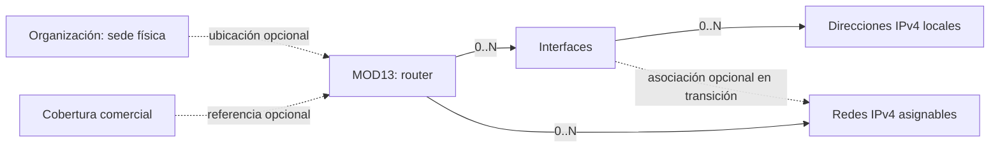

# INFORME — MOD13: interfaces, ubicación y registro de redes

**Versión:** 1.0  
**Estado:** Opción B y ADR-101 aprobados; G1–G4 PASS/cerrados; G4 v1.12/v1.13 históricos y re-sync v1.15 congelado; O2-H/O2-M/FE integrados; G6 NO PASS; CA-R12 y rollback abiertos; captura IP deshabilitada  
**Fecha:** 2026-10-27  
**Autor:** AI-EM-ARCH  
**Modo:** Product Architect + Architect + EM + Orchestrator  
**Origen:** seis observaciones del usuario sobre `/dashboard/network/routers` y el registro de redes IPv4.

## 1. Dictamen

**Aprobación humana, 2026-10-26:** el usuario indicó «Apruebo la opción B». Queda elegida B para ejecutar la secuencia definida, comenzando por Ola 0. Esta aprobación resuelve la elección de alcance; no equivale a afirmar que existen contratos nuevos congelados, factibilidad final o evidencia de implementación. No se vuelve a solicitar aprobación de la misma opción.

**Continuación y entrega del encargo integral, 2026-10-26:** se escribieron la adenda PRD y los borradores de modelo/UX/API. Las tres sesiones especialistas se interrumpieron por límite de uso antes de cerrar su revisión cruzada; esos documentos seguían en revisión en ese corte. Ante la solicitud explícita de un prompt de ejecución, se emitieron el [encargo integral](../prompts/PROMPT-MOD13-INTERFACES-IPV4-EJECUCION-v1.0.md) y los launchers iniciales. El launcher v1.2 conserva el corte O2-C parcial/G4 bloqueado; el [launcher vigente v1.3](../prompts/PROMPT-MOD13-INTERFACES-IPV4-EJECUCION-LAUNCH-v1.3.md) y el plan v1.7 registran el freeze contract-first y el siguiente dispatch. El encargo de O0 conserva su alcance documental original.

Recomiendo **B: catálogo progresivo de interfaces y direcciones IPv4 dentro de MOD13**, con creación de redes desde el contexto del router, reutilización de datos explícitos y gateway confirmado. Es un cambio de modelo y flujo; las ayudas incorporadas previamente no resuelven por sí solas múltiples interfaces.

La sede física permanece en Organización. El nodo técnico pertenece al futuro NMS y el nodo comercial a cobertura. **No se añadirá un tipo «Nodo» a Sedes**, conforme a [ADR-044, aprobado](../adrs/ADR-044-Separacion-OrganizationSite-NmsNode.md), D1–D3. Esta precisión completa la respuesta inicial de la conversación: registrar el lugar físico en Organización no equivale a crear allí el nodo técnico.

Esta sesión produce análisis y planificación. La corrección local del botón y las ayudas del turno anterior se conservan como antecedente, con evidencia en el [informe vivo de UI](INFORME-MOD13-REVISION-UI-v1.0.md). No se vuelven a implementar ni se les atribuye evidencia nueva de E2E.

## 2. Evidencia del sistema actual

| Observación                                                        | Evidencia                                                                                                                                | Implicación                                                                                           |
| ------------------------------------------------------------------ | ---------------------------------------------------------------------------------------------------------------------------------------- | ----------------------------------------------------------------------------------------------------- |
| LAN es un texto opcional de 64 caracteres                          | `packages/database/src/entities/network-router.entity.ts:29`; `packages/shared/src/contracts/network/network.bodies.ts:62`               | No hay colección de interfaces ni IP configuradas; un texto con CIDR no crea una red                  |
| Router y red son entidades diferentes                              | `packages/database/src/entities/ipv4-network.entity.ts:17`; `apps/api/src/modules/network/network-catalog.service.ts:337`                | El router identifica equipo; cada red define un bloque y sus reglas de asignación                     |
| Guardar router no transmite contexto al alta de red                | `NetworkRouterDrawer.tsx:152`; `Ipv4NetworkDrawer.tsx:120`; `Ipv4NetworkCatalogClient.tsx:530`, en `apps/portal/src/components/network/` | Se vuelve a pedir elegir router y capturar información sin una continuidad clara                      |
| Las referencias de sede/cobertura no se validan más allá del UUID  | `apps/api/src/modules/network/network-catalog.service.ts:118` y `:185`                                                                   | Riesgo de integridad; no es prueba de exposición de datos entre empresas                              |
| «Sin sede/nodo» no desasocia al editar                             | `packages/shared/src/contracts/network/network.bodies.ts:111`; servicio anterior `:195`                                                  | La omisión conserva la asociación, y `null` no está admitido                                          |
| CIDR y gateway son inmutables al editar red                        | [HLD v1.1](../hlds/HLD-MOD13-RED-APROVISIONAMIENTO-FASE-01-v1.1.md), §API de catálogo; `network-catalog.service.ts:409`                  | No deben cambiar en cascada al editar una interfaz                                                    |
| IPAM omite red, difusión, gateway, exclusiones manuales e IP vivas | `apps/api/src/modules/network/ipam.service.ts:136`, `:185`, `:221`                                                                       | Validación manual, selección automática y ocupación deben compartir la nueva protección de IP locales |
| Las exclusiones adicionales no se comprueban contra el bloque      | `apps/api/src/modules/network/network-catalog.service.ts:651`                                                                            | Añadir validación de pertenencia y conservar protección de servicios existentes                       |
| No hay descubrimiento RouterOS en la entrega vigente               | [ADR-098, aprobado](../adrs/ADR-098-IPAM-y-Aprovisionamiento-Certificado-MOD13.md), D9                                                   | El dato registrado es declarado por el operador, no observado automáticamente                         |

Las rutas citadas sin prefijo de archivo en la tabla conservan el prefijo de su fila. Las líneas corresponden al estado inspeccionado el 2026-10-26; la implementación posterior puede desplazarlas.

## 3. Opciones comparadas

| Opción                                            | Qué resuelve                                                                         | Costo relativo y límite                                                                | Recomendación                                                     |
| ------------------------------------------------- | ------------------------------------------------------------------------------------ | -------------------------------------------------------------------------------------- | ----------------------------------------------------------------- |
| A. Mejorar recorrido manteniendo el modelo        | Router preseleccionado, nombre de red sugerido y ayudas                              | Bajo; no representa varias interfaces ni aporta una fuente fiable para gateway         | Contención y correcciones de integridad aprovechables dentro de B |
| **B. Interfaces y direcciones explícitas**        | Varias LAN, varias IP por interfaz, redes en contexto y reutilización de información | Medio; requiere migración aditiva, contratos, evolución de IPAM y pruebas concurrentes | **Elegida como propuesta**                                        |
| C. Descubrimiento RouterOS y gestión de nodos NMS | Inventario observado, topología y conciliación                                       | Alto; conectividad, credenciales y otros boundaries/fases                              | Diferir; no es requisito previo de B                              |

Los costos son comparativos, no estimaciones de duración ni compromisos de calendario. FE-PLATFORM y SR-FULL deben estimar los bloques tras formalizar sus contratos.

## 4. Solución para los seis puntos

1. **Interfaz LAN.** Sustituir progresivamente el campo singular por una colección de interfaces del router. Cada interfaz admite cero o varias direcciones IPv4 y varias redes asociadas. Nombre y clase describen una interfaz ya existente: no se crean bridges, VLAN ni configuraciones en el equipo. El alta básica del router no exige inventariarlas todas.
2. **Sede, nodo y monitoreo.** La sede es el lugar físico; puede ser oficina, base técnica o monitoreo operativo. No filtrar únicamente sedes de monitoreo, porque un router también puede estar en una oficina. Crear el nodo técnico requiere la definición de NMS prevista por ADR-044. Mantener cobertura como referencia opcional separada. Los sitios deben cumplir datos reales de Organización; no inventar contactos para instalaciones sin personal ni relajar su contrato en este corte.
3. **Estado.** Conservar el botón ya corregido, badge y texto de acción siguiente. Explicar el efecto: desactivar impide nuevas reservas y conserva los servicios y direcciones existentes, según R13 del [PRD v1.1 aprobado](../prds/PRD-MOD13-RED-APROVISIONAMIENTO-FASE-01-v1.1.md). No confundir este estado del catálogo con apagar el equipo o detectar su disponibilidad física.
4. **Nombre y bloque.** El nombre del router identifica equipo. El nombre de la red es una etiqueta sugerida y editable, por ejemplo `Red 192.0.2.0/24`; no se exige inventar otro nombre. Incorporar «Guardar y añadir red» y «Añadir red» en el contexto del router; el catálogo global IPv4 permanece. El bloque se calcula cuando existe una IP/prefijo explícito apto y se muestra para revisión.
5. **Gateway.** Reutilizar direcciones de interfaz registradas, mostrar su origen y proponer gateway/bloque. Varias candidatas requieren elección. Sin dato suficiente, admitir «IP del gateway con máscara» o bloque y gateway por separado. Nunca asumir `.1`, reutilizar silenciosamente la IP de administración ni deducir un pool desde `/32`. El operador confirma; el gateway queda persistido en la red y no se actualiza silenciosamente después.
6. **Exclusiones.** Usar «IP excluidas de asignación» para las exclusiones adicionales. Separarlas visualmente de las protecciones automáticas: red, difusión, gateway y las IP locales que se registren con la evolución B. Las IP locales todavía no están protegidas por una colección en la implementación actual. Mostrar capacidad resultante sin contar dos veces una IP y sin confundir exclusiones con servicios en estado «Reservado».

Ejemplo sintético: seleccionar `192.0.2.1/24` de `bridge-clientes` permite proponer bloque `192.0.2.0/24` y gateway `192.0.2.1`. Registrar `192.0.2.254/24` debe proponer `.254`, no `.1`. Si el gateway configurado es virtual y distinto de la IP física, se conserva el valor confirmado manualmente.

## 5. Modelo e invariantes propuestos

Es un modelo **propuesto**, no una descripción de tablas ya implementadas. NMS conserva su propio contexto futuro; no se incorpora a este corte.

- Dentro de MOD13: interfaces, direcciones y asociaciones con router/tenant consistentes; índices por patrones de lectura y unicidad de nombre de interfaz por router. La dirección configurada conserva su prefijo; el pool conserva su CIDR, rango y gateway.
- Una dirección de interfaz puede tener `/32`; los pools siguen limitados a `/16–/30`. Registrar el primer dato no modifica las restricciones del segundo. Se conservan la prohibición actual de solapamientos por empresa y la unicidad de IP viva; no se agregan VRF.
- Las IP locales registradas dentro de un bloque quedan protegidas por su dirección host, incluso si pertenecen a otro router de la misma empresa o la interfaz se inactiva. No se mezclan silenciosamente con `excludedIps` del operador.
- Registrar o editar una IP local ya reservada/activa responde conflicto y revierte toda la operación; nunca libera o reasigna un servicio para hacer espacio.
- Las mutaciones de direcciones, la creación de pools y las reservas se coordinan transaccionalmente. El HLD debe fijar orden de locks y probar las carreras dirección↔reserva y dirección↔alta de pool. La ocupación usa el mismo conjunto deduplicado de restricciones.
- Sedes/cobertura se consultan por puertos tipados de sus dueños. Cada identificador nuevo debe pertenecer a la empresa y al router correspondiente. Un ID ajeno y uno inexistente no deben revelar información diferente.
- PATCH de referencias: omisión conserva, `null` desasocia, UUID válido valida y asigna. Las referencias históricas inactivas siguen legibles; guardar otro campo no exige reemplazarlas. Una asociación nueva exige destino activo.

**Políticas propuestas para cerrar G1–G3:** inactivar una interfaz impide asociaciones nuevas y reservas nuevas en sus redes vinculadas, pero conserva servicios y protecciones de sus IP. Las redes legacy sin interfaz siguen las reglas actuales de router/red. No permitir borrado físico de interfaces o direcciones referenciadas en este primer corte; el retiro de infraestructura queda fuera y no se simula vaciando campos. La edición de datos de identificación no altera hosts ni gateways. Los cambios de direcciones se revisan como operaciones explícitas con validación de conflictos y referencias. Al cambiar un candidato, una sugerencia no confirmada puede recalcularse; un valor editado o confirmado por el operador se conserva y se solicita revisión cuando ya no sea coherente. El contrato de API debe definir un código específico de IP protegida por infraestructura y distinguirlo de IP ocupada por un servicio, con mensaje de producto claro.

## 6. Migración y operación

1. Migración tenant manual y aditiva: tablas nuevas y asociación de red nullable, numeración elegida al ejecutar, registro en `runner.ts`. No fijar ahora un número que otra sesión pueda ocupar.
2. Conservar `lan_interface`, nombres, CIDR, gateway, IP, reservas y servicios actuales. Un valor libre que parezca CIDR no acredita una interfaz ni una puerta de enlace. La normalización exige confirmación humana; no hay backfill inferido.
3. Las redes históricas sin interfaz continúan utilizables. Registrar una red manual sigue disponible cuando no hay dirección local suficiente.
4. Desplegar primero backend/IPAM compatible con protección de direcciones; habilitar después su captura en UI. No exponer escrituras nuevas mientras la protección no esté activa.
5. Probar `up/down/up` en esquema aislado y rollback con datos poblados según la política de reversibilidad del repo. No ejecutar `down()` real ni borrar datos nuevos automáticamente. La recuperación debe preservar o exportar su información.
6. Volver al API antiguo después de capturar IP locales puede permitir asignarlas. El plan de rollback debe mantener una versión compatible o detener reservas nuevas hasta reconciliar las protecciones. Conservar el campo legacy no basta para garantizar rollback seguro.

## 7. Criterios de aceptación de la evolución

| ID     | Resultado observable                                                                                           | Capa mínima                    |
| ------ | -------------------------------------------------------------------------------------------------------------- | ------------------------------ |
| CA-R01 | Un router con dos interfaces, una sin IP y otra con dos direcciones y dos redes, sin sobrescrituras            | Integración + UI               |
| CA-R02 | Desde router o filtro de router se añade red sin volver a seleccionar equipo; nombre sugerido editable         | E2E                            |
| CA-R03 | IP/prefijo explícito deriva CIDR correcto; varias candidatas exigen elección; `/32` no inventa un pool         | Unitarias + componente         |
| CA-R04 | Gateway manual/virtual y gateway existente se conservan; editar interfaz no los modifica en cascada            | Integración + E2E              |
| CA-R05 | Gateway, red, difusión, IP locales y exclusiones no son asignables; ocupación deduplica                        | PostgreSQL real                |
| CA-R06 | Alta/edición de IP local frente a reserva viva y carreras con reservas/alta de pool terminan sin doble uso     | PostgreSQL real concurrente    |
| CA-R07 | IDs ajenos, de otro router o inexistentes se rechazan; omisión/null/asignación tienen efectos distintos        | HTTP + dos tenants             |
| CA-R08 | Red legacy opera con interfaz nula; texto LAN ambiguo y servicios activos permanecen intactos                  | Migración + regresión          |
| CA-R09 | Exclusión fuera del bloque o que afecte una IP viva se rechaza sin modificar datos                             | HTTP + integración             |
| CA-R10 | Estado del catálogo con texto/forma; error conserva estado; solo lectura sin acciones; desactivar no libera IP | Componente + HTTP + E2E        |
| CA-R11 | 375/768/1280 px, claro/oscuro, teclado/foco, controles ≥44 px y scroll contenido                               | Visual + a11y WCAG 2.2 AA      |
| CA-R12 | Rollout y rollback preservan las protecciones IPAM; reversibilidad se prueba con evidencia                     | Integración + ensayo operativo |

## 8. Consulta experta y decisiones de gobierno

Consultas de solo lectura recibidas de `sr-backend`, `data-eng`, `prod-ux`, `sec-eng` y `sr-qa`: consideran B viable con ajustes y verificable bajo contratos congelados. Sus conclusiones están incorporadas arriba; no constituyen aprobación de los contratos futuros.

- **AppSec:** referencias sin validación y exclusiones sin pertenencia al CIDR son hallazgos de severidad media; no se confirmó vulnerabilidad crítica ni fuga entre empresas. La ruta ya dispone de guards de JWT, empresa, roles y permisos. Conservarlos y extender autorización, validación, versionado y auditoría a operaciones nuevas.
- **QA:** la integración IPAM actual construye tablas simplificadas en su fixture; ampliarlo no acredita las nuevas FK ni la migración. Se necesita también un esquema construido por migraciones reales. Probar carreras en ambos órdenes con barreras/locks, sin depender de sleeps, y mantener el criterio vigente de 20 reservas concurrentes diferentes.
- **Datos:** una migración aditiva no hace seguro por sí mismo volver al API antiguo; incorporar recuperación de protecciones. `AGENTS.md` y `iwana-tenant-migration` prevalecen sobre consejos incompatibles de generación automática en la skill genérica de migración.

**Revisión de los artefactos emitidos:** SEC-ENG y SR-QA leyeron el informe, plan y launcher; QA también el encargo. Ambos reportaron **sin ajustes bloqueantes de definición**, condicionado a G1–G4. QA considera el paquete apto para entregar como plan en revisión y lanzar O0 documental. Sus dictámenes no acreditan implementación ni G6.

**Decisión normativa:** la sugerencia exploratoria de incorporar «Nodo de red» a Organización se descarta por ADR-044. Se conserva la necesidad UX de una ubicación clara; no se implementa mediante un nuevo tipo o capacidad que encubra NMS.

**Estado de aprobaciones en la emisión inicial:** ampliación del alcance PRD/HLD, G1–G4 pendientes. La continuación ejecutiva siguiente registra su avance sin cambiar la elección B.

## 8.1 Continuación ejecutiva — 2026-10-26

- **ADR-101:** aprobación explícita del CTO para la opción A registrada en ADR-101 v1.1; protege por host las IP locales en todos los pools tenant-wide y las tres rutas IPAM. La captura sigue fail-closed hasta implementar y probar CA-R12.
- **Artefactos actuales:** PRD/HLD addenda v1.0; modelo v1.6; UX v2.1; aprovisionamiento UX v1.3; contrato DS v1.2; factibilidad FE v1.0; API v1.2 en revisión G3; matriz QA v1.0. Ningún contrato runtime está publicado o congelado.
- **G1 PASS, cerrado por AI-EM-ARCH:** AI-SR-FULL emitió PASS independiente de factibilidad backend sobre PRD/HLD; AI-PROD-UX emitió PASS de alcance/producto y revalidó D-23–D-25. La cobertura mantiene Opción B, seis puntos, compatibilidad legacy, separación de sede/nodo/cobertura y protección IPAM aprobada.
- **G2 PASS, cerrado por AI-EM-ARCH:** DS-OWNER v1.2 y PROD-UX v2.1 quedaron sincronizados; SR-QA emitió PASS independiente para UX/DS y D7/D13 semánticos SEC. La verificación enfocada de componentes registró 1 suite, 53 tests y 0 skips, con ratios y caveats en la matriz QA v1.0. G2 se cierra el 2026-10-26; no equivale a contrato runtime congelado.
- **G3 pendiente:** SR-FULL propone D-23 sin ciclos, con `EffectivePermissionScopePort` y puertos tipados de Organización/Tenant; FE-PLATFORM da PASS condicionado. El API v1.2 añade propuestas de `GET /network/routers/:id` y `/network/router-site-options`. Falta revisión independiente SEC/QA de clasificación del scope, permisos y anti-enumeración, así como evidencia runtime posterior. Se conserva `PermissionsGuard` genérico para otros módulos.
- **G4 no emitido:** requiere G1–G3, tipos/DTO/Zod/OpenAPI runtime publicados, revisión SEC/QA de los contratos y congelación explícita por ruta/versión. No se inicia implementación antes de ese registro.
- **O1-S, informe v1.2:** PASS semántico para D7/D13 y D-23–D-25; G3 técnico de los nuevos puertos/endpoint aún requiere revalidación SEC. La confirmación de host y los estados 404/403/422/409 quedan aprobados en diseño por SEC. D-23 necesita evidencia runtime; auditoría, tres rutas IPAM, concurrencia y rollback también requieren pruebas. La captura no se habilita antes de CA-R12.

No se ejecutaron pruebas de implementación MOD13, migraciones ni E2E durante esta continuación. La única ejecución fue la suite focalizada de componentes para G2 (1/53/0 skips); no cubre CA-R01–R12. G3, G4, G6, G6.5 ni G7 no se declaran cerrados.

## 8.2 Continuación ejecutiva — cierre de G3 — 2026-10-26

> Corte histórico previo a la publicación completa del target OpenAPI. El estado vigente de O2-C y G4 está en §8.3.

El §8.1 conserva el corte anterior a las revisiones finales. Después, AI-EM-ARCH recibió API documental v1.5, factibilidad FE v1.2, revisión SEC v1.4, matriz QA v1.3 y contrato DS sincronizado v1.3. FE emitió PASS de factibilidad; SEC emitió PASS de diseño; QA v1.2 recomendó PASS independiente de testabilidad/diseño y la matriz v1.3 preservó el dictamen al sincronizar el cierre formal. La UX vigente v2.2 conserva el contenido funcional de v2.1 revisado para G3. D3 permanece manage-only. D10 resuelve el router tenant-local y obtiene `ALLOWED` para `network.catalog.read` sobre la sede persistida antes de consultar resúmenes allowlisted owner-side de sede y nodo. La sede física, el nodo comercial y el futuro nodo técnico siguen separados.

**Decisión formal de AI-EM-ARCH: G3 PASS y cerrado el 2026-10-26.** El cierre es de factibilidad de diseño; habilita O2-C, publicación de tipos/Zod/DTO/OpenAPI y mocks tipados reales. La UX vigente es v2.2, con la semántica funcional de v2.1 ya revisada por G3. No declara comportamiento implementado, prueba runtime, migración, cobertura, E2E, accesibilidad integrada ni freeze.

**O2-C parcial, 2026-10-26:** `sr-backend` publicó contratos Zod/tipos/DTO, mocks sintéticos y `apps/api/openapi/network-catalog.v1.json`, generado y comparado con `SwaggerModule.createDocument`. Las 21 operaciones que ya existen documentan `security` bearer y `x-required-permissions`; no se cambiaron handlers ni guards. Se corrigieron nulabilidad PATCH, nombres en blanco y ejemplos privados por rangos RFC 5737. SEC-ENG dio PASS limitado al cambio; SR-QA y contract-drift-reviewer confirmaron el estado parcial y los bloqueos descritos abajo.

**Verificación O2-C:** listas y corridas Jest directas, `--runInBand --no-cache`: shared 2 suites/19 tests; API 3 suites/14 tests; todos pasaron. Typecheck y ESLint focalizados de ambos paquetes, Prettier y `git diff --check` terminaron con salida 0. Cobertura diagnóstica de los archivos seleccionados: shared 96.11 % statements, 90 % branches, 100 % functions, 95.91 % lines; API 93.82 % statements, 83.33 % branches, 23.33 % functions, 93.57 % lines. El comando API usó `--coverageThreshold={}` para aislar esta medición del umbral configurado para otra utilidad; estas cifras no acreditan el gate de ≥80 % del módulo core.

**[BLOQUEO G4]:** el snapshot no incluye `GET /network/catalog-meta`, `GET /network/provisioning/meta`, `GET /network/router-site-options` ni `GET /network/routers/:id`; tampoco incluye las rutas nuevas de interfaces/direcciones. Las operaciones existentes `GET /network/routers` y `GET /network/ipv4-networks` siguen enlazadas a DTO legacy, sin los campos/filtro requeridos; POST/PATCH afectados siguen ligados a DTO/class-validator legacy en vez de los nuevos schemas Zod. Los componentes extendidos existen, pero no están vinculados a esas operaciones. Sin rutas runtime no hay contratos reales por ruta/versión que congelar. No se añadieron stubs, handlers sin fuente de datos ni valores fingidos.

**Dependencia de secuencia pendiente:** los paths y proyecciones que exige G4 dependen de autorización/puertos de O2-H y de persistencia/protección IPAM de O2-M; el plan aprobado ubica H→M después de G4. AI-EM-ARCH no emite G4 ni inicia esos bloques hasta resolver ese DoR circular mediante rebaseline de la secuencia, conservando los gates de seguridad. No implica reabrir opción B ni ADR-101. El detalle está en el [plan v1.6](../plans/2026-10-26-mod13-interfaces-ipv4-orquestacion.md) §1.

| Gate | Estado        | Evidencia / siguiente condición                                                                                                 |
| ---- | ------------- | ------------------------------------------------------------------------------------------------------------------------------- |
| G1   | PASS, cerrado | Revisión independiente SR-FULL y PROD-UX de PRD/HLD; opción B y ADR-101 aprobados.                                              |
| G2   | PASS, cerrado | DS/UX/QA revisados; suite focalizada: 1 suite, 53 tests, 0 skips. Es evidencia de componentes G2, no de CA-R01–R12.             |
| G3   | PASS, cerrado | API v1.5; DS v1.3; FE v1.2 PASS; SEC v1.4 PASS; QA v1.2 PASS recomendado (preservado en matriz v1.3); cierre formal AI-EM-ARCH. |
| O2-C | Parcial       | 2 suites/19 shared y 3 suites/14 API, snapshot runtime y revisiones independientes limitadas; componentes publicados.           |
| G4   | Bloqueado     | Faltan operaciones/proyecciones runtime requeridas y su DoR depende de O2-H/O2-M, previstos tras G4. No hay freeze.             |

La captura/corrección de IP locales sigue fail-closed hasta que CA-R12 pruebe protección tenant-wide en las tres rutas IPAM y el rollback seguro conforme a ADR-101. No se iniciaron H/M/FE porque G4 está bloqueado; tras resolver la dependencia y emitir el gate, backend avanza H→M secuencialmente y FE en paralelo contra mocks tipados, con integración después de M. No se amplía el alcance a NMS/RouterOS. No se ejecutaron pruebas HTTP tenancy, concurrencia, migración, E2E ni accesibilidad; G6, G6.5 y G7 permanecen separados.

**Auditorías documentales del corte G3:** `pnpm audit:adr-citations` terminó con salida 0, 0 bloqueantes y 146 avisos globales sobre 86 ADRs indexados; `pnpm audit:doc-locations` terminó con salida 0, 0 bloqueantes y 3 avisos preexistentes en `.playwright-mcp/`, sobre 2029 Markdown; `pnpm sync:agents:check` terminó con salida 0 y 13 agentes sincronizados. Los avisos son del repositorio global y no constituyen hallazgos bloqueantes de MOD13.

El [cierre previo de MOD13](INFORME-MOD13-APROVISIONAMIENTO-CIERRE-v1.0.md) todavía declara acciones operativas pendientes. Este análisis es evolución del mismo módulo y no cierra ese G7 ni inicia NMS.

## 8.3 Continuación ejecutiva — cierre O2-C y G4 — 2026-10-26

**G4 PASS y cerrado por AI-EM-ARCH — freeze contract-first.** El protocolo de colaboración §3bis define como contrato API congelable los types/DTO en `@iwana/shared` más OpenAPI comprometida. Se congela `apps/api/openapi/network-catalog.contract.v1.json` v1.12, 35 operaciones, junto con los tipos/Zod/DTO publicados. La congelación no declara runtime las 14 operaciones que aún no existen.

**Separación runtime/target:** `apps/api/openapi/network-catalog.v1.json` permanece como snapshot generado de los 21 métodos activos y pasa su spec contra `SwaggerModule.createDocument`. El archivo `network-catalog.contract.v1.json` es el target para implementación. H y M deben alinear Swagger runtime con v1.12 antes de integrar FE.

**Reviews independientes G4:** contract-drift-reviewer PASS sobre shared ↔ target/runtime ↔ Portal; SR-QA PASS sobre bodies, respuestas, permisos, restricciones y separación TARGET/runtime; SEC-ENG PASS limitado a seguridad contractual. Ninguno certifica comportamiento de handlers, tenancy runtime ni IPAM protector.

**Evidencia O2-C:** inventario shared 26 archivos; API 427. Shared full no-cache: 26 suites/242 tests PASS. Corrida API full no-cache baseline v1.10: 423 suites/5.631 tests PASS; 4 suites/15 tests fueron omitidas por guards preexistentes. Target v1.12 + snapshot runtime tras registrar `FROZEN_BY_G4`: 2 suites/17 tests PASS. Typecheck API/shared, ESLint focal y Prettier PASS; `git diff --check` exit 0 con aviso CRLF de un informe UI ajeno.

| Gate / bloque                | Estado                 | Evidencia o condición siguiente                                                     |
| ---------------------------- | ---------------------- | ----------------------------------------------------------------------------------- |
| G1                           | PASS, cerrado          | Revisión independiente AI-SR-FULL y AI-PROD-UX; opción B aprobada.                  |
| G2                           | PASS, cerrado          | Contrato DS/UX y test focal 1 suite/53 tests, 0 skips.                              |
| G3                           | PASS, cerrado          | FE v1.2, SEC v1.4 y QA v1.2; ver HLD/PRD v1.1.                                      |
| G4                           | PASS, congelado        | Shared types/Zod/DTO + OpenAPI target v1.12; QA, SEC y contract-drift PASS.         |
| O2-H                         | Habilitado             | Implementar puertos, referencias, PATCH nullable y exclusiones; revisar antes de M. |
| O2-M                         | En espera de H         | Migración reversible, ocupación/concurrencia y protección IPAM tenant-wide.         |
| O2-FE                        | Habilitado en paralelo | Portal contra mocks v1.12; integrar después de M.                                   |
| CA-R12 / captura de IP local | Pendiente              | No capturar hasta probar las tres rutas IPAM y rollback fail-closed.                |

La corrección del DoR G4 se limita al contrato. H→M sigue secuencial en backend; FE trabaja en paralelo. NMS/RouterOS permanecen fuera de alcance y sede física, nodo comercial y nodo técnico no se mezclan. G5/G6/G6.5/G7 permanecen abiertos.

## 9. Artefactos y fuentes

- [Plan de orquestación y dispatch](../plans/2026-10-26-mod13-interfaces-ipv4-orquestacion.md).
- [Encargo documental de Ola 0](../prompts/PROMPT-MOD13-INTERFACES-IPV4-DEFINICION-v1.0.md).
- [Launcher de Ola 0](../prompts/PROMPT-MOD13-INTERFACES-IPV4-DEFINICION-LAUNCH-v1.0.md).
- [ADR-044 aprobado](../adrs/ADR-044-Separacion-OrganizationSite-NmsNode.md), [ADR-098 aprobado](../adrs/ADR-098-IPAM-y-Aprovisionamiento-Certificado-MOD13.md), [spec UX vigente](../specs/2026-10-22-mod13-aprovisionamiento-ux.md), [modelo de sedes/nodos](../specs/2026-05-23-mod00-sedes-nodos-nms-design.md).
- RouterOS permite varias direcciones o ninguna por interfaz: [manual oficial, Networking Fundamentals](https://manual.mikrotik.com/docs/getting-started/networking-fundamentals/). La distinción entre dirección física y virtual respalda conservar gateway explícito: [documentación oficial VRRP](https://help.mikrotik.com/docs/spaces/ROS/pages/81362945/VRRP). Estas capacidades del proveedor informan el modelo; no autorizan integrarlo en esta fase.

**Evidencia de la emisión inicial (§8.1):** revisión estática de fuentes y consultas expertas; entonces no hubo cambios productivos, migraciones ni nuevas ejecuciones de pruebas funcionales. La continuación original O2-C/G4 está en §8.3 y el estado vigente de re-sync/H/FE/M está en §8.4.

## 8.4 Continuación ejecutiva — re-sync G4, cierre H/FE y despacho M — 2026-10-26

**G4 re-sincronizado y congelado.** Se conserva sin alteración el contrato histórico v1.12 en `apps/api/openapi/network-catalog.contract.v1.12.json` (SHA-256 `F0409834F55555B5322B07B61109039224AC48F7DE7990D97DD61B955C8FF533`). El target actual v1.13 añade únicamente `404 RESOURCE_NOT_FOUND` a `GET /network/provisioning/orders/{executionOrderId}/context`, coherente con la respuesta de privacidad del runtime. Sigue en 35 operaciones y 29 paths; el snapshot runtime muestra 23 operaciones y 20 paths. Contrato y Swagger: 2 suites/20 tests PASS. Contract-drift-reviewer, SEC-ENG y SR-QA dieron PASS independiente; no se reescribe el dictamen G4 original.

**O2-H PASS limitado.** La ejecución de cobertura sin caché pasó 19 suites/195 tests. `ServiceProvisioningService`: 97.98% líneas, 96.88% statements, 97.10% funciones y 80.43% ramas; `NetworkCatalogService`: 94.79%, 92.17%, 96.07% y 80.00%. La prueba D23 HTTP y Tasks read port pasó 2 suites/18 tests contra PostgreSQL `127.0.0.1:5433/dbiw`, con schema aleatorio y aserción de aislamiento entre schemas. Typecheck API PASS. ESLint tuvo cero errores y siete warnings preexistentes ajenos a MOD13. SR-QA, SEC-ENG y boundary-reviewer reportaron PASS limitado. No incluye D10 ni IPAM/M; esas condiciones permanecen expresas.

**O2-FE PASS local.** La implementación contra mocks tipados pasó 6 suites/33 tests de Portal y 1 suite/5 tests de `@iwana/ui`; SR-QA emitió PASS independiente. La integración con runtime de M, E2E, visual 375/768/1280 en ambos temas y revisión manual WCAG 2.2 AA siguen pendientes.

**O2-M habilitado tras cierre/revisión H.** Incluye D10 (detalle/lista dependen de columnas/tablas nuevas), migración y entidades tenant, protección tenant-wide de IP locales en validación manual, reserva automática y ocupación, y contención transaccional. El agente `sr-backend` ejecuta el bloque en este momento. El último tenant migration observado al preparar el despacho era 164; debe recalcular el consecutivo antes de crear el archivo. Pruebas obligatorias: dos schemas aislados, 20 reservas simultáneas, carreras con barreras en ambos órdenes IP local↔reserva y IP local↔alta pool, I-1, migración up/down/up y rechazo down con datos, más EXPLAIN /16. No se aceptan sleeps como sincronización.

**Seguridad del despliegue.** `ipProtection` permanece `PENDING`; no habilitar captura de IP local hasta pasar CA-R12, proteger todas las escrituras/reservas y ocupación y demostrar rollback fail-closed. H/M conserva el legado sin inferir interfaces/gateways. NMS/RouterOS siguen fuera de alcance; sede física, nodo técnico y cobertura permanecen separados.

**Gates separados.** G1–G3 y el G4 re-sincronizado están PASS/cerrados. G6 de calidad integrada, G6.5 de CI Linux por SHA y G7 productivo no se derivan de H, FE ni G4 y continúan abiertos. El estado y launcher vigentes están en el [plan v1.8](../plans/2026-10-26-mod13-interfaces-ipv4-orquestacion.md) y [launcher v1.4](../prompts/PROMPT-MOD13-INTERFACES-IPV4-EJECUCION-LAUNCH-v1.4.md).

## 8.5 Estado ejecutivo y evidencia integrada — 2026-10-27

La opción B permanece aprobada y ADR-101 v1.1 fue aprobada explícitamente por CTO. G1–G4 están cerrados. Los G4 v1.12/v1.13 conservan su congelación histórica; el target v1.15 se congeló tras contract-drift PASS con 35 operaciones/29 paths. Target versionado, copia activa y sidecar coinciden en SHA-256 `e2c8b5f35e550bc1b80808cf79fa30203666248f60fd66428bf5578ce53616d4`. O2-H/O2-M y la integración FE están implementados; consulta la [adenda PRD v1.3](../prds/PRD-MOD13-INTERFACES-IPV4-ADDENDUM-v1.3.md) y [HLD v1.3](../hlds/HLD-MOD13-INTERFACES-IPV4-ADDENDUM-v1.3.md).

**Pruebas:** 23 suites/278 tests/0 skips en API network + utilidad inventory con coverage; cobertura del agregado network 88.80% statements, 72.34% branches, 95.21% functions y 91.82% lines. Portal network + alertas: 8 suites/109 tests/0 skips. OpenAPI/Swagger: 2 suites/24 tests PASS tras congelar metadata. PostgreSQL real: 6 suites/111 tests/0 skips; la migración 165 pasó `up/down/up` y bloqueó `down` con datos. E2E Portal + axe: 12/12 en mocks, seis combinaciones de viewport/tema y pruebas de teclado/foco. D23 MT-01 usa el guard real: JWT tenant B con contexto A recibe 403 `FORBIDDEN`, cero queries al schema A y filas idénticas antes/después. Cobertura por archivo, comandos e incidencias están en el [informe de calidad v1.0](INFORME-MOD13-INTERFACES-CALIDAD-v1.0.md) y la [matriz QA v1.4](../quality/2026-10-26-mod13-interfaces-matriz.md).

**Revisiones:** contract-drift-reviewer dio PASS final de target/runtime/Portal y hash G4. SR-QA dejó G4 PASS/frozen y matriz v1.4; SEC-ENG dio PASS al delta de D-14, privacidad, guard 401/403 y protección IPAM. SEC-ENG condiciona el PASS del switch IPAM al estado actual PENDING: configurar `NETWORK_IP_PROTECTION=ACTIVE` antes de CA-R12 habilitaría captura y el código no comprueba el gate operativo.

**Gates pendientes:** G6 es NO PASS porque archivos core quedan bajo 80% en statements/branches, hay criterios de aceptación parciales y CA-R12 requiere ensayo operativo de rollback fail-closed. La suite de eventos que requiere Redis no se contó (5 tests). G6.5 necesita CI Linux por SHA y G7 el ensayo productivo/decisión CTO. `NETWORK_IP_PROTECTION` está cableado, defaulta a `PENDING` y no tiene override en el entorno actual; no se permite configurar `ACTIVE` antes de aprobar CA-R12. La UI de captura de IP sigue cerrada. NMS/RouterOS y mezclar sede física, nodo técnico y cobertura siguen fuera de alcance.
