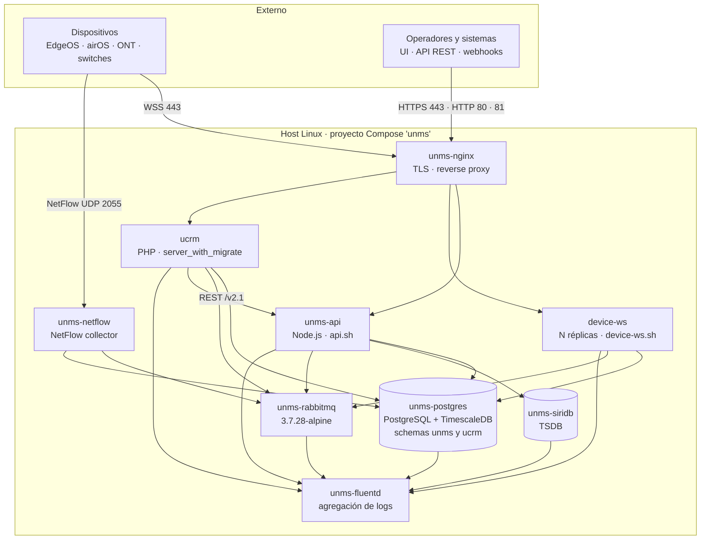
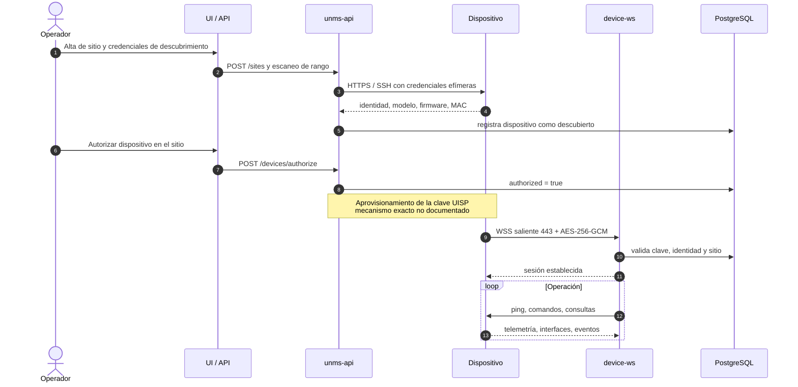
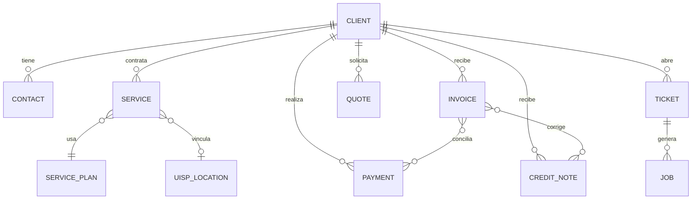
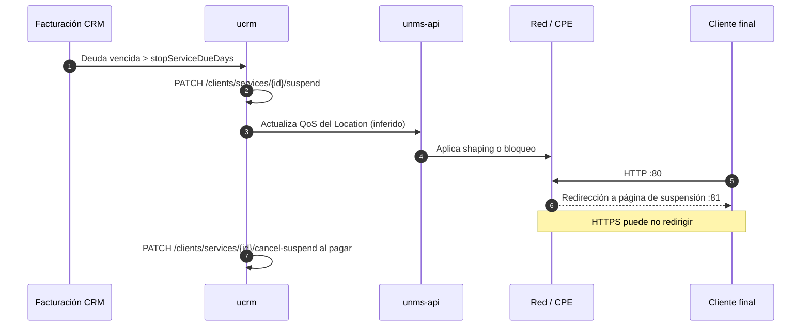

# Manual técnico de referencia — Ubiquiti UISP

**Tipo:** INFORME
**Módulo:** UISP (tercero)
**Fase:** MANUAL-TECNICO
**Versión:** 1.0
**Estado:** Vigente — referencia técnica no normativa
**Fecha:** 2026-10-31
**Alcance:** UISP self-hosted 3.1.70 + UISP CRM 4.6.17
**Audiencia:** arquitectura, plataforma, backend, operaciones, integraciones

---

## 0. Cómo leer este documento

UISP es un producto parcialmente cerrado. La documentación pública cubre instalación, operación, API y plugins; no cubre el protocolo interno de los dispositivos, el formato de las tramas WebSocket, los nombres de colas de RabbitMQ ni el DDL de la base de datos.

Por eso cada afirmación relevante se clasifica con uno de estos niveles:

| Nivel | Significado |
| --- | --- |
| **Verificado** | Confirmado en un artefacto oficial: paquete de instalación, `docker-compose.yml.template`, Swagger en vivo, especificación Apiary o documentación de Ubiquiti. |
| **Inferido** | Se deduce del comportamiento observable o de la topología, pero Ubiquiti no lo documenta explícitamente. |
| **No documentado** | No existe fuente pública. Se indica como límite, no se rellena con invención. |

Los artefactos de referencia usados son:

- Paquete de instalación self-hosted 3.1.70 (`docker-compose.yml.template`, `install-full.sh`, `metadata`).
- Swagger de NMS `1.5.0`, servido por la instancia (`/nms/api-docs/`): 533 operaciones y 1.158 definiciones.
- Especificación Apiary de UISP CRM (`https://unmscrm.docs.apiary.io/`).
- Documentación de ayuda de UISP: instalación, seguridad, sitios/dispositivos, suspensión/shaping, plugins.
- Repositorio `Ubiquiti-App/UCRM-plugins` (`manifest.md`, `file-structure.md`, `security.md`).

---

## 1. Resumen ejecutivo

UISP se despliega como un stack Docker Compose de nueve servicios sobre un único host Linux. No es una arquitectura de microservicios independientes: es un monolito operado como conjunto de contenedores con una base PostgreSQL compartida, un TSDB dedicado (SiriDB), un broker RabbitMQ y un reverse proxy Nginx.

Hechos estructurales:

1. **NMS y CRM comparten instancia PostgreSQL.** Base `unms`, esquemas `unms` y `ucrm`, roles separados. No hay dos bases de datos.
2. **El canal de gestión es WebSocket saliente desde el dispositivo.** El dispositivo abre TLS a `443`; UISP actúa como servidor WebSocket. No hay agente instalado con binario público.
3. **La telemetría se reparte entre SiriDB y PostgreSQL/TimescaleDB.** El reparto exacto no está documentado.
4. **RabbitMQ es el bus asíncrono.** Redis no forma parte del stack en 3.1.70.
5. **El CRM expone REST con `X-Auth-App-Key`; el NMS con `x-auth-token`.** Son dos APIs, dos esquemas de autenticación y dos versiones de contrato.
6. **Los plugins son PHP y se ejecutan dentro del contenedor `ucrm`.** No hay runtime Node.js de plugins.
7. **La suspensión se apoya en el binding Servicio → Location de UISP y en traffic shaping.** La página de suspensión vive en el puerto `81`.
8. **Los webhooks del CRM no llevan firma HMAC documentada.** El receptor debe verificar el `uuid` contra la API y refrescar la entidad.

Consecuencia práctica: cualquier integración seria debe apoyarse en las dos APIs REST y en webhooks, no en la base de datos ni en automatización de la UI. La base de datos se puede leer para diagnóstico, pero su esquema no es contrato público.

---

## 2. Corrección de premisas frecuentes

Estas premisas aparecen con frecuencia en diseños de integración y son incorrectas o incompletas para UISP 3.1.70:

| Premisa | Veredicto | Evidencia |
| --- | --- | --- |
| UISP usa el puerto TCP `2443` para dispositivos | **Falso.** `2443` no aparece en el compose, en `install-full.sh`, en la guía de instalación ni en el Swagger. IANA lo asigna a `powerclientcsf`. | Búsqueda en el paquete 3.1.70; IANA Service Name and Transport Protocol Port Number Registry. |
| UISP usa Redis como dependencia | **Falso para 3.1.70.** No hay servicio, imagen, variable de entorno ni volumen Redis. El broker es `rabbitmq:3.7.28-alpine`. | `docker-compose.yml.template`; `install-full.sh`. |
| Los plugins de UISP corren en Node.js | **Falso.** Los plugins del CRM son PHP, se empaquetan en ZIP y se ejecutan dentro del contenedor `ucrm`. El NMS está escrito en Node.js, pero no expone un runtime de plugins. | Documentación de plugins; `file-structure.md`; `manifest.md`. |
| Existe un binario `unms-agent` documentado en el dispositivo | **No documentado.** En EdgeOS el servicio se llama `unms`; en airOS se configura `unms.uri`. El cliente WebSocket va embebido en el firmware. No hay protocolo público ni binario publicado con ese nombre. | Documentación de dispositivos; ausencia de fuente oficial. |
| El cifrado es AES simétrico simple | **Incompleto.** La clave UISP contiene el endpoint WSS y un secreto AES. El canal usa AES-256-GCM con doble cifrado. El handshake exacto no está documentado. | Documentación de seguridad de UISP. |
| El CRM y el NMS son el mismo producto con una sola API | **Falso.** NMS: `/nms/api/v2.1`, `x-auth-token`. CRM: `/crm/api/v1.0`, `X-Auth-App-Key`. Entidades, estados y unidades distintas. | Swagger NMS; Apiary CRM. |
| Los webhooks se firman con HMAC | **No documentado.** El payload no incluye firma. La verificación recomendada es `GET /webhook-events/{uuid}` y luego refrescar la entidad. | Apiary CRM; comportamiento en runtime. |

---

## 3. Arquitectura de despliegue

### 3.1 Topología de contenedores



Notas de lectura:

- `nginx` es el único punto de entrada TLS. Publica `80`, `443`, `81` y `8089`.
- `unms-api` y `device-ws` comparten imagen (`ubnt/unms:3.1.70`) y difieren solo en el comando.
- Las flechas hacia `unms-fluentd` representan el driver de logging de Docker, no tráfico de aplicación.
- `ucrm` usa imagen separada (`ubnt/unms-crm:4.6.17`) y comparte PostgreSQL con el NMS.
- `unms-netflow` publica UDP `2055` directamente, sin pasar por Nginx.
- `unms-fluentd` escucha en `127.0.0.1:24224`; todos los contenedores escriben logs ahí.

### 3.2 Componentes

| Servicio Compose | Contenedor | Imagen | Runtime | Función | Réplicas |
| --- | --- | --- | --- | --- | --- |
| `fluentd` | `unms-fluentd` | `ubnt/unms-fluentd:3.1.70` | Fluentd | Recepción y rotación de logs | 1 |
| `siridb` | `unms-siridb` | `ubnt/unms-siridb:3.1.70` | SiriDB | Series temporales de alta cardinalidad | 1 |
| `postgres` | `unms-postgres` | `ubnt/unms-postgres:3.1.70` | PostgreSQL + TimescaleDB | Datos relacionales de NMS y CRM; series agregadas | 1 |
| `rabbitmq` | `unms-rabbitmq` | `rabbitmq:3.7.28-alpine` | RabbitMQ | Colas de trabajo asíncrono | 1 |
| `unms-api` | `unms-api` | `ubnt/unms:3.1.70` | Node.js | API NMS, lógica de negocio, orquestación | 1 |
| `device-ws` | `device-ws` (DNS RR) | `ubnt/unms:3.1.70` | Node.js | Terminación WebSocket de dispositivos | `REPLICAS_UNMS_DEVICE_WS` (1 por defecto) |
| `ucrm` | `ucrm` | `ubnt/unms-crm:4.6.17` | PHP | CRM, facturación, plugins | 1 |
| `nginx` | `unms-nginx` | `ubnt/unms-nginx:3.1.70` | Nginx | TLS, enrutamiento, página de suspensión | 1 |
| `netflow` | `unms-netflow` | `ubnt/unms-netflow:3.1.70` | Colector NetFlow | Ingesta NetFlow v5/v9 | 1 |

`device-ws` se despliega en modo `replicated` con `endpoint_mode: dnsrr`; Nginx resuelve el servicio por DNS y reparte conexiones. Es el único componente pensado para escalar horizontalmente de forma directa.

### 3.3 Redes y volúmenes

Dos redes:

| Red | Propiedad | Contenedores |
| --- | --- | --- |
| `public` | Puente con IPAM configurable | `fluentd`, `unms-api`, `device-ws`, `ucrm`, `nginx`, `netflow` |
| `internal` | `internal: true` (sin salida) | `siridb`, `postgres`, `rabbitmq`, `unms-api`, `device-ws`, `ucrm`, `nginx`, `netflow` |

Volúmenes persistentes, todos bajo `${DATA_DIR}` (por defecto `$HOME/data`):

| Ruta | Contenido |
| --- | --- |
| `postgres/` | `PGDATA` de la base `unms` |
| `siridb/`, `siridb-cores/` | Datos y cores de SiriDB |
| `rabbitmq/` | Estado del broker |
| `logs/` | Logs agregados por Fluentd |
| `firmwares/` | Firmware servido por Nginx a los dispositivos |
| `loading/` | Recursos de carga de la UI |
| `ucrm/` | Datos del CRM: plugins, adjuntos, documentos, configuración |
| `cert/` o ruta alternativa | Certificados TLS |

El contenedor `unms-api` monta `${DATA_DIR}` completo en `/home/app/unms/data`; `device-ws` hace lo mismo. Ambos procesos comparten el mismo árbol de datos, incluidos `${DATA_DIR}/firmwares` y `${DATA_DIR}/ucrm`.

### 3.4 Puertos

Puertos públicos por defecto:

| Puerto | Protocolo | Variable | Servicio | Función |
| --- | --- | --- | --- | --- |
| `80` | TCP | `HTTP_PORT` | `nginx` | UI/API, redirección a HTTPS, validación ACME |
| `443` | TCP | `HTTPS_PORT` | `nginx` | UI, API REST, WebSocket de dispositivos |
| `81` | TCP | `SUSPEND_PORT` | `nginx` | Página de suspensión para clientes morosos |
| `8089` | TCP | `REMOTE_UI_WS_PORT_PUBLIC` | `nginx` | WebSocket de la UI remota |
| `2055` | UDP | `NETFLOW_PORT` | `unms-netflow` | NetFlow v5/v9 |
| `WS_PORT` | TCP | `WS_PORT` / `--ws-port` | `nginx` | Mapeo adicional solo si se separa el tráfico WS de `443` |

Puertos internos (no publicados):

| Puerto | Protocolo | Variable | Servicio | Función |
| --- | --- | --- | --- | --- |
| `8081` | TCP | `UNMS_HTTP_PORT` | `unms-api` | HTTP interno del API |
| `8082` | TCP | `UNMS_WS_PORT` | `device-ws` | WebSocket de dispositivos |
| `8083` | TCP | `UNMS_WS_SHELL_PORT` | `device-ws` | Shell WebSocket |
| `8084` | TCP | `UNMS_WS_API_PORT` | `device-ws` | API interna de WebSocket |
| `31415` | TCP | healthcheck | `unms-api`, `device-ws` | `GET /health` |
| `24224` | TCP | — | `unms-fluentd` | Ingesta de logs, solo `127.0.0.1` |
| `5432` | TCP | — | `unms-postgres` | PostgreSQL |
| `5672` | TCP | — | `unms-rabbitmq` | AMQP |
| — | — | — | `unms-siridb` | SiriDB no publica puerto |

Descubrimiento local en LAN:

| Puerto | Protocolo | Uso |
| --- | --- | --- |
| `10001` | UDP/TCP | Descubrimiento de dispositivos Ubiquiti en la red local. No es el API de UISP. |

`WS_PORT` vacío significa que el WebSocket de dispositivos viaja por `443`. Si se define y es distinto de `HTTPS_PORT`, el instalador agrega un mapeo adicional `WS_PORT:WS_PORT` en Nginx. `PUBLIC_WS_PORT` permite anunciar un puerto público distinto cuando hay NAT.

### 3.5 Instalación y ciclo de vida

Instalación típica:

```bash
# El paquete se descarga desde Ubiquiti y se ejecuta como root
sudo ./install-full.sh

# Variantes útiles
sudo ./install-full.sh --http-port 8080 --https-port 8443
sudo ./install-full.sh --ws-port 8444 --public-ws-port 8444
sudo ./install-full.sh --ucrm-version 4.6.17
```

El instalador:

1. Detecta distribución, arquitectura y versión de Docker.
2. Genera contraseñas aleatorias para PostgreSQL, CRM y tokens internos.
3. Renderiza `docker-compose.yml` desde la plantilla.
4. Crea las redes, volúmenes y directorios de datos.
5. Ejecuta migraciones del NMS y del CRM.
6. Configura actualizaciones automáticas y tareas de mantenimiento.

Operación:

```bash
# Estado
sudo docker compose -p unms ps

# Logs de un servicio
sudo docker compose -p unms logs -f unms-api

# Reinicio controlado
sudo docker compose -p unms restart unms-api device-ws

# Actualización
sudo ./update.sh
```

El healthcheck de `unms-api` y `device-ws` es `curl -f localhost:31415/health`. `start_period` es de 30 minutos para el API y 2 minutos para `device-ws`, lo que refleja que el arranque del API puede incluir migraciones y tareas de inicialización.

### 3.6 Backup y restore

El backup debe cubrir, como mínimo:

1. Base PostgreSQL (`pg_dump` de `unms`, que incluye ambos esquemas).
2. `${DATA_DIR}/ucrm` (plugins, adjuntos, documentos, configuración).
3. `${DATA_DIR}/firmwares` si se alojan firmwares personalizados.
4. Certificados TLS y `docker-compose.yml` renderizado.

```bash
# Backup lógico de la base completa
docker compose -p unms exec -T postgres \
  pg_dump -U postgres -d unms -Fc > unms-$(date +%F).dump

# Backup del árbol de datos
tar -czf unms-data-$(date +%F).tar.gz -C "$HOME" data
```

El restore debe hacerse con el stack detenido, restaurando primero PostgreSQL y luego el árbol de datos. Restaurar solo la base deja plugins y adjuntos huérfanos; restaurar solo el árbol deja referencias a entidades inexistentes.

---

## 4. Flujo de datos de dispositivos

### 4.1 Descubrimiento y adopción



Puntos clave:

- **Las credenciales de descubrimiento no se persisten.** Se usan para la conexión inicial y se descartan.
- **El dispositivo inicia la conexión de gestión.** UISP no mantiene una conexión entrante permanente al dispositivo; el dispositivo abre WSS hacia UISP.
- **La adopción es un acto administrativo.** `POST /devices/authorize` con `siteId` y `deviceIds` mueve el dispositivo de "descubierto" a "gestionado".
- **La clave UISP es un secreto compartido.** Contiene el endpoint (`wss://host:443`) y el material AES. Debe tratarse como credencial y rotarse si se compromete.

### 4.2 Canal de gestión

| Aspecto | Comportamiento |
| --- | --- |
| Transporte | WebSocket sobre TLS |
| Dirección | Dispositivo → UISP (saliente desde la CPE) |
| Puerto por defecto | `443` |
| Cifrado | AES-256-GCM con doble cifrado |
| Secreto | Clave UISP por instancia/dispositivo, almacenada en PostgreSQL |
| Servicio en EdgeOS | `service unms` |
| Configuración en airOS | `unms.uri` |
| Formato de tramas | **No documentado** |
| Handshake exacto | **No documentado** |

Consecuencia de red: el dispositivo solo necesita salida TCP `443` hacia UISP. No requiere NAT entrante, port forwarding ni VPN. Si se separa el WebSocket a otro puerto, el dispositivo debe poder alcanzar `wss://host:<WS_PORT>`.

La dirección IP de gestión se reporta por el propio canal WebSocket (**inferido**). Los pings de monitorización también viajan por ese canal. Las estadísticas de outage, en cambio, dependen de ICMP hacia el host de UISP; bloquear ICMP en el path de gestión degrada la detección de caídas.

### 4.3 Telemetría y persistencia

| Fuente | Datos | Destino | Nivel |
| --- | --- | --- | --- |
| WebSocket de dispositivos | Estado, interfaces, clientes asociados, eventos | PostgreSQL (`unms`) | Verificado |
| WebSocket / polling | Series temporales de dispositivo y sitio | SiriDB | Inferido |
| NetFlow v5/v9 | Flujos por interfaz/sitio | PostgreSQL/TimescaleDB | Verificado (colector y puerto) |
| ICMP | Disponibilidad y latencia | PostgreSQL/SiriDB | Inferido |
| Logs de contenedores | Operación, errores, auditoría técnica | Fluentd → `${DATA_DIR}/logs` | Verificado |

El reparto exacto entre SiriDB y TimescaleDB no está documentado. La inferencia razonable es:

- **SiriDB**: series crudas de alta frecuencia y alta cardinalidad (interfaz, dispositivo, señal, tráfico).
- **TimescaleDB**: agregados, retención de largo plazo y consultas relacionales de sitio.

No se debe asumir que una tabla o una serie concreta vive en un motor determinado sin introspección.

### 4.4 NetFlow

`unms-netflow` escucha UDP `2055` y publica en RabbitMQ/PostgreSQL. El flujo es unidireccional: el dispositivo o router exportador envía los registros; UISP no consulta al exportador.

Requisitos:

- El exportador debe apuntar a la IP del host UISP y al puerto `2055/udp`.
- El puerto debe estar abierto en firewall.
- NetFlow no atraviesa Nginx; va directo al contenedor.
- Si se cambia `NETFLOW_PORT`, hay que actualizar el exportador y el compose.

### 4.5 Topología

UISP construye topología a partir de:

- Uplink declarado por el dispositivo (`uplinkDevice`, `uplink`).
- MAC table (`GET /devices/{deviceId}/mac-table`).
- Sitios y enlaces de datos (`/sites`, `/data-links/sites/{siteId}`).
- Asociaciones inalámbricas AP → estación (`/devices/airmaxes/{id}/stations`).

La topología es administrativa, no un descubrimiento pasivo completo. Un enlace mal declarado o un dispositivo no gestionado aparece como hueco. `GET /data-links/sites/{siteId}` expone los enlaces de datos del sitio; `GET /sites/{id}/uplink-devices` lista los dispositivos de uplink.

---

## 5. NMS

### 5.1 Modelo de dominio

| Entidad | Descripción | Identificador |
| --- | --- | --- |
| Device | Dispositivo gestionado: router, switch, AP, ONU, OLT, radio | UUID |
| Site | Agrupación lógica/geográfica | UUID |
| Interface | Interfaz física o lógica de un dispositivo | Nombre/índice |
| Client | Cliente asociado a un AP/ONU | MAC/serial |
| Uplink | Enlace de un sitio hacia el resto de la red | UUID de sitio/dispositivo |
| Task | Trabajo asíncrono, típicamente upgrade masivo | `batchId` |
| Backup | Copia de configuración de un dispositivo | `backupId` |
| QoS | Traffic shaping por sitio | `siteId` |

Estados de sitio: `active`, `disconnected`, `inactive`, `unknown`. Tipos: `site`, `endpoint`, `client`, `subscriber`.

Tipos de dispositivo en el Swagger: `onu`, `olt`, `uispp`, `uispr`, `uisps`, `uispLte`, `erouter`, `eswitch`, `epower`, `airCube`, `airMax`, `airFiber`, `toughSwitch`, `solarBeam`, `wave`, `blackBox`, `uisprlxc`, `express`.

### 5.2 Descubrimiento

Métodos soportados:

| Método | Uso | Persistencia de credenciales |
| --- | --- | --- |
| Escaneo de rango con HTTPS | Dispositivos con UI web | No |
| Escaneo con SSH | EdgeOS/airOS con shell | No |
| Descubrimiento local UDP/TCP `10001` | Dispositivos en la misma LAN que UISP | No |
| Importación manual | Alta por MAC/serial/IP | N/A |

Endpoints:

| Método | Ruta | Función |
| --- | --- | --- |
| `GET` | `/devices/discovered` | Lista dispositivos descubiertos no autorizados |
| `GET` | `/devices/discovered/head` | Cabecera/versión del conjunto descubierto |
| `GET` | `/devices/unknown` | Dispositivos vistos pero no identificados |
| `POST` | `/devices/import` | Importación masiva |
| `GET` | `/devices/import/status` | Estado de la importación |
| `POST` | `/devices/authorize` | Autoriza uno o varios dispositivos en un sitio |

`POST /devices/authorize`:

```json
{
  "siteId": "b1f0c2d4-5e6a-4b7c-8d9e-0a1b2c3d4e5f",
  "deviceIds": [
    "0f3a5b7e-6c1d-4a2f-9c8e-1b2d3e4f5a6b",
    "1a2b3c4d-5e6f-4a7b-8c9d-0e1f2a3b4c5d"
  ]
}
```

### 5.3 Inventario

| Método | Ruta | Función |
| --- | --- | --- |
| `GET` | `/devices` | Lista; filtros `siteId`, `withInterfaces`, `authorized`, `type`, `role` |
| `GET` | `/devices/{id}` | Detalle de dispositivo |
| `GET` | `/devices/{id}/detail` | Detalle extendido |
| `GET` | `/devices/{deviceId}/interfaces` | Interfaces |
| `GET` | `/devices/{deviceId}/mac-table` | Tabla MAC |
| `GET` | `/devices/{id}/clients` | Clientes asociados |
| `GET` | `/devices/{id}/system` | Sistema y recursos |
| `GET` | `/devices/{id}/configuration` | Configuración |
| `GET` | `/devices/{id}/capabilities` | Capacidades soportadas |
| `GET` | `/devices/{id}/supportfile` | Support file |
| `GET` | `/devices/{id}/statistics` | Series temporales |
| `GET` | `/devices/{id}/remoteuiproxy` | Proxy a la UI del dispositivo |
| `GET` | `/devices/mac/{mac}` | Búsqueda por MAC |
| `GET` | `/devices/ips` | Búsqueda por IP |

`GET /devices/{id}/statistics` exige tres parámetros:

| Parámetro | Valores | Uso |
| --- | --- | --- |
| `interval` | `hour`, `fourhours`, `day`, `week`, `month`, `quarter`, `year`, `range` | Resolución |
| `start` | timestamp | Inicio |
| `period` | duración | Ventana |

Ejemplo:

```http
GET /nms/api/v2.1/devices/0f3a5b7e-6c1d-4a2f-9c8e-1b2d3e4f5a6b/statistics?interval=hour&start=2026-10-30T00:00:00.000Z&period=86400
x-auth-token: <token>
```

### 5.4 Sitios y topología

| Método | Ruta | Función |
| --- | --- | --- |
| `GET` | `/sites` | Lista de sitios |
| `POST` | `/sites` | Crear sitio |
| `GET` | `/sites/{id}` | Detalle |
| `PUT` | `/sites/{id}` | Actualizar |
| `DELETE` | `/sites/{id}` | Eliminar |
| `GET` | `/sites/{id}/clients` | Clientes del sitio |
| `GET` | `/sites/{id}/uplink-devices` | Dispositivos de uplink |
| `GET` | `/sites/{siteId}/traffic` | Tráfico del sitio |
| `GET` | `/sites/{siteId}/statistics` | Series del sitio |
| `GET` | `/sites/{siteId}/slastats` | SLA |
| `GET` | `/sites/{siteId}/qos` | Traffic shaping |
| `PUT` | `/sites/{siteId}/qos` | Actualizar shaping |
| `GET` | `/data-links/sites/{siteId}` | Enlaces de datos |

### 5.5 Firmware y tareas masivas

| Método | Ruta | Función |
| --- | --- | --- |
| `GET` | `/devices/images` | Firmwares disponibles |
| `POST` | `/devices/{id}/upgrade-to-latest` | Upgrade individual |
| `POST` | `/tasks` | Upgrade masivo |
| `GET` | `/tasks` | Lista de tareas |
| `GET` | `/tasks/{batchId}` | Detalle de lote |
| `GET` | `/tasks/in-progress` | Tareas en curso |
| `GET` | `/tasks/prepare-auto-updates` | Preparación de auto-updates |

Upgrade masivo:

```json
{
  "upgradeInMaintenanceWindow": true,
  "upgrades": [
    {
      "deviceId": "0f3a5b7e-6c1d-4a2f-9c8e-1b2d3e4f5a6b",
      "firmwareVersion": "2.4.7"
    },
    {
      "deviceId": "1a2b3c4d-5e6f-4a7b-8c9d-0e1f2a3b4c5d",
      "firmwareVersion": "2.4.7"
    }
  ]
}
```

Reglas:

- `upgrades` es obligatorio y no puede estar vacío.
- `deviceId` y `firmwareVersion` son obligatorios por elemento.
- `firmwareForMStationsVersion` solo aplica a APs AC con estaciones M.
- `upgradeInMaintenanceWindow` programa la ejecución dentro de la ventana de mantenimiento.
- El seguimiento se hace por `batchId`; no es una operación síncrona.

### 5.6 Respaldos de configuración

| Método | Ruta | Función |
| --- | --- | --- |
| `GET` | `/devices/{deviceId}/backups` | Lista backups |
| `POST` | `/devices/{deviceId}/backups` | Crear backup |
| `PUT` | `/devices/{deviceId}/backups` | Subir backup |
| `GET` | `/devices/{deviceId}/backups/{backupId}` | Descargar |
| `PUT` | `/devices/{deviceId}/backups/{backupId}` | Reemplazar |
| `DELETE` | `/devices/{deviceId}/backups/{backupId}` | Eliminar |
| `POST` | `/devices/{deviceId}/backups/{backupId}/apply` | Aplicar al dispositivo |
| `GET` | `/nms/backups` | Lista global |
| `GET` | `/nms/backups/{backupId}` | Detalle global |
| `DELETE` | `/nms/backups/{backupId}` | Eliminar global |

`apply` es una operación destructiva: reemplaza la configuración en ejecución. Requiere ventana y rollback manual.

### 5.7 Traffic shaping por sitio

`GET/PUT /sites/{siteId}/qos` usa `SiteTrafficShaping`:

| Campo | Tipo | Unidad | Descripción |
| --- | --- | --- | --- |
| `enabled` | boolean | — | Activa las colas de shaping |
| `propagation` | enum | — | `all` (CPE/ONU) o `gateway` |
| `downloadSpeed` | integer | **bps** | Límite de bajada |
| `downloadBurstSize` | integer | bytes | Ráfaga de bajada |
| `uploadSpeed` | integer | **bps** | Límite de subida |
| `uploadBurstSize` | integer | bytes | Ráfaga de subida |
| `aggregation` | integer | factor | Relación entre el máximo permitido y la tasa garantizada; `null` = automático |

Ejemplo:

```json
{
  "enabled": true,
  "propagation": "all",
  "downloadSpeed": 104857600,
  "downloadBurstSize": 5242880,
  "uploadSpeed": 26214400,
  "uploadBurstSize": 1310720,
  "aggregation": 4
}
```

`104857600` bps = 100 Mbps. `26214400` bps = 25 Mbps.

Advertencia de unidades: el NMS trabaja en **bps**; el CRM trabaja en **Mbps**. Una integración que copie valores sin convertir aplica un shaping 1.000.000 veces mayor o menor.

---

## 6. Persistencia

### 6.1 PostgreSQL

| Elemento | Valor |
| --- | --- |
| Base de datos | `unms` |
| Esquema NMS | `unms` |
| Esquema CRM | `ucrm` |
| Usuario NMS | `unms` |
| Usuario CRM | `ucrm` |
| Superusuario | `postgres` |
| Extensión | TimescaleDB |
| Puerto | `5432` interno |

El comando de arranque de PostgreSQL incluye parámetros de TimescaleDB:

```text
postgres -c deadlock_timeout=5000
         -c max_connections=1280
         -c timescaledb.max_background_workers=50
         -c max_worker_processes=${UNMS_PG_MAX_WORKER_PROCESSES}
         -c max_parallel_workers=${UNMS_PG_MAX_PARALLEL_WORKERS}
         -c work_mem=64MB
         -c maintenance_work_mem=256MB
         -c log_temp_files=10485760
         -c temp_file_limit=8GB
```

`UCRM_POSTGRES_DB` apunta a la misma base `unms`. La separación es por esquema y por rol, no por instancia.

**Los nombres de tabla no son públicos.** Cualquier consulta directa debe basarse en introspección (`information_schema.tables`, `pg_catalog`) y tratarse como frágil frente a upgrades.

### 6.2 Dominios lógicos

| Dominio | Esquema | Entidades esperadas | Nivel |
| --- | --- | --- | --- |
| Inventario NMS | `unms` | devices, sites, interfaces, uplinks, backups | Verificado por API |
| Telemetría NMS | `unms` + SiriDB | series de dispositivo, sitio, interfaz | Inferido |
| Alarmas/eventos | `unms` | eventos, notificaciones | Inferido |
| Usuarios y roles NMS | `unms` | users, roles, tokens | Verificado por API |
| Clientes CRM | `ucrm` | clients, contacts, tags, attributes | Verificado por API |
| Servicios CRM | `ucrm` | services, service_plans, periods, surcharges | Verificado por API |
| Facturación | `ucrm` | invoices, invoice_items, taxes, credit_notes | Verificado por API |
| Pagos | `ucrm` | payments, payment_methods, payment_plans | Verificado por API |
| Quotes | `ucrm` | quotes, quote_items | Verificado por API |
| Soporte | `ucrm` | tickets, ticket_comments, jobs | Verificado por API |
| Webhooks | `ucrm` | webhook_events | Verificado por API |
| Plugins | `ucrm` + filesystem | estado y logs en `${DATA_DIR}/ucrm` | Verificado por documentación |

### 6.3 SiriDB

SiriDB es el TSDB dedicado. Almacena series de alta cardinalidad y no se publica al exterior. Su puerto interno no está mapeado en el compose.

Limitaciones:

- No hay API pública documentada de SiriDB para integraciones de terceros.
- No se debe consultar directamente para reporting de negocio; para eso está el API NMS.
- La retención y compactación no están documentadas.

### 6.4 RabbitMQ

| Aspecto | Valor |
| --- | --- |
| Imagen | `rabbitmq:3.7.28-alpine` |
| Puerto | `5672` interno |
| UI de management | No expuesta |
| Colas | **No documentadas** |
| Uso | Upgrades, notificaciones, NetFlow, tareas CRM |

No se debe asumir el nombre de una cola. Si se requiere inspección, se hace con `rabbitmqctl` dentro del contenedor y solo en diagnóstico.

---

## 7. CRM

### 7.1 Modelo lógico

Derivado de la API, no del DDL:



`UISP_LOCATION` no es una entidad del CRM: es la proyección del sitio de UISP identificada por `unmsClientSiteId`.

### 7.2 Entidades principales

| Entidad | Campos relevantes | Notas |
| --- | --- | --- |
| Client | `id`, `firstName`, `lastName`, `companyName`, `accountBalance`, `accountCredit`, `accountOutstanding`, `currencyCode`, `isActive`, `isArchived`, `hasOverdueInvoice`, `hasSuspendedService`, `hasOutage` | `accountBalance` positivo = crédito; negativo = deuda |
| Contact | `id`, `clientId`, `email`, `phone`, `name`, `isBilling`, `isContact`, `types` | Un cliente puede tener varios contactos |
| Service | `id`, `clientId`, `servicePlanId`, `servicePlanPeriodId`, `status`, `downloadSpeed`, `uploadSpeed`, `unmsClientSiteId`, `suspensionReasonId`, `trafficShapingOverrideEnabled`, `downloadSpeedOverride`, `uploadSpeedOverride`, `trafficShapingOverrideEnd` | Velocidades en **Mbps** |
| Service Plan | `id`, `name`, `price`, `period`, `downloadSpeed`, `uploadSpeed`, `downloadBurst`, `uploadBurst`, `dataUsageLimit`, `downloadSpeedLimited`, `uploadSpeedLimited` | Estructura `Tariff`; burst en kB, consumo en GB, velocidades en Mbps |
| Invoice | `id`, `number`, `status`, `clientId`, `total`, `amountPaid`, `dueDate`, `createdDate` | Estados y numeración configurables |
| Payment | `id`, `clientId`, `amount`, `currencyCode`, `method`, `createdDate` | Puede quedar sin conciliar |
| Credit Note | `id`, `clientId`, `number`, `total`, `items` | Corrige una factura |
| Quote | `id`, `clientId`, `number`, `status`, `items` | Puede convertirse en servicio |
| Ticket | `id`, `clientId`, `subject`, `status`, `assignedUserId` | Soporte |
| Job | `id`, `ticketId`, `clientId`, `date`, `status`, `assignedUserId` | Trabajo de campo |

### 7.3 Planes de servicio

Un plan define la plantilla comercial y técnica:

- Precio y periodo (mensual, prepago).
- Velocidad de bajada/subida en Mbps.
- Burst.
- Límite de consumo y velocidad reducida.
- Agregación.
- Configuración de prepago.

Un `Service` referencia `servicePlanId` y `servicePlanPeriodId`. El periodo es obligatorio en servicios recurrentes; en prepago se usa `servicePlanId` directamente.

La UI y las rutas hablan de "Service Plans"; la estructura de datos se llama `Tariff`. Es la misma entidad con dos nombres.

### 7.4 Estados del servicio

| Código | Estado | Significado operativo |
| --- | --- | --- |
| `0` | Prepared | Creado, no activo |
| `1` | Active | Prestando servicio |
| `2` | Ended | Terminado |
| `3` | Suspended | Suspendido por mora o decisión |
| `4` | Prepared blocked | Preparado y bloqueado |
| `5` | Obsolete | Obsoleto |
| `6` | Deferred | Diferido |
| `7` | Quoted | Cotizado |
| `8` | Inactive | Inactivo |

Solo `Active` presta servicio sin restricciones. `Suspended` sigue existiendo y puede seguir facturándose, pero con bloqueo o shaping.

### 7.5 Suspensión

Endpoints:

| Método | Ruta | Función |
| --- | --- | --- |
| `PATCH` | `/clients/services/{id}/suspend` | Suspender con motivo |
| `PATCH` | `/clients/services/{id}/cancel-suspend` | Reactivar |
| `PATCH` | `/clients/services/{id}/unmsclientsite/bind` | Vincular a Location UISP |
| `PATCH` | `/clients/services/{id}/unmsclientsite/unbind` | Desvincular |
| `PATCH` | `/clients/services/{id}/traffic-shaping-override` | Override temporal de shaping |

Flujo:



Configuración de la suspensión automática:

| Opción | Efecto |
| --- | --- |
| `stopServiceDue` | Activa la suspensión por deuda |
| `stopServiceDueDays` | Días de gracia desde el vencimiento |

Comportamiento:

- La página de suspensión se sirve en `81`.
- Las peticiones HTTP a `80` se redirigen; las HTTPS pueden no redirigirse.
- El Location sigue existiendo en UISP, pero con el servicio bloqueado o limitado.
- `cancel-suspend` revierte el estado y el shaping.
- `trafficShapingOverride` permite dar velocidad temporal (por ejemplo, un upgrade puntual) sin cambiar el plan.

### 7.6 Traffic shaping

Hay dos niveles:

| Nivel | Dónde se define | Unidad | Alcance |
| --- | --- | --- | --- |
| Plan/Servicio CRM | `servicePlan.downloadSpeed`, `service.downloadSpeed` | Mbps | Comercial |
| Location/Sitio NMS | `SiteTrafficShaping.downloadSpeed` | bps | Técnico |

El shaping efectivo se aplica en el Location de UISP. El CRM mantiene la referencia (`unmsClientSiteId`) y el plan comercial; la sincronización exacta entre ambos es **inferida**. Si no hay binding (`unmsClientSiteId` nulo), el servicio se factura pero no se aplica shaping.

Overrides:

- `trafficShapingOverrideEnabled`: activa el override.
- `downloadSpeedOverride` / `uploadSpeedOverride`: Mbps; `null` con override activo significa ilimitado.
- `trafficShapingOverrideEnd`: fecha de expiración automática.

### 7.7 Facturación y pagos

| Método | Ruta | Función |
| --- | --- | --- |
| `GET` | `/invoices` | Lista con filtros |
| `POST` | `/clients/{id}/invoices` | Crear factura |
| `PATCH` | `/invoices/{id}/approve` | Aprobar |
| `PATCH` | `/invoices/{id}/send` | Enviar |
| `PATCH` | `/invoices/{id}/void` | Anular |
| `GET` | `/invoices/{id}/pdf` | PDF |
| `GET` | `/payments` | Lista |
| `POST` | `/payments` | Registrar pago |
| `PATCH` | `/payments/{id}/attach` | Conciliar |
| `PATCH` | `/payments/{id}/detach` | Desconciliar |
| `GET` | `/credit-notes` | Notas de crédito |
| `POST` | `/clients/{id}/credit-note` | Crear nota |
| `GET` | `/quotes` | Cotizaciones |
| `POST` | `/clients/{id}/quotes` | Crear cotización |
| `GET` | `/ticketing/tickets` | Tickets |
| `POST` | `/ticketing/tickets` | Crear ticket |
| `GET` | `/scheduling/jobs` | Jobs |
| `POST` | `/scheduling/jobs` | Crear job |

Los catálogos de estados, métodos de pago y monedas se leen de `/options` y de los endpoints de catálogo. No se deben hardcodear en integraciones.

---

## 8. API REST

### 8.1 NMS

| Aspecto | Valor |
| --- | --- |
| Base | `/nms/api/v2.1` |
| Autenticación | `x-auth-token` |
| Obtención de token | `POST /user/login` (header de respuesta) o `POST /token` |
| Documentación viva | `/nms/api-docs/` |
| Versión del contrato | Swagger `1.5.0` |
| Formato | JSON |
| Paginación | Específica por endpoint (`count`, `page`, `limit`, `offset`) |

Ejemplo de autenticación:

```http
POST /nms/api/v2.1/user/login
Content-Type: application/json

{
  "username": "api-user",
  "password": "<redacted>"
}
```

El token se devuelve en un header de la respuesta. También se puede crear un token de larga duración con `POST /token`.

### 8.2 Endpoints NMS relevantes

| Método | Ruta | Función |
| --- | --- | --- |
| `POST` | `/user/login` | Login y emisión de token |
| `GET` | `/token` | Listar tokens |
| `POST` | `/token` | Crear token |
| `GET` | `/devices` | Inventario |
| `GET` | `/devices/{id}` | Detalle |
| `GET` | `/devices/{id}/detail` | Detalle extendido |
| `GET` | `/devices/{deviceId}/interfaces` | Interfaces |
| `GET` | `/devices/{id}/statistics` | Series |
| `GET` | `/devices/{id}/system` | Sistema |
| `GET` | `/devices/{id}/configuration` | Configuración |
| `GET` | `/devices/{id}/capabilities` | Capacidades |
| `GET` | `/devices/{id}/clients` | Clientes |
| `GET` | `/devices/{id}/supportfile` | Support file |
| `GET` | `/devices/{deviceId}/mac-table` | MAC table |
| `GET` | `/devices/discovered` | Descubiertos |
| `POST` | `/devices/authorize` | Autorizar |
| `POST` | `/devices/import` | Importar |
| `GET` | `/devices/import/status` | Estado de importación |
| `POST` | `/devices/{id}/upgrade-to-latest` | Upgrade individual |
| `GET` | `/devices/images` | Firmwares |
| `GET` | `/devices/{deviceId}/backups` | Backups |
| `POST` | `/devices/{deviceId}/backups` | Crear backup |
| `POST` | `/devices/{deviceId}/backups/{backupId}/apply` | Aplicar backup |
| `GET` | `/sites` | Sitios |
| `POST` | `/sites` | Crear sitio |
| `GET` | `/sites/{id}` | Detalle |
| `PUT` | `/sites/{id}` | Actualizar |
| `DELETE` | `/sites/{id}` | Eliminar |
| `GET` | `/sites/{id}/clients` | Clientes del sitio |
| `GET` | `/sites/{id}/uplink-devices` | Uplinks |
| `GET` | `/sites/{siteId}/traffic` | Tráfico |
| `GET` | `/sites/{siteId}/statistics` | Series |
| `GET` | `/sites/{siteId}/slastats` | SLA |
| `GET` | `/sites/{siteId}/qos` | Shaping |
| `PUT` | `/sites/{siteId}/qos` | Actualizar shaping |
| `GET` | `/data-links/sites/{siteId}` | Enlaces |
| `POST` | `/tasks` | Upgrade masivo |
| `GET` | `/tasks` | Tareas |
| `GET` | `/tasks/{batchId}` | Detalle de lote |
| `GET` | `/tasks/in-progress` | En curso |
| `GET` | `/nms/backups` | Backups globales |

El Swagger completo tiene 533 operaciones. La tabla anterior cubre el ciclo operativo; para el resto, la fuente es `/nms/api-docs/`.

### 8.3 Ejemplo: detalle de dispositivo

```json
{
  "id": "0f3a5b7e-6c1d-4a2f-9c8e-1b2d3e4f5a6b",
  "identification": {
    "id": "0f3a5b7e-6c1d-4a2f-9c8e-1b2d3e4f5a6b",
    "name": "AP-Norte-01",
    "displayName": "AP Norte 01",
    "hostname": "ap-norte-01",
    "model": "UISP-R",
    "modelName": "UISP Router",
    "firmwareVersion": "2.4.7",
    "mac": "24:5a:4c:00:00:01",
    "serialNumber": "F09A1B2C3D4E",
    "category": "wired",
    "authorized": true
  },
  "siteId": "b1f0c2d4-5e6a-4b7c-8d9e-0a1b2c3d4e5f",
  "site": {
    "id": "b1f0c2d4-5e6a-4b7c-8d9e-0a1b2c3d4e5f",
    "name": "Norte",
    "status": "active",
    "type": "site"
  },
  "type": "uispr",
  "ipAddress": "10.20.0.11",
  "overview": {
    "cpu": 12,
    "ram": 41,
    "lastSeen": "2026-10-31T09:12:44.000Z",
    "canUpgrade": false
  },
  "meta": {
    "alias": "AP Norte 01",
    "maintenance": false,
    "note": "Nodo de agregación zona norte"
  }
}
```

### 8.4 CRM

| Aspecto | Valor |
| --- | --- |
| Base | `/crm/api/v1.0` |
| Autenticación | `X-Auth-App-Key` |
| Tipos de clave | lectura y lectura/escritura |
| Error de clave ausente/inválida | `401 Unauthorized` |
| Error de tipo incorrecto | `403 Forbidden` |
| Formato | JSON |
| Paginación | `limit` + `offset` |

La clave se genera en la UI del CRM y se asigna a una aplicación. No hay login por usuario para el API; la clave es la identidad.

### 8.5 Endpoints CRM relevantes

| Método | Ruta | Función |
| --- | --- | --- |
| `GET` | `/clients` | Listar clientes |
| `POST` | `/clients` | Crear cliente |
| `GET` | `/clients/{id}` | Detalle |
| `PATCH` | `/clients/{id}` | Actualizar |
| `DELETE` | `/clients/{id}` | Eliminar |
| `PATCH` | `/clients/{id}/archive` | Archivar |
| `PATCH` | `/clients/{id}/restore` | Restaurar |
| `GET` | `/clients/{id}/contacts` | Contactos |
| `POST` | `/clients/{id}/contacts` | Crear contacto |
| `GET` | `/clients/{id}/services` | Servicios |
| `POST` | `/clients/{id}/services` | Crear servicio |
| `GET` | `/clients/services/{id}` | Detalle de servicio |
| `PATCH` | `/clients/services/{id}` | Actualizar |
| `DELETE` | `/clients/services/{id}` | Eliminar |
| `PATCH` | `/clients/services/{id}/suspend` | Suspender |
| `PATCH` | `/clients/services/{id}/cancel-suspend` | Reactivar |
| `PATCH` | `/clients/services/{id}/unmsclientsite/bind` | Vincular Location |
| `PATCH` | `/clients/services/{id}/unmsclientsite/unbind` | Desvincular |
| `PATCH` | `/clients/services/{id}/traffic-shaping-override` | Override shaping |
| `GET` | `/service-plans` | Planes |
| `GET` | `/service-plans/{id}` | Detalle de plan |
| `GET` | `/invoices` | Facturas |
| `POST` | `/clients/{id}/invoices` | Crear factura |
| `PATCH` | `/invoices/{id}/approve` | Aprobar |
| `PATCH` | `/invoices/{id}/send` | Enviar |
| `PATCH` | `/invoices/{id}/void` | Anular |
| `GET` | `/invoices/{id}/pdf` | PDF |
| `GET` | `/payments` | Pagos |
| `POST` | `/payments` | Registrar pago |
| `PATCH` | `/payments/{id}/attach` | Conciliar |
| `PATCH` | `/payments/{id}/detach` | Desconciliar |
| `GET` | `/credit-notes` | Notas de crédito |
| `POST` | `/clients/{id}/credit-note` | Crear nota |
| `GET` | `/quotes` | Cotizaciones |
| `POST` | `/clients/{id}/quotes` | Crear cotización |
| `GET` | `/ticketing/tickets` | Tickets |
| `POST` | `/ticketing/tickets` | Crear ticket |
| `GET` | `/scheduling/jobs` | Jobs |
| `POST` | `/scheduling/jobs` | Crear job |
| `GET` | `/webhook-events/{uuid}` | Consultar evento |
| `GET` | `/version` | Versión del CRM |
| `GET` | `/options` | Opciones globales |

### 8.6 Ejemplo: cliente

```json
{
  "id": 1042,
  "firstName": "Ana",
  "lastName": "Pérez",
  "companyName": null,
  "isActive": true,
  "isArchived": false,
  "accountBalance": -47.5,
  "accountCredit": 0,
  "accountOutstanding": 47.5,
  "currencyCode": "COP",
  "hasOverdueInvoice": true,
  "hasSuspendedService": false,
  "hasOutage": false,
  "contacts": [
    {
      "id": 2088,
      "clientId": 1042,
      "email": "ana.perez@example.invalid",
      "phone": "+57 300 000 0000",
      "name": "Ana Pérez",
      "isBilling": true,
      "isContact": true
    }
  ]
}
```

`accountBalance` negativo indica deuda. `accountOutstanding` es el saldo pendiente.

### 8.7 Ejemplo: servicio

```json
{
  "id": 5017,
  "clientId": 1042,
  "servicePlanId": 3,
  "servicePlanPeriodId": 11,
  "servicePlanName": "Hogar 100/25",
  "servicePlanPrice": 89900,
  "servicePlanPeriod": 1,
  "servicePlanType": "Internet",
  "status": 1,
  "name": "Internet",
  "downloadSpeed": 100,
  "uploadSpeed": 25,
  "currencyCode": "COP",
  "unmsClientSiteId": "7b1c38b5-a8b5-48c7-867c-405668be0324",
  "unmsClientSiteStatus": "active",
  "hasOutage": false,
  "trafficShapingOverrideEnabled": false,
  "downloadSpeedOverride": null,
  "uploadSpeedOverride": null,
  "trafficShapingOverrideEnd": null,
  "suspensionReasonId": null,
  "activeFrom": "2026-01-15T00:00:00+0000",
  "invoicingStart": "2026-01-15T00:00:00+0000",
  "lastInvoicedDate": "2026-10-01T00:00:00+0000"
}
```

### 8.8 Errores y convenciones

| Código | Uso |
| --- | --- |
| `200` | Éxito |
| `201` | Recurso creado |
| `401` | Token/clave ausente o inválida |
| `403` | Clave de solo lectura en operación de escritura |
| `404` | Recurso inexistente |
| `422` | Validación de negocio |
| `500` | Error interno |

Convenciones:

- Fechas del CRM en formato `YYYY-MM-DDTHH:MM:SS+0000`.
- Fechas del NMS en ISO-8601 con `Z`.
- Booleanos JSON estándar; no hay `0/1` en el API.
- Enums numéricos del CRM no deben traducirse a texto sin consultar el catálogo.
- El API no es idempotente por defecto; los reintentos de `POST` requieren clave de negocio o verificación previa.

---

## 9. Webhooks

### 9.1 Modelo de entrega

El CRM envía un `POST` a la URL configurada por cada evento suscrito. El payload es una notificación, no una copia completa de la entidad.

| Aspecto | Comportamiento |
| --- | --- |
| Transporte | HTTP/HTTPS |
| Método | `POST` |
| Formato | JSON |
| Firma | **No documentada** |
| Reintentos | **No documentados en detalle** |
| Orden | No garantizado |
| Idempotencia | Responsabilidad del receptor |

### 9.2 Payload

```json
{
  "uuid": "2c6984d7-03ae-4e48-a212-7b99378837a2",
  "changeType": "insert",
  "entity": "payment",
  "entityId": 1,
  "eventName": "payment.add",
  "extraData": {
    "clientId": 1042,
    "invoiceId": 9001
  }
}
```

| Campo | Tipo | Descripción |
| --- | --- | --- |
| `uuid` | string | Identificador del evento; se usa para verificarlo |
| `changeType` | string | `insert`, `update`, `delete` u otro según entidad |
| `entity` | string | Tipo de entidad |
| `entityId` | number | ID de la entidad afectada |
| `eventName` | string | Etiqueta del evento (presente en runtime) |
| `extraData` | object | Datos adicionales (presente en runtime) |

La especificación Apiary publicada documenta `uuid`, `changeType`, `entity` y `entityId`. En runtime, `GET /webhook-events/{uuid}` devuelve además `eventName` y `extraData`. Cualquier integración debe tolerar ambos contratos. El contenido de `extraData` es específico de cada evento; el ejemplo es ilustrativo.

### 9.3 Catálogo de eventos

| Entidad | Eventos |
| --- | --- |
| Cliente | `client.add`, `client.edit`, `client.delete`, `client.archive` |
| Factura | `invoice.add`, `invoice.edit`, `invoice.delete`, `invoice.overdue`, `invoice.near_due`, `invoice.add_draft`, `invoice.draft_approved` |
| Pago | `payment.add`, `payment.edit`, `payment.delete`, `payment.unmatch` |
| Servicio | `service.add`, `service.activate`, `service.suspend`, `service.suspend_cancel`, `service.end`, `service.archive`, `service.postpone` |
| Mensaje | `client.message` |

Los nombres exactos pueden variar por versión. El receptor debe basarse en `entity` + `changeType` y usar `eventName` como dato informativo, no como contrato único.

### 9.4 Verificación

No hay HMAC. El patrón correcto es:

1. Recibir el webhook y responder `2xx` rápido.
2. Encolar el `uuid` para procesamiento asíncrono.
3. `GET /crm/api/v1.0/webhook-events/{uuid}` con `X-Auth-App-Key`.
4. Si el evento no existe, descartar.
5. Refrescar la entidad afectada con `GET` sobre `entity`/`entityId`.
6. Aplicar la lógica de negocio con el estado actual, no con el payload.
7. Registrar `uuid` para idempotencia.

Esto evita tres problemas: eventos duplicados, eventos fuera de orden y payloads obsoletos.

### 9.5 Ejemplo de receptor

```ts
// Pseudocódigo deliberadamente agnóstico de framework
app.post('/hooks/ucrm', async (req, res) => {
  const { uuid } = req.body;
  if (!uuid) return res.status(400).end();

  // Responder antes de procesar
  res.status(202).end();

  const event = await crm.get(`/webhook-events/${uuid}`);
  if (!event) return;

  switch (event.entity) {
    case 'payment':
      await syncPayment(event.entityId);
      break;
    case 'invoice':
      await syncInvoice(event.entityId);
      break;
    case 'service':
      await syncService(event.entityId);
      break;
    default:
      log.info({ entity: event.entity }, 'evento no manejado');
  }
});
```

---

## 10. Plugins y extensibilidad

### 10.1 Modelo de ejecución

| Aspecto | Valor |
| --- | --- |
| Lenguaje | PHP |
| Distribución | ZIP |
| Ejecución | Dentro del contenedor `ucrm` |
| Disparador | Cron/periodo definido o petición HTTP a `public.php` |
| Límite de ejecución | 1 hora |
| Solapamiento | Ejecuciones automáticas/manuales no se solapan; `public.php` puede ser concurrente |
| Sandbox | **No** |
| Acceso | Filesystem y red del contenedor |
| UISP Cloud | Plugins personalizados no permitidos |

No hay runtime Node.js. El NMS está en Node.js, pero no carga plugins de usuario.

### 10.2 Estructura del ZIP

```text
plugin.zip
├── manifest.json              # obligatorio
├── main.php                   # obligatorio
├── public.php                 # opcional: endpoint público
├── public/                    # opcional, requiere public.php
│   ├── admin-zone.js          # JS inyectado en admin
│   ├── client-zone.js         # JS inyectado en client zone
│   └── assets/                # estáticos sin autenticación
├── hook_install.php           # opcionales
├── hook_update.php
├── hook_configure.php
├── hook_enable.php
├── hook_disable.php
├── hook_remove.php
└── data/                      # persistente entre upgrades
    ├── config.json            # configuración
    ├── plugin.log             # log visible en la ficha del plugin
    └── files/                 # archivos subidos
```

Archivos de control en runtime:

| Archivo | Función |
| --- | --- |
| `ucrm.json` | Metadatos generados por el CRM: URLs y credenciales del plugin |
| `.ucrm-plugin-running` | Bloqueo de ejecución manual/cron |
| `.ucrm-plugin-execution-requested` | Solicitud de ejecución desde la UI |

`ucrm.json` es reservado: no se incluye en el ZIP. Expone:

| Campo | Uso |
| --- | --- |
| `ucrmPublicUrl` | URL pública del CRM |
| `ucrmLocalUrl` | URL local para llamar al API sin TLS autofirmado |
| `unmsLocalUrl` | URL local del NMS |
| `pluginPublicUrl` | URL pública de `public.php` |
| `pluginAppKey` | App key con permisos de escritura, generada para el plugin |
| `pluginId` | ID del plugin |

`public/` solo se sirve si existe `public.php`. Los archivos son estáticos y **no** pasan por autenticación. `.ucrm-plugin-running` no bloquea las peticiones a `public.php`; esas pueden ejecutarse en paralelo.

### 10.3 `manifest.json`

```json
{
  "version": "1",
  "information": {
    "name": "ejemplo-integracion",
    "displayName": "Ejemplo de integración",
    "description": "Sincroniza clientes con un sistema externo",
    "url": "https://example.invalid/plugin",
    "version": "1.0.0",
    "ucrmVersionCompliancy": {
      "min": "4.6.0",
      "max": null
    },
    "unmsVersionCompliancy": {
      "min": "3.1.0",
      "max": null
    },
    "author": "Equipo de integraciones"
  },
  "configuration": [
    {
      "key": "endpoint",
      "label": "URL del sistema externo",
      "description": "Endpoint HTTPS que recibirá la sincronización.",
      "required": 1,
      "type": "text"
    },
    {
      "key": "apiKey",
      "label": "Clave de API",
      "required": 1,
      "type": "text"
    },
    {
      "key": "modo",
      "label": "Modo de ejecución",
      "required": 1,
      "type": "choice",
      "choices": {
        "Solo lectura": "read",
        "Lectura y escritura": "write"
      }
    }
  ],
  "supportsWebhookEvents": true
}
```

Campos del manifiesto:

| Campo | Obligatorio | Descripción |
| --- | --- | --- |
| `version` | Sí | Versión del formato del manifiesto; el único valor soportado es `"1"` |
| `information.name` | Sí | Nombre técnico en minúsculas; determina el nombre de la carpeta del plugin |
| `information.displayName` | Sí | Nombre visible en el CRM |
| `information.description` | Sí | Descripción funcional |
| `information.url` | Sí | Página del plugin |
| `information.version` | Sí | Versión visible del plugin |
| `information.ucrmVersionCompliancy` | Condicional | Rango de versiones CRM; omitir si solo se soporta UISP integrado |
| `information.unmsVersionCompliancy` | Sí desde UISP 1.0 | Rango de versiones UISP |
| `information.author` | Sí | Autor visible |
| `configuration[]` | No | Campos del formulario de configuración |
| `configuration[].key` | Sí | Clave en `data/config.json` |
| `configuration[].label` | Sí | Etiqueta del campo |
| `configuration[].required` | No | `1` obligatorio, `0` opcional; por defecto `1` |
| `configuration[].type` | No | `text`, `textarea`, `checkbox`, `choice`, `date`, `datetime`, `file` |
| `configuration[].choices` | Condicional | Opciones para `type: "choice"` |
| `menu[]` | No | Enlaces en el menú admin/cliente |
| `widgets[]` | No | Widgets iframe en dashboard o ficha de cliente/servicio |
| `paymentButton` | No | Botón de pago en la pasarela |
| `supportsWebhookEvents` | No | Habilita la pestaña de webhooks del plugin; por defecto `false` |

`type: "password"` no existe en el manifiesto. Los secretos se capturan como `text` y se protegen en `data/config.json` y en la UI; no hay campo cifrado nativo.

### 10.4 Hooks y ciclo de vida

Un plugin puede:

- Ejecutarse por periodo (`main.php`).
- Exponer una página pública (`public.php`).
- Reaccionar al ciclo de vida (`hook_install.php`, `hook_update.php`, `hook_configure.php`, `hook_enable.php`, `hook_disable.php`, `hook_remove.php`).
- Inyectar JS en la zona admin o cliente.
- Persistir configuración en `data/config.json`.
- Escribir logs en `data/plugin.log`.

Los `hook_*.php` son hooks de ciclo de vida, no de eventos de negocio. Para eventos de negocio se usan webhooks o polling del API.

Buenas prácticas:

- `main.php` debe ser idempotente y tolerante a reintentos.
- No asumir que el plugin corre una sola vez.
- Usar `.ucrm-plugin-running` para evitar solapamientos propios.
- Respetar el límite de una hora; dividir trabajos largos en lotes.
- No bloquear `public.php` con trabajo pesado.
- Versionar la configuración y migrarla.

### 10.5 Seguridad

Riesgos reales:

| Riesgo | Impacto | Mitigación |
| --- | --- | --- |
| Sin sandbox | El plugin puede leer/escribir todo el volumen del CRM | Revisión de código, mínimo privilegio, plugins propios únicamente |
| Acceso a red | Puede llamar cualquier endpoint interno | Lista blanca de destinos, timeouts, sin credenciales embebidas |
| `public.php` expuesto | Superficie no autenticada | Validar sesión/token, rate limit, no exponer datos sensibles |
| Secretos en `config.json` | Fuga si se copia el volumen | Cifrado en reposo, rotación, no versionar |
| Ejecución de una hora | Bloqueo de workers | Lotes, checkpoints, timeout propio |
| Logs | PII en `plugin.log` | Redacción y retención |

Reglas:

1. Un plugin es código privilegiado. Se trata como parte del backend.
2. No se instalan plugins de terceros sin revisión.
3. `public.php` debe autenticar o firmar cada petición.
4. No se escriben secretos en el ZIP ni en el repositorio.
5. Se prueba en staging con una copia de la base.

### 10.6 Patrones de integración

| Patrón | Mecanismo | Cuándo usarlo |
| --- | --- | --- |
| Sincronización de suscriptores | API CRM + webhooks | Alta/baja de clientes y servicios |
| Aprovisionamiento de red | API NMS + binding Location | Crear sitio, autorizar dispositivo, aplicar QoS |
| Facturación externa | API CRM (`/invoices`, `/payments`) | ERP/pasarela propia |
| Suspensión automática | Opciones CRM + API | Mora |
| Monitoreo → soporte | API NMS + API CRM (`/ticketing/tickets`) | Caída de sitio/servicio |
| Reporting | API NMS + API CRM, ETL programado | BI |
| Extensión de UI | Plugin PHP | Casos que requieren pantalla propia |

### 10.7 Cuándo no usar un plugin

No usar plugin si:

- La integración se resuelve con webhooks + API.
- El trabajo es de solo lectura y puede hacerlo un ETL externo.
- El requisito es alta disponibilidad: el plugin vive en un solo contenedor.
- El requisito es multi-tenant: UISP es una instancia por operador, no un SaaS multi-tenant.
- El requisito es tiempo real estricto: los webhooks no garantizan orden ni latencia.

---

## 11. Patrones de integración recomendados

### 11.1 Sincronización CRM → NMS

1. Crear/actualizar cliente en CRM.
2. Crear servicio con `servicePlanId`/`servicePlanPeriodId` y `unmsClientSiteId`.
3. Crear o localizar el sitio en NMS (`POST /sites` o `GET /sites`).
4. Vincular el servicio: `PATCH /clients/services/{id}/unmsclientsite/bind`.
5. Si el shaping se gestiona desde la integración, aplicar `PUT /sites/{siteId}/qos` con velocidades en **bps**.
6. Verificar `unmsClientSiteStatus` (`active`, `inactive`, `disconnected`).

### 11.2 Suspensión y reactivación

1. Job diario lee facturas vencidas y `stopServiceDueDays`.
2. `PATCH /clients/services/{id}/suspend` con `suspensionReasonId`.
3. Verificar que el servicio quedó en estado `Suspended` (3) y que el shaping se aplicó.
4. Al registrar el pago, `PATCH /clients/services/{id}/cancel-suspend`.
5. Verificar que el shaping volvió a los valores del plan.

### 11.3 Alta de dispositivo

1. `POST /sites` si el sitio no existe.
2. Descubrir o importar (`POST /devices/import`).
3. `POST /devices/authorize` con `siteId` y `deviceIds`.
4. Esperar `lastSeen` reciente y `authorized = true`.
5. Opcional: `POST /devices/{id}/upgrade-to-latest`.
6. Opcional: crear backup inicial (`POST /devices/{deviceId}/backups`).

### 11.4 Reporting

- Extraer por API con paginación (`limit`/`offset` en CRM; `count`/`page` en NMS).
- Guardar marcas de agua (`updated`, `createdDate`) para incrementales.
- No consultar SiriDB directamente.
- No usar la base como contrato.
- Separar extracción de transformación; el API puede ser lento en volúmenes altos.

---

## 12. Límites, riesgos y decisiones abiertas

### 12.1 Límites documentados

| Límite | Consecuencia |
| --- | --- |
| Sin HA nativa | PostgreSQL, RabbitMQ, SiriDB y Nginx son puntos únicos |
| Sin multi-tenant | Una instancia por operador |
| Sin firma de webhooks | Verificación por API obligatoria |
| Sin sandbox de plugins | Riesgo de código privilegiado |
| Sin contrato de esquema DB | Introspección frágil |
| Sin protocolo de dispositivo público | No se puede implementar un agente propio |
| Sin nombres de cola públicos | No se puede integrar por RabbitMQ |
| Sin API pública de SiriDB | Reporting solo por API NMS |

### 12.2 Riesgos operativos

| Riesgo | Impacto | Mitigación |
| --- | --- | --- |
| PostgreSQL único | Caída total de NMS y CRM | Backup frecuente, réplica externa, ventana de mantenimiento |
| Crecimiento de SiriDB | Disco lleno | Monitorizar `${DATA_DIR}/siridb`, retención |
| Crecimiento de logs | Disco lleno | Rotación de Fluentd, retención |
| Certificado vencido | UI/API inaccesibles; algunos firmware pueden rechazar TLS | Renovación automatizada y alerta |
| Upgrade NMS/CRM desalineado | CRM incompatible | Actualizar ambos según matriz de compatibilidad |
| Plugin defectuoso | Bloqueo del CRM | Staging, límites, revisión |
| Webhooks perdidos | Datos desincronizados | Reconciliación periódica por API |
| Shaping en unidades erróneas | Cliente sin servicio o con exceso | Convertir Mbps ↔ bps explícitamente |
| `search_path`/sesión | Consultas cruzadas | Usar roles y esquemas correctos; no compartir sesión |

### 12.3 Decisiones abiertas

1. **Retención de series**: no documentada. Definir política propia con monitoreo de disco.
2. **HA**: no soportada de forma nativa. Si se requiere, diseñar a nivel de infraestructura (host, storage, backup) y aceptar RTO/RPO.
3. **Observabilidad**: Fluentd es local. Exportar logs a un colector externo si se requiere retención centralizada.
4. **Gestión de secretos**: la clave UISP y las claves de app del CRM son críticas. Rotarlas y almacenarlas fuera del compose.
5. **Actualizaciones**: el paquete incluye `update.sh`; validar en staging y respaldar antes.

---

## 13. Anexo: matriz de evidencia

| # | Afirmación | Nivel | Fuente |
| --- | --- | --- | --- |
| 1 | El stack tiene nueve servicios Compose | Verificado | `docker-compose.yml.template` |
| 2 | NMS y CRM comparten la base `unms` con esquemas `unms` y `ucrm` | Verificado | `install-full.sh`; variables `*_POSTGRES_DB/SCHEMA` |
| 3 | No hay Redis en 3.1.70 | Verificado | Compose e install script |
| 4 | RabbitMQ es `3.7.28-alpine` | Verificado | Compose |
| 5 | PostgreSQL usa TimescaleDB | Verificado | `command` del servicio `postgres` |
| 6 | SiriDB es el TSDB dedicado | Verificado | Servicio `siridb` y volúmenes |
| 7 | Puertos públicos `80/443/81/8089/2055` | Verificado | `install-full.sh` |
| 8 | Puertos internos `8081-8084`, health `31415`, Fluentd `24224` | Verificado | Compose |
| 9 | `2443` no se usa | Verificado | Ausencia en todos los artefactos; IANA |
| 10 | El dispositivo inicia WSS saliente | Verificado | Documentación de seguridad/sitios |
| 11 | Cifrado AES-256-GCM con doble cifrado | Verificado | Documentación de seguridad |
| 12 | La clave UISP contiene endpoint + secreto AES | Verificado | Documentación de sitios |
| 13 | No hay binario `unms-agent` documentado | No documentado | Ausencia de fuente oficial |
| 14 | El API NMS es `/nms/api/v2.1` con `x-auth-token` | Verificado | Swagger |
| 15 | El API CRM es `/crm/api/v1.0` con `X-Auth-App-Key` | Verificado | Apiary |
| 16 | Swagger NMS: 533 operaciones, 1.158 definiciones | Verificado | Conteo sobre `uisp_swagger.json` |
| 17 | El CRM usa estados de servicio `0..8` | Verificado | Apiary `ServiceStatus` |
| 18 | Las velocidades NMS son bps y las CRM Mbps | Verificado | Swagger `SiteTrafficShaping`; Apiary `ServiceReadOnly` |
| 19 | La suspensión usa `suspend`/`cancel-suspend` y puerto `81` | Verificado | Apiary; documentación de suspensión |
| 20 | Los plugins son PHP y se ejecutan en `ucrm` | Verificado | Documentación de plugins; `file-structure.md` |
| 21 | No hay runtime Node.js de plugins | Verificado | Documentación de plugins |
| 22 | Los webhooks no tienen HMAC documentado | Verificado | Apiary; documentación |
| 23 | `eventName` y `extraData` existen en runtime | Verificado | Respuesta de `/webhook-events/{uuid}` |
| 24 | Los nombres de tabla no son públicos | No documentado | Ausencia de DDL oficial |
| 25 | El reparto SiriDB/TimescaleDB no es público | No documentado | Ausencia de documentación |
| 26 | Las colas RabbitMQ no son públicas | No documentado | Ausencia de documentación |
| 27 | El formato de trama WebSocket no es público | No documentado | Ausencia de documentación |
| 28 | El handshake AES exacto no es público | No documentado | Ausencia de documentación |

---

## 14. Referencias

### Documentación oficial

- UISP First Time Setup & Installation — `https://help.uisp.com/hc/en-us/articles/22591008678039-UISP-First-Time-Setup-Installation`
- UISP Security & Data Management — `https://help.uisp.com/hc/en-us/articles/22590983111447-UISP-Security-Data-Management`
- UISP Site & Device Management — `https://help.uisp.com/hc/en-us/articles/22590965763991-UISP-Site-Device-Management`
- UISP Suspension, Traffic Shaping and Aggregation — `https://help.uisp.com/hc/en-us/articles/22590998317719-UISP-Suspension-Traffic-Shaping-and-Aggregation`
- UISP CRM Plugins — `https://help.uisp.com/hc/en-us/articles/22590998471191-UISP-CRM-Plugins`

### Contratos y repositorios

- UISP CRM API (Apiary) — `https://unmscrm.docs.apiary.io/`
- UCRM plugins manifest — `https://github.com/Ubiquiti-App/UCRM-plugins/blob/master/docs/manifest.md`
- UCRM plugins file structure — `https://github.com/Ubiquiti-App/UCRM-plugins/blob/master/docs/file-structure.md`
- UCRM plugins security — `https://github.com/Ubiquiti-App/UCRM-plugins/blob/master/docs/security.md`

### Artefactos locales inspeccionados

- `docker-compose.yml.template` (paquete 3.1.70)
- `install-full.sh` (paquete 3.1.70)
- `metadata` (`version=3.1.70`)
- Swagger NMS `1.5.0` (`uisp_swagger.json`)
- Especificación Apiary CRM (`.apib`)

### Nota final

Este documento describe comportamiento verificable de UISP 3.1.70 y CRM 4.6.17. No sustituye la validación en una instancia propia: antes de automatizar una integración, ejecutar las llamadas contra el entorno real, capturar el contrato efectivo y registrar las diferencias. Los puntos marcados como **inferidos** o **no documentados** deben validarse con introspección o prueba controlada antes de convertirse en dependencia de diseño.
