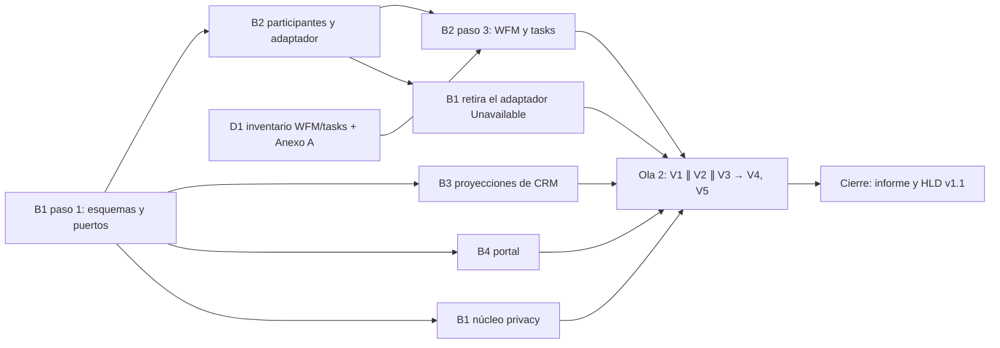

# `privacy` Fase 1b — Bloqueo, anonimización y plazo de traslado · Plan de orquestación

**Fecha:** 2026-10-16 · **Versión:** 1.6 · **Emisor:** AI-EM-ARCH (modo EM + Orchestrator)
**Prompt:** [PROMPT-PRIVACY-FASE-1B-v1.0.md](../prompts/PROMPT-PRIVACY-FASE-1B-v1.0.md) · **Launcher:** [PROMPT-PRIVACY-FASE-1B-LAUNCH-v1.0.md](../prompts/PROMPT-PRIVACY-FASE-1B-LAUNCH-v1.0.md)
**Autoridad:**
- [ADR-094](../adrs/ADR-094-Modelo-Proteccion-Datos-Personales-Habeas-Data.md);
- [HLD-PRIVACY-HABEAS-DATA-v1.0](../hlds/HLD-PRIVACY-HABEAS-DATA-v1.0.md);
- [ADR-095](../adrs/ADR-095-Topologia-Productiva-Dominio-TLS-Hosting.md): G7 diferido hasta la beta mínima.

## 0. Por qué ahora

- **D-1B** (2026-10-15) dejó la Fase 1b para después de producción, con el runbook manual como mitigación.
- El 2026-10-16 el CTO difirió producción hasta la beta y pidió **terminar el código**. Por eso la Fase 1b entra ahora.
- Al cerrarla, el runbook manual queda como vía de emergencia, y el criterio #1 de la re-auditoría de MOD05 (SUB-A06) se cierra sin mitigación.
- No está en la ruta crítica de la Ley 2573: la suplantación ya está en GO.

## 1. Decisiones del CTO antes de lanzar

| # | Decisión | Recomendación de AI-EM-ARCH | Motivo |
| --- | --- | --- | --- |
| D-1B-1 | ¿Con qué fundamento se bloquea al rechazar una supresión? | **Solo con `DEBER_LEGAL_CONSERVACION`** | Con contrato vigente los datos se necesitan para prestar el servicio; bloquearlos frena la operación. Diferir el bloqueo hasta la terminación exige un disparador nuevo sin beneficio: al terminar, el titular puede volver a pedir la supresión y entonces rige el deber legal |
| D-1B-2 | ¿Entran WFM y `tasks` en la supresión? | **Sí**, y el Anexo A del runbook se corrige ya | Hallazgo H7: `visit_requests`, `schedule_events` y `execution_orders` guardan dirección, coordenadas y la etiqueta del cliente. Hoy el runbook manual **deja esos datos**: es una brecha del procedimiento vigente, no solo de la Fase 1b |
| D-1B-3 | ¿Se retira `IPersonalDataBlockPort`? | **Sí**: el bloqueo se aplica al leer, desde las marcas | CRM ya lee las marcas por lote (H1); un puerto de escritura duplicaría el estado. La propuesta previa (`processing_blocked_at` en Party) suponía que CRM no podía leer las marcas, y eso ya no es cierto |
| D-1B-4 | ¿La app permite anonimizar expedientes que no coinciden por HMAC? | **No**: el servidor calcula los candidatos; `--confirm-unmatched` queda solo en el CLI | La confirmación manual de un expediente ajeno es el error más costoso e irreversible; en la app solo se borra lo que el sistema prueba que es del titular |

Las cuatro son reversibles antes de lanzar y no cambian ADR-094. El HLD se actualiza al cierre.

**✅ D-1B-1 a D-1B-4 aprobadas por el CTO (2026-10-16).**

### Estado al 2026-10-16 (Ola 1, checkpoint)

| Bloque | Estado | Evidencia |
| --- | --- | --- |
| B1 | Parcial: S1, la 149, `resolve` y `reject`, traslado y retiro de `IPersonalDataBlockPort` hechos. Falta retirar el adaptador `Unavailable` (S3) | [B1](../informes/INFORME-PRIVACY-FASE-1B-B1-v1.0.md). Verificación de AI-EM-ARCH sin caché: `privacy` y el spec del módulo CRM, 32 suites y 148 tests; shared, 4 suites y 20 tests; portal, 3 suites y 10 tests; 149, 1 suite y 2 tests; typecheck de api, shared, db y portal |
| D1 | ✅ Cerrado; Anexo A del runbook corregido | [D1](../informes/INFORME-PRIVACY-FASE-1B-D1-v1.0.md) |
| B2 | `[BLOQUEO]`: regla de `contracts`, sus snapshots y la evidencia de estrato | [B2](../informes/INFORME-PRIVACY-FASE-1B-B2-v1.0.md) |
| B3 | `[BLOQUEO]` sin objeto: `crm/contacts/**` está desmontado (D-CONT). Defecto del emisor en §2.11 | [B3](../informes/INFORME-PRIVACY-FASE-1B-B3-v1.0.md); línea base de `crm/subscribers`: 93,81 % de statements y 83,20 % de branches |
| B4 | Parcial: detalle de solicitud hecho; la redacción espera a B3 | [B4](../informes/INFORME-PRIVACY-FASE-1B-B4-v1.0.md) |

Mientras no esté el adaptador real, `resolve` de SUPRIMIR y la vista previa responden **503**: fallan cerrados en lugar de declarar una supresión sin ejecutarla. El runbook manual cubre ese tramo. El delta v1.1 del prompt resuelve los dos bloqueos.

### v1.1 (2026-10-16): delta y Ola 1-bis

**Decisiones del CTO:**
- **D-1B-5:** los datos personales del contrato se anonimizan, pero el contrato se conserva como insumo de las consultas, y en todo el sistema se ve que fue anonimizado (marca `anonymized_at` en Party, suscriptor y expediente).
- **D-1B-6:** los datos de un titular bloqueado los ven el Oficial (`privacy.read`) y facturación y cobro (permiso nuevo `crm.blocked_data.read`, perfil «Facturación y cobro», rol base `ACCOUNTANT`). Ventas y técnicos no los ven en CRM.

**Delta:** [PROMPT-PRIVACY-FASE-1B-v1.1.md](../prompts/PROMPT-PRIVACY-FASE-1B-v1.1.md):
- reglas de `contracts` y `quotes`;
- migraciones 150 (marca de anonimización) y 151 (permiso);
- encadenamiento de WFM y `tasks` según D1;
- R10 corregida (sin `crm/contacts/**`);
- cierre de `DATOS_BLOQUEADOS` al resolver una supresión posterior.

**Launcher:** [PROMPT-PRIVACY-FASE-1B-LAUNCH-v1.1.md](../prompts/PROMPT-PRIVACY-FASE-1B-LAUNCH-v1.1.md).

**Orden de la Ola 1-bis:**
1. B1 (S1′: 150, 151 y el enum) ∥ B2 (extracción del CLI desde ya).
2. B3 tras S1′; publica los esquemas (S2′).
3. B4 tras S2′.
4. B1 retira el adaptador `Unavailable` tras el paso 2 de B2 (S3).

| Bloque | Skills: sin cambios respecto a §3 |
| --- | --- |
| B1 a B4 | Las mismas filas de la matriz; B4 aplica también `wcag-audit-patterns` a la insignia y al enlace |

## 2. Bloques y dependencias

- **Ruta crítica:** B1 paso 1 → B2 (extracción del CLI, la pieza más grande) → B2 paso 3 → V1 (E2E real).
- **Paralelo real:** B1, B2, B3 y B4 tienen propiedad disjunta (prompt §4) y trabajan contra los contratos de §2, que escribe B1 en su primer paso. D1 corre desde el minuto cero.
- **Puntos de sincronización:**
  1. **S1:** fin del primer paso de B1; B2, B3 y B4 importan de ahí.
  2. **S2:** informe de D1; B2 aplica WFM y `tasks`.
  3. **S3:** B2 paso 2; B1 retira el adaptador `Unavailable`.
  4. **S4:** todos los bloques verdes, y empieza la Ola 2.
- **Se trabaja en `main`, sin ramas.** Dos bloques `sr-backend` simultáneos comparten el árbol: la propiedad disjunta es la única protección, y nadie commitea hasta el cierre.

## 3. Matriz de dispatch (agente × skill)

| Bloque | Agente | Skills obligatorias (leer el `SKILL.md` antes de escribir código) | De apoyo, con su condición | Descartadas y motivo |
| --- | --- | --- | --- | --- |
| B1 | `sr-backend` | `nestjs-expert`, `database-migration`, `iwana-tenant-migration`, `test-driven-development`, `backend-security-coder` | `postgresql` para el trigger de la 149; `openapi-spec-generation` para el swagger | `bullmq-specialist`: no hay colas nuevas |
| B2 | `sr-backend` | `nestjs-expert`, `postgresql`, `backend-security-coder`, `test-driven-development`, `codebase-cleanup-deps-audit` | `typescript-pro` para tipar los participantes | `database-migration`: B2 no migra |
| B3 | `sr-backend` | `nestjs-expert`, `backend-security-coder`, `testing-patterns` | `postgresql` para el filtro `<> ALL` | `iwana-tenant-migration`: sin DDL |
| D1 | `data-eng` | `postgresql`, `docs-architect` | — | `database-migration`: D1 inventaría, no migra |
| B4 | `fe-platform` | `core-components`, `frontend-dev-guidelines`, `nextjs-app-router-patterns`, `iwana-identity-ui-review` | `wcag-audit-patterns` para el diálogo y la casilla; `ui-ux-pro-max` **subordinada** a las anteriores y sin fundamentar severidad | `tailwind-patterns` como fuente de tokens: no hay tokens nuevos |
| V1 | `sr-qa` | `e2e-testing-patterns`, `playwright-skill`, `iwana-test-evidence`, `verification-before-completion` | `testing-patterns` | `ui-ux-pro-max`: no hay revisión visual |
| V2 | `sec-eng` | `security-auditor`, `backend-security-coder` | `frontend-security-coder` para el diálogo | — |
| V3 | `boundary-reviewer` ∥ `contract-drift-reviewer` | `architect-review` | `monorepo-architect` | — |
| V4 | `gate-verifier` | `iwana-test-evidence`, `turborepo-caching` | — | — |
| V5 | `docs-governance` | `docs-architect` | — | — |
| Cierre | AI-EM-ARCH | `iwana-cierre-fase`, `architecture-decision-records` | — | — |

**Scripts que exige el plan:**
- `pnpm exec turbo run test --filter=<paquete> --force` (0 cache hits);
- `pnpm audit:adr-citations` y `pnpm audit:doc-locations` para los `docs/`;
- `rg IPersonalDataBlockPort apps packages`, que debe dar vacío (R12).

## 4. Gates

| Gate | Criterio | Quién |
| --- | --- | --- |
| G4 | Cero hallazgos críticos y altos en V2 y V3 | `sec-eng`, revisores |
| G6 | Tests y E2E reales verdes; matriz R ↔ test completa; cobertura de `privacy/**` ≥ 80 %; `crm/subscribers` sin bajar de su línea base | `sr-qa`, `gate-verifier` |
| G6.5 | CI de `main` verde con la 149 aplicada, verificado por SHA con `gh run` | AI-EM-ARCH |
| G7 | No se evalúa: diferido hasta la beta (ADR-095) | CTO |

## 5. Riesgos

| Riesgo | Mitigación |
| --- | --- |
| La extracción del CLI cambia la semántica de anonimización | La integración vigente del CLI pasa **sin editar sus aserciones** (prompt §2.6) |
| Anonimización parcial e irreversible | Una sola transacción, verificación de residuales dentro de ella y test de rollback con fallo provocado (R2) |
| Enumeración de titulares bloqueados por búsqueda | R9, revisado por V2 |
| Los dictámenes jurídicos (preguntas 9 a 11) cambian lo que se conserva | La lista de §2.5 está en participantes por módulo; un cambio toca una tabla, no el flujo |

## 6. Cierre

- Informe `INFORME-PRIVACY-FASE-1B-CIERRE-G6-v1.0.md`.
- HLD v1.1: retiro de `IPersonalDataBlockPort`, el defecto H6 cerrado y el plazo de traslado.
- Runbook manual v1.1: pasa a vía de emergencia.
- Re-auditoría de SUB-A06.

## Lanzamiento

El launcher es [PROMPT-PRIVACY-FASE-1B-LAUNCH-v1.0.md](../prompts/PROMPT-PRIVACY-FASE-1B-LAUNCH-v1.0.md); si diverge de esta sección, prevalece el archivo.

- **Ola 1:** B1 (primer paso) ∥ D1. Tras S1, B2 ∥ B3 ∥ B4.
- **Ola 2:** V1 ∥ V2 ∥ V3, después V4 y V5.
- **Precondición:** el CTO aprueba D-1B-1 a D-1B-4; `main` en `aeedeffc` o posterior; `dbiw` respaldada con `pnpm db:backup` antes de migrar a la 149 (Ola 2).

### v1.2 (2026-10-16): resultado de la Ola 1-bis y delta

| Bloque | Estado | Evidencia |
| --- | --- | --- |
| CI | Test de `restore-tenant` corregido (normaliza espacios; el script no cambia): 43/43 | [INFORME-PLAT-OPS-CI-RESTORE-TENANT-TEST-v1.0](../informes/INFORME-PLAT-OPS-CI-RESTORE-TENANT-TEST-v1.0.md) |
| B1 | ✅ 150, 151, permiso, cierre de `DATOS_BLOQUEADOS` y S3 (adaptador `Unavailable` retirado) | [B1 v1.1](../informes/INFORME-PRIVACY-FASE-1B-B1-v1.1.md) |
| B2 | Participantes, adaptador y marca hechos; `[BLOQUEO]` por la evidencia de las autorizaciones | [B2 v1.1](../informes/INFORME-PRIVACY-FASE-1B-B2-v1.1.md) |
| B3 | Hecho: 33 suites y 663 tests. Queda P1 (subrecursos del expediente) y P2 (functions −0,50 pp) | [B3 v1.1](../informes/INFORME-PRIVACY-FASE-1B-B3-v1.1.md) |
| B4 | ✅ 11 suites y 86 tests | [B4 v1.1](../informes/INFORME-PRIVACY-FASE-1B-B4-v1.1.md) |

**Diagnóstico:** el bloqueo de B2 es una contradicción del emisor. R6 y la pregunta 9 al abogado conservan la prueba de la autorización, pero el Anexo A y el CLI borran su evidencia. Por eso hoy la API y el CLI divergen (contra R13).

**D-1B-7 (pendiente del CTO):** conservar la evidencia de las autorizaciones (A, recomendada) o borrarla (B).

**Delta:** [PROMPT-PRIVACY-FASE-1B-v1.2.md](../prompts/PROMPT-PRIVACY-FASE-1B-v1.2.md):
- E-A o E-B según D-1B-7;
- F, lecturas de subrecursos bloqueadas;
- G, cobertura de functions.

**Launcher:** [PROMPT-PRIVACY-FASE-1B-LAUNCH-v1.2.md](../prompts/PROMPT-PRIVACY-FASE-1B-LAUNCH-v1.2.md).

**✅ D-1B-7 = A aprobada por el CTO (2026-10-16):** la evidencia de las autorizaciones se conserva como prueba de la autorización. Corregida la fila `public.media_assets` del Anexo A del runbook. E-A queda habilitado.

### v1.3 (2026-10-16): resultado de la Ola 2 y correcciones

| Verificador | Resultado |
| --- | --- |
| V1 `sr-qa` | `[BLOQUEO]`: no hay suite E2E de la fase y `dbiw` no está migrada a la 151. El launcher v1.3 prohibía «corregir código» y `sr-qa` entendió que tampoco podía escribir tests: defecto del emisor |
| V2 `sec-eng` | **NO-GO G4**: `updateSection` sirve la PII de un bloqueado (alta); la auditoría de la supresión no es transaccional (alta) |
| V3 revisores | Sin violaciones de boundary. **NO-GO G4** por el límite de candidatos entre la vista previa y `resolve` (alta); además, la marca en las respuestas de mutación de contrato (media) y OpenAPI (baja) |
| V4 `gate-verifier` | Gates verdes: api 5 204, db 397, portal 3 042, shared 173 y worker 169 tests; `privacy/**` con 93,38 % de statements y 81,99 % de branches |
| V5 `docs-governance` | 0 bloqueantes; 7 metadatos menores (los de los prompts FIX-CI ya están corregidos) |
| CI `38958070660` | Unit tests de los siete paquetes en verde. Falla la integración de la 150: el test cuenta en `pg_proc` sin filtrar por schema |

**Delta:** [PROMPT-PRIVACY-FASE-1B-v1.3.md](../prompts/PROMPT-PRIVACY-FASE-1B-v1.3.md):
- H1 a H10, con los contratos C1 a C8;
- decisión del emisor: las lecturas de datos bloqueados no se sirven sin auditoría (C3).

**Launcher:** [PROMPT-PRIVACY-FASE-1B-LAUNCH-v1.4.md](../prompts/PROMPT-PRIVACY-FASE-1B-LAUNCH-v1.4.md).

### v1.4 (2026-10-16): resultado de la Ola 2-bis

**Lo que quedó cerrado:**
- H1 a H10 de v1.3, según V2′ y V3′;
- V3′ sin violaciones de boundary.

**Lo que sigue abierto:**
- **G4 NO-GO**, por dos P1 de V2′: las transiciones de estado del suscriptor y del contrato mutan titulares bloqueados. La causa es del emisor: v1.1 §5.3 enumeró rutas en vez de fijar una regla.
- **V4′:** la API tiene 69 tests en rojo (fixtures HTTP de expedientes tras C3).
- **V1:** la suite está escrita, pero no se ejecutó. **AI-EM-ARCH verificó en solo lectura que `dbiw` no tiene la 149 ni la 150 en ninguno de sus 21 schemas tenant:** la precondición del CTO sigue pendiente.
- **CI de `0af184d4`:** rojo solo por la integración de la 150 (H7), corregida en el árbol por B1 (C6).

**Delta:** [PROMPT-PRIVACY-FASE-1B-v1.4.md](../prompts/PROMPT-PRIVACY-FASE-1B-v1.4.md):
- R10 como regla general, con un decorador y un test de arquitectura sobre todas las rutas de mutación;
- H12 a H14;
- deuda D-H15.

**Launcher:** [PROMPT-PRIVACY-FASE-1B-LAUNCH-v1.5.md](../prompts/PROMPT-PRIVACY-FASE-1B-LAUNCH-v1.5.md).

### v1.5 (2026-10-16): resultado de la Ola 2-ter

| Verificador | Resultado |
| --- | --- |
| B1 y B3 | API con 385 suites y 5 229 tests, 0 fallos; turbo 10/10 sin caché. Guardas: 4 rutas de suscriptores, 13 de contratos y 12 de expedientes (todas las del inventario salvo las excepciones), con test de arquitectura |
| V2″ `sec-eng` | ✅ **G4 GO**: 32 rutas de mutación revisadas |
| V4″ `gate-verifier` | `privacy/**` con 94,61 % de statements y 82,73 % de branches; integraciones de la 149 a la 151, 3/3. El build terminó 7/7 sin caché, pero el wrapper de turbo quedó abierto en Windows sin ninguna tarea activa |
| V1 `sr-qa` | `[BLOQUEO]`: `dbiw` sigue sin la 149 a la 151 en sus 21 schemas tenant |

**Disposición de H14:** la evidencia de build se toma del CI de Linux («Build y validación de imágenes production» y el build del job de unit tests). El cuelgue del wrapper en Windows queda como deuda P3 de `plat-ops`.

**Observación P3:** el decorador `guard-blocked-titular` está repetido en tres módulos; consolidarlo en un util compartido de CRM.

**G6 sigue abierto** solo por V1, que espera la migración de `dbiw` (CTO).

### Corrección del emisor y migración de `dbiw` (2026-10-16)

- **Corrección:** la afirmación de v1.4 de que «`dbiw` no tiene la 149 ni la 150 en ninguno de sus 21 schemas» se apoyó en `information_schema.columns`, que oculta las columnas sin permiso para el rol de solo lectura. La comprobación correcta (`pg_attribute` y `typeorm_migrations`) muestra que los **3 tenants ACTIVE** tienen la 149 a la 151. Los otros 18 schemas son tenants no ACTIVE (QA y E2E), que `db:migrate:all` no recorre.
- **Ejecutado por orden del CTO:** `pnpm db:backup` (`.backups/dbiw-2026-10-16T23-45-00-410Z.dump`, 14 MB) y luego `pnpm db:migrate:all`, que terminó con exit 0, lock global, 3 tenants y `apply-least-privilege: OK`.
- **Consecuencia para V1:** la suite E2E corre sobre un tenant **ACTIVE** migrado. Los tenants de E2E no ACTIVE no tienen la Fase 1b.

### v1.6 (2026-10-17): CI verde, V1 y FIX-PREVIEW

- **G6.5 (evidencia):** el CI [`38983191847`](https://github.com/Sleybc/iWana-neXt/actions/runs/38983191847) de `1214ea02` terminó en **verde en sus 5 jobs**, con todos los pasos ejecutados: unit tests, integraciones de db, API y worker, E2E operativo, build de imágenes y citas ADR. Es el primer CI totalmente verde desde el 2026-10-15.
- **V1 v1.7:** 3/4. La vista previa de la supresión daba HTTP 500.
- **[FIX-PREVIEW](../informes/INFORME-PRIVACY-FASE-1B-FIX-PREVIEW-v1.0.md):**
  - **Causa:** `22P02` en `wfm-titular-erasure.participant.ts`, por comparar `origin_context` con `'TASKS'`, valor que no existe en el enum de la base.
  - **Segundo defecto destapado:** `42883` en `operational_tasks`, columnas de texto comparadas como uuid.
  - **Corrección:** las dos comparaciones se hacen como texto. Un fallo de esquema esperable de un participante responde 503 `PRIVACY_ERASURE_PARTICIPANT_UNAVAILABLE` en vez de 500.
  - **Test nuevo:** `privacy-erasure-api.postgres.integration.spec.ts`, con el adaptador real y el schema creado con las migraciones reales. Antes ningún test cubría la vista previa ni `resolve` por la API con el adaptador real contra Postgres.

**Deuda escalada (fuera de la Fase 1b):**

| Severidad | Deuda | Dueño |
| --- | --- | --- |
| P1 (a verificar) | `WorkOrderSourceContext.TASKS` está en `@iwana/shared`, pero no en el enum `work_order_source_context` de la base (030, sin `ADD VALUE`). Lo usan WFM, `tasks` y el portal: crear una visita o una orden con origen `TASKS` fallaría con `22P02`. Decisión del CTO: migración `ADD VALUE 'TASKS'` (recomendada, porque la funcionalidad existe en API y portal) o retirarlo del contrato | MOD11 / WFM |
| P2 | Ante un `QueryFailedError` inesperado, el log global de Nest imprime la consulta con sus parámetros, que pueden incluir un HMAC | `sec-eng` + backend |
| P3 | Los demás tests de supresión crean las tablas a mano y no ven los tipos reales; deben pasar al patrón de migraciones reales | `sr-qa` |
