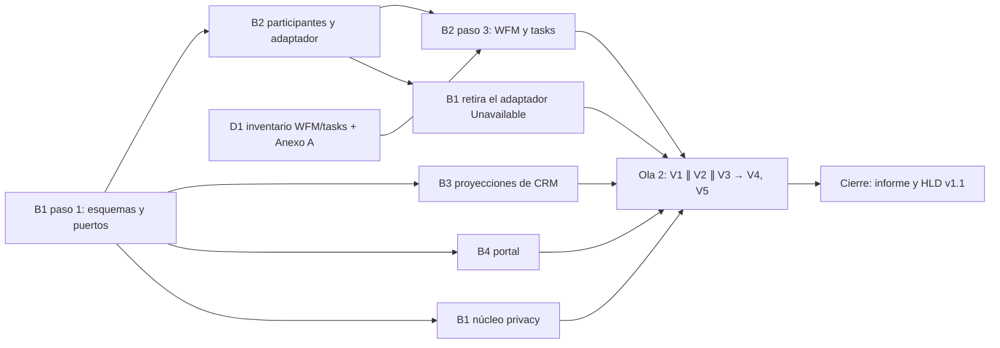

# `privacy` Fase 1b — Bloqueo, anonimización y plazo de traslado · Plan de orquestación

**Fecha:** 2026-10-16 · **Versión:** 1.0 · **Emisor:** AI-EM-ARCH (modo EM + Orchestrator)
**Prompt:** [PROMPT-PRIVACY-FASE-1B-v1.0.md](../prompts/PROMPT-PRIVACY-FASE-1B-v1.0.md) · **Launcher:** [PROMPT-PRIVACY-FASE-1B-LAUNCH-v1.0.md](../prompts/PROMPT-PRIVACY-FASE-1B-LAUNCH-v1.0.md)
**Autoridad:**
- [ADR-094](../adrs/ADR-094-Modelo-Proteccion-Datos-Personales-Habeas-Data.md);
- [HLD-PRIVACY-HABEAS-DATA-v1.0](../hlds/HLD-PRIVACY-HABEAS-DATA-v1.0.md);
- [ADR-095](../adrs/ADR-095-Topologia-Productiva-Dominio-TLS-Hosting.md): G7 diferido hasta la beta mínima.

## 0. Por qué ahora

- **D-1B** (2026-10-15) dejó la Fase 1b para después de producción, con el runbook manual como mitigación.
- El 2026-10-16 el CTO difirió producción hasta la beta y pidió **terminar el código**. Por eso la Fase 1b entra ahora.
- Al cerrarla, el runbook manual queda como vía de emergencia, y el criterio #1 de la re-auditoría de MOD05 (SUB-A06) se cierra sin mitigación.
- No está en la ruta crítica de la Ley 2573: la suplantación ya está en GO.

## 1. Decisiones del CTO antes de lanzar

| # | Decisión | Recomendación de AI-EM-ARCH | Motivo |
| --- | --- | --- | --- |
| D-1B-1 | ¿Con qué fundamento se bloquea al rechazar una supresión? | **Solo con `DEBER_LEGAL_CONSERVACION`** | Con contrato vigente los datos se necesitan para prestar el servicio; bloquearlos frena la operación. Diferir el bloqueo hasta la terminación exige un disparador nuevo sin beneficio: al terminar, el titular puede volver a pedir la supresión y entonces rige el deber legal |
| D-1B-2 | ¿Entran WFM y `tasks` en la supresión? | **Sí**, y el Anexo A del runbook se corrige ya | Hallazgo H7: `visit_requests`, `schedule_events` y `execution_orders` guardan dirección, coordenadas y la etiqueta del cliente. Hoy el runbook manual **deja esos datos**: es una brecha del procedimiento vigente, no solo de la Fase 1b |
| D-1B-3 | ¿Se retira `IPersonalDataBlockPort`? | **Sí**: el bloqueo se aplica al leer, desde las marcas | CRM ya lee las marcas por lote (H1); un puerto de escritura duplicaría el estado. La propuesta previa (`processing_blocked_at` en Party) suponía que CRM no podía leer las marcas, y eso ya no es cierto |
| D-1B-4 | ¿La app permite anonimizar expedientes que no coinciden por HMAC? | **No**: el servidor calcula los candidatos; `--confirm-unmatched` queda solo en el CLI | La confirmación manual de un expediente ajeno es el error más costoso e irreversible; en la app solo se borra lo que el sistema prueba que es del titular |

Las cuatro son reversibles antes de lanzar y no cambian ADR-094. El HLD se actualiza al cierre.

**✅ D-1B-1 a D-1B-4 aprobadas por el CTO (2026-10-16).**

### Estado al 2026-10-16 (Ola 1, checkpoint)

| Bloque | Estado | Evidencia |
| --- | --- | --- |
| B1 | Parcial: S1, la 149, `resolve` y `reject`, traslado y retiro de `IPersonalDataBlockPort` hechos. Falta retirar el adaptador `Unavailable` (S3) | [B1](../informes/INFORME-PRIVACY-FASE-1B-B1-v1.0.md). Verificación de AI-EM-ARCH sin caché: `privacy` y el spec del módulo CRM, 32 suites y 148 tests; shared, 4 suites y 20 tests; portal, 3 suites y 10 tests; 149, 1 suite y 2 tests; typecheck de api, shared, db y portal |
| D1 | ✅ Cerrado; Anexo A del runbook corregido | [D1](../informes/INFORME-PRIVACY-FASE-1B-D1-v1.0.md) |
| B2 | `[BLOQUEO]`: regla de `contracts`, sus snapshots y la evidencia de estrato | [B2](../informes/INFORME-PRIVACY-FASE-1B-B2-v1.0.md) |
| B3 | `[BLOQUEO]` sin objeto: `crm/contacts/**` está desmontado (D-CONT). Defecto del emisor en §2.11 | [B3](../informes/INFORME-PRIVACY-FASE-1B-B3-v1.0.md); línea base de `crm/subscribers`: 93,81 % de statements y 83,20 % de branches |
| B4 | Parcial: detalle de solicitud hecho; la redacción espera a B3 | [B4](../informes/INFORME-PRIVACY-FASE-1B-B4-v1.0.md) |

Mientras no esté el adaptador real, `resolve` de SUPRIMIR y la vista previa responden **503**: fallan cerrados en lugar de declarar una supresión sin ejecutarla. El runbook manual cubre ese tramo. El delta v1.1 del prompt resuelve los dos bloqueos.

## 2. Bloques y dependencias

- **Ruta crítica:** B1 paso 1 → B2 (extracción del CLI, la pieza más grande) → B2 paso 3 → V1 (E2E real).
- **Paralelo real:** B1, B2, B3 y B4 tienen propiedad disjunta (prompt §4) y trabajan contra los contratos de §2, que escribe B1 en su primer paso. D1 corre desde el minuto cero.
- **Puntos de sincronización:**
  1. **S1:** fin del primer paso de B1; B2, B3 y B4 importan de ahí.
  2. **S2:** informe de D1; B2 aplica WFM y `tasks`.
  3. **S3:** B2 paso 2; B1 retira el adaptador `Unavailable`.
  4. **S4:** todos los bloques verdes, y empieza la Ola 2.
- **Se trabaja en `main`, sin ramas.** Dos bloques `sr-backend` simultáneos comparten el árbol: la propiedad disjunta es la única protección, y nadie commitea hasta el cierre.

## 3. Matriz de dispatch (agente × skill)

| Bloque | Agente | Skills obligatorias (leer el `SKILL.md` antes de escribir código) | De apoyo, con su condición | Descartadas y motivo |
| --- | --- | --- | --- | --- |
| B1 | `sr-backend` | `nestjs-expert`, `database-migration`, `iwana-tenant-migration`, `test-driven-development`, `backend-security-coder` | `postgresql` para el trigger de la 149; `openapi-spec-generation` para el swagger | `bullmq-specialist`: no hay colas nuevas |
| B2 | `sr-backend` | `nestjs-expert`, `postgresql`, `backend-security-coder`, `test-driven-development`, `codebase-cleanup-deps-audit` | `typescript-pro` para tipar los participantes | `database-migration`: B2 no migra |
| B3 | `sr-backend` | `nestjs-expert`, `backend-security-coder`, `testing-patterns` | `postgresql` para el filtro `<> ALL` | `iwana-tenant-migration`: sin DDL |
| D1 | `data-eng` | `postgresql`, `docs-architect` | — | `database-migration`: D1 inventaría, no migra |
| B4 | `fe-platform` | `core-components`, `frontend-dev-guidelines`, `nextjs-app-router-patterns`, `iwana-identity-ui-review` | `wcag-audit-patterns` para el diálogo y la casilla; `ui-ux-pro-max` **subordinada** a las anteriores y sin fundamentar severidad | `tailwind-patterns` como fuente de tokens: no hay tokens nuevos |
| V1 | `sr-qa` | `e2e-testing-patterns`, `playwright-skill`, `iwana-test-evidence`, `verification-before-completion` | `testing-patterns` | `ui-ux-pro-max`: no hay revisión visual |
| V2 | `sec-eng` | `security-auditor`, `backend-security-coder` | `frontend-security-coder` para el diálogo | — |
| V3 | `boundary-reviewer` ∥ `contract-drift-reviewer` | `architect-review` | `monorepo-architect` | — |
| V4 | `gate-verifier` | `iwana-test-evidence`, `turborepo-caching` | — | — |
| V5 | `docs-governance` | `docs-architect` | — | — |
| Cierre | AI-EM-ARCH | `iwana-cierre-fase`, `architecture-decision-records` | — | — |

**Scripts que exige el plan:**
- `pnpm exec turbo run test --filter=<paquete> --force` (0 cache hits);
- `pnpm audit:adr-citations` y `pnpm audit:doc-locations` para los `docs/`;
- `rg IPersonalDataBlockPort apps packages`, que debe dar vacío (R12).

## 4. Gates

| Gate | Criterio | Quién |
| --- | --- | --- |
| G4 | Cero hallazgos críticos y altos en V2 y V3 | `sec-eng`, revisores |
| G6 | Tests y E2E reales verdes; matriz R ↔ test completa; cobertura de `privacy/**` ≥ 80 %; `crm/subscribers` sin bajar de su línea base | `sr-qa`, `gate-verifier` |
| G6.5 | CI de `main` verde con la 149 aplicada, verificado por SHA con `gh run` | AI-EM-ARCH |
| G7 | No se evalúa: diferido hasta la beta (ADR-095) | CTO |

## 5. Riesgos

| Riesgo | Mitigación |
| --- | --- |
| La extracción del CLI cambia la semántica de anonimización | La integración vigente del CLI pasa **sin editar sus aserciones** (prompt §2.6) |
| Anonimización parcial e irreversible | Una sola transacción, verificación de residuales dentro de ella y test de rollback con fallo provocado (R2) |
| Enumeración de titulares bloqueados por búsqueda | R9, revisado por V2 |
| Los dictámenes jurídicos (preguntas 9 a 11) cambian lo que se conserva | La lista de §2.5 está en participantes por módulo; un cambio toca una tabla, no el flujo |

## 6. Cierre

- Informe `INFORME-PRIVACY-FASE-1B-CIERRE-G6-v1.0.md`.
- HLD v1.1: retiro de `IPersonalDataBlockPort`, el defecto H6 cerrado y el plazo de traslado.
- Runbook manual v1.1: pasa a vía de emergencia.
- Re-auditoría de SUB-A06.

## Lanzamiento

El launcher es [PROMPT-PRIVACY-FASE-1B-LAUNCH-v1.0.md](../prompts/PROMPT-PRIVACY-FASE-1B-LAUNCH-v1.0.md); si diverge de esta sección, prevalece el archivo.

- **Ola 1:** B1 (primer paso) ∥ D1. Tras S1, B2 ∥ B3 ∥ B4.
- **Ola 2:** V1 ∥ V2 ∥ V3, después V4 y V5.
- **Precondición:** el CTO aprueba D-1B-1 a D-1B-4; `main` en `aeedeffc` o posterior; `dbiw` respaldada con `pnpm db:backup` antes de migrar a la 149 (Ola 2).
