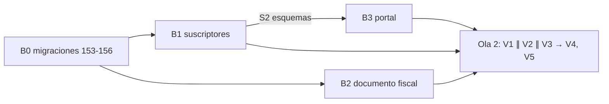

# MOD05 — Deuda de código (M03, M04, documento fiscal, B02, B04) · Plan de orquestación

**Fecha:** 2026-10-17 · **Versión:** 1.0 · **Emisor:** AI-EM-ARCH (modo EM + Orchestrator)
**Prompt:** [PROMPT-MOD05-DEUDA-CODIGO-v1.0.md](../prompts/PROMPT-MOD05-DEUDA-CODIGO-v1.0.md) · **Launcher:** [PROMPT-MOD05-DEUDA-CODIGO-LAUNCH-v1.0.md](../prompts/PROMPT-MOD05-DEUDA-CODIGO-LAUNCH-v1.0.md)
**Origen:** [re-auditoría MOD05](../informes/INFORME-MOD05-SUBSCRIBERS-REAUDITORIA-v1.0.md) §8 (deuda de código abierta) y el [cierre de la Fase 1b](../informes/INFORME-PRIVACY-FASE-1B-CIERRE-G6-v1.0.md) §4 (`fiscal_document` en claro).

## 0. Alcance

| Ítem | Hallazgo | Qué se hace |
| --- | --- | --- |
| M03 | `TaxRegime { SIMPLIFIED, COMMON }` está derogado (Ley 1943 de 2018) | `vatResponsibility` y `rutResponsibilities[]`, según ADR-093 D6 |
| M04 | El DV del NIT y el representante legal son opcionales; el representante se captura como un UUID en texto libre | DV obligatorio y validado; representante legal obligatorio para persona jurídica (D-M04) |
| Documento fiscal | `contracts.fiscal_document` y `expediente_records.fiscal_document` en claro | Cifrado y HMAC, más un CLI de backfill (ADR-058) |
| B02 | `subscribers.expediente_id` y `legal_representative_id` sin FK | FK de expediente; la del representante sale de D-M04 |
| B04 | La entidad declara `varchar` donde la DDL usa `enum` | Metadata corregida, con test de paridad |

**Fuera de alcance:**
- la corrección del log global de Nest (P2 de seguridad, encargo aparte);
- la Fase 2 de privacidad;
- eliminar las columnas deprecadas (después del backfill por tenant, en G7).

## 1. Decisiones del CTO antes de lanzar

| # | Decisión | Recomendación de AI-EM-ARCH | Motivo |
| --- | --- | --- | --- |
| D-M03 | Catálogo de responsabilidades del RUT, mientras el contador no responda la pregunta 7 | **Implementar ya** con el catálogo de responsabilidades fiscales de la factura electrónica DIAN (`O-13`, `O-15`, `O-23`, `O-47`, `R-99-PN`), como lista cerrada en `@iwana/shared` marcada como provisional | La estructura ya la decidió ADR-093 D6. Esa lista es la que pide la factura electrónica; si el contador la ajusta, se cambia una lista y su CHECK, no el diseño. Esperar el dictamen deja el campo derogado en uso |
| D-M04 | ¿Qué es el representante legal? | **A: un Party** de tipo natural, con el rol nuevo `LEGAL_REPRESENTATIVE`, capturado por nombre, tipo y número de documento y deduplicado por HMAC (`IPartyWritePort.ensurePartyWithRole`) | El PRD (RF-SUB-03) dice «FK a otro subscriber NATURAL», pero eso obligaría a registrar al representante como **cliente**, con dirección, estrato y autorizaciones que no le corresponden. ADR-030 hace del Party la identidad, y el puerto ya existe. **B:** seguir el PRD al pie de la letra. **C:** dejarlo opcional, solo con FK. Si se aprueba A, el PRD se actualiza en el cierre |
| D-FIS | ¿Qué documentos se cifran? | `fiscal_document` de **contratos y expedientes** (puede ser una cédula). `subscribers.nit` **no**: solo existe para personas jurídicas y el NIT de una empresa no es dato personal (ADR-058 cubre cédulas, teléfonos y correos) | Cifrar el NIT de empresa rompería su búsqueda por igualdad sin ganar protección legal. Queda como observación |

**✅ D-M03, D-M04 (opción A) y D-FIS aprobadas por el CTO (2026-10-17).** La 154 entra en el alcance, y el PRD-MOD05 RF-SUB-03 se actualiza al cierre de la fase.

## 2. Bloques y dependencias

- **Ruta crítica:** B0 → B1 → B3 → V1.
- **Paralelo:** B1 ∥ B2, con propiedad disjunta. El único archivo compartido es `subscriber-creation.service.ts`: B2 toca **solo** las líneas del documento fiscal (prompt §4).
- **Sincronización:**
  - S1: migraciones listas;
  - S2: esquemas de shared publicados por B1.
- **Se trabaja en `main`, sin ramas.** B0 es el único que edita `runner.ts`.

## 3. Matriz de dispatch (agente × skill)

| Bloque | Agente | Skills obligatorias (leer el `SKILL.md` antes de escribir código) | De apoyo | Descartadas y motivo |
| --- | --- | --- | --- | --- |
| B0 | `sr-backend` | `database-migration`, `iwana-tenant-migration`, `postgresql`, `test-driven-development` | — | `nestjs-expert`: B0 no toca la API |
| B1 | `sr-backend` | `nestjs-expert`, `backend-security-coder`, `test-driven-development`, `typescript-expert` | `postgresql` para el test de paridad de enums | `database-migration`: B1 no migra |
| B2 | `sr-backend` | `nestjs-expert`, `backend-security-coder`, `postgresql`, `test-driven-development` | `auth-implementation-patterns` para el manejo de claves | `iwana-tenant-migration`: B0 ya migró |
| B3 | `fe-platform` | `core-components`, `frontend-dev-guidelines`, `iwana-identity-ui-review`, `system-vocabulary-review` | `wcag-audit-patterns` para la selección múltiple; `ui-ux-pro-max` subordinada | `tailwind-patterns` como fuente de tokens: no hay tokens nuevos |
| V1 | `sr-qa` | `e2e-testing-patterns`, `playwright-skill`, `iwana-test-evidence`, `verification-before-completion` | `testing-patterns` | — |
| V2 | `sec-eng` | `security-auditor`, `backend-security-coder` | `frontend-security-coder` | — |
| V3 | `boundary-reviewer` ∥ `contract-drift-reviewer` | `architect-review` | `monorepo-architect` | — |
| V4 | `gate-verifier` | `iwana-test-evidence`, `turborepo-caching` | — | — |
| V5 | `docs-governance` | `docs-architect` | — | — |

**Scripts que exige el plan:**
- `pnpm exec turbo run test --force --continue`;
- `test:integration` de db y api contra `iwana_it_g7_ci`;
- `pnpm audit:adr-citations` y `pnpm audit:doc-locations`.

## 4. Gates

| Gate | Criterio |
| --- | --- |
| G4 | Cero críticos y altos en V2 y V3 |
| G6 | V1 en verde contra la API real; las suites completas en verde; cobertura de `crm/subscribers` y `crm/contracts` sin bajar de su línea base (B1 y B2 la miden en `main` antes de editar) |
| G6.5 | CI de `main` en verde por SHA, con **todos** sus pasos ejecutados |
| G7 | Diferido hasta la beta (ADR-095). El backfill del documento fiscal y la eliminación de columnas deprecadas entran en el runbook por tenant |

## 5. Riesgos

| Riesgo | Mitigación |
| --- | --- |
| La 156 aborta en un tenant con suscriptores huérfanos | Aborta con un reporte (patrón de la 143). La conciliación se hace por tenant, antes de G7 |
| Filas heredadas sin responsabilidades del RUT | Se muestran «pendientes de completar» y se exigen al editar (R2). No bloquean la lectura |
| El contador cambia el catálogo | Es una lista cerrada en shared más un CHECK: un cambio pequeño de contrato |
| Lectura mixta del documento fiscal durante la expansión | R7, con test de una fila heredada; el CLI verifica 0 filas en claro |

## Lanzamiento

El launcher es [PROMPT-MOD05-DEUDA-CODIGO-LAUNCH-v1.0.md](../prompts/PROMPT-MOD05-DEUDA-CODIGO-LAUNCH-v1.0.md); si diverge de esta sección, prevalece el archivo.

- **Ola 1:** B0; tras S1, B1 ∥ B2; tras S2, B3.
- **Ola 2:** V1 ∥ V2 ∥ V3, después V4 y V5.
- **Precondición:** el CTO aprueba D-M03, D-M04 y D-FIS; `main` en `48529fd0` o posterior.

### v1.1 (2026-10-17): bloqueo de B1 y D-M05

- **B1:** publicó los esquemas (S2) y se bloqueó con razón. La conversión desde el expediente no tiene responsabilidades del RUT ni identidad del representante, y hoy **infiere** el régimen. Es un defecto del emisor: la pasada regla → campo no trazó la conversión.
- **B2:** R5 a R8 implementadas; falta la integración. El agente no alcanzó PostgreSQL (arriba en `:5433`) y probó Redis en 6399, cuando está en 6380.
- **D-M05 (pendiente del CTO):** exigir los datos fiscales al **activar y al contratar** (A, recomendada), y crear el prospecto convertido sin inventar nada. Delta: [PROMPT-MOD05-DEUDA-CODIGO-v1.1.md](../prompts/PROMPT-MOD05-DEUDA-CODIGO-v1.1.md), con la migración 157.

- **✅ D-M05 = A** (el CTO lanzó B0, B1 y B2 con esa opción, 2026-10-17): los datos fiscales se exigen al activar y al contratar; la conversión no infiere nada.
- **Ola 1, estado:** B0 v1.2 (157, 10/10 de integración en dos schemas), B1 v1.1 y B2 v1.1 completos. API con 5 294 tests y 0 fallos; integración de la API con 97 tests; `crm/subscribers` por encima de su línea base en las cuatro métricas. El portal tiene 3 tests en rojo por el contrato nuevo, que corresponden a B3.

### v1.2 (2026-10-17): Ola 2 y correcciones

- **CI de la Ola 1:** [`39054256748`](https://github.com/Sleybc/iWana-neXt/actions/runs/39054256748) sobre `e2348a42`, verde en 5/5. `main` volvió a verde tras el rojo de `09af7f60` (migración `NOT NULL` subida antes que su código).
- **Ola 2:**
  - V1: 9/12, con **DEF-01 crítica preexistente** (el alta manual de suscriptores está rota por HTTP desde `15bda462`) y DEF-02 alta (el 360° no descifra el documento fiscal);
  - V2: GO, con un medio (M-1);
  - V3: NO-GO por CD-01;
  - V4: verde, pero con las integraciones omitidas porque Docker estaba caído;
  - V5: NO-GO por la redacción del launcher, ya corregida.
- **Delta:** [PROMPT-MOD05-DEUDA-CODIGO-v1.2.md](../prompts/PROMPT-MOD05-DEUDA-CODIGO-v1.2.md):
  - DEF-01 y el patrón de los 7 DTO, con una guardia;
  - DEF-02, CD-01 a CD-08, B-01 y M-1;
  - el DV del NIT en `@iwana/shared`;
  - decisión CD-04: los campos fiscales entran en la lista blanca del detalle bloqueado.

### v1.3 (2026-10-18): cierre G6

- **Fase cerrada:** G4 y G6 en GO ([cierre](../informes/INFORME-MOD05-DEUDA-CIERRE-G6-v1.0.md)). G6.5 queda pendiente del CI del commit de cierre.
- **PRD:** se agregó la adenda §11 al PRD vigente ([Fase 04](../prds/PRD-MOD05-CRM-SUBSCRIBERS-FASE-04-v1.0.md)): RF-SUB-03′, RF-SUB-06′ y RF-SUB-14 a 16. El PRD v1.0 (superado) solo se anotó.
- **G6.5: GO** (2026-10-18): CI [`39126330380`](https://github.com/Sleybc/iWana-neXt/actions/runs/39126330380) sobre `d9018071`, verde en 5/5 con todos los pasos ejecutados. **Fase cerrada.**
