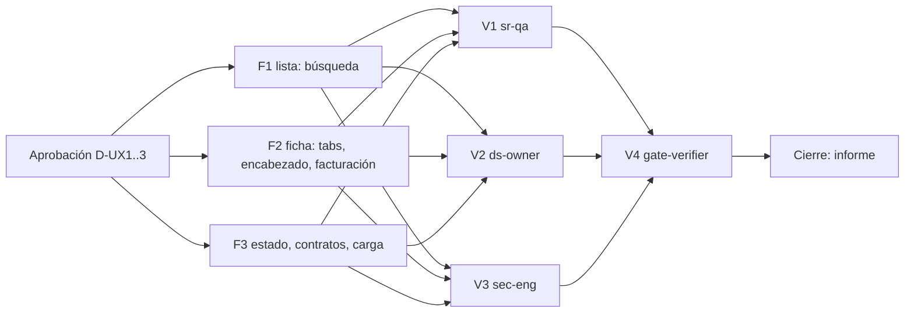

# MOD05 — CRM / Suscriptores · Quick wins de UX · Plan de orquestación

**Fecha:** 2026-10-18 · **Versión:** 1.0 · **Emisor:** AI-EM-ARCH (modo EM + Orchestrator)
**Spec:** [2026-10-18-mod05-suscriptores-ux-rediseno-spec.md](../specs/2026-10-18-mod05-suscriptores-ux-rediseno-spec.md) v1.0
**Prompt:** [PROMPT-MOD05-SUSCRIPTORES-UX-QW-v1.0.md](../prompts/PROMPT-MOD05-SUSCRIPTORES-UX-QW-v1.0.md) · **Launchers:** [v1.0 Olas 1 y 2](../prompts/PROMPT-MOD05-SUSCRIPTORES-UX-QW-LAUNCH-v1.0.md) · [v1.1 reanudación del cierre](../prompts/PROMPT-MOD05-SUSCRIPTORES-UX-QW-LAUNCH-v1.1.md)
**Base:** `main` en `d9018071`. Se trabaja en `main`, sin ramas.
**Estado de ejecución:** **Cerrado (G6, 2026-10-18).** F1-F3 implementados; G0-G5 aprobados. G5 se reabrió tras remediar las 4 críticas en la fase PLAT (`a6ca8e3f`, CI verde) y repetir V4 sin caché (307 suites, 3121 tests aprobados/1 omitido, Cached 0). Evidencia en [informe](../informes/INFORME-MOD05-SUSCRIPTORES-UX-QW-CIERRE-v1.0.md).

## 0. Alcance

Los seis quick wins de la spec §3 (QW1-QW6). **Solo frontend** en `apps/portal`: no cambia ningún contrato de `@iwana/shared`, ninguna ruta de la API ni ninguna migración.

**Fuera de alcance** (spec §4): E1-E8. En particular, la columna de servicio, la vista lateral, los chips con conteo, el flujo unificado de suspensión, el cambio de plan, la tab Soporte y todo lo de red (IP, MAC, diagnóstico).

## 1. Decisiones del CTO antes de lanzar

| # | Decisión | Recomendación de AI-EM-ARCH | Motivo |
| --- | --- | --- | --- |
| D-UX1 | ¿Cómo elige el operador entre búsqueda libre y exacta? | **Selector explícito** (`Texto`, `Documento`, `Teléfono`, `Correo`) | Una cédula y un teléfono son ambos dígitos: autodetectar el tipo adivinaría mal. Además el modo exacto es un acceso a PII y conviene que sea un acto deliberado |
| D-UX2 | ¿Qué hacer con las tabs «Financiero» y «Seguimiento»? | **Ocultarlas** hasta que exista su integración | Hoy son `StubCard` vacías. Volverán como «Facturación» y «Actividad» en E6/E7 |
| D-UX3 | Tipo de persona y segmento en el encabezado | **Texto secundario**, no badge | Son atributos fijos; como badges compiten con el estado, que es lo que se actúa |

**Estado:** G0 aprobado por el CTO en la sesión del 2026-10-18: D-UX1 selector explícito, D-UX2 ocultar stubs y D-UX3 texto secundario. Ola 1 lanzada; G1-G6 sujetos a evidencia de ejecución.

## 2. Bloques y dependencias



- **Ruta crítica:** F2 → V1 → V4 (F2 es el bloque más grande).
- **Paralelo:** F1 ∥ F2 ∥ F3 con **propiedad de archivos disjunta** (prompt §2). En la Ola 2, V1 ∥ V2 ∥ V3.
- **Sincronización:** S1 = los tres bloques F reportan tests de componente verdes con conteo real. Nadie edita un archivo fuera de su lista; si lo necesita, emite `[BLOQUEO]`.
- **Archivo compartido:** `subscriber-ui.ts` solo lo edita F3 (agrega `CONTRACT_STATUS_META`). F2 lo **lee**, no lo modifica.

## 3. Matriz de dispatch (agente × skill)

| Bloque | Agente | Skills obligatorias (leer el `SKILL.md` antes de escribir código) | De apoyo | Descartadas y motivo |
| --- | --- | --- | --- | --- |
| F1 | `fe-platform` | `core-components`, `frontend-dev-guidelines`, `iwana-identity-ui-review`, `frontend-security-coder` | `wcag-audit-patterns` para el grupo de modo; `system-vocabulary-review` para los textos | `nextjs-app-router-patterns`: no cambian rutas; `tailwind-patterns` como fuente de tokens: no hay tokens nuevos |
| F2 | `fe-platform` | `core-components`, `frontend-dev-guidelines`, `iwana-identity-ui-review`, `wcag-audit-patterns`, `nextjs-app-router-patterns` (estado en `searchParams`) | `ui-ux-pro-max` **subordinada** a `iwana-identity-ui-review` y a los tokens reales | `frontend-security-coder`: F2 no toca PII nueva |
| F3 | `fe-platform` | `core-components`, `frontend-dev-guidelines`, `iwana-identity-ui-review` | `system-vocabulary-review` para el mensaje de error | `wcag-audit-patterns` más allá de `aria-required`: el diálogo ya es accesible |
| V1 | `sr-qa` | `testing-patterns`, `wcag-audit-patterns`, `playwright-skill`, `iwana-test-evidence`, `verification-before-completion` | `e2e-testing-patterns` si se agrega un E2E | — |
| V2 | `ds-owner` | `iwana-identity-ui-review` (con `audit-ui.mjs`), `core-components` | `senior-ui-systems-designer` si la revisión requiere dirección visual sistémica | `ui-ux-pro-max` como fuente de severidad: prohibido |
| V3 | `sec-eng` | `frontend-security-coder`, `security-auditor` | — | `backend-security-coder`: no hay cambios de API |
| V4 | `gate-verifier` | `iwana-test-evidence`, `turborepo-caching` | — | — |
| Cierre | AI-EM-ARCH | `iwana-cierre-fase` | `docs-governance` (agente) | — |

**Scripts que exige el plan:**
- `node .agents/skills/iwana-identity-ui-review/scripts/audit-ui.mjs apps/portal/src/components/crm/subscribers` debe dar P0-P3 en 0 (gate de V2).
- `pnpm --filter @iwana/portal test`, `lint` y `typecheck`, con `--force` o sin caché de turbo y **conteo real** de suites y tests (gate de V4).

## 4. Gates

| Gate | Condición | Quién |
| --- | --- | --- |
| G0 | D-UX1, D-UX2 y D-UX3 aprobadas | CTO |
| G1 | S1: F1, F2 y F3 con tests de componente nuevos verdes (conteo real) | cada `fe-platform` |
| G2 | CA1-CA7 de la spec verificados; navegador en `localhost:3002` con lista, ficha y diálogo | `sr-qa` |
| G3 | Veredicto de identidad GO y `audit-ui.mjs` en 0 | `ds-owner` |
| G4 | Sin PII en URL, logs ni `console.*` en los archivos tocados | `sec-eng` |
| G5 | Gates Before Merge de `AGENTS.md` sobre `apps/portal` | `gate-verifier` |
| G6 | Informe de cierre `docs/informes/INFORME-MOD05-SUSCRIPTORES-UX-QW-CIERRE-v1.0.md` y commit en `main` | AI-EM-ARCH |

## 5. Riesgos

| Riesgo | Mitigación |
| --- | --- |
| Tres agentes en el mismo checkout de `main` | Propiedad de archivos disjunta (prompt §2); ningún agente commitea, solo AI-EM-ARCH al cierre |
| Un test verde que no corrió | Exigir conteo real y caché desactivada (memoria de proyecto: turbo, `--passWithNoTests`) |
| El modo exacto filtra PII a la URL o a los logs | R1.5 de la spec + G4 |
| Ocultar tabs rompe enlaces guardados | R2.2: los slugs viejos caen en Vista general |

## 6. Siguiente fase (no lanzada)

Tras el cierre de esta ola, el orden recomendado es: **E4** (addendum al PRD: relación suscriptor ↔ contrato y suspensión unificada), luego **E1 + E2** (proyección de la lista, vista lateral y chips), y en paralelo el **ADR de dominio de red** (E8) con `data-eng`. Cada una necesita su propia definición, plan y launcher.

## Lanzamiento

> **Fuente:** [launcher de reanudación](../prompts/PROMPT-MOD05-SUSCRIPTORES-UX-QW-LAUNCH-v1.1.md). El archivo prevalece; espejo completo:

````markdown
# LAUNCH — MOD05 · Suscriptores UX · Reanudar cierre

**Plan:** `docs/plans/2026-10-18-mod05-suscriptores-ux-quick-wins.md` v1.0.
**Contrato:** `docs/prompts/PROMPT-MOD05-SUSCRIPTORES-UX-QW-v1.0.md` y spec UX del 2026-10-18 v1.0.
**Informe:** `docs/informes/INFORME-MOD05-SUSCRIPTORES-UX-QW-CIERRE-v1.0.md`.
**Estado real:** `main` en `d9018071`; F1-F3 implementados, G0-G4 aprobados; sin commit.
**G5:** comandos aprobados (307 suites, 3121 tests, 1 omitido, Cached 0); gate global NO-GO.
**Bloqueos:** 4 vulnerabilidades críticas preexistentes y objetivo integral de cobertura ≥80 no acreditado.

| Bloque | Responsable | Encargo | Skills obligatorias |
| --- | --- | --- | --- |
| V4 | `gate-verifier` | Revalidar §V4 tras remediaciones con encargo propio | `iwana-test-evidence`, `turborepo-caching` |
| G6 | AI-EM-ARCH (padre) | Consolidar informe y commit solo con G5 cumplido | `iwana-cierre-fase` |

**Secuencia:** remediaciones aprobadas fuera de esta fase → V4 → G6.
**F1-F3 y V1-V3 ya concluyeron:** conservar entregables; reabrir solo si cambia su código.
**Alcance:** frontend congelado; E1-E8 siguen sin lanzarse. Preservar cambios previos ajenos.

```text
Actúa como AI-EM-ARCH, modo Orquestador. Lee AGENTS.md, el plan y el informe anteriores.
Retoma el cierre, sin volver a despachar F1-F3. Comprueba que las remediaciones de
seguridad y cobertura tengan evidencia; mientras falten, mantén G5/G6 en NO-GO.
Tras resolverlas, despacha V4; solo con gates cumplidos consolida G6 y commitea.
```
````
