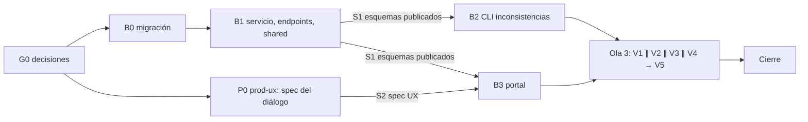

# MOD05 — Ciclo de vida suscriptor ↔ contrato y suspensión unificada (E4) · Plan de orquestación

**Fecha:** 2026-10-19 · **Versión:** 1.0 · **Emisor:** AI-EM-ARCH (modo EM + Orchestrator)
**Definición:** [PRD-MOD05-CRM-SUBSCRIBERS-FASE-05-v1.0.md](../prds/PRD-MOD05-CRM-SUBSCRIBERS-FASE-05-v1.0.md) (Aprobado, 2026-10-19)
**Prompt:** [PROMPT-MOD05-CICLO-VIDA-v1.0.md](../prompts/PROMPT-MOD05-CICLO-VIDA-v1.0.md) · **Launcher:** [PROMPT-MOD05-CICLO-VIDA-LAUNCH-v1.0.md](../prompts/PROMPT-MOD05-CICLO-VIDA-LAUNCH-v1.0.md)
**Base:** `main` en `d5b5c92d`. Se trabaja en `main`, sin ramas.

## 0. Alcance

PRD Fase 05 §3: derivación del estado, comandos por lote con vista previa, catálogo de motivos, historial, guardas cruzadas, permiso único, portal y CLI de inconsistencias.

**Fuera de alcance:** Billing real, corte en red (E8), retiro de comodato y OT de desinstalación, cambio de plan (E5), vista lateral y chips (E2).

## 1. Decisiones del CTO antes de lanzar (G0)

Las seis de PRD §9.1. Recomendación de AI-EM-ARCH: **D-E4-1 A** (el contrato manda, el suscriptor deriva), **D-E4-2** lista cerrada provisional, **D-E4-3** tabla nueva, **D-E4-4 A** (bloquear la cancelación con servicios vivos), **D-E4-5** `CRM_SUBSCRIBERS_MANAGE`, **D-E4-6** solo informar.

**Estado:** ✅ G0 aprobado por el CTO el 2026-10-19 con las seis recomendaciones. La Ola 1 puede lanzarse.

## 2. Bloques y dependencias



- **Ruta crítica:** B0 → B1 → B3 → V1 → V5.
- **Paralelo:** P0 ∥ B0; B2 ∥ B3 tras S1. En la Ola 3, V1 ∥ V2 ∥ V3 ∥ V4.
- **Sincronización:**
  - S1: B1 publica en `@iwana/shared` el catálogo de motivos, `LifecycleCommandSchema` y `LifecyclePreviewResponse`, y congela la forma de los endpoints. B3 no empieza sin S1.
  - S2: P0 entrega la spec UX del diálogo.
- **Archivos compartidos:** `subscriber-status-transition.service.ts` y `contracts.service.ts` solo los edita B1. B0 es el único que edita `runner.ts`. B2 solo agrega un CLI nuevo.

## 3. Matriz de dispatch (agente × skill)

| Bloque | Agente | Skills obligatorias (leer el `SKILL.md` antes de escribir código) | De apoyo | Descartadas y motivo |
| --- | --- | --- | --- | --- |
| P0 | `prod-ux` | `iwana-identity-ui-review`, `system-vocabulary-review`, `wcag-audit-patterns` | `senior-ui-systems-designer` | `ui-ux-pro-max` como fuente: subordinada a la identidad y sin fundamentar severidad |
| B0 | `sr-backend` | `database-migration`, `iwana-tenant-migration`, `postgresql`, `test-driven-development` | — | `nestjs-expert`: B0 no toca la API |
| B1 | `sr-backend` | `nestjs-expert`, `backend-security-coder`, `test-driven-development`, `typescript-expert`, `openapi-spec-generation` | `postgresql` para el bloqueo de filas y los tests integrados; `auth-implementation-patterns` para el cambio de permiso | `bullmq-specialist`: no hay colas, los eventos son en proceso; `iwana-matriz-motivos`: es de MOD11↔MOD12 |
| B2 | `sr-backend` | `nestjs-expert`, `test-driven-development` | `postgresql` | `database-migration`: el CLI no migra ni escribe |
| B3 | `fe-platform` | `core-components`, `frontend-dev-guidelines`, `iwana-identity-ui-review`, `wcag-audit-patterns`, `system-vocabulary-review` | `frontend-security-coder` para la nota libre | `tailwind-patterns` como fuente de tokens: no hay tokens nuevos |
| V1 | `sr-qa` | `testing-patterns`, `e2e-testing-patterns`, `playwright-skill`, `iwana-test-evidence`, `verification-before-completion` | — | — |
| V2 | `sec-eng` | `security-auditor`, `backend-security-coder` | `frontend-security-coder` | — |
| V3 | `boundary-reviewer` ∥ `contract-drift-reviewer` | `architect-review` | `monorepo-architect` | — |
| V4 | `ds-owner` | `iwana-identity-ui-review` (con `audit-ui.mjs`), `core-components` | — | — |
| V5 | `gate-verifier` | `iwana-test-evidence`, `turborepo-caching` | — | — |
| Cierre | AI-EM-ARCH | `iwana-cierre-fase` | `docs-governance` (agente) | — |

**Scripts que exige el plan:**
- `node .agents/skills/iwana-identity-ui-review/scripts/audit-ui.mjs apps/portal/src/components/crm/subscribers` en P0-P3 0 (V4).
- Tests de `@iwana/api`, `@iwana/shared` y `@iwana/portal` con `--force`, conteo real y `Cached: 0` (V5).
- `pnpm audit --prod --audit-level critical` en 0 (V5; ya es paso del CI desde `a6ca8e3f`).

## 4. Gates

| Gate | Condición | Quién |
| --- | --- | --- |
| G0 | D-E4-1 a D-E4-6 aprobadas; el PRD pasa a `Aprobado` | CTO |
| G1 | S1 y S2 cumplidos; migración up/down probada en un tenant de desarrollo | `sr-backend`, `prod-ux` |
| G2 | CA-LC-01 a CA-LC-11 trazados a tests; un test integrado contra Postgres por cada 409 de PRD §5.4 | `sr-qa` |
| G3 | Sin PII en logs; historial inmutable; permiso único verificado (CA-LC-09) | `sec-eng` |
| G4 | Sin violaciones de boundary ni deriva entre shared, API y portal | `boundary-reviewer`, `contract-drift-reviewer` |
| G5 | Veredicto de identidad GO del diálogo | `ds-owner` |
| G6 | Gates Before Merge de `AGENTS.md`, OpenAPI actualizado, CI de `main` en verde | `gate-verifier` |
| G7 | Informe `docs/informes/INFORME-MOD05-CICLO-VIDA-CIERRE-v1.0.md`, PRD padre y HLD-MOD05 con referencia a la Fase 05, y commit en `main` | AI-EM-ARCH |

## 5. Riesgos

| Riesgo | Mitigación |
| --- | --- |
| Romper el `PATCH /status` que usa el portal | B3 migra el portal en la misma ola; V1 corre el E2E de la ficha |
| Carreras entre el lote y la acción individual | PRD RNF-LC-02 y CA-LC-07, con test integrado |
| Inconsistencias históricas al activar la derivación | B2 informa antes del cierre; el informe incluye el conteo por tenant de desarrollo |
| Varios agentes en el mismo checkout de `main` | Propiedad de archivos del prompt §2; nadie commitea salvo AI-EM-ARCH en G7 |

## Lanzamiento

> **El archivo [PROMPT-MOD05-CICLO-VIDA-LAUNCH-v1.0.md](../prompts/PROMPT-MOD05-CICLO-VIDA-LAUNCH-v1.0.md) es la fuente y prevalece si diverge de este espejo.**

```text
Actúa como AI-EM-ARCH en modo Orchestrator. G0 aprobado (D-E4-1..6 según el acta).
Lanza docs/plans/2026-10-19-mod05-ciclo-vida-suspension.md:
Ola 1: P0 (prod-ux) ∥ B0 (sr-backend). Ola 2: B1 (sr-backend); tras S1, B2 ∥ B3 (fe-platform, que además espera S2).
Ola 3: V1 ∥ V2 ∥ V3 ∥ V4 y después V5. Encargos en docs/prompts/PROMPT-MOD05-CICLO-VIDA-v1.0.md.
Nadie commitea salvo tú en G7.
```
