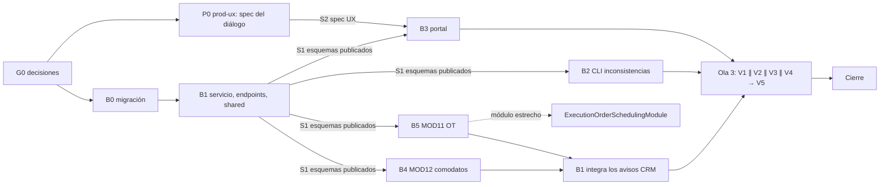

# MOD05 — Ciclo de vida suscriptor ↔ contrato y suspensión unificada (E4) · Plan de orquestación

**Fecha:** 2026-10-19 · **Versión:** 1.2 · **Emisor:** AI-EM-ARCH (modo EM + Orchestrator)
**Definición:** [PRD-MOD05-CRM-SUBSCRIBERS-FASE-05-v1.2.md](../prds/PRD-MOD05-CRM-SUBSCRIBERS-FASE-05-v1.2.md) (Aprobado, 2026-10-19)
**Prompt:** [PROMPT-MOD05-CICLO-VIDA-v1.2.md](../prompts/PROMPT-MOD05-CICLO-VIDA-v1.2.md) · **Launcher:** [PROMPT-MOD05-CICLO-VIDA-LAUNCH-v1.2.md](../prompts/PROMPT-MOD05-CICLO-VIDA-LAUNCH-v1.2.md)
**Base:** `main` en `a3c5539e`. Se trabaja en `main`, sin ramas. Se preservan cambios preexistentes del arreglo de portal; no se mezclan con E4.
**Estado:** En cierre. G0-G6 verificados (G6 con gates locales, corregido el 2026-10-19). G7: commit y push en curso; la fase se declara cerrada con el CI de `main` en verde.

**Convención ADR:** ADR-097 conserva el identificador secuencial canónico del registro de arquitectura. El validador `audit-adr-citations.mjs` indexa los ADR por archivos `ADR-###-*`; renombrarlo conforme a la plantilla documental genérica perdería la resolución de citas y rompería referencias existentes. Se mantiene bajo `docs/adrs/`; el módulo, fase y versión figuran en su título y metadatos.

## 0. Alcance

PRD Fase 05 §3: derivación del estado, comandos por lote con vista previa, catálogo de motivos, historial, guardas cruzadas, permiso único, portal, CLI de inconsistencias y puertos de lectura dueños para los avisos de terminación.

**Fuera de alcance:** Billing real, corte en red (E8), retiro de comodato y OT de desinstalación, cambio de plan (E5), vista lateral y chips (E2).

## 1. Decisiones del CTO antes de lanzar (G0)

Las seis de PRD §9.1. Recomendación de AI-EM-ARCH: **D-E4-1 A** (el contrato manda, el suscriptor deriva), **D-E4-2** lista cerrada provisional, **D-E4-3** tabla nueva, **D-E4-4 A** (bloquear la cancelación con servicios vivos), **D-E4-5** `CRM_SUBSCRIBERS_MANAGE`, **D-E4-6** solo informar.

**Estado:** ✅ G0 aprobado por el CTO el 2026-10-19 con las seis recomendaciones. La Ola 1 puede lanzarse.

**Aclaraciones aprobadas durante el lanzamiento:** RF-LC-11 recibe `action` obligatorio; cancelación manual exige `reasonCode` y `note?`, sin `DESCARTE_EXPEDIENTE`; avisos consultan puertos de lectura propiedad de MOD12 y MOD11 (ADR-097). En ejecución, sec-eng resolvió Q3 con cifrado AES-256-GCM según ADR-058 y boundary/contratos exigieron `hasLiveContracts` coherente en lista, búsqueda exacta y 360. Fuente vigente: PRD y prompt v1.2.

## 2. Bloques y dependencias



- **Rutas críticas:** backend B0 → B1/S1 → (B4 ∥ B5) → B1 integra → V1 → V5; portal S1 + S2 → B3 → V1 → V5.
- **Paralelo:** P0 ∥ B0; tras S1 corren B2 ∥ B3 ∥ B4 ∥ B5 (B3 espera también S2). En la Ola 3, V1 ∥ V2 ∥ V3 ∥ V4.
- **Sincronización:**
  - S1: B1 publica en `@iwana/shared` el catálogo de motivos, `LifecycleCommandSchema`, `LifecyclePreviewResponse` y `hasLiveContracts`, y congela la forma de los endpoints. B3 no empieza sin S1.
  - S2: P0 entrega la spec UX del diálogo.
  - S3: B4 y B5 publican `AssetLoanReadPort` (MOD12) y `ExecutionOrderReadPort` (MOD11); el módulo estrecho `ExecutionOrderSchedulingModule` exporta el puerto de MOD11 y B1 integra ambos en CRM. Un error de lectura falla la vista previa, no se convierte en `warnings: []`.
- **Archivos compartidos:** `subscriber-status-transition.service.ts` y `contracts.service.ts` solo los edita B1. B0 es el único que edita `runner.ts`. B2 solo agrega un CLI nuevo. B4 y B5 son dueños exclusivos de sus módulos proveedores.

## 3. Matriz de dispatch (agente × skill)

| Bloque | Agente                                          | Skills obligatorias (leer el `SKILL.md` antes de escribir código)                                                           | De apoyo                                                                                                               | Descartadas y motivo                                                                                     |
| ------ | ----------------------------------------------- | --------------------------------------------------------------------------------------------------------------------------- | ---------------------------------------------------------------------------------------------------------------------- | -------------------------------------------------------------------------------------------------------- |
| P0     | `prod-ux`                                       | `iwana-identity-ui-review`, `system-vocabulary-review`, `wcag-audit-patterns`                                               | `senior-ui-systems-designer`                                                                                           | `ui-ux-pro-max` como fuente: subordinada a la identidad y sin fundamentar severidad                      |
| B0     | `sr-backend`                                    | `database-migration`, `iwana-tenant-migration`, `postgresql`, `test-driven-development`                                     | —                                                                                                                      | `nestjs-expert`: B0 no toca la API                                                                       |
| B1     | `sr-backend`                                    | `nestjs-expert`, `backend-security-coder`, `test-driven-development`, `typescript-expert`, `openapi-spec-generation`        | `postgresql` para el bloqueo de filas y los tests integrados; `auth-implementation-patterns` para el cambio de permiso | `bullmq-specialist`: no hay colas, los eventos son en proceso; `iwana-matriz-motivos`: es de MOD11↔MOD12 |
| B2     | `sr-backend`                                    | `nestjs-expert`, `test-driven-development`                                                                                  | `postgresql`                                                                                                           | `database-migration`: el CLI no migra ni escribe                                                         |
| B3     | `fe-platform`                                   | `core-components`, `frontend-dev-guidelines`, `iwana-identity-ui-review`, `wcag-audit-patterns`, `system-vocabulary-review` | `frontend-security-coder` para la nota libre                                                                           | `tailwind-patterns` como fuente de tokens: no hay tokens nuevos                                          |
| B4     | `sr-backend`                                    | `nestjs-expert`, `backend-security-coder`, `postgresql`, `test-driven-development`                                          | `typescript-expert`                                                                                                    | `database-migration`: no altera el esquema                                                               |
| B5     | `sr-backend`                                    | `nestjs-expert`, `backend-security-coder`, `postgresql`, `test-driven-development`                                          | `typescript-expert`                                                                                                    | `database-migration`: no altera el esquema                                                               |
| V1     | `sr-qa`                                         | `testing-patterns`, `e2e-testing-patterns`, `playwright-skill`, `iwana-test-evidence`, `verification-before-completion`     | —                                                                                                                      | —                                                                                                        |
| V2     | `sec-eng`                                       | `security-auditor`, `backend-security-coder`                                                                                | `frontend-security-coder`                                                                                              | —                                                                                                        |
| V3     | `boundary-reviewer` ∥ `contract-drift-reviewer` | `architect-review`                                                                                                          | `monorepo-architect`                                                                                                   | —                                                                                                        |
| V4     | `ds-owner`                                      | `iwana-identity-ui-review` (con `audit-ui.mjs`), `core-components`                                                          | —                                                                                                                      | —                                                                                                        |
| V5     | `gate-verifier`                                 | `iwana-test-evidence`, `turborepo-caching`                                                                                  | —                                                                                                                      | —                                                                                                        |
| Cierre | AI-EM-ARCH                                      | `iwana-cierre-fase`                                                                                                         | `docs-governance` (agente)                                                                                             | —                                                                                                        |

**Scripts que exige el plan:**

- `node .agents/skills/iwana-identity-ui-review/scripts/audit-ui.mjs apps/portal/src/components/crm/subscribers` en P0-P3 0 (V4).
- Tests de `@iwana/api`, `@iwana/shared`, `@iwana/db` y `@iwana/portal` con `--force`, conteo real y `Cached: 0` (V5).
- `pnpm audit --prod --audit-level critical` en 0 (V5; ya es paso del CI desde `a6ca8e3f`).

## 4. Gates

| Gate | Condición                                                                                                                                                | Quién                                          |
| ---- | -------------------------------------------------------------------------------------------------------------------------------------------------------- | ---------------------------------------------- |
| G0   | D-E4-1 a D-E4-6 aprobadas; el PRD pasa a `Aprobado`                                                                                                      | CTO                                            |
| G1   | S1, S2 y S3 cumplidos; migración up/down probada en un tenant de desarrollo; los dos puertos responden con tenant actual                                 | `sr-backend`, `prod-ux`                        |
| G2   | CA-LC-01 a CA-LC-12 trazados a tests; un test integrado contra Postgres por cada 409 de PRD §5.4                                                         | `sr-qa`                                        |
| G3   | Sin PII en logs; historial inmutable; permiso único verificado (CA-LC-09)                                                                                | `sec-eng`                                      |
| G4   | Sin violaciones de boundary/tenancy ni deriva entre puertos, shared, API y portal                                                                        | `boundary-reviewer`, `contract-drift-reviewer` |
| G5   | Veredicto de identidad GO del diálogo; skeleton con demora indicada y explicación accesible por teclado                                                  | `ds-owner`                                     |
| G6   | Gates Before Merge de `AGENTS.md` ejecutados en local sin caché y OpenAPI actualizado (el CI de `main` solo existe tras el push: pasa a G7)                | `gate-verifier`                                |
| G7   | Commit y push en `main`; **CI de `main` en verde** sobre ese commit; informe `docs/informes/INFORME-MOD05-CICLO-VIDA-CIERRE-v1.0.md`, PRD padre y HLD-MOD05 con referencia a la Fase 05 | AI-EM-ARCH                                     |

## 5. Riesgos

| Riesgo                                              | Mitigación                                                                                       |
| --------------------------------------------------- | ------------------------------------------------------------------------------------------------ |
| Romper el `PATCH /status` que usa el portal         | B3 migra el portal en la misma ola; V1 corre el E2E de la ficha                                  |
| Carreras entre el lote y la acción individual       | PRD RNF-LC-02 y CA-LC-07, con test integrado                                                     |
| Inconsistencias históricas al activar la derivación | B2 informa antes del cierre; el informe incluye el conteo por tenant de desarrollo               |
| Varios agentes en el mismo checkout de `main`       | Propiedad de archivos del prompt §2; nadie commitea salvo AI-EM-ARCH en G7                       |
| Dependencia de MOD05 hacia MOD12 y MOD11            | ADR-097 limita la integración a puertos de lectura mínimos, sin ciclos ni acceso a tablas ajenas |

## Lanzamiento

> **El archivo [PROMPT-MOD05-CICLO-VIDA-LAUNCH-v1.2.md](../prompts/PROMPT-MOD05-CICLO-VIDA-LAUNCH-v1.2.md) es la fuente de despacho vigente.**

```text
G0 aprobado el 2026-10-19. Aclara RF-LC-11, cancelación y puertos MOD12/MOD11 en PRD v1.2 y ADR-097. Sec-eng resuelve Q3; V2 y V4 GO, boundary GO; se corrige el NO-GO de contratos en `hasLiveContracts` y OpenAPI.
Ola 1: P0 (prod-ux) ∥ B0 (sr-backend, migración 158).
Ola 2: B1 (sr-backend; S1 primero); tras S1, B2 ∥ B3 (espera S2) ∥ B4 MOD12 ∥ B5 MOD11; B1 integra tras S3.
Ola 3: V1 sr-qa ∥ V2 sec-eng ∥ V3 boundary-reviewer + contract-drift-reviewer ∥ V4 ds-owner → V5 gate-verifier.
Encargos y skills por bloque: docs/prompts/PROMPT-MOD05-CICLO-VIDA-v1.2.md y tabla §3. Nadie commitea salvo AI-EM-ARCH en G7.
```

### Estado de verificación — 2026-10-19

- **G0, G1, G3, G4 y G5:** GO. La migración 158 se probó up/down en PostgreSQL efímero; los puertos MOD12/MOD11 pasan sus pruebas tenant-scoped; V2, boundary, deriva de contratos y V4 cerraron sin bloqueos.
- **V1 / G2:** GO. API sin caché: 399 suites aprobadas/4 omitidas; 5.364 tests aprobados/15 omitidos. Shared: 22 suites/204 tests. Portal, corrida actual posterior al arreglo SSR: 309 suites; 3.142 tests aprobados/1 omitido. PostgreSQL lifecycle: 8/8; migración: 3/3; orden de migraciones: 6/6. El smoke Chromium previo de `AuthReadyGate` pasa 1/1; la spec sintética `e2e/tests/portal-mod05-lifecycle.spec.ts` pasa 2/2. Verifica búsqueda exacta con `hasLiveContracts`, detalle, bloqueo de cancelación con servicios vivos, ausencia de acciones `PROSPECT → SUSPENDED`, preview con `action`, suspensión de todos y reactivación de un contrato seleccionado; no usa credenciales ni modifica datos reales. Trazabilidad CA:

| Criterio | Evidencia concreta                                                                                                                                                                                  |
| -------- | --------------------------------------------------------------------------------------------------------------------------------------------------------------------------------------------------- |
| CA-LC-01 | `subscriber-lifecycle.service.spec.ts` y `subscriber-lifecycle.service.postgres.integration.spec.ts`: suspensión total, estado derivado y `batch_id` compartido.                                    |
| CA-LC-02 | `subscriber-lifecycle.service.spec.ts` y `portal-mod05-lifecycle.spec.ts`: reactivación de uno seleccionado.                                                                                        |
| CA-LC-03 | `subscriber-lifecycle.service.spec.ts`: suspender un contrato conserva ACTIVE si queda otro activo.                                                                                                 |
| CA-LC-04 | `subscribers.controller.spec.ts`: `PATCH /status` rechaza el estado derivado con `SUBSCRIBER_STATUS_DERIVED`.                                                                                       |
| CA-LC-05 | `subscriber-lifecycle.service.postgres.integration.spec.ts`: guardas 409 RF-LC-16, RF-LC-17 y RF-LC-18 contra PostgreSQL.                                                                           |
| CA-LC-06 | `subscriber-lifecycle.service.postgres.integration.spec.ts`: preview no cambia contrato, suscriptor ni historial.                                                                                   |
| CA-LC-07 | `subscriber-lifecycle.service.postgres.integration.spec.ts`: fallo intermedio revierte el lote; también cubierto por spec unitaria.                                                                 |
| CA-LC-08 | `subscriber-lifecycle.service.spec.ts`: captura el logger y comprueba que omite la nota libre.                                                                                                      |
| CA-LC-09 | `contracts.controller.spec.ts`: el guard deniega transiciones con solo `CRM_EXPEDIENTES_MANAGE` (ver deuda P3 de V2: prueba del guard, no HTTP).                                                    |
| CA-LC-10 | `SubscriberLifecycleDialog.portal.spec.tsx`, `subscriber-status-dialog-ux-qw.portal.spec.tsx` y `portal-mod05-lifecycle.spec.ts`: motivo, preview y ausencia de `PROSPECT → SUSPENDED`.             |
| CA-LC-11 | `report-lifecycle-inconsistencies.postgres.integration.spec.ts`: simulación real sin escrituras ni PII.                                                                                             |
| CA-LC-12 | `subscribers.service.spec.ts`, `subscribers.controller.spec.ts`, `SubscribersListClient.spec.tsx` y `portal-mod05-lifecycle.spec.ts`: lista, búsqueda exacta, 360 y bloqueo visible de cancelación. |

- **AuthReadyGate (arreglo transversal fuera de E4):** el SSR ahora cierra el stream y mantiene el contenido protegido fuera del HTML inicial hasta validar la sesión. Se verificó en portal y web con specs SSR/layout, typecheck, lint focal, builds y smoke Chromium. Los componentes gate/layout y [su informe](../informes/INFORME-PORTAL-FIX-INSTANTNAV-v1.0.md) permanecen fuera del commit E4.
- **V5 / G6:** GO (corrección del CTO del 2026-10-19: G6 exigía un CI que solo existe tras el push, y el commit estaba en G7; el CI pasa a G7). Gates locales: suites sin caché, cobertura de `subscriber-lifecycle.service.ts` (95,79 % líneas; 82,50 % ramas), lint, typecheck, audit crítico, OpenAPI, UI, builds, migración y `git diff --check` pasan. GitHub solo tiene CI verde para `d5b5c92`; el HEAD local `a3c5539` y los cambios locales aún no tienen CI asociado. Ese CI se verifica en G7, tras el push.
- **G7:** en curso. Orden: commit del arreglo `AuthReadyGate` (los journeys Chromium de E4 dependen de él), commit de E4, push, CI de `main` en verde y commit de docs con el informe de cierre.
