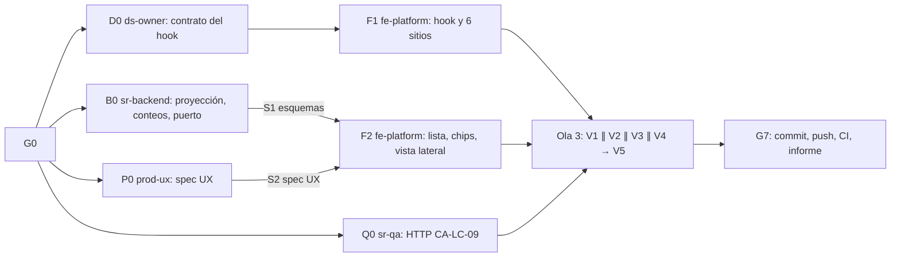

# MOD05 — Lista operativa de Suscriptores (E1 + E2) · Plan de orquestación

**Fecha:** 2026-10-19 · **Versión:** 1.0 · **Estado:** Aprobado · **Emisor:** AI-EM-ARCH (modo EM + Orchestrator)
**Definición:** [PRD-MOD05-CRM-SUBSCRIBERS-FASE-06-v1.0.md](../prds/PRD-MOD05-CRM-SUBSCRIBERS-FASE-06-v1.0.md) (Aprobado, 2026-10-19)
**Prompt:** [PROMPT-MOD05-LISTA-OPERATIVA-v1.0.md](../prompts/PROMPT-MOD05-LISTA-OPERATIVA-v1.0.md) · **Launcher:** [PROMPT-MOD05-LISTA-OPERATIVA-LAUNCH-v1.0.md](../prompts/PROMPT-MOD05-LISTA-OPERATIVA-LAUNCH-v1.0.md)
**Base:** `main` en `ec0e4e16`. Se trabaja en `main`, sin ramas.
**Estado al lanzamiento:** Fase 05 cerrada con CI verde; nada de Fase 06 implementado. El checkout tiene cambios locales preexistentes ajenos a Fase 06 que se preservan.

## 0. Alcance

PRD Fase 06 §3: servicio principal en la lista, conteos de cola, chips y «Más filtros», vista lateral con las acciones de la Fase 05, teclado acotado a la tabla, y dos P3 técnicos de la Fase 05 (prueba HTTP de CA-LC-09 y la guarda de foco consolidada en `@iwana/ui`).

**Fuera de alcance:** zona de cobertura (E8), vistas guardadas, móvil en tarjetas (E3), E5-E7.

**Pendientes de la Fase 05 que no entran porque no son de código:**
- Q1, validación jurídica del catálogo de motivos (asesoría jurídica);
- Q2, días de mora (CTO y comercial, cuando exista Billing);
- la corrida del CLI de inconsistencias por tenant antes de la beta (operación, con el G7 de producción diferido por ADR-095).

## 1. Decisiones del CTO antes de lanzar (G0)

Las seis de PRD §9.1. Recomendación de AI-EM-ARCH: **D-F6-1 A** (sin zona; ciudad del servicio principal), **D-F6-2** regla RF-LO-02, **D-F6-3** conteos globales, **D-F6-4** diferir vistas guardadas, **D-F6-5** teclado solo con foco en la tabla, **D-F6-6** incluir los P3.

**Estado:** ✅ G0 aprobado por el CTO el 2026-10-19 con las seis recomendaciones. La Ola 1 puede lanzarse.

## 2. Bloques y dependencias



- **Ruta crítica:** B0 → F2 → V1 → V5 → G7.
- **Paralelo:** en la Ola 1, P0 ∥ D0 ∥ B0 ∥ Q0. En la Ola 2, F1 ∥ F2 con archivos disjuntos. En la Ola 3, V1 ∥ V2 ∥ V3 ∥ V4.
- **Sincronización:**
  - S1: B0 publica en `@iwana/shared` `primaryService`, `otherLiveServicesCount`, `SubscriberQueueCountsSchema` y los filtros nuevos, y avisa;
  - S2: P0 entrega la spec UX;
  - S3: D0 entrega el contrato del hook.
  - Ajuste aprobado durante la ejecución (CTO, 2026-10-19): `PlanCatalogReadPort` se resuelve en runtime por `CommercialCatalogReadAdapter`; B0 amplía su propiedad a ese adaptador para implementar el batch real de contratos y conserva el método en el adaptador legado de Tenant por compatibilidad. El wiring del token no cambia.
  - Aclaración aprobada durante la ejecución (CTO, 2026-10-19): RNF-LO-01/CA-LO-02 limitan a tres las consultas principales de filas, conteo total y lote de planes. Las lecturas delegadas en puertos de Party/Privacy se miden y reportan aparte; no se ocultan en la medición total. El tenant de desarrollo mostró seis `SELECT/WITH` en una página de 100 filas con titular y representante legal: tres principales y tres de Party/Privacy.
- **Archivos compartidos:** `SubscriberLifecycleDialog.tsx` lo edita **solo F1** (RF-LO-22); F2 lo consume sin editarlo. `PortalSidePeek` (`portal-ui.tsx`) lo edita solo F1 en su guarda de foco; F2 lo consume.

## 3. Matriz de dispatch (agente × skill)

| Bloque | Agente | Skills obligatorias (leer el `SKILL.md` antes de escribir código) | De apoyo | Descartadas y motivo |
| --- | --- | --- | --- | --- |
| P0 | `prod-ux` | `iwana-identity-ui-review`, `system-vocabulary-review`, `wcag-audit-patterns` | `senior-ui-systems-designer` | `ui-ux-pro-max` como fuente: subordinada a la identidad |
| D0 | `ds-owner` | `core-components`, `iwana-identity-ui-review` | `wcag-audit-patterns` | `tailwind-patterns`: el contrato no tiene tokens |
| B0 | `sr-backend` | `nestjs-expert`, `postgresql`, `test-driven-development`, `typescript-expert`, `openapi-spec-generation` | `backend-security-coder` para la proyección de privacidad | `database-migration`: no hay migraciones |
| Q0 | `sr-qa` | `testing-patterns`, `test-driven-development`, `iwana-test-evidence` | `auth-implementation-patterns` para armar el usuario con permisos | `playwright-skill`: es una prueba HTTP, no de navegador |
| F1 | `fe-platform` | `core-components`, `frontend-dev-guidelines`, `test-driven-development`, `wcag-audit-patterns` | — | `nextjs-app-router-patterns`: no toca rutas |
| F2 | `fe-platform` | `core-components`, `frontend-dev-guidelines`, `iwana-identity-ui-review`, `wcag-audit-patterns`, `nextjs-app-router-patterns` (estado en la URL), `system-vocabulary-review` | `frontend-security-coder` para `?peek=` | `ui-ux-pro-max` como fuente de severidad |
| V1 | `sr-qa` | `testing-patterns`, `e2e-testing-patterns`, `playwright-skill`, `iwana-test-evidence`, `verification-before-completion` | — | — |
| V2 | `sec-eng` | `security-auditor`, `frontend-security-coder` | `backend-security-coder` | — |
| V3 | `boundary-reviewer` ∥ `contract-drift-reviewer` | `architect-review` | `monorepo-architect` | — |
| V4 | `ds-owner` | `iwana-identity-ui-review` (con `audit-ui.mjs`), `core-components` | — | — |
| V5 | `gate-verifier` | `iwana-test-evidence`, `turborepo-caching` | — | — |
| G7 | AI-EM-ARCH | `iwana-cierre-fase` | `docs-governance` (agente) | — |

**Scripts que exige el plan:**
- `audit-ui.mjs` sobre `apps/portal/src/components/crm/subscribers` en P0-P3 0 (V4);
- tests de `@iwana/api`, `@iwana/shared`, `@iwana/ui` y `@iwana/portal` con `--force`, conteo real y `Cached: 0` (V5);
- `pnpm audit --prod --audit-level critical` en 0 (V5).

## 4. Gates

| Gate | Condición | Quién |
| --- | --- | --- |
| G0 | D-F6-1 a D-F6-6 aprobadas; el PRD pasa a `Aprobado` | CTO |
| G1 | S1, S2 y S3 cumplidos; RNF-LO-01 y RNF-LO-02 medidos en el tenant de desarrollo | `sr-backend`, `prod-ux`, `ds-owner` |
| G2 | CA-LO-01 a CA-LO-10 trazados a tests; E2E de chips y vista lateral | `sr-qa` |
| G3 | Proyección de privacidad en la lista y la vista lateral; `?peek=` sin PII | `sec-eng` |
| G4 | Puerto de MOD06 aditivo y sin acceso cruzado fuera de él; sin deriva entre shared, API y portal | `boundary-reviewer`, `contract-drift-reviewer` |
| G5 | Veredicto de identidad GO de lista, chips y vista lateral | `ds-owner` |
| G6 | Gates Before Merge de `AGENTS.md` **en local**, sin caché, y OpenAPI actualizado | `gate-verifier` |
| G7 | Commit y push en `main`; **CI de `main` en verde** sobre el commit final; informe `docs/informes/INFORME-MOD05-LISTA-OPERATIVA-CIERRE-v1.0.md` | AI-EM-ARCH |

El CI no puede estar en G6: solo existe después del push. Es la lección de la Fase 05.

## 5. Riesgos

| Riesgo | Mitigación |
| --- | --- |
| La proyección nueva degrada la lista | RNF-LO-01 y RNF-LO-02 medidos en G1 y CA-LO-02 en V1 |
| F1 cambia el foco en pantallas ajenas al módulo | Los tests existentes de los seis sitios deben pasar sin editarse; V4 revisa |
| Carreras de foco que solo aparecen en CI (Fase 05) | V5 corre la carpeta `src/components/crm` también con `--maxWorkers=1`, y la spec de la vista lateral cinco veces seguidas |
| Varios agentes en el mismo checkout | Propiedad de archivos del prompt §2; nadie commitea salvo AI-EM-ARCH en G7 |

## Lanzamiento

> **El archivo [PROMPT-MOD05-LISTA-OPERATIVA-LAUNCH-v1.0.md](../prompts/PROMPT-MOD05-LISTA-OPERATIVA-LAUNCH-v1.0.md) es la fuente y prevalece si diverge de este espejo.**

```text
Actúa como AI-EM-ARCH en modo Orchestrator. G0 aprobado (D-F6-1..6 según el acta).
Lanza docs/plans/2026-10-19-mod05-lista-operativa.md con los encargos de docs/prompts/PROMPT-MOD05-LISTA-OPERATIVA-v1.0.md:
Ola 1: P0 prod-ux ∥ D0 ds-owner ∥ B0 sr-backend ∥ Q0 sr-qa.
Ola 2: F1 fe-platform (tras S3) ∥ F2 fe-platform (tras S1 y S2).
Ola 3: V1 ∥ V2 ∥ V3 ∥ V4 → V5. G7: commit, push, CI de main en verde e informe. Nadie commitea salvo tú.
```
