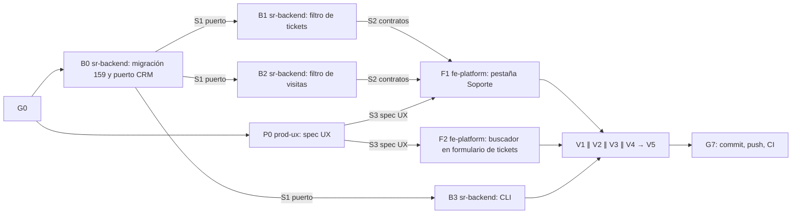

# MOD05 — Pestaña Soporte del suscriptor (E6) · Plan de orquestación

**Fecha:** 2026-10-20 · **Versión:** 1.0 · **Emisor:** AI-EM-ARCH (modo EM + Orchestrator)
**Definición:** [PRD-MOD05-CRM-SUBSCRIBERS-FASE-07-v1.0.md](../prds/PRD-MOD05-CRM-SUBSCRIBERS-FASE-07-v1.0.md) (Aprobado, 2026-10-20)
**Prompt:** [PROMPT-MOD05-PESTANA-SOPORTE-v1.0.md](../prompts/PROMPT-MOD05-PESTANA-SOPORTE-v1.0.md) · **Launcher:** [PROMPT-MOD05-PESTANA-SOPORTE-LAUNCH-v1.0.md](../prompts/PROMPT-MOD05-PESTANA-SOPORTE-LAUNCH-v1.0.md)
**Base al arrancar:** `main` en `90b05217`. Se trabaja en `main`, sin ramas. Última migración tenant: `158`.

## 0. Alcance

PRD Fase 07 §3: pestaña Soporte con Tickets y Visitas, filtros por suscriptor en Assurance (MOD10) y WFM (MOD09) con sus índices, «Crear ticket» vinculado, buscador de suscriptor en el formulario de tickets y CLI de tickets mal vinculados.

**Fuera de alcance:** PRD §3 «Fuera».

## 1. Decisiones del CTO antes de lanzar (G0)

Las seis de PRD §9.1. Recomendación de AI-EM-ARCH: **D-E6-1 A** (composición en el portal con el permiso de cada módulo), **D-E6-2** tres vías de vínculo del ticket, **D-E6-3** visitas por `subscriber_id` o expediente, **D-E6-4** OT fuera, **D-E6-5** solo informar, **D-E6-6** incluir el formulario de MOD10.

**Estado:** ✅ G0 aprobado por el CTO el 2026-10-20 con las seis recomendaciones. La Ola 1 puede lanzarse.

## 2. Bloques y dependencias



- **Ruta crítica:** B0 → B1/B2 → F1 → V1 → V5 → G7.
- **Paralelo:** P0 ∥ B0; B1 ∥ B2 ∥ B3 en módulos distintos; F1 ∥ F2.
- **Sincronización:**
  - S1: B0 publica los dos métodos de `CrmSubscriberReadPort` y su adaptador;
  - S2: B1 y B2 publican el parámetro `subscriberId` en sus esquemas y en el cliente de API;
  - S3: P0 entrega la spec UX.
- **Archivos compartidos:** `apps/portal/src/lib/api-client.ts` lo edita solo F1 (métodos de tickets y visitas por suscriptor); F2 reutiliza la búsqueda de suscriptores que ya existe. `runner.ts` solo lo edita B0.

## 3. Matriz de dispatch (agente × skill)

| Bloque | Agente | Skills obligatorias (leer el `SKILL.md` antes de escribir código) | De apoyo | Descartadas y motivo |
| --- | --- | --- | --- | --- |
| P0 | `prod-ux` | `iwana-identity-ui-review`, `system-vocabulary-review`, `wcag-audit-patterns` | — | `ui-ux-pro-max` como fuente |
| B0 | `sr-backend` | `database-migration`, `iwana-tenant-migration`, `postgresql`, `nestjs-expert`, `test-driven-development` | — | `openapi-spec-generation`: B0 no expone endpoints |
| B1 | `sr-backend` | `nestjs-expert`, `postgresql`, `test-driven-development`, `openapi-spec-generation` | `backend-security-coder` | `database-migration`: los índices son de B0 |
| B2 | `sr-backend` | `nestjs-expert`, `postgresql`, `test-driven-development`, `openapi-spec-generation` | — | ídem |
| B3 | `sr-backend` | `nestjs-expert`, `test-driven-development` | `postgresql` | — |
| F1 | `fe-platform` | `core-components`, `frontend-dev-guidelines`, `iwana-identity-ui-review`, `wcag-audit-patterns`, `system-vocabulary-review` | `frontend-security-coder` | `tailwind-patterns` como fuente de tokens |
| F2 | `fe-platform` | `core-components`, `frontend-dev-guidelines`, `test-driven-development` | `wcag-audit-patterns` | — |
| V1 | `sr-qa` | `testing-patterns`, `e2e-testing-patterns`, `playwright-skill`, `iwana-test-evidence` | — | — |
| V2 | `sec-eng` | `security-auditor`, `backend-security-coder`, `frontend-security-coder` | — | — |
| V3 | `boundary-reviewer` ∥ `contract-drift-reviewer` | `architect-review` | `monorepo-architect` | — |
| V4 | `ds-owner` | `iwana-identity-ui-review` (con `audit-ui.mjs`), `core-components` | — | — |
| V5 | `gate-verifier` | `iwana-test-evidence`, `turborepo-caching` | — | — |
| G7 | AI-EM-ARCH | `iwana-cierre-fase` | — | — |

## 4. Gates

| Gate | Condición | Quién |
| --- | --- | --- |
| G0 | D-E6-1 a D-E6-6 aprobadas; el PRD pasa a `Aprobado` | CTO |
| G1 | S1, S2 y S3; migración 159 up/down; `EXPLAIN` con los índices (CA-SO-07) | `sr-backend`, `prod-ux` |
| G2 | CA-SO-01 a CA-SO-09; las integraciones nuevas corren en el job de CI (no figuran en la lista de omisiones esperadas) | `sr-qa` |
| G3 | RBAC por sección (CA-SO-03) y sin PII nueva | `sec-eng` |
| G4 | Assurance y WFM leen CRM solo por `CrmSubscriberReadPort`; sin deriva de contratos | `boundary-reviewer`, `contract-drift-reviewer` |
| G5 | Identidad de la pestaña y del buscador | `ds-owner` |
| G6 | Gates Before Merge en local, sin caché, y E2E del portal con 0 fallos y 0 cuarentenas | `gate-verifier` |
| G7 | Commit y push; **CI de `main` en verde** con el job «E2E portal» bloqueante; informe `docs/informes/INFORME-MOD05-PESTANA-SOPORTE-CIERRE-v1.0.md` | AI-EM-ARCH |

## 5. Riesgos

| Riesgo | Mitigación |
| --- | --- |
| Pocos tickets históricos bien vinculados (PRD H3) | B3 mide antes del cierre; el informe reporta el conteo por tenant de desarrollo |
| Cambios en MOD09 y MOD10 por una fase de MOD05 | Solo filtros aditivos de lectura y un buscador en el formulario; V3 revisa los boundaries |
| Una spec de integración nueva se omite en CI sin que nadie lo note | El gate de omisiones de la fase de salud de pruebas la pondría en rojo; G2 lo verifica |

## Lanzamiento

> **El archivo [PROMPT-MOD05-PESTANA-SOPORTE-LAUNCH-v1.0.md](../prompts/PROMPT-MOD05-PESTANA-SOPORTE-LAUNCH-v1.0.md) es la fuente y prevalece si diverge de este espejo.**

```text
Actúa como AI-EM-ARCH en modo Orchestrator. G0 aprobado (D-E6-1..6 según el acta).
Lanza docs/plans/2026-10-20-mod05-pestana-soporte.md con los encargos de docs/prompts/PROMPT-MOD05-PESTANA-SOPORTE-v1.0.md:
Ola 1: P0 prod-ux ∥ B0 sr-backend (migración 159 y puerto CRM, S1).
Ola 2: B1 ∥ B2 ∥ B3 (sr-backend); tras S2 y S3, F1 ∥ F2 (fe-platform).
Ola 3: V1 ∥ V2 ∥ V3 ∥ V4 → V5. G7: commit, push, CI de main en verde e informe. Nadie commitea salvo tú.
```
