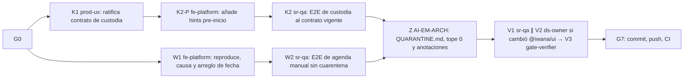

# TRANSVERSAL — Resolución de las cuarentenas E2E · Plan de orquestación

**Fecha:** 2026-10-20 · **Versión:** 1.0 · **Emisor:** AI-EM-ARCH (modo EM + Orchestrator)
**Definición:** [spec 2026-10-20-transversal-cuarentenas-e2e-spec.md](../specs/2026-10-20-transversal-cuarentenas-e2e-spec.md) (Aprobado, 2026-10-20)
**Prompt:** [PROMPT-TRANSVERSAL-CUARENTENAS-E2E-v1.0.md](../prompts/PROMPT-TRANSVERSAL-CUARENTENAS-E2E-v1.0.md) · **Launcher:** [PROMPT-TRANSVERSAL-CUARENTENAS-E2E-LAUNCH-v1.0.md](../prompts/PROMPT-TRANSVERSAL-CUARENTENAS-E2E-LAUNCH-v1.0.md)
**Base:** `main` en `4dc44550`. Se trabaja en `main`, sin ramas.
**Plazo:** CI de `main` en verde con tope de cuarentena 0 **antes del 2026-11-19** (vencimiento de ambas filas).

## 0. Alcance

Spec §3: reescribir el E2E de custodia al contrato vigente de MOD11, añadir únicamente los tres hints pre-inicio faltantes que RQ-K-02 exige (aclaración D-CQ-4 aprobada por el CTO el 2026-10-20), corregir la regresión de fecha de la agenda manual de WFM y bajar el tope de cuarentena a 0.

**Fuera de alcance:** spec §5 (auditoría de Inventario y rediseños).

## 1. Decisiones del CTO (G0 y aclaración durante ejecución)

Las tres de la spec §6. Recomendación de AI-EM-ARCH: **D-CQ-1 A** (prevalece la spec MOD11 v1.5 §6), **D-CQ-2** arreglar en la capa de la causa, **D-CQ-3** no abrir ahora la auditoría de Inventario.

**Estado:** ✅ G0 aprobado por el CTO el 2026-10-20 con las tres recomendaciones. Durante K2 se aprobó D-CQ-4: añadir los tres hints pre-inicio faltantes; no cambiar ningún otro comportamiento de MOD11. La actualización quedó registrada en la spec y el prompt.

## 2. Bloques y dependencias



- **Ruta crítica:** W1 → W2 → Z → V1 → V3 → G7. W1 es el único bloque con causa desconocida.
- **Paralelo:** K1 ∥ W1; después, K2 ∥ W2, con specs distintas.
- **Archivos compartidos:** `e2e/QUARANTINE.md`, `e2e/quarantine-cap.json` y las anotaciones de los documentos de agosto (RQ-K-04) son del orquestador, que es su único escritor.
- **V2 es condicional:** solo corre si W1 cambia `packages/ui`.

## 3. Matriz de dispatch (agente × skill)

| Bloque | Agente | Skills obligatorias (leer el `SKILL.md` antes de actuar) | De apoyo | Descartadas y motivo |
| --- | --- | --- | --- | --- |
| K1 | `prod-ux` | `iwana-identity-ui-review` | `system-vocabulary-review` | `wcag-audit-patterns`: no cambia la UI |
| K2-P | `fe-platform` | `frontend-dev-guidelines`, `core-components`, `iwana-identity-ui-review`, `system-vocabulary-review` | `test-driven-development`, `testing-patterns` | `ui-ux-pro-max`: no se rediseña MOD11 |
| K2 | `sr-qa` | `playwright-skill`, `e2e-testing-patterns`, `iwana-test-evidence` | `test-driven-development` para revisar el test contra RQ-K-02 | — |
| W1 | `fe-platform` | `systematic-debugging`, `test-driven-development`, `frontend-dev-guidelines` | `core-components` si la causa está en `DatePicker` | `ui-ux-pro-max`: no hay diseño |
| W2 | `sr-qa` | `playwright-skill`, `iwana-test-evidence` | — | — |
| V1 | `sr-qa` | `playwright-skill`, `iwana-test-evidence`, `verification-before-completion` | — | — |
| V2 | `ds-owner` (condicional) | `core-components`, `iwana-identity-ui-review` | — | — |
| V3 | `gate-verifier` | `iwana-test-evidence`, `turborepo-caching` | — | — |
| G7 | AI-EM-ARCH | `iwana-cierre-fase` | — | — |

## 4. Gates

| Gate | Condición | Quién |
| --- | --- | --- |
| G0 | D-CQ-1 a D-CQ-3 aprobadas; la spec pasa a `Aprobado` | CTO |
| G1 | K1 ratificado; W1 con la prueba de componente en rojo y la causa raíz documentada; K2-P añade los hints acotados con tests | `prod-ux`, `fe-platform` |
| G2 | CA-CQ-02 y CA-CQ-03 | `sr-qa` |
| G3 | Tope 0 y `PASS (0/0)` (CA-CQ-04); anotaciones RQ-K-04 hechas | AI-EM-ARCH |
| G4 | E2E del portal: dos corridas locales y una en el contenedor, 0 fallos y 0 cuarentenas (RQ-Z-02) | `sr-qa` |
| G5 | Identidad del `DatePicker`, solo si cambió `@iwana/ui` | `ds-owner` |
| G6 | Gates Before Merge en local, sin caché, sobre los paquetes tocados | `gate-verifier` |
| G7 | Commit y push; **CI de `main` en verde** con el job «E2E portal» bloqueante, antes del 2026-11-19; informe `docs/informes/INFORME-TRANSVERSAL-CUARENTENAS-E2E-CIERRE-v1.0.md` | AI-EM-ARCH |

## 5. Riesgos

| Riesgo | Mitigación |
| --- | --- |
| La causa de la fecha está en `DatePicker` y afecta a otros formularios | D-CQ-2, RQ-W-03 y V2 |
| El CTO elige D-CQ-1 B | La spec y el plan se reescriben: K2 pasa a ser un cambio de producto en MOD11 con su propio bloque `fe-platform` |
| Se acerca el 2026-11-19 sin cerrar W1 | Extender la fecha de la fila WFM es una decisión explícita del CTO, nunca automática; el orquestador avisa al llegar al 2026-11-12 si W1 sigue abierto |

## Lanzamiento

> **El archivo [PROMPT-TRANSVERSAL-CUARENTENAS-E2E-LAUNCH-v1.0.md](../prompts/PROMPT-TRANSVERSAL-CUARENTENAS-E2E-LAUNCH-v1.0.md) es la fuente y prevalece si diverge de este espejo.**

```text
Actúa como AI-EM-ARCH en modo Orchestrator. G0 aprobado (D-CQ-1..3); D-CQ-4 sobre hints aprobado durante K2.
Lanza docs/plans/2026-10-20-transversal-cuarentenas-e2e.md con los encargos de docs/prompts/PROMPT-TRANSVERSAL-CUARENTENAS-E2E-v1.0.md:
Ola 1: K1 prod-ux ∥ W1 fe-platform. Ola 2: K2-P fe-platform (tras K1) → K2 sr-qa ∥ W2 sr-qa (tras W1).
Z: tú cierras QUARANTINE.md, bajas el tope a 0 y anotas los documentos de agosto.
Ola 3: V1 sr-qa ∥ V2 ds-owner (solo si cambió @iwana/ui) → V3 gate-verifier. G7 antes del 2026-11-19.
```
