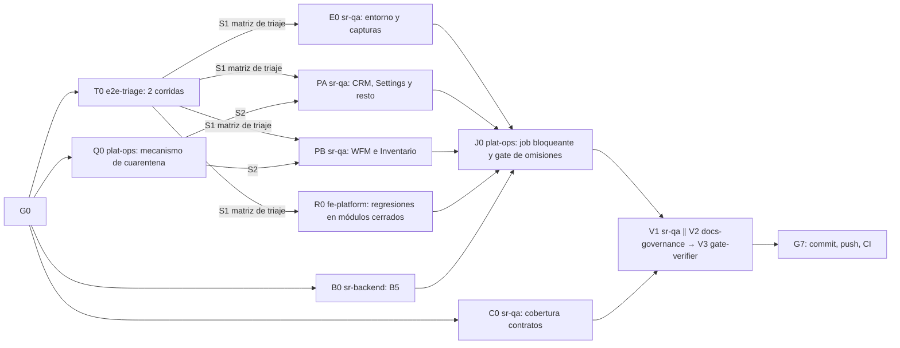

# TRANSVERSAL — Salud de pruebas · Plan de orquestación

**Fecha:** 2026-10-20 · **Versión:** 1.0 · **Emisor:** AI-EM-ARCH (modo EM + Orchestrator)
**Definición:** [spec 2026-10-20-transversal-salud-pruebas-spec.md](../specs/2026-10-20-transversal-salud-pruebas-spec.md) (Aprobado, 2026-10-20)
**Prompt:** [PROMPT-TRANSVERSAL-SALUD-PRUEBAS-v1.0.md](../prompts/PROMPT-TRANSVERSAL-SALUD-PRUEBAS-v1.0.md) · **Launcher:** [PROMPT-TRANSVERSAL-SALUD-PRUEBAS-LAUNCH-v1.0.md](../prompts/PROMPT-TRANSVERSAL-SALUD-PRUEBAS-LAUNCH-v1.0.md)
**Base:** `main` en `cc54cf9d`. Se trabaja en `main`, sin ramas.

## 0. Alcance

Spec §3: triaje de los 125 fallos E2E del portal, entorno y capturas, corrección o cuarentena, regresiones en módulos cerrados, cuarentena acotada, job E2E bloqueante, B5 en CI con gate de omisiones y cobertura de los cuatro componentes de contratos.

**Fuera de alcance:** spec §5.

## 1. Decisiones del CTO antes de lanzar (G0)

Las seis de la spec §6. Recomendación de AI-EM-ARCH: **D-SP-1 A** (bloqueante, 0 fallos fuera de cuarentena), **D-SP-2** cuarentena acotada, **D-SP-3** omitir `-live` con motivo, **D-SP-4** capturas generadas en el contenedor y revisadas, **D-SP-5** cuarentena en módulos con auditoría pendiente, **D-SP-6** B5 con migraciones.

**Estado:** ✅ G0 aprobado por el CTO el 2026-10-20 con las seis recomendaciones. Ola 1 y Ola 2 cerradas; J0 cerró el job bloqueante y el gate de omisiones. V2/G5 y V3/G6 dieron GO; la integración API amplia local quedó roja por setup de DB/tenant `test` ausente en `dbiw` (12 suites/44 tests fallidos; B5 dirigido pasó), registrada como incidencia de entorno para comprobar en CI. Tras el CI `39465599851`, R0 corrigió el contraste dark de Button con tokens AA y regresión Axe. Una corrida CI posterior (`39489106232`, intento 2) expuso una carrera real del autofocus diferido en `PurchaseLinesEditor`: al pasar el usuario al campo Título antes del `requestAnimationFrame`, el foco podía regresar a Cantidad. R0 corrigió la causa y añadió regresión. V1/G2 revalidó el árbol corregido con dos corridas locales y una corrida full en `mcr.microsoft.com/playwright:v1.58.2-noble`: cada una 305 casos en 51 archivos, 285 aprobados, 20 omitidos (18 live con motivo y 2 cuarentenas), 0 fallidos, retries 0; los SCM #92/#93 pasaron en las tres corridas. El contenedor duró 483955 ms. G7: pendiente commit/push y dos corridas CI consecutivas verdes en el mismo commit (CA-SP-02), incluida CI de `main` en verde (CA-SP-07).

## 2. Bloques y dependencias



- **Ruta crítica:** T0 → PB/PA → J0 → V1 → V3 → G7.
- **Paralelo:** en la Ola 1, T0 ∥ B0 ∥ C0 ∥ Q0. En la Ola 2, E0 ∥ PA ∥ PB ∥ R0, con archivos disjuntos.
- **Sincronización:**
  - S1: el orquestador escribe la matriz de triaje (`INFORME-TRANSVERSAL-SALUD-PRUEBAS-TRIAJE-v1.0.md`) a partir del reporte de T0, que no edita archivos, y asigna cada fallo a E0, PA, PB o R0.
  - S2: Q0 entrega `e2e/QUARANTINE.md`, el script de conteo y el tope provisional.
  - La configuración E2E del portal construye y sirve la salida standalone de producción, tanto en local como en CI. La suite conserva `page.route` y sus mocks aislados, y las capturas no incluyen el indicador de Next dev que aparece con la interceptación del navegador.
  - E0 genera en el contenedor oficial y entrega a `ds-owner` para revisión los baselines Linux de `portal-settings-organization-ui` y `portal-settings-access-ui`; esta última se suma al alcance porque sus seis comprobaciones de screenshot pasan a ejecutarse después de corregir Axe, y el repo solo tenía referencias Windows.
- **Archivos compartidos:**
  - `e2e/QUARANTINE.md` tiene un solo escritor, el orquestador: los bloques PA, PB y R0 reportan sus filas y ponen el `test.fixme` en su spec;
  - `.github/workflows/ci.yml` solo lo edita J0;
  - `e2e/playwright.portal.config.ts` y `scripts/next-standalone-e2e.mjs` pertenecen al orquestador para fijar el mismo runtime standalone en local y CI;
  - las specs E2E se reparten por archivo, sin solaparse (prompt §2).
- **R0 puede quedar vacío** si el triaje no encuentra regresiones en módulos cerrados.

## 3. Matriz de dispatch (agente × skill)

| Bloque | Agente            | Skills obligatorias (leer el `SKILL.md` antes de escribir código)                         | De apoyo                                                                                           | Descartadas y motivo                                        |
| ------ | ----------------- | ----------------------------------------------------------------------------------------- | -------------------------------------------------------------------------------------------------- | ----------------------------------------------------------- |
| T0     | `e2e-triage`      | `playwright-skill`, `e2e-testing-patterns`, `systematic-debugging`                        | —                                                                                                  | `test-driven-development`: T0 no escribe pruebas            |
| B0     | `sr-backend`      | `postgresql`, `iwana-tenant-migration`, `testing-patterns`, `iwana-test-evidence`         | `nestjs-expert`                                                                                    | `database-migration`: no hay migraciones nuevas             |
| C0     | `sr-qa`           | `testing-patterns`, `test-driven-development`, `iwana-test-evidence`                      | `wcag-audit-patterns` para aserciones por rol                                                      | `playwright-skill`: son pruebas de componente               |
| Q0     | `plat-ops`        | `turborepo-caching`, `verification-before-completion`                                     | —                                                                                                  | `docker-expert`: el mecanismo es un script                  |
| E0     | `sr-qa`           | `playwright-skill`, `e2e-testing-patterns`, `iwana-test-evidence`                         | `docker-expert` para el contenedor de Playwright; `iwana-identity-ui-review` para revisar capturas | —                                                           |
| PA     | `sr-qa`           | `playwright-skill`, `e2e-testing-patterns`, `systematic-debugging`, `iwana-test-evidence` | `system-vocabulary-review` si cambió un texto                                                      | `ui-ux-pro-max`: no se diseña UI                            |
| PB     | `sr-qa`           | `playwright-skill`, `e2e-testing-patterns`, `systematic-debugging`, `iwana-test-evidence` | —                                                                                                  | Cualquier skill de backend: PB no corrige producto (D-SP-5) |
| R0     | `fe-platform`     | `frontend-dev-guidelines`, `systematic-debugging`, `test-driven-development`              | `core-components`                                                                                  | —                                                           |
| J0     | `plat-ops`        | `turborepo-caching`, `verification-before-completion`                                     | `observability-engineer` para el resumen del job                                                   | —                                                           |
| V1     | `sr-qa`           | `playwright-skill`, `iwana-test-evidence`, `verification-before-completion`               | —                                                                                                  | —                                                           |
| V2     | `docs-governance` | (agente de solo lectura)                                                                  | —                                                                                                  | —                                                           |
| V3     | `gate-verifier`   | `iwana-test-evidence`, `turborepo-caching`                                                | —                                                                                                  | —                                                           |
| G7     | AI-EM-ARCH        | `iwana-cierre-fase`                                                                       | —                                                                                                  | —                                                           |

**Scripts que exige el plan:**

- `pnpm test:e2e:portal` dos veces seguidas sobre el mismo commit (T0 y V1);
- el script de cuarentena de Q0 (Ola 2 en adelante y en el job);
- `pnpm --filter @iwana/api test:integration` con B5 en 17 de 17 (B0 y V3);
- cobertura del portal para los cuatro componentes (C0 y V3).

## 4. Gates

| Gate | Condición                                                                                                                                                                                                                                              | Quién                                |
| ---- | ------------------------------------------------------------------------------------------------------------------------------------------------------------------------------------------------------------------------------------------------------ | ------------------------------------ |
| G0   | D-SP-1 a D-SP-6 aprobadas; la spec pasa a `Aprobado`                                                                                                                                                                                                   | CTO                                  |
| G1   | S1 (125/125 clasificados, dos corridas) y S2                                                                                                                                                                                                           | `e2e-triage`, AI-EM-ARCH, `plat-ops` |
| G2   | E2E del portal en local: 0 fallos fuera de cuarentena en dos corridas; cuarentena ≤ tope y completa                                                                                                                                                    | `sr-qa`                              |
| G3   | B5 17/17 y gate de omisiones probado con una omisión no declarada (rojo anexado)                                                                                                                                                                       | `sr-backend`, `plat-ops`             |
| G4   | Cuatro componentes ≥80 % de líneas                                                                                                                                                                                                                     | `sr-qa`                              |
| G5   | Documentación conforme                                                                                                                                                                                                                                 | `docs-governance`                    |
| G6   | Gates Before Merge en local, sin caché                                                                                                                                                                                                                 | `gate-verifier`                      |
| G7   | Commit y push; **dos corridas CI consecutivas del mismo commit con el job «E2E portal» bloqueante y 0 fallos no cuarentenados** (CA-SP-02), CI de `main` en verde (CA-SP-07); informe `docs/informes/INFORME-TRANSVERSAL-SALUD-PRUEBAS-CIERRE-v1.0.md` | AI-EM-ARCH                           |

## 5. Riesgos

| Riesgo                                                          | Mitigación                                                                          |
| --------------------------------------------------------------- | ----------------------------------------------------------------------------------- |
| Arreglar pruebas relajando aserciones                           | Spec RQ-P-01; V1 revisa el diff de cada spec corregida                              |
| La cuarentena se vuelve el destino por defecto                  | Tope decreciente, fecha límite de 30 días y dueño por fila (RQ-Q-01 a RQ-Q-03)      |
| Diferencias entre Windows y el runner de Linux                  | V1 corre la suite también en el contenedor de Playwright; G7 exige el CI verde      |
| El job bloqueante frena a otras sesiones que trabajan en `main` | Se activa en J0, al final, cuando la suite ya está en verde; se avisa en el informe |

## Lanzamiento

> **El archivo [PROMPT-TRANSVERSAL-SALUD-PRUEBAS-LAUNCH-v1.0.md](../prompts/PROMPT-TRANSVERSAL-SALUD-PRUEBAS-LAUNCH-v1.0.md) es la fuente y prevalece si diverge de este espejo.**

```text
Actúa como AI-EM-ARCH en modo Orchestrator. G0 aprobado (D-SP-1..6 según el acta).
Lanza docs/plans/2026-10-20-transversal-salud-pruebas.md con los encargos de docs/prompts/PROMPT-TRANSVERSAL-SALUD-PRUEBAS-v1.0.md:
Ola 1: T0 e2e-triage ∥ B0 sr-backend ∥ C0 sr-qa ∥ Q0 plat-ops. Con el reporte de T0 escribe la matriz de triaje (S1).
Ola 2: E0 ∥ PA ∥ PB (sr-qa) ∥ R0 (fe-platform). Tú eres el único que escribe e2e/QUARANTINE.md.
Ola 3: J0 plat-ops. Ola 4: V1 ∥ V2 → V3. G7: commit, push y CI de main en verde con el job E2E bloqueante.
```
