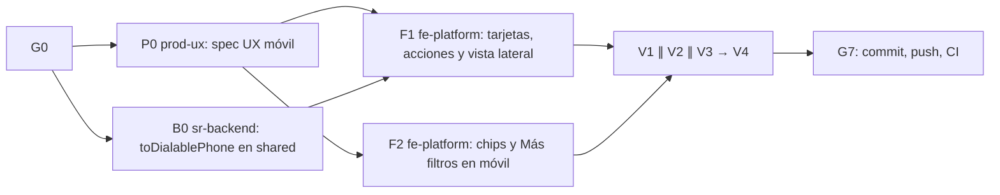

# MOD05 — Lista móvil de Suscriptores en tarjetas (E3) · Plan de orquestación

**Fecha:** 2026-10-21 · **Versión:** 1.0 · **Emisor:** AI-EM-ARCH (modo EM + Orchestrator)
**Definición:** [PRD-MOD05-CRM-SUBSCRIBERS-FASE-08-v1.0.md](../prds/PRD-MOD05-CRM-SUBSCRIBERS-FASE-08-v1.0.md) (Aprobado, 2026-10-21)
**Prompt:** [PROMPT-MOD05-LISTA-MOVIL-v1.0.md](../prompts/PROMPT-MOD05-LISTA-MOVIL-v1.0.md) · **Launcher:** [PROMPT-MOD05-LISTA-MOVIL-LAUNCH-v1.0.md](../prompts/PROMPT-MOD05-LISTA-MOVIL-LAUNCH-v1.0.md)
**Base:** `main` en `ec6111e0` (commit de aprobación de esta fase). Se trabaja en `main`, sin ramas.

## 0. Alcance

PRD Fase 08 §3: tarjetas por debajo de 768 px, acciones «Llamar» y «WhatsApp» con los teléfonos que la proyección ya entrega, normalización a E.164 y controles de la lista usables a 375 px. Solo presentación: sin cambios de API ni de datos.

**Fuera de alcance:** PRD §3 «Fuera».

## 1. Decisiones del CTO antes de lanzar (G0)

Las seis de PRD §9.1. Recomendación de AI-EM-ARCH: **D-E3-1** 768 px, **D-E3-2** teléfonos de la proyección vigente, **D-E3-3** ocultar con aviso los no normalizables, **D-E3-4** WhatsApp sin texto, **D-E3-5** sin registrar el contacto, **D-E3-6** normalizar solo al mostrar.

**Estado:** ✅ G0 aprobado por el CTO el 2026-10-21 con las seis recomendaciones. La Ola 1 puede lanzarse.

## 2. Bloques y dependencias



- **Ruta crítica:** P0 → F1 → V1 → V4 → G7.
- **Paralelo:** P0 ∥ B0; F1 ∥ F2 con archivos disjuntos; V1 ∥ V2 ∥ V3.
- **Sincronización:** S1 = B0 publica `toDialablePhone` con sus pruebas; S2 = P0 entrega la spec UX.
- **Archivos compartidos:** `SubscribersListClient.tsx` lo edita solo F1; F2 edita solo los componentes de chips y «Más filtros».

## 3. Matriz de dispatch (agente × skill)

| Bloque | Agente          | Skills obligatorias (leer el `SKILL.md` antes de escribir código)                                                                 | De apoyo                                            | Descartadas y motivo                                    |
| ------ | --------------- | --------------------------------------------------------------------------------------------------------------------------------- | --------------------------------------------------- | ------------------------------------------------------- |
| P0     | `prod-ux`       | `iwana-identity-ui-review`, `system-vocabulary-review`, `wcag-audit-patterns`                                                     | `senior-ui-systems-designer`                        | `ui-ux-pro-max` como fuente                             |
| B0     | `sr-backend`    | `typescript-expert`, `test-driven-development`                                                                                    | —                                                   | `nestjs-expert`: es una función pura de `@iwana/shared` |
| F1     | `fe-platform`   | `core-components`, `frontend-dev-guidelines`, `iwana-identity-ui-review`, `wcag-audit-patterns`, `tailwind-patterns` (responsive) | `frontend-security-coder` para los enlaces externos | `nextjs-app-router-patterns`: no cambian rutas          |
| F2     | `fe-platform`   | `core-components`, `frontend-dev-guidelines`, `wcag-audit-patterns`, `tailwind-patterns`                                          | —                                                   | —                                                       |
| V1     | `sr-qa`         | `playwright-skill`, `e2e-testing-patterns`, `iwana-test-evidence`, `verification-before-completion`                               | —                                                   | —                                                       |
| V2     | `sec-eng`       | `frontend-security-coder`, `security-auditor`                                                                                     | —                                                   | `backend-security-coder`: no hay cambios de API         |
| V3     | `ds-owner`      | `iwana-identity-ui-review` (con `audit-ui.mjs`), `core-components`                                                                | —                                                   | —                                                       |
| V4     | `gate-verifier` | `iwana-test-evidence`, `turborepo-caching`                                                                                        | —                                                   | —                                                       |
| G7     | AI-EM-ARCH      | `iwana-cierre-fase`                                                                                                               | —                                                   | —                                                       |

## 4. Gates

| Gate | Condición                                                                                                                                     | Quién                   |
| ---- | --------------------------------------------------------------------------------------------------------------------------------------------- | ----------------------- |
| G0   | D-E3-1 a D-E3-6 aprobadas; el PRD pasa a `Aprobado`                                                                                           | CTO                     |
| G1   | S1 y S2                                                                                                                                       | `sr-backend`, `prod-ux` |
| G2   | CA-MV-01 a CA-MV-08; E2E móvil en el job bloqueante (la métrica de teléfonos normalizables salió del gate el 2026-10-21, ver §6) | `sr-qa`                 |
| G3   | Sin número visible en la tarjeta, sin PII en URL ni logs, enlaces externos con `noopener`                                                     | `sec-eng`               |
| G4   | Identidad a 375 y 768 px, claro y oscuro; `audit-ui.mjs` en 0                                                                                 | `ds-owner`              |
| G5   | Gates Before Merge en local, sin caché; E2E del portal con 0 fallos y 0 cuarentenas                                                           | `gate-verifier`         |
| G7   | Commit y push; **CI de `main` en verde** con el job «E2E portal» bloqueante; informe `docs/informes/INFORME-MOD05-LISTA-MOVIL-CIERRE-v1.0.md` | AI-EM-ARCH              |

## 5. Riesgos

| Riesgo                                          | Mitigación                                                                                     |
| ----------------------------------------------- | ---------------------------------------------------------------------------------------------- |
| Pocos teléfonos normalizables                   | V1 mide el porcentaje; si es alto el de no normalizables, el informe recomienda reabrir D-E3-6 |
| Lógica duplicada entre tabla y tarjetas         | PRD RNF-MV-03: un solo estado y formateadores compartidos                                      |
| Diferencias de render entre Windows y el runner | El E2E móvil corre en el job de CI; V1 lo repite en el contenedor de Playwright                |

## 6. Estado de ejecución · 2026-10-21

| Gate | Estado         | Evidencia / pendiente                                                                                                                                                                                                                                                  |
| ---- | -------------- | ---------------------------------------------------------------------------------------------------------------------------------------------------------------------------------------------------------------------------------------------------------------------- |
| G0   | ✅ GO          | D-E3-1 a D-E3-6 aprobadas; PRD en `Aprobado`.                                                                                                                                                                                                                          |
| G1   | ✅ GO          | S1 (`toDialablePhone`) y S2 (spec UX móvil) publicados.                                                                                                                                                                                                                |
| G2   | ✅ GO          | CA-MV-01 a CA-MV-08 cubiertos; E2E global: 309 casos, 291 aprobados, 18 omitidos con motivo, 0 fallidos y cuarentena 0/0. **Decisión del CTO (2026-10-21):** la métrica de teléfonos normalizables sale de G2; medirla exigía descifrar teléfonos fuera de la aplicación sobre datos de semilla. Queda como pendiente previo a la beta (CLI de agregados). |
| G3   | ✅ GO          | Revisión de seguridad cerrada; no se detectan teléfonos expuestos ni enlaces externos inseguros.                                                                                                                                                                       |
| G4   | ✅ GO          | DS revisado a 375/768 px en claro/oscuro; `audit-ui.mjs`: P0–P3 = 0.                                                                                                                                                                                                   |
| G5   | ✅ GO local    | Shared: 23 suites / 221 tests; Portal: 320 suites / 3.240 tests aprobados y 1 skip preexistente. Cobertura de los siete fuentes cambiados: 83,73% statements y 85,24% líneas. V4 se relanza sin la métrica.                                                             |
| G7   | ▶️ En curso    | V4 relanzado; después, commit de la fase, push y CI de `main` en verde. Cierre en `docs/informes/INFORME-MOD05-LISTA-MOVIL-CIERRE-v1.0.md`.                                                                                                                                          |

**Pendiente previo a la beta (decisión del CTO, 2026-10-21):** CLI de solo agregados que mida, por tenant y con datos reales, qué porcentaje de teléfonos de suscriptores normaliza `toDialablePhone`, usando el descifrado autorizado de la aplicación (como `report-lifecycle-inconsistencies`). Con ese resultado se revisa D-E3-6. No medir con SQL directo ni en el tenant de desarrollo.

## Lanzamiento

> **El archivo [PROMPT-MOD05-LISTA-MOVIL-LAUNCH-v1.0.md](../prompts/PROMPT-MOD05-LISTA-MOVIL-LAUNCH-v1.0.md) es la fuente y prevalece si diverge de este espejo.**

```text
Actúa como AI-EM-ARCH en modo Orchestrator. G0 aprobado (D-E3-1..6 según el acta).
Lanza docs/plans/2026-10-21-mod05-lista-movil.md con los encargos de docs/prompts/PROMPT-MOD05-LISTA-MOVIL-v1.0.md:
Ola 1: P0 prod-ux ∥ B0 sr-backend. Ola 2: F1 (tras S1 y S2) ∥ F2 (tras S2), fe-platform.
Ola 3: V1 ∥ V2 ∥ V3 → V4. G7: commit, push, CI de main en verde e informe. Nadie commitea salvo tú.
```
