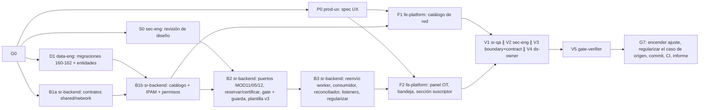

# MOD13 — Red y Aprovisionamiento · Fase 01 (IPAM y activación certificada) · Plan de orquestación

**Fecha:** 2026-10-22 · **Versión:** 1.0 · **Emisor:** AI-EM-ARCH (modo EM + Orchestrator)
**Definición:** [PRD-MOD13-RED-APROVISIONAMIENTO-FASE-01-v1.0.md](../prds/PRD-MOD13-RED-APROVISIONAMIENTO-FASE-01-v1.0.md) (Aprobado) · [HLD-MOD13-RED-APROVISIONAMIENTO-FASE-01-v1.0.md](../hlds/HLD-MOD13-RED-APROVISIONAMIENTO-FASE-01-v1.0.md) (contrato) · [ADR-098](../adrs/ADR-098-IPAM-y-Aprovisionamiento-Certificado-MOD13.md)
**Prompt:** [PROMPT-MOD13-APROVISIONAMIENTO-FASE-01-v1.0.md](../prompts/PROMPT-MOD13-APROVISIONAMIENTO-FASE-01-v1.0.md) · **Launcher Ola 1:** [PROMPT-MOD13-APROVISIONAMIENTO-FASE-01-LAUNCH-v1.0.md](../prompts/PROMPT-MOD13-APROVISIONAMIENTO-FASE-01-LAUNCH-v1.0.md)
**Base:** `main` en `01a3e91b`. Se trabaja en `main`, sin ramas. **El árbol tiene 48 rutas sin commitear ajenas a esta fase:** ningún agente las toca ni las incluye en sus commits.

## 0. Alcance

PRD §3 «Dentro»: catálogo de routers y redes IPv4, IPAM, reserva con la OT en ejecución, instrucción manual para el MikroTik, certificación NOC, guarda de cierre, activación por eventos, bandeja, panel en la OT, sección en la ficha y regularización.

**Fuera de alcance:** PRD §3 «Fuera». En particular, nada escribe en el router.

## 1. Decisiones del CTO antes de lanzar (G0)

Las siete del PRD §9 (D-NET-1 a D-NET-7), más la aprobación de ADR-098 y de la enmienda de ADR-027.

Decisiones ya tomadas por el CTO el 2026-10-22 (no se reabren):
- métodos `SIMPLE_QUEUE_STATIC_IP` y `PCQ_ADDRESS_LIST`, extensibles;
- sin escritura en el router;
- aprovisionar con la OT en ejecución, antes del cierre;
- reservar la IP con la OT `IN_PROGRESS`;
- certifica NOC con maker-checker;
- la guarda aplica también a las OT vivas.

**Estado:** ✅ G0 aprobado por el CTO el 2026-10-22 con las siete recomendaciones, ADR-098 y la enmienda de ADR-027. La Ola 1 puede lanzarse.

## 2. Bloques y dependencias



- **Ruta crítica:** D1 → B1b → B2 → B3 → F2 → V1 → V5 → G7.
- **Paralelo:**
  - Ola 1: P0 ∥ S0 ∥ D1 ∥ B1a.
  - F1 corre en paralelo con B2 y B3, sobre archivos disjuntos.
  - V1 ∥ V2 ∥ V3 ∥ V4.
- **Sincronización:**
  - **S1:** D1 entrega las entidades exportadas desde `packages/database/src/entities/index.ts` y las migraciones aplicadas en local.
  - **S2:** B1a publica `packages/shared/src/contracts/network/` y las claves en `AccessPermissionKey`, que D1 necesita para la migración 162.
  - **S3:** P0 entrega `docs/specs/2026-10-22-mod13-aprovisionamiento-ux.md`.
  - **S4:** S0 cierra Q2 del HLD.
- **Dueño único de cada superficie compartida:**
  - `packages/database`: D1 (Ola 1), B2 (solo la migración 163).
  - `packages/shared/src/contracts/network`: B1a.
  - `packages/shared/src/contracts/operations/execution-orders.ts`: B2.
  - `apps/worker`: B3, solo el reenvío firmado. El consumidor de `network-execution-events` vive en `apps/api/src/modules/network` (HLD §6.3), también de B3.
  - `access-control.constants.ts`: B1b.
  - `SubscriberDetailClient.tsx` y la carpeta de componentes de OT: F2.
  - Todo `apps/portal/src/app/dashboard/network/{routers,ipv4-networks}`: F1.
  - `apps/portal/src/app/dashboard/network/provisioning`: F2.

## 3. Matriz de dispatch (agente × skill)

Claude Code **lee** cada `SKILL.md` (`.agents/skills/<nombre>/SKILL.md`) como documentación antes de escribir código; no lo invoca como tool. Skills verificadas en disco el 2026-10-22.

| Bloque | Agente | Skills obligatorias | De apoyo (condición) | Descartadas y motivo |
| --- | --- | --- | --- | --- |
| P0 | `prod-ux` | `iwana-identity-ui-review`, `system-vocabulary-review`, `wcag-audit-patterns` | `senior-ui-systems-designer` (bandeja y panel); `ui-ux-pro-max`, subordinada a las anteriores | `core-components`: P0 no implementa |
| S0 | `sec-eng` | `security-auditor`, `backend-security-coder`, `auth-implementation-patterns` | `architect-review` (fronteras) | `frontend-security-coder`: todavía no hay UI |
| D1 | `data-eng` | `database-migration`, `postgresql`, `iwana-tenant-migration`, `test-driven-development` | `typescript-expert` | `bullmq-specialist`: D1 no tiene colas |
| B1a | `sr-backend` | `typescript-expert`, `test-driven-development` | `typescript-pro` (unión discriminada Zod) | `nestjs-expert`: solo `@iwana/shared` |
| B1b | `sr-backend` | `nestjs-expert`, `backend-security-coder`, `openapi-spec-generation`, `test-driven-development` | `postgresql` (consulta de IPAM) | `bullmq-specialist`: B1b no tiene colas |
| B2 | `sr-backend` | `nestjs-expert`, `architect-review`, `openapi-spec-generation`, `test-driven-development`, `database-migration` (163) | `backend-security-coder` (maker-checker) | `iwana-matriz-motivos`: no toca consumo de inventario de OT |
| B3 | `sr-backend` | `bullmq-specialist`, `nestjs-expert`, `backend-security-coder`, `test-driven-development` | `iwana-queue-inspect` (comprobar drenaje), `observability-engineer` (logs sin PII) | `openapi-spec-generation` salvo para `regularize` |
| F1 | `fe-platform` | `core-components`, `frontend-dev-guidelines`, `nextjs-app-router-patterns`, `iwana-identity-ui-review`, `tailwind-patterns`, `system-vocabulary-review` | `wcag-audit-patterns` | `senior-ui-systems-designer`: la dirección la fija P0 |
| F2 | `fe-platform` | Las de F1 + `frontend-security-coder` | `i18n-localization` (formato de fechas e IP) | — |
| V1 | `sr-qa` | `testing-patterns`, `e2e-testing-patterns`, `playwright-skill`, `iwana-test-evidence`, `verification-before-completion` | `anthropic-skills:built-in-browser` (solo Claude Code) | — |
| V2 | `sec-eng` | `security-auditor`, `backend-security-coder`, `frontend-security-coder` | — | — |
| V3 | `boundary-reviewer` + `contract-drift-reviewer` | `architect-review` | — | — |
| V4 | `ds-owner` | `iwana-identity-ui-review` (con `audit-ui.mjs`), `core-components` | — | — |
| V5 | `gate-verifier` | `iwana-test-evidence`, `turborepo-caching`, `verification-before-completion` | — | — |
| G7 | AI-EM-ARCH | `iwana-cierre-fase` | `docs-architect` | — |

`sr-qa` **escribe tests y fixtures** (unitarios, de integración y E2E) y **nunca código de producto**.

## 4. Gates

| Gate | Condición | Quién |
| --- | --- | --- |
| G0 | D-NET-1 a D-NET-7 resueltas. ADR-098 y la enmienda de ADR-027 aprobadas. PRD en `Aprobado`; HLD congelado | CTO |
| G1 | S1 a S4 | data-eng, sr-backend, prod-ux, sec-eng |
| G2 | B1b: CA-NET-01 a 03 y CA-NET-12; test de concurrencia con 20 reservas y 0 duplicados, contra Postgres real y con conteo real | sr-backend |
| G3 | B2 + B3: CA-NET-04 a 11. Test que provoque el fallo dentro del `@OnEvent` real del listener CRM. Reentrega del evento sin efecto | sr-backend |
| G4 | F1 + F2: CA-NET-13 y 14. E2E contra el API real, no solo mocks | fe-platform, sr-qa |
| G5 | V2 sin hallazgos P0/P1 (HMAC, maker-checker, regularización, PII en logs). V3 sin violaciones de frontera ni deriva de contrato. V4 con `audit-ui.mjs` en 0 | sec-eng, reviewers, ds-owner |
| G6 | Gates Before Merge en local, sin caché de turbo: cobertura ≥80 % en `network`, lint, typecheck, migraciones reversibles, OpenAPI actualizado | gate-verifier |
| G7 | Encender `enforceProvisioningOnInstallClose` en los tenants ACTIVE (D-NET-3). Regularizar la OT `OTE-20260828-001` (caso de origen) desde la UI (D-NET-7). Commit y push; **CI de `main` en verde**. Informe `docs/informes/INFORME-MOD13-APROVISIONAMIENTO-CIERRE-v1.0.md` | AI-EM-ARCH + CTO |

## 5. Riesgos

| # | Riesgo | Mitigación |
| --- | --- | --- |
| P1 | Encender la guarda antes de que exista el panel deja las instalaciones incerrables | El ajuste nace apagado (migración 162) y solo se enciende en G7 |
| P2 | El suscriptor del caso de origen no tiene contacto real o datos fiscales completos, y la regularización deja «activación comercial pendiente» | Antes de G7, CRM verifica su ficha y la completa por la UI. El resultado queda visible, no oculto |
| P3 | `btree_gist` no está disponible (HLD Q1) | Plan B ya descrito en el HLD; data-eng decide en D1 y lo reporta |
| P4 | El reenvío del worker rompe la proyección vigente de agenda, visita y tarea | B3 añade el encolado después de la proyección; la suite actual del worker se ejecuta sin caché |
| P5 | El árbol sucio de `main` contamina los commits | Cada bloque hace `git add` solo de sus rutas |

## 6. Estado de ejecución · 2026-10-22

Definición aprobada (G0 ✅, 2026-10-22). Ningún bloque lanzado.

## Lanzamiento


Fuente: [PROMPT-MOD13-APROVISIONAMIENTO-FASE-01-LAUNCH-v1.0.md](../prompts/PROMPT-MOD13-APROVISIONAMIENTO-FASE-01-LAUNCH-v1.0.md). **Si divergen, prevalece el archivo.** Lanza la Ola 1 (P0 ∥ S0 ∥ D1 ∥ B1a); G0 ya está aprobado. B1b, B2, B3, F1 y F2 se lanzan con launchers propios cuando cierre su gate previo.

```text
===== 1 · prod-ux =====
Actúa como `prod-ux`. Lee `AGENTS.md`, el plan `docs/plans/2026-10-22-mod13-aprovisionamiento.md` y tu encargo `docs/prompts/PROMPT-MOD13-APROVISIONAMIENTO-FASE-01-v1.0.md` §P0. Antes de escribir, lee los `SKILL.md` de `iwana-identity-ui-review`, `system-vocabulary-review` y `wcag-audit-patterns`. Consumes el contrato congelado `docs/hlds/HLD-MOD13-RED-APROVISIONAMIENTO-FASE-01-v1.0.md`: si un flujo pide un campo que no está, emite `[BLOQUEO]` y para. Cierras al entregar `docs/specs/2026-10-22-mod13-aprovisionamiento-ux.md`.

===== 2 · sec-eng =====
Actúa como `sec-eng`. Lee `AGENTS.md`, el plan y tu encargo §S0 del mismo prompt. Lee `security-auditor`, `backend-security-coder` y `auth-implementation-patterns`. Revisas en solo lectura ADR-098 y el HLD; cierras Q2. Cierras al entregar `docs/informes/INFORME-MOD13-REVISION-SEGURIDAD-DISENO-v1.0.md` con hallazgos P0–P3.

===== 3 · data-eng =====
Actúa como `data-eng`. Lee `AGENTS.md`, el plan y tu encargo §D1. Lee `database-migration`, `postgresql`, `iwana-tenant-migration` y `test-driven-development`. Implementa el HLD §3.1 a 3.3 sin modificarlo; cierra Q1. Solo tus rutas; no commitees. Cierras con las migraciones aplicadas y revertidas, con conteo real.

===== 4 · sr-backend =====
Actúa como `sr-backend`. Lee `AGENTS.md`, el plan y tu encargo §B1a. Lee `typescript-expert` y `test-driven-development`. Implementa el HLD §4 y las claves del §7 en `@iwana/shared`, sin modificar el contrato. No commitees. Cierras con los tests de los esquemas en verde, con conteo real.
```
