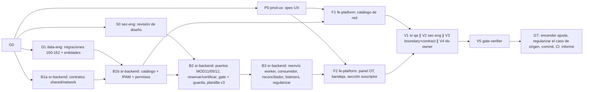

# MOD13 — Red y Aprovisionamiento · Fase 01 (IPAM y activación certificada) · Plan de orquestación

**Fecha:** 2026-10-22 · **Versión:** 1.20 · **Emisor:** AI-EM-ARCH (modo EM + Orchestrator)
**Definición:** [PRD-MOD13-RED-APROVISIONAMIENTO-FASE-01-v1.1.md](../prds/PRD-MOD13-RED-APROVISIONAMIENTO-FASE-01-v1.1.md) (Aprobado) · [HLD-MOD13-RED-APROVISIONAMIENTO-FASE-01-v1.1.md](../hlds/HLD-MOD13-RED-APROVISIONAMIENTO-FASE-01-v1.1.md) (contrato) · [ADR-098](../adrs/ADR-098-IPAM-y-Aprovisionamiento-Certificado-MOD13.md)
**Prompt:** [PROMPT-MOD13-APROVISIONAMIENTO-FASE-01-v1.1.md](../prompts/PROMPT-MOD13-APROVISIONAMIENTO-FASE-01-v1.1.md) · **Launcher vigente (Ola 18):** [PROMPT-MOD13-APROVISIONAMIENTO-FASE-01-LAUNCH-v1.19.md](../prompts/PROMPT-MOD13-APROVISIONAMIENTO-FASE-01-LAUNCH-v1.19.md) · Ejecutados: Ola 1 [LAUNCH-v1.0](../prompts/PROMPT-MOD13-APROVISIONAMIENTO-FASE-01-LAUNCH-v1.0.md), Ola 1-bis [LAUNCH-v1.1](../prompts/PROMPT-MOD13-APROVISIONAMIENTO-FASE-01-LAUNCH-v1.1.md), Ola 2 [LAUNCH-v1.2](../prompts/PROMPT-MOD13-APROVISIONAMIENTO-FASE-01-LAUNCH-v1.2.md), Ola 3 [LAUNCH-v1.3](../prompts/PROMPT-MOD13-APROVISIONAMIENTO-FASE-01-LAUNCH-v1.3.md), Ola 4 [LAUNCH-v1.4](../prompts/PROMPT-MOD13-APROVISIONAMIENTO-FASE-01-LAUNCH-v1.4.md), Ola 5 [LAUNCH-v1.5](../prompts/PROMPT-MOD13-APROVISIONAMIENTO-FASE-01-LAUNCH-v1.5.md), Ola 6 [LAUNCH-v1.6](../prompts/PROMPT-MOD13-APROVISIONAMIENTO-FASE-01-LAUNCH-v1.6.md), Ola 7 [LAUNCH-v1.7](../prompts/PROMPT-MOD13-APROVISIONAMIENTO-FASE-01-LAUNCH-v1.7.md), Ola 8 [LAUNCH-v1.8](../prompts/PROMPT-MOD13-APROVISIONAMIENTO-FASE-01-LAUNCH-v1.8.md) y Ola 9-pre [LAUNCH-v1.10](../prompts/PROMPT-MOD13-APROVISIONAMIENTO-FASE-01-LAUNCH-v1.10.md)
**Historial:** v1.1 (2026-10-22) incorpora el re-sync del contrato tras la Ola 1 y la Ola 1-bis (§6). v1.2 (2026-10-22) cierra G1 y lanza la Ola 2. v1.3 (2026-10-22) cierra G2 y lanza la Ola 3 (B2 ∥ F1 ∥ P0-ter). v1.4 (2026-10-22) recibe la Ola 3 y lanza la Ola 4 (B3 ∥ F1-v). v1.5 (2026-10-22) cierra G3 y lanza la Ola 5 (F2 ∥ F1-v). v1.6 (2026-10-22) registra los entregables F2, la evidencia local y los bloqueos de build y F1-v. v1.7 (2026-10-22) recibe la Ola 6 y lanza la Ola 7 de correcciones. v1.8 (2026-10-23) recibe la Ola 7 y lanza la Ola 8; fija las precondiciones de la Ola 9. v1.9 (2026-10-23) cierra G5 en código y deja lista la Ola 9, a la espera del entorno. v1.10 (2026-10-23) registra el fallo de la 163 en `db:migrate:all` y lanza la Ola 9-pre (B-mig). v1.11 (2026-10-23) cierra la Ola 9-pre: migraciones verificadas en los 6 `ACTIVE`, arranque del API corregido con prueba del `AppModule` y tenant E2E `ACTIVE` listo; la Ola 9 queda lista para relanzar. v1.11 (2026-10-23) recibe la Ola 9 y lanza la Ola 10 de desbloqueo. v1.12 (2026-10-23) recibe la Ola 10 y lanza la Ola 11, que cierra G4. v1.13 (2026-10-23) recibe la Ola 11 y lanza la Ola 12 (B-fix2). v1.14 (2026-10-23) recibe el segundo relanzamiento de V1-r y lanza la Ola 13 (B-fix3). v1.15 (2026-10-23) registra la corrección de `NetworkInboxEvent` y lanza la Ola 14 (B-wire). v1.16 (2026-10-23) recibe V1-r y V4-bis-r y lanza la Ola 15 (V1-ci ∥ V5, y después V4-plan). v1.17 (2026-10-23) recibe la Ola 15 y lanza la Ola 16 (B-cov ∥ V1-ci2). v1.18 (2026-10-23) cierra G4 y G6 con la Ola 16 y deja la lista de G7. v1.19 (2026-10-23) retoma G7: commit `594861d0` y lanzamiento de la Ola 17 (E2E-CI) antes del push. v1.20 (2026-10-24) registra el push de G7, el CI de main en rojo y lanza la Ola 18.
**Base:** `main` en `01a3e91b`. Se trabaja en `main`, sin ramas. **El árbol tiene 48 rutas sin commitear ajenas a esta fase:** ningún agente las toca ni las incluye en sus commits.

## 0. Alcance

PRD §3 «Dentro»: catálogo de routers y redes IPv4, IPAM, reserva con la OT en ejecución, instrucción manual para el MikroTik, certificación NOC, guarda de cierre, activación por eventos, bandeja, panel en la OT, sección en la ficha y regularización.

**Fuera de alcance:** PRD §3 «Fuera». En particular, nada escribe en el router.

## 1. Decisiones del CTO antes de lanzar (G0)

Las siete del PRD §9 (D-NET-1 a D-NET-7), más la aprobación de ADR-098 y de la enmienda de ADR-027.

Decisiones ya tomadas por el CTO el 2026-10-22 (no se reabren):
- métodos `SIMPLE_QUEUE_STATIC_IP` y `PCQ_ADDRESS_LIST`, extensibles;
- sin escritura en el router;
- aprovisionar con la OT en ejecución, antes del cierre;
- reservar la IP con la OT `IN_PROGRESS`;
- certifica NOC con maker-checker;
- la guarda aplica también a las OT vivas.

**Estado:** ✅ G0 aprobado por el CTO el 2026-10-22 con las siete recomendaciones, ADR-098 y la enmienda de ADR-027. La Ola 1 puede lanzarse.

## 2. Bloques y dependencias



- **Ruta crítica:** D1 → B1b → B2 → B3 → F2 → V1 → V5 → G7.
- **Paralelo:**
  - Ola 1: P0 ∥ S0 ∥ D1 ∥ B1a.
  - F1 corre en paralelo con B2 y B3, sobre archivos disjuntos.
  - V1 ∥ V2 ∥ V3 ∥ V4.
- **Sincronización:**
  - **S1:** D1 entrega las entidades exportadas desde `packages/database/src/entities/index.ts` y las migraciones aplicadas en local.
  - **S2:** B1a publica `packages/shared/src/contracts/network/` y las claves en `AccessPermissionKey`, que D1 necesita para la migración 162.
  - **S3:** P0 entrega `docs/specs/2026-10-22-mod13-aprovisionamiento-ux.md`.
  - **S4:** S0 cierra Q2 del HLD.
- **Dueño único de cada superficie compartida:**
  - `packages/database`: D1 (Ola 1), B2 (solo la migración 163).
  - `packages/shared/src/contracts/network`: B1a.
  - `packages/shared/src/contracts/operations/execution-orders.ts`: B2.
  - `apps/worker`: B3, solo el reenvío firmado. El consumidor de `network-execution-events` vive en `apps/api/src/modules/network` (HLD §6.3), también de B3.
  - `access-control.constants.ts`: B1b.
  - `SubscriberDetailClient.tsx` y la carpeta de componentes de OT: F2.
  - Todo `apps/portal/src/app/dashboard/network/{routers,ipv4-networks}`: F1.
  - `apps/portal/src/app/dashboard/network/provisioning`: F2.

## 3. Matriz de dispatch (agente × skill)

Claude Code **lee** cada `SKILL.md` (`.agents/skills/<nombre>/SKILL.md`) como documentación antes de escribir código; no lo invoca como tool. Skills verificadas en disco el 2026-10-22.

| Bloque | Agente | Skills obligatorias | De apoyo (condición) | Descartadas y motivo |
| --- | --- | --- | --- | --- |
| P0 | `prod-ux` | `iwana-identity-ui-review`, `system-vocabulary-review`, `wcag-audit-patterns` | `senior-ui-systems-designer` (bandeja y panel); `ui-ux-pro-max`, subordinada a las anteriores | `core-components`: P0 no implementa |
| S0 | `sec-eng` | `security-auditor`, `backend-security-coder`, `auth-implementation-patterns` | `architect-review` (fronteras) | `frontend-security-coder`: todavía no hay UI |
| D1 | `data-eng` | `database-migration`, `postgresql`, `iwana-tenant-migration`, `test-driven-development` | `typescript-expert` | `bullmq-specialist`: D1 no tiene colas |
| B1a | `sr-backend` | `typescript-expert`, `test-driven-development` | `typescript-pro` (unión discriminada Zod) | `nestjs-expert`: solo `@iwana/shared` |
| B1b | `sr-backend` | `nestjs-expert`, `backend-security-coder`, `openapi-spec-generation`, `test-driven-development` | `postgresql` (consulta de IPAM) | `bullmq-specialist`: B1b no tiene colas |
| B2 | `sr-backend` | `nestjs-expert`, `architect-review`, `openapi-spec-generation`, `test-driven-development`, `database-migration` (163) | `backend-security-coder` (maker-checker) | `iwana-matriz-motivos`: no toca consumo de inventario de OT |
| B3 | `sr-backend` | `bullmq-specialist`, `nestjs-expert`, `backend-security-coder`, `test-driven-development` | `iwana-queue-inspect` (comprobar drenaje), `observability-engineer` (logs sin PII) | `openapi-spec-generation` salvo para `regularize` |
| F1 | `fe-platform` | `core-components`, `frontend-dev-guidelines`, `nextjs-app-router-patterns`, `iwana-identity-ui-review`, `tailwind-patterns`, `system-vocabulary-review` | `wcag-audit-patterns` | `senior-ui-systems-designer`: la dirección la fija P0 |
| F2 | `fe-platform` | Las de F1 + `frontend-security-coder` | `i18n-localization` (formato de fechas e IP) | — |
| V1 | `sr-qa` | `testing-patterns`, `e2e-testing-patterns`, `playwright-skill`, `iwana-test-evidence`, `verification-before-completion` | `anthropic-skills:built-in-browser` (solo Claude Code) | — |
| V2 | `sec-eng` | `security-auditor`, `backend-security-coder`, `frontend-security-coder` | — | — |
| V3 | `boundary-reviewer` + `contract-drift-reviewer` | `architect-review` | — | — |
| V4 | `ds-owner` | `iwana-identity-ui-review` (con `audit-ui.mjs`), `core-components` | — | — |
| V5 | `gate-verifier` | `iwana-test-evidence`, `turborepo-caching`, `verification-before-completion` | — | — |
| G7 | AI-EM-ARCH | `iwana-cierre-fase` | `docs-architect` | — |

`sr-qa` **escribe tests y fixtures** (unitarios, de integración y E2E) y **nunca código de producto**.

## 4. Gates

| Gate | Condición | Quién |
| --- | --- | --- |
| G0 | D-NET-1 a D-NET-7 resueltas. ADR-098 y la enmienda de ADR-027 aprobadas. PRD en `Aprobado`; HLD congelado | CTO |
| G1 | S1 a S4 | data-eng, sr-backend, prod-ux, sec-eng |
| G2 | B1b: CA-NET-01 a 03 y CA-NET-12; test de concurrencia con 20 reservas y 0 duplicados, contra Postgres real y con conteo real | sr-backend |
| G3 | B2 + B3: CA-NET-04 a 11. Test que provoque el fallo dentro del `@OnEvent` real del listener CRM. Reentrega del evento sin efecto | sr-backend |
| G4 | F1 + F2: CA-NET-13 y 14. E2E contra el API real, no solo mocks | fe-platform, sr-qa |
| G5 | V2 sin hallazgos P0/P1 (HMAC, maker-checker, regularización, PII en logs). V3 sin violaciones de frontera ni deriva de contrato. V4 con `audit-ui.mjs` en 0 | sec-eng, reviewers, ds-owner |
| G6 | Gates Before Merge en local, sin caché de turbo: cobertura ≥80 % en `network`, lint, typecheck, migraciones reversibles, OpenAPI actualizado | gate-verifier |
| G7 | Encender `enforceProvisioningOnInstallClose` en los tenants ACTIVE (D-NET-3). Regularizar la OT `OTE-20260828-001` (caso de origen) desde la UI (D-NET-7). Commit y push; **CI de `main` en verde**. Informe `docs/informes/INFORME-MOD13-APROVISIONAMIENTO-CIERRE-v1.0.md` | AI-EM-ARCH + CTO |

## 5. Riesgos

| # | Riesgo | Mitigación |
| --- | --- | --- |
| P1 | Encender la guarda antes de que exista el panel deja las instalaciones incerrables | El ajuste nace apagado (migración 162) y solo se enciende en G7 |
| P2 | El suscriptor del caso de origen no tiene contacto real o datos fiscales completos, y la regularización deja «activación comercial pendiente» | Antes de G7, CRM verifica su ficha y la completa por la UI. El resultado queda visible, no oculto |
| P3 | `btree_gist` no está disponible (HLD Q1) | ✅ Cerrado en D1: la migración pública 028 instala la extensión y se conserva el `EXCLUDE` |
| P4 | El reenvío del worker rompe la proyección vigente de agenda, visita y tarea | B3 añade el encolado después de la proyección; la suite actual del worker se ejecuta sin caché |
| P5 | El árbol sucio de `main` contamina los commits | Cada bloque hace `git add` solo de sus rutas |

## 6. Estado de ejecución · 2026-10-22

| Ola | Bloque | Estado | Evidencia |
| --- | --- | --- | --- |
| 1 | S0 · sec-eng | ✅ Cerrado: Q2 → `network.provisioning.read`; 4 P1 y 3 P2 de diseño | [INFORME-MOD13-REVISION-SEGURIDAD-DISENO-v1.0](../informes/INFORME-MOD13-REVISION-SEGURIDAD-DISENO-v1.0.md) |
| 1 | D1 · data-eng | ✅ Cerrado: pública 028 `btree_gist` (cierra Q1), tenant 160–162, 7 entidades; 3 migraciones de ida y vuelta; 4/4 integraciones y 27/27 de orden | [INFORME-MOD13-APROVISIONAMIENTO-OLA1-v1.1](../informes/INFORME-MOD13-APROVISIONAMIENTO-OLA1-v1.1.md) |
| 1 | B1a · sr-backend | 🔶 Parcial: esquemas, colas y 6 permisos; 5/5 tests. Faltaban las formas de los DTO | ídem |
| 1 | P0 · prod-ux | ⛔ Bloqueado: el contrato no tenía la identidad legible de quien certifica | [spec UX](../specs/2026-10-22-mod13-aprovisionamiento-ux.md) |
| — | Re-sync | ✅ HLD y PRD v1.1, aprobados por el CTO el 2026-10-22. El CTO decidió que regularizan ADMIN y NOC, y que sin técnico asignado se bloquea (R6 ter) | HLD v1.1 §12 |
| 1-bis | D1-bis · data-eng | ✅ Cerrado: 161, 162 y entidades ajustadas; 160–162 de ida y vuelta; 3/3 integraciones y 6/6 de orden | [INFORME-MOD13-APROVISIONAMIENTO-OLA1-v1.1](../informes/INFORME-MOD13-APROVISIONAMIENTO-OLA1-v1.1.md) |
| 1-bis | B1a-bis · sr-backend | ✅ Cerrado: tipos, cuerpos y listas de códigos de HLD §4.4; 9/9 tests; lint, typecheck y build | ídem |
| 1-bis | P0-bis · prod-ux | ✅ Cerrado: spec UX v1.1 completa, sin campos fuera del HLD | [spec UX](../specs/2026-10-22-mod13-aprovisionamiento-ux.md) |
| 1-bis | S0-bis · sec-eng | ✅ 4 P1 y 2 P2 cerrados en diseño; el P2 del pipeline queda para V2, así que G5 sigue abierto | [revisión de seguridad](../informes/INFORME-MOD13-REVISION-SEGURIDAD-DISENO-v1.0.md) §Verificación v1.1 |
| — | G1 | ✅ Cerrado el 2026-10-22 | — |
| 2 | B1b · sr-backend | ✅ Cerrado: G2; API 3 suites/27 tests, PostgreSQL 2/11, shared 24/230, migración 162 1/1; lint, typecheck y build | [INFORME B1b](../informes/INFORME-MOD13-APROVISIONAMIENTO-B1B-v1.0.md) |
| — | G2 | ✅ Cerrado el 2026-10-22. Cobertura sin medir: queda para G6 | — |
| 3 | B2 · sr-backend | ✅ Cerrado: puertos MOD11, MOD05 y MOD12, comandos `reserve`, `certify` y `release`, gate y guarda de cierre, migración 163; `tasks` 37/746, B2 3/10, rollback de auditoría 1/3, 163 2/3 | [INFORME Ola 3](../informes/INFORME-MOD13-APROVISIONAMIENTO-OLA-3-v1.0.md) |
| 3 | P0-ter · prod-ux | ✅ Cerrado: sección Ajustes de red en la spec UX | [spec UX](../specs/2026-10-22-mod13-aprovisionamiento-ux.md) |
| 3 | F1 · fe-platform | 🔶 Construido: lint, typecheck y build con Webpack (43 rutas). Prueba contra el API vivo en 0/0: el API no respondía y faltaban credenciales E2E → F1-v | ídem |
| 4 | B3 · sr-backend | ✅ Cerrado: eventos firmados, listeners CRM/Inventario, reconciliador y regularización; Postgres/Redis 1/5, network 6/23, tasks 37/748, worker 21/173 | [INFORME Ola 4](../informes/INFORME-MOD13-APROVISIONAMIENTO-OLA-4-v1.0.md) |
| 4 | F1-v · fe-platform | ⛔ `[BLOQUEO]`: API no escucha en `127.0.0.1:3000` y faltan las dos variables E2E; 0 suites / 0 tests | [INFORME Ola 4](../informes/INFORME-MOD13-APROVISIONAMIENTO-OLA-4-v1.0.md) |
| — | G3 | ✅ Cerrado el 2026-10-22 (B2 + B3) | — |
| 5 | F2 · fe-platform | 🔶 Construido: 4 suites/239 tests; lint, typecheck y auditoría UI pasan. Build Webpack bloqueado por `EPERM` durante prerender bajo `.next` | [INFORME Ola 5](../informes/INFORME-MOD13-APROVISIONAMIENTO-OLA-5-v1.0.md) |
| 5 | F1-v · fe-platform | ⛔ `[BLOQUEO]`: API no escucha en `127.0.0.1:3000` y faltan las dos variables E2E; 0 suites / 0 tests | [INFORME Ola 5](../informes/INFORME-MOD13-APROVISIONAMIENTO-OLA-5-v1.0.md) |
| 6 | V2 · sec-eng | ✅ Entregado: 1 P1 (SEC-IMPL-01, la fila liberada en `regularize` no se audita) y 2 P3. El P2 del pipeline queda verificado en la configuración estática | [INFORME seguridad implementación](../informes/INFORME-MOD13-REVISION-SEGURIDAD-IMPLEMENTACION-v1.0.md) |
| 6 | V3 · boundary-reviewer + contract-drift-reviewer | ✅ Entregado: frontera con el P3 de CRM y dos puntos para decidir; contratos con 1 P2 (códigos fuera de la lista) y la falta de una prueba de la etiqueta `PROVISIONING` | [INFORME frontera y contratos](../informes/INFORME-MOD13-REVISION-FRONTERA-CONTRATOS-v1.0.md) |
| 6 | V4 · ds-owner | ✅ Entregado: `audit-ui.mjs` en 0; revisión manual con 1 P1 (DS-MOD13-P1-01: el técnico no ve su vista), 1 P2 y 1 P3 | [INFORME UI](../informes/INFORME-MOD13-REVISION-UI-v1.0.md) |
| — | G5 | ⏳ Abierto por SEC-IMPL-01 y DS-MOD13-P1-01 | — |
| 7 | B-fix · sr-backend | ✅ Cinco puntos corregidos; network, tasks y crm 113/1 714; worker 21/173. Prueba de reversión contra Postgres omitida (1 suite, 6 tests: Docker sin daemon) → R-pg | [INFORME Ola 7](../informes/INFORME-MOD13-CORRECCIONES-OLA-7-v1.0.md) |
| 7 | F-fix · fe-platform | ✅ Cuatro puntos corregidos; portal 322/3 251 (1 omitido preexistente); lint y typecheck. Build sin repetir por el `EPERM` | ídem |
| 8 | V2-c · sec-eng | ✅ SEC-IMPL-01, 02 y 03 cerrados en código, sin hallazgos nuevos; la reversión contra Postgres sigue pendiente de runtime | [INFORME seguridad implementación](../informes/INFORME-MOD13-REVISION-SEGURIDAD-IMPLEMENTACION-v1.0.md) §Confirmación Ola 7 |
| 8 | V4-c · ds-owner | ✅ DS-MOD13-P1-01, P2-02 y P3-03 confirmados; `audit-ui.mjs` en 0 | [INFORME UI](../informes/INFORME-MOD13-REVISION-UI-v1.0.md) §Confirmación Ola 7 |
| — | G5 | ✅ Cerrado en código el 2026-10-23. La evidencia en runtime llega con R-pg | — |
| 9 | R-pg ∥ F1-v ∥ V1 ∥ V4-bis, y después V5 | ⛔ Intento del 2026-10-23: los cuatro bloques en `[BLOQUEO]` y 0 pruebas ejecutadas. Docker sin daemon (Postgres 5433 y Redis 6379 caídos), API 3000 y portal 3002 sin responder, faltan las variables E2E. Se relanza el mismo launcher cuando el entorno cumpla las 5 precondiciones | Launcher v1.9 |
| 9-pre | `db:migrate:all` (AI-EM-ARCH, por orden del CTO) | ⛔ Fallo parcial: pública 028 y tenant 160–162 aplicadas en los 6 `ACTIVE`. La 163 falló en 5 tenants (`23514`, la restricción de tipos no admite `PROVISIONING`) y quedó como no-op en `tenant_iwana`, que ya tenía una v3 sin `PROVISIONING`. `db:apply-least-privilege` no corrió | Verificación en solo lectura, 2026-10-23 |
| 9-pre | B-mig · data-eng | ✅ 163 corregida y 164 nueva, con un helper compartido; unitarias 10/10 en 3 suites; Postgres real 1 suite con 3/3 sobre un schema construido con las migraciones reales; lint y typecheck en 0. Deuda P3: la restricción de tipos solo se amplía en los tenants que tienen la plantilla `INSTALACION_ESTANDAR` | [INFORME migraciones 163-164](../informes/INFORME-MOD13-MIGRACIONES-163-164-v1.0.md) |
| 9-pre | Segundo `db:migrate:all` (AI-EM-ARCH, por orden del CTO, 2026-10-23) | ✅ Código de salida 0 y `db:apply-least-privilege` en OK. Verificado en solo lectura en los 6 `ACTIVE`: 163 y 164 aplicadas, exactamente 1 requisito `PROVISIONING` en la última versión (v3; en `tenant_iwana`, v4, publicada por la 164), restricción de tipos ampliada, `iwana_app` con privilegios sobre las tablas nuevas y la guarda apagada como manda D-NET-3. La precondición 5 de la Ola 9 queda cumplida | Verificación en solo lectura |
| 9-pre | Arranque del API | ⛔ Defecto de MOD13: Nest no puede inyectar `EventEmitter2` en `NetworkProvisioningReconcilerProcessor` porque el parámetro está tipado con un *import type* en línea (`import('@nestjs/event-emitter').EventEmitter2`, `network-provisioning-reconciler.processor.ts:81`), que no emite metadatos. Es el único caso en `apps/api` y `apps/worker`. Las pruebas no lo detectaron porque construyen los módulos por separado. El portal sí llegó a «Ready» en 3002, sin `EPERM` | — |
| 9-pre | Corrección del arranque (AI-EM-ARCH, por orden del CTO, 2026-10-23) | ✅ `EventEmitter2` pasa a importarse como valor en el reconciliador. `pnpm --filter api dev`: «Nest application successfully started», el 3000 abierto y `GET /api/v1/health` 200. Después se detuvo y el 3000 quedó libre. Se añadió `apps/api/src/app.module.boot.spec.ts`, que compila el `AppModule` completo (DataSource, `REDIS_CLIENT` y BullMQ neutralizados) y falla si queda una dependencia sin resolver: 1 suite / 1 test en verde. Deuda ajena a MOD13: `permission-holders-read.adapter.ts` (access-control, consumido por privacy desde `15bda462`) falla al arrancar con 42P10, un `SELECT DISTINCT` con `ORDER BY` fuera de la lista | — |
| 9-pre | Tenant E2E | ✅ `E2E_TENANT_SLUG` pasa a `srqa-mod11-r5-20261006` (`ACTIVE`, con 163 y 164 aplicadas), nunca a `tenant_iwana`. Las credenciales ADMIN se regeneraron por el endpoint del producto, se completó el cambio de contraseña de primer acceso y el login quedó verificado; la contraseña solo vive en `.env.development.local`, que no se versiona. `E2E_AUDITOR_*` y `E2E_PRIVACY_*` siguen ancladas al tenant de privacy anterior: queda como seguimiento para `portal-privacy-live.spec.ts` | — |
| 9 | R-pg · sr-backend | ✅ 4 suites con 23 tests contra Postgres real: la auditoría se revierte si falla y 20 reservas concurrentes no generan duplicados. SEC-IMPL-01 cerrado también en runtime | [INFORME R-pg](../informes/INFORME-MOD13-PRUEBAS-R-PG-v1.0.md) |
| 9 | F1-v · fe-platform | 🔶 API 7/7. En el navegador, 6 fallos en dos corridas: el login del portal vuelve a `/auth/login` y la página no llega a ser interactiva. Falta una sesión de solo lectura | [INFORME F1-v](../informes/INFORME-MOD13-PRUEBAS-F1-V-v1.0.md) |
| 9 | V1 · sr-qa | ⛔ `[BLOQUEO]`: la guarda está apagada en el tenant de pruebas y no hay sesiones NOC ni de técnico ni datos de dominio. Entregó la matriz CA-NET → test, con 0 tests ejecutados | [INFORME V1](../informes/INFORME-MOD13-PRUEBAS-V1-v1.0.md) |
| 9 | V4-bis · ds-owner | 🔶 24 de 42 combinaciones en 26 capturas, `audit-ui.mjs` en 0. Faltan 18 combinaciones por falta de sesiones y datos. Nuevo P2 heredado del shell: DS-MOD13-VIS-P2-01, «Inicio» activo a la vez que el módulo | [INFORME UI](../informes/INFORME-MOD13-REVISION-UI-v1.0.md) §V4-bis |
| 10 | T-login · e2e-triage | ✅ Causa de prueba: el harness hacía clic antes de la hidratación (reproducido 3/3). Esperando a la interactividad, el login y la recarga funcionan. Los cambios ajenos de instant navigation quedan descartados. El API se cayó una vez durante el control, sin causa determinada | [INFORME triaje login](../informes/INFORME-MOD13-TRIAGE-LOGIN-PORTAL-v1.0.md) |
| 10 | FX-v1 · sr-qa | ✅ Guarda encendida solo en el tenant de pruebas, tres sesiones (NOC, técnico y solo lectura), expediente listo, suscriptor completo y OT asignada con plantilla v3; 11 comprobaciones por API aprobadas. Credenciales solo en el entorno local | [INFORME V1](../informes/INFORME-MOD13-PRUEBAS-V1-v1.0.md) §Fixtures |
| 10 | FX-nav · fe-platform | ✅ «Inicio» con coincidencia exacta; 25/25 tests, lint y typecheck | [INFORME UI](../informes/INFORME-MOD13-REVISION-UI-v1.0.md) |
| 11 | F1-v2 · fe-platform | ✅ 1 suite con 6/6 en el navegador: ADMIN y solo lectura consultan routers e IPv4; la sesión de solo lectura no ve las acciones de gestión | [INFORME F1](../informes/INFORME-MOD13-PRUEBAS-F1-V-v1.0.md) |
| 11 | V1-r · sr-qa | ⛔ El contexto de la OT responde 500 (`22P02`). Corrida: 1 suite, 1 test, 1 fallido, sin mutaciones | [INFORME V1](../informes/INFORME-MOD13-PRUEBAS-V1-v1.0.md) |
| 11 | V4-bis-r · ds-owner | 🔶 6 de 18 combinaciones válidas (vista del técnico). Las capturas de NOC muestran el error del contexto y la ficha del suscriptor queda en 0/6. El sidebar pasa 25/25 | [INFORME UI](../informes/INFORME-MOD13-REVISION-UI-v1.0.md) |
| — | Diagnóstico de AI-EM-ARCH | El log de Postgres da la causa: `invalid input value for enum serialized_asset_status: "INSTALLED_AT_CUSTOMER"`. `installed-equipment-read.adapter.ts:41` filtra el estado del activo con un valor de disposición; el estado en comodato es `INSTALLED_COMODATO`. El adaptador no tenía prueba contra Postgres | — |
| 12 | B-fix2 · sr-backend | ✅ Filtro corregido con `SerializedAssetStatus.INSTALLED_COMODATO` como parámetro; integración contra Postgres con comodato abierto, cerrado y activo inexistente; filtros de `TenantStatus` en los procesadores de red y del worker pasados al enum compartido. 4 suites con 43 tests (2 contra Postgres y Redis, con 8 tests). Contexto en vivo: 200. El `cpe` vacío es un hueco del fixture, que se resuelve en V1-r | [INFORME V1](../informes/INFORME-MOD13-PRUEBAS-V1-v1.0.md) |
| 13 | V1-r ∥ V4-bis-r (primer relanzamiento) | ⛔ V1-r se detuvo con 0 tests porque el encargo exigía una MAC para el CPE y el API de inventario no permite asignarla. Fue un error del emisor: el contrato admite `cpe.macAddress` nulo. V4-bis-r: 0 capturas nuevas por falta de datos. Sidebar 25/25 | [INFORME V1](../informes/INFORME-MOD13-PRUEBAS-V1-v1.0.md) |
| 13 | V1-r (segundo relanzamiento) | 🔶 La cadena del CPE funciona: custodia del técnico → registro en la OT → worker → comodato, y el contexto de NOC muestra el `cpe` (serial, MAC nula). Router y red /24 de prueba activos. `reserve` responde 500 sin error en Postgres, así que la excepción es de la aplicación. 10 invocaciones del mismo spec: 3 aprobadas y 7 fallidas | [INFORME V1](../informes/INFORME-MOD13-PRUEBAS-V1-v1.0.md) |
| 13 | B-fix3 · sr-backend | ✅ Causa: `IpAssignment` no estaba registrada en `NetworkModule` y, con `autoLoadEntities`, TypeORM no encontraba su metadata. Corregido. Cableado real: 1 suite con 6/6. Integración de `network` contra Postgres: 4 suites aprobadas y 1 omitida (Redis); unitarias 9/29. La OT de FX-v1 quedó `RESERVED` | [INFORME corrección reserva](../informes/INFORME-MOD13-CORRECCION-RESERVA-v1.0.md) |
| — | Hallazgo de AI-EM-ARCH al recibir B-fix3 | ⛔ Cuarto defecto de la misma clase: `NetworkInboxEvent` no está en ningún `forFeature` y el consumidor la usa con `manager.findOne` y `manager.save` (`network-execution-event.processor.ts:300` y siguientes). Al cerrar la OT, el procesamiento de `ExecutionOrderClosedV1` fallaría sin metadata y no habría activación. El cableado real de B-fix3 no cubre el consumidor | — |
| — | Corrección de `NetworkInboxEvent` (AI-EM-ARCH, por orden del CTO, 2026-10-23) | ✅ Registrada en el `forFeature` de `NetworkModule`. El API arranca («Nest application successfully started») con health 200; después se detuvo y el 3000 quedó libre | — |
| 14 | B-wire · sr-backend | ✅ Cableado real del consumidor con el `AppModule`, Postgres y Redis reales: EXECUTED sobre CERTIFIED, NOT_EXECUTED sobre RESERVED y reentrega idempotente. Guarda de arquitectura de `forFeature`. Arranque del `AppModule` 1/1. 4 suites con 11 pruebas, 0 omitidas (la de Redis, 5/5). La OT de FX-v1 sigue `RESERVED` | [INFORME cableado consumidor](../informes/INFORME-MOD13-CABLEADO-CONSUMIDOR-v1.0.md) |
| 15 | V1-r · sr-qa | ✅ Flujo de punta a punta demostrado: certificación NOC, cierre prematuro `422 CLOSURE_GATE_INCOMPLETE`, cierre del técnico, y servicio, suscriptor y comodato en `ACTIVE`. Se completó en varias invocaciones (13 en total, 5 aprobadas); el spec depende del estado de FX-v1 | [INFORME V1](../informes/INFORME-MOD13-PRUEBAS-V1-v1.0.md) |
| 15 | V4-bis-r · ds-owner | ✅ 30 capturas: las 18 combinaciones y la bandeja con una OT; sidebar con un solo enlace activo (30/30, suite 25/25); `audit-ui.mjs` en 0. «Ajustes con planes» vacío: el tenant de pruebas no tiene planes | [INFORME UI](../informes/INFORME-MOD13-REVISION-UI-v1.0.md) |
| — | Decisión de AI-EM-ARCH | G4 se cierra cuando el spec de V1 sea autocontenido y pase dos veces seguidas en una sola corrida (V1-ci). «Ajustes con planes» se cubre en V4-plan con el plan que deje V1-ci | — |
| 16 | V1-ci · sr-qa | ⛔ Defecto de MOD11, previo y ajeno: desde `5de2f5eb` el gate de cierre exige los requisitos obligatorios con cualquier resultado, así que no se puede cerrar como `NOT_EXECUTED` sin CPE. El agente no registró instalaciones falsas (correcto). Creó el plan PCQ | [INFORME V1](../informes/INFORME-MOD13-PRUEBAS-V1-v1.0.md) |
| 16 | V4-plan · ds-owner | ✅ 6/6 capturas de «ajustes con planes», sin desbordamiento y con los datos personales enmascarados | [INFORME UI](../informes/INFORME-MOD13-REVISION-UI-v1.0.md) |
| 16 | V5 · gate-verifier | 🔶 Lint y typecheck en 5 paquetes (10 comandos); worker 21/173, portal 322/3 255, shared 24/230, db 76/421; build del portal 45/45. **Abiertos:** el API (1 suite y 2 tests de `log-error-safety`: `network-execution-event.processor.ts:263` y falta `@SanitizeFailedReason` en `:170` y en el reconciliador `:121`) y la cobertura de `network` (49,92 % statements, 40,85 % branches) | [INFORME V5](../informes/INFORME-MOD13-GATES-V5-v1.0.md) |
| — | Decisión de AI-EM-ARCH | El defecto de MOD11 se trata aparte, fuera de MOD13. V1-ci2 prueba la liberación de la IP cancelando o anulando una OT; la rama `NOT_EXECUTED` ya la cubre la integración de B-wire | — |
| 17 | B-cov · sr-backend | ✅ Guard de logging en verde. Cobertura combinada de `network`, listeners y adaptador: 87,05 % statements, 88,28 % líneas, 84,34 % funciones y 70,44 % branches (19 suites con 139 tests). Suite completa del API: 419 suites con 5 577 tests aprobados, 4 suites y 15 tests omitidos (guardas de DB real ajenas). Lint y typecheck en 0 | [INFORME V5](../informes/INFORME-MOD13-GATES-V5-v1.0.md) §Confirmación Ola 16 |
| 17 | V1-ci2 · sr-qa | ✅ Spec autocontenido y estricto en verde en dos corridas seguidas (18 y 19): instalación, certificación y activación; la anulación de la segunda OT libera la reserva (`RELEASED`, motivo `ANNULLED`) y restaura la ocupación. Los datos sintéticos de los 17 intentos previos quedan aislados en el tenant de pruebas | [INFORME V1](../informes/INFORME-MOD13-PRUEBAS-V1-v1.0.md) §V1-ci2 |
| — | G4 | ✅ Cerrado el 2026-10-23 | — |
| — | G6 | ✅ Cerrado el 2026-10-23 (Gates Before Merge locales, sin caché) | — |
| — | MOD11 aparte | ADR-099 aprobado: el gate de cierre según el resultado. Su encargo vive en la sesión propia, fuera de MOD13 | `docs/plans/2026-10-23-mod11-gate-cierre-por-resultado.md` |
| G7 | Paso 1: commit | ✅ Olas 9 a 16 en `594861d0` (127 archivos; sin `next.config.ts`, `coverage-*`, credenciales ni el plan de MOD11). Sin push, por decisión del CTO | — |
| G7 | Antes del push | ⛔ El spec en vivo entraría en el job bloqueante «E2E portal» (`testMatch: /portal-.*\.spec\.ts/`) y fallaría: pide `E2E_MOD13_SITE_ID`, que el CI no publica. El CTO decidió sembrarlo en CI | — |
| 17 | E2E-CI · sr-qa | ✅ El spec usa `E2E_OPERATIONAL_SITE_ID`. El provisioner corre la suite portal completa, con el worker E2E firmando eventos (`INTERNAL_QUEUE_SIGNING_KEY` en `docker-compose.e2e.yml`) y un reporter JSON para los marcadores; `load-env` deja de leer archivos `.env` con `CI=true`. Local, por el camino del CI: 310 tests, 284 aprobados, 8 fallidos y 18 omitidos con motivo; 0 flaky y 0 en cuarentena. MOD13: 1/1 en 53 s | [INFORME V1](../informes/INFORME-MOD13-PRUEBAS-V1-v1.0.md) §E2E en CI |
| — | Revisión de AI-EM-ARCH | Los cambios de infraestructura son correctos. Los 8 fallos son capturas visuales de `portal-settings-access-ui` y `portal-settings-organization-ui` en Windows: ajenos a MOD13 y probablemente por líneas base de Linux. El juez es el CI. Deuda P3 previa: el paso «Cleanup E2E infrastructure (safety net)» de `ci.yml` ejecuta `compose down` sin las variables que `docker-compose.e2e.yml` exige con `:?`, así que falla en silencio por `|| true`. Ya pasaba antes con `DB_APP_*` y `REDIS_PASSWORD` | — |
| G7 | Paso 2: push y CI | ⛔ E2E-CI commiteado en `9ae4cc8f`. Push el 2026-10-24 (`01a3e91b..9ae4cc8f`, 12 commits, MOD11 incluido). CI `40096899059` en **rojo**. Fallan la integración del API (`network.wiring` depende de un API vivo y un tenant local; la regex de `report-subscriber-phone-readiness` falla al azar con UUID, ajena a MOD13) y E2E portal y R4.1 con 8 capturas de ajustes desfasadas por el sidebar de MOD13. Pasan E2E Web Admin Smoke, el build de imágenes, las citas ADR y la integración de MOD11. Aviso enviado a la sesión de MOD11 | Run 40096899059 |
| 18 | CI-B ∥ CI-V | ⏳ Por lanzar | Launcher v1.19 |
| — | Deuda P3 (MOD12) | El API de inventario no permite registrar la MAC de un activo serializado: solo la devuelve en sus respuestas. No bloquea a MOD13 en Fase 01 (las colas simples y PCQ no usan la MAC), pero sí al futuro método `DHCP_LEASE` | — |
| — | R-pg, F1-v, V1, V4-bis y V5 | ⏸ Listos para relanzar con el launcher v1.9; el tenant E2E ya es `ACTIVE` y está migrado | — |

Los bloqueos fueron defectos del emisor (contrato v1.0), no de los agentes.

Correcciones de AI-EM-ARCH al recibir la Ola 1-bis:
- se revirtió el formateo con Prettier que había reescrito las tablas de este plan, porque `docs/` no se formatea;
- se restauró el informe de la Ola 1 v1.0, que ya estaba commiteado y se había borrado; queda marcado como superado por v1.1.

La Ola 2 queda cerrada con B1b.

Correcciones de AI-EM-ARCH al recibir la Ola 2:
- se borraron tres cachés de jest escritos dentro de `src/` por una ruta relativa: `apps/api/src/apps/`, `packages/database/src/packages/` y `packages/shared/src/packages/`, unos 2 850 archivos;
- se detectó que la pantalla de RF-NET-03 (perfiles por plan) y la del ajuste de la guarda no estaban en el HLD §9. Se añadió como aclaración sin cambio de API (HLD v1.1 §12): la especifica P0-ter en la Ola 3 y la construye F2.

Correcciones de AI-EM-ARCH al recibir la Ola 3:
- se borraron 10 carpetas de caché de jest (`apps/api/.jest-cache-mod13-b2-*` y `packages/database/.jest-cache-mod13-b2-*`); la regla común 3 prohíbe desde ahora crear cachés dentro del repo;
- hallazgo de frontera (P2): `TasksModule` importa `NetworkModule` completo y este exporta servicios. HLD §5.2 pedía un módulo estrecho, así que se corrige en B3.0, antes que el resto de B3;
- el fallo de Turbopack con `leaflet.css` no viene de MOD13: lo usan pantallas ya existentes de CRM y de ajustes. El build con Webpack pasa. Queda fuera de esta fase.

Correcciones y notas de AI-EM-ARCH al recibir la Ola 4:
- B3.0 verificado: `TasksModule` importa solo `NetworkProvisioningReadModule`, y `NetworkModule` exporta únicamente el puerto de estado comercial.
- Hallazgo de frontera (P3, para V3): `CrmModule` importa `NetworkModule` completo para obtener ese puerto. Es el mismo patrón que B3.0 corrigió para tasks.
- Seguridad: una salida de diagnóstico del agente imprimió la contraseña local de Redis. AI-EM-ARCH verificó que no quedó escrita en ningún archivo del repo (0 coincidencias en todo el árbol y en los 116 archivos cambiados). Recomendación: rotarla antes de volver a usar Redis de desarrollo. El launcher v1.5 prohíbe imprimir secretos.

Correcciones y notas de AI-EM-ARCH al recibir la Ola 5:
- F2 queda construido con 4 suites y 239 tests focalizados, lint y typecheck aprobados. El build compila y pasa TypeScript, pero el prerender recibe `EPERM` al escribir bajo `.next`; no se declara verde el build.
- F1-v sigue bloqueado: no había listener del API en `127.0.0.1:3000` ni credenciales E2E en el entorno. G4 permanece abierto.

Diagnóstico de AI-EM-ARCH sobre el `EPERM`: no había ningún proceso escuchando en los puertos 3000 a 3002, así que no lo causa un servidor de desarrollo del portal. Lo más probable es otro proceso con archivos de `apps/portal/.next` abiertos: un `node` residual, el antivirus o el indexador. Es un problema del entorno, no de F2. Quedan fuera de los commits de MOD13 el cambio de `apps/portal/next.config.ts` (es de la sesión de instant navigation) y las carpetas de cobertura.

Decisiones de AI-EM-ARCH al recibir la Ola 6 (registradas en HLD v1.1 §12, sin cambio de contrato):
- **Códigos de error:** se normalizan en el API, sin ampliar la lista. La red inexistente pasa a `NETWORK_NOT_IN_ROUTER` y el conflicto de IP a `IP_IN_USE`; `IPAM_CONFLICT` queda solo en el inbox.
- **Reemplazo en `regularize`:** se audita como `RELEASE` con `releaseReason: REPLACED`.
- **`NetworkActivationListenerError`:** se acepta como parte del contrato del evento, cuyo dueño es MOD13.
- **`TenantAwareThrottlerGuard`:** se acepta como infraestructura transversal; moverlo a `common/guards` queda como deuda P3.
- **Frontera CRM:** pasa a un módulo estrecho en B-fix.

Nota de AI-EM-ARCH al recibir la Ola 7: el cambio en `network-tenant.guard.ts` no estaba en el encargo, pero es correcto. Conserva el 401 y deja de emitir `TENANT_CONTEXT_REQUIRED`, que no figura en la lista cerrada de códigos.

La Ola 8 cerró G5 en código. Se añadió la precondición 5 de la Ola 9: el tenant de pruebas debe estar migrado hasta la 163, porque `db:migrate:all` solo recorre los tenants `ACTIVE`.

La Ola 9-pre cerró el 2026-10-23: la 163 corregida y la 164 se aplicaron en los 6 tenants `ACTIVE`; el defecto de inyección de `EventEmitter2` quedó corregido y cubierto por `apps/api/src/app.module.boot.spec.ts`; y `E2E_TENANT_SLUG` apunta a `srqa-mod11-r5-20261006`, `ACTIVE` y migrado, con credenciales verificadas. La Ola 9 queda lista para relanzar con el launcher v1.9.

## G7 · Lista de cierre (AI-EM-ARCH + CTO)

1. **Commit** de todo lo de MOD13 que sigue sin commitear (Olas 11 a 16), sin `apps/portal/next.config.ts`, carpetas `coverage-*` ni credenciales. Después, **push**.
2. **CI de `main` en verde** con el job E2E del portal bloqueante; mirar el `gh run` real. El spec `portal-network-provisioning-live.spec.ts` necesita el entorno vivo: decidir si entra en CI o queda como prueba local documentada.
3. **Catálogo real en `tenant_iwana`** (CTO, por la UI): registrar el router MikroTik y la red IPv4 reales, y el perfil PCQ de los planes que se usen.
4. **Encender la guarda** `enforceProvisioningOnInstallClose` en los tenants `ACTIVE` (D-NET-3), desde **Red › Ajustes** como ADMIN.
5. **Regularizar `OTE-20260828-001`** (caso de origen) desde la bandeja, pestaña «Cerradas sin aprovisionar», como ADMIN o NOC, con motivo. Antes, comprobar en la ficha que el suscriptor tiene contacto real y datos fiscales completos (R11). Si faltan, completarlos primero, o la activación comercial quedará pendiente.
6. **Verificación en solo lectura:** el suscriptor del caso de origen queda en `ACTIVE` con `activated_at`, y el expediente en `CLIENTE_ACTIVO`.
7. **Informe de cierre** `docs/informes/INFORME-MOD13-APROVISIONAMIENTO-CIERRE-v1.0.md`, con la deuda P3 declarada:
   - la MAC no se puede registrar en inventario;
   - el CHECK de tipos solo se amplía en los tenants que tienen la plantilla;
   - `TenantAwareThrottlerGuard` se importa desde `tasks/guards`;
   - el 42P10 de `permission-holders-read.adapter.ts`;
   - las variables `E2E_AUDITOR_*` y `E2E_PRIVACY_*` apuntan a un tenant en `PROVISIONING`;
   - los datos sintéticos de V1-ci2 siguen en el tenant de pruebas.

## Lanzamiento

Fuente: [PROMPT-MOD13-APROVISIONAMIENTO-FASE-01-LAUNCH-v1.19.md](../prompts/PROMPT-MOD13-APROVISIONAMIENTO-FASE-01-LAUNCH-v1.19.md). **Si divergen, prevalece el archivo.** Lanza la Ola 18 (CI-B ∥ CI-V).

```text
===== 1 · sr-backend =====
Actúa como `sr-backend`. Lee `AGENTS.md`, el plan `docs/plans/2026-10-22-mod13-aprovisionamiento.md`, tu encargo `docs/prompts/PROMPT-MOD13-APROVISIONAMIENTO-FASE-01-v1.1.md` §Ola 18 y §CI-B, y el paso «Integration tests — API (PostgreSQL real)» de `.github/workflows/ci.yml`. Lee `nestjs-expert`, `test-driven-development` e `iwana-test-evidence`. Reescribe `network.wiring` dentro del proceso, sin API vivo ni tenant fijo; asegura que el consumidor corre en CI; haz determinista la regex de `report-subscriber-phone-readiness`. Sin cambios de producto, sin cachés en el repo, sin secretos, sin commit ni push. Cierras con el conteo real.

===== 2 · ds-owner =====
Actúa como `ds-owner`. Lee `AGENTS.md`, el plan y tu encargo §Ola 18 y §CI-V del mismo prompt. Lee `iwana-identity-ui-review` y `playwright-skill`. Confirma que los 175 px son solo el sidebar de MOD13 y regenera en un contenedor Linux de Playwright las 8 líneas base de tablet y escritorio de `portal-settings-access-ui` y `portal-settings-organization-ui`, revisándolas una a una. No toques las de móvil ni el código. Sin commit ni push.
```
