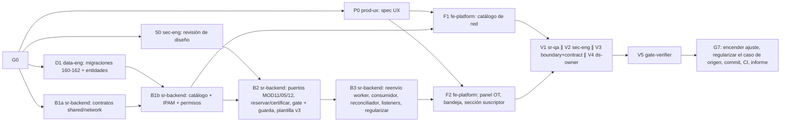

# MOD13 — Red y Aprovisionamiento · Fase 01 (IPAM y activación certificada) · Plan de orquestación

**Fecha:** 2026-10-22 · **Versión:** 1.6 · **Emisor:** AI-EM-ARCH (modo EM + Orchestrator)
**Definición:** [PRD-MOD13-RED-APROVISIONAMIENTO-FASE-01-v1.1.md](../prds/PRD-MOD13-RED-APROVISIONAMIENTO-FASE-01-v1.1.md) (Aprobado) · [HLD-MOD13-RED-APROVISIONAMIENTO-FASE-01-v1.1.md](../hlds/HLD-MOD13-RED-APROVISIONAMIENTO-FASE-01-v1.1.md) (contrato) · [ADR-098](../adrs/ADR-098-IPAM-y-Aprovisionamiento-Certificado-MOD13.md)
**Prompt:** [PROMPT-MOD13-APROVISIONAMIENTO-FASE-01-v1.1.md](../prompts/PROMPT-MOD13-APROVISIONAMIENTO-FASE-01-v1.1.md) · **Launcher vigente (Ola 6):** [PROMPT-MOD13-APROVISIONAMIENTO-FASE-01-LAUNCH-v1.6.md](../prompts/PROMPT-MOD13-APROVISIONAMIENTO-FASE-01-LAUNCH-v1.6.md) · Ejecutados: Ola 1 [LAUNCH-v1.0](../prompts/PROMPT-MOD13-APROVISIONAMIENTO-FASE-01-LAUNCH-v1.0.md), Ola 1-bis [LAUNCH-v1.1](../prompts/PROMPT-MOD13-APROVISIONAMIENTO-FASE-01-LAUNCH-v1.1.md), Ola 2 [LAUNCH-v1.2](../prompts/PROMPT-MOD13-APROVISIONAMIENTO-FASE-01-LAUNCH-v1.2.md), Ola 3 [LAUNCH-v1.3](../prompts/PROMPT-MOD13-APROVISIONAMIENTO-FASE-01-LAUNCH-v1.3.md), Ola 4 [LAUNCH-v1.4](../prompts/PROMPT-MOD13-APROVISIONAMIENTO-FASE-01-LAUNCH-v1.4.md) y Ola 5 [LAUNCH-v1.5](../prompts/PROMPT-MOD13-APROVISIONAMIENTO-FASE-01-LAUNCH-v1.5.md)
**Historial:** v1.1 (2026-10-22) incorpora el re-sync del contrato tras la Ola 1 y la Ola 1-bis (§6). v1.2 (2026-10-22) cierra G1 y lanza la Ola 2. v1.3 (2026-10-22) cierra G2 y lanza la Ola 3 (B2 ∥ F1 ∥ P0-ter). v1.4 (2026-10-22) recibe la Ola 3 y lanza la Ola 4 (B3 ∥ F1-v). v1.5 (2026-10-22) cierra G3 y lanza la Ola 5 (F2 ∥ F1-v). v1.6 (2026-10-22) registra los entregables F2, la evidencia local y los bloqueos de build y F1-v.
**Base:** `main` en `01a3e91b`. Se trabaja en `main`, sin ramas. **El árbol tiene 48 rutas sin commitear ajenas a esta fase:** ningún agente las toca ni las incluye en sus commits.

## 0. Alcance

PRD §3 «Dentro»: catálogo de routers y redes IPv4, IPAM, reserva con la OT en ejecución, instrucción manual para el MikroTik, certificación NOC, guarda de cierre, activación por eventos, bandeja, panel en la OT, sección en la ficha y regularización.

**Fuera de alcance:** PRD §3 «Fuera». En particular, nada escribe en el router.

## 1. Decisiones del CTO antes de lanzar (G0)

Las siete del PRD §9 (D-NET-1 a D-NET-7), más la aprobación de ADR-098 y de la enmienda de ADR-027.

Decisiones ya tomadas por el CTO el 2026-10-22 (no se reabren):
- métodos `SIMPLE_QUEUE_STATIC_IP` y `PCQ_ADDRESS_LIST`, extensibles;
- sin escritura en el router;
- aprovisionar con la OT en ejecución, antes del cierre;
- reservar la IP con la OT `IN_PROGRESS`;
- certifica NOC con maker-checker;
- la guarda aplica también a las OT vivas.

**Estado:** ✅ G0 aprobado por el CTO el 2026-10-22 con las siete recomendaciones, ADR-098 y la enmienda de ADR-027. La Ola 1 puede lanzarse.

## 2. Bloques y dependencias



- **Ruta crítica:** D1 → B1b → B2 → B3 → F2 → V1 → V5 → G7.
- **Paralelo:**
  - Ola 1: P0 ∥ S0 ∥ D1 ∥ B1a.
  - F1 corre en paralelo con B2 y B3, sobre archivos disjuntos.
  - V1 ∥ V2 ∥ V3 ∥ V4.
- **Sincronización:**
  - **S1:** D1 entrega las entidades exportadas desde `packages/database/src/entities/index.ts` y las migraciones aplicadas en local.
  - **S2:** B1a publica `packages/shared/src/contracts/network/` y las claves en `AccessPermissionKey`, que D1 necesita para la migración 162.
  - **S3:** P0 entrega `docs/specs/2026-10-22-mod13-aprovisionamiento-ux.md`.
  - **S4:** S0 cierra Q2 del HLD.
- **Dueño único de cada superficie compartida:**
  - `packages/database`: D1 (Ola 1), B2 (solo la migración 163).
  - `packages/shared/src/contracts/network`: B1a.
  - `packages/shared/src/contracts/operations/execution-orders.ts`: B2.
  - `apps/worker`: B3, solo el reenvío firmado. El consumidor de `network-execution-events` vive en `apps/api/src/modules/network` (HLD §6.3), también de B3.
  - `access-control.constants.ts`: B1b.
  - `SubscriberDetailClient.tsx` y la carpeta de componentes de OT: F2.
  - Todo `apps/portal/src/app/dashboard/network/{routers,ipv4-networks}`: F1.
  - `apps/portal/src/app/dashboard/network/provisioning`: F2.

## 3. Matriz de dispatch (agente × skill)

Claude Code **lee** cada `SKILL.md` (`.agents/skills/<nombre>/SKILL.md`) como documentación antes de escribir código; no lo invoca como tool. Skills verificadas en disco el 2026-10-22.

| Bloque | Agente | Skills obligatorias | De apoyo (condición) | Descartadas y motivo |
| --- | --- | --- | --- | --- |
| P0 | `prod-ux` | `iwana-identity-ui-review`, `system-vocabulary-review`, `wcag-audit-patterns` | `senior-ui-systems-designer` (bandeja y panel); `ui-ux-pro-max`, subordinada a las anteriores | `core-components`: P0 no implementa |
| S0 | `sec-eng` | `security-auditor`, `backend-security-coder`, `auth-implementation-patterns` | `architect-review` (fronteras) | `frontend-security-coder`: todavía no hay UI |
| D1 | `data-eng` | `database-migration`, `postgresql`, `iwana-tenant-migration`, `test-driven-development` | `typescript-expert` | `bullmq-specialist`: D1 no tiene colas |
| B1a | `sr-backend` | `typescript-expert`, `test-driven-development` | `typescript-pro` (unión discriminada Zod) | `nestjs-expert`: solo `@iwana/shared` |
| B1b | `sr-backend` | `nestjs-expert`, `backend-security-coder`, `openapi-spec-generation`, `test-driven-development` | `postgresql` (consulta de IPAM) | `bullmq-specialist`: B1b no tiene colas |
| B2 | `sr-backend` | `nestjs-expert`, `architect-review`, `openapi-spec-generation`, `test-driven-development`, `database-migration` (163) | `backend-security-coder` (maker-checker) | `iwana-matriz-motivos`: no toca consumo de inventario de OT |
| B3 | `sr-backend` | `bullmq-specialist`, `nestjs-expert`, `backend-security-coder`, `test-driven-development` | `iwana-queue-inspect` (comprobar drenaje), `observability-engineer` (logs sin PII) | `openapi-spec-generation` salvo para `regularize` |
| F1 | `fe-platform` | `core-components`, `frontend-dev-guidelines`, `nextjs-app-router-patterns`, `iwana-identity-ui-review`, `tailwind-patterns`, `system-vocabulary-review` | `wcag-audit-patterns` | `senior-ui-systems-designer`: la dirección la fija P0 |
| F2 | `fe-platform` | Las de F1 + `frontend-security-coder` | `i18n-localization` (formato de fechas e IP) | — |
| V1 | `sr-qa` | `testing-patterns`, `e2e-testing-patterns`, `playwright-skill`, `iwana-test-evidence`, `verification-before-completion` | `anthropic-skills:built-in-browser` (solo Claude Code) | — |
| V2 | `sec-eng` | `security-auditor`, `backend-security-coder`, `frontend-security-coder` | — | — |
| V3 | `boundary-reviewer` + `contract-drift-reviewer` | `architect-review` | — | — |
| V4 | `ds-owner` | `iwana-identity-ui-review` (con `audit-ui.mjs`), `core-components` | — | — |
| V5 | `gate-verifier` | `iwana-test-evidence`, `turborepo-caching`, `verification-before-completion` | — | — |
| G7 | AI-EM-ARCH | `iwana-cierre-fase` | `docs-architect` | — |

`sr-qa` **escribe tests y fixtures** (unitarios, de integración y E2E) y **nunca código de producto**.

## 4. Gates

| Gate | Condición | Quién |
| --- | --- | --- |
| G0 | D-NET-1 a D-NET-7 resueltas. ADR-098 y la enmienda de ADR-027 aprobadas. PRD en `Aprobado`; HLD congelado | CTO |
| G1 | S1 a S4 | data-eng, sr-backend, prod-ux, sec-eng |
| G2 | B1b: CA-NET-01 a 03 y CA-NET-12; test de concurrencia con 20 reservas y 0 duplicados, contra Postgres real y con conteo real | sr-backend |
| G3 | B2 + B3: CA-NET-04 a 11. Test que provoque el fallo dentro del `@OnEvent` real del listener CRM. Reentrega del evento sin efecto | sr-backend |
| G4 | F1 + F2: CA-NET-13 y 14. E2E contra el API real, no solo mocks | fe-platform, sr-qa |
| G5 | V2 sin hallazgos P0/P1 (HMAC, maker-checker, regularización, PII en logs). V3 sin violaciones de frontera ni deriva de contrato. V4 con `audit-ui.mjs` en 0 | sec-eng, reviewers, ds-owner |
| G6 | Gates Before Merge en local, sin caché de turbo: cobertura ≥80 % en `network`, lint, typecheck, migraciones reversibles, OpenAPI actualizado | gate-verifier |
| G7 | Encender `enforceProvisioningOnInstallClose` en los tenants ACTIVE (D-NET-3). Regularizar la OT `OTE-20260828-001` (caso de origen) desde la UI (D-NET-7). Commit y push; **CI de `main` en verde**. Informe `docs/informes/INFORME-MOD13-APROVISIONAMIENTO-CIERRE-v1.0.md` | AI-EM-ARCH + CTO |

## 5. Riesgos

| # | Riesgo | Mitigación |
| --- | --- | --- |
| P1 | Encender la guarda antes de que exista el panel deja las instalaciones incerrables | El ajuste nace apagado (migración 162) y solo se enciende en G7 |
| P2 | El suscriptor del caso de origen no tiene contacto real o datos fiscales completos, y la regularización deja «activación comercial pendiente» | Antes de G7, CRM verifica su ficha y la completa por la UI. El resultado queda visible, no oculto |
| P3 | `btree_gist` no está disponible (HLD Q1) | ✅ Cerrado en D1: la migración pública 028 instala la extensión y se conserva el `EXCLUDE` |
| P4 | El reenvío del worker rompe la proyección vigente de agenda, visita y tarea | B3 añade el encolado después de la proyección; la suite actual del worker se ejecuta sin caché |
| P5 | El árbol sucio de `main` contamina los commits | Cada bloque hace `git add` solo de sus rutas |

## 6. Estado de ejecución · 2026-10-22

| Ola | Bloque | Estado | Evidencia |
| --- | --- | --- | --- |
| 1 | S0 · sec-eng | ✅ Cerrado: Q2 → `network.provisioning.read`; 4 P1 y 3 P2 de diseño | [INFORME-MOD13-REVISION-SEGURIDAD-DISENO-v1.0](../informes/INFORME-MOD13-REVISION-SEGURIDAD-DISENO-v1.0.md) |
| 1 | D1 · data-eng | ✅ Cerrado: pública 028 `btree_gist` (cierra Q1), tenant 160–162, 7 entidades; 3 migraciones de ida y vuelta; 4/4 integraciones y 27/27 de orden | [INFORME-MOD13-APROVISIONAMIENTO-OLA1-v1.1](../informes/INFORME-MOD13-APROVISIONAMIENTO-OLA1-v1.1.md) |
| 1 | B1a · sr-backend | 🔶 Parcial: esquemas, colas y 6 permisos; 5/5 tests. Faltaban las formas de los DTO | ídem |
| 1 | P0 · prod-ux | ⛔ Bloqueado: el contrato no tenía la identidad legible de quien certifica | [spec UX](../specs/2026-10-22-mod13-aprovisionamiento-ux.md) |
| — | Re-sync | ✅ HLD y PRD v1.1, aprobados por el CTO el 2026-10-22. El CTO decidió que regularizan ADMIN y NOC, y que sin técnico asignado se bloquea (R6 ter) | HLD v1.1 §12 |
| 1-bis | D1-bis · data-eng | ✅ Cerrado: 161, 162 y entidades ajustadas; 160–162 de ida y vuelta; 3/3 integraciones y 6/6 de orden | [INFORME-MOD13-APROVISIONAMIENTO-OLA1-v1.1](../informes/INFORME-MOD13-APROVISIONAMIENTO-OLA1-v1.1.md) |
| 1-bis | B1a-bis · sr-backend | ✅ Cerrado: tipos, cuerpos y listas de códigos de HLD §4.4; 9/9 tests; lint, typecheck y build | ídem |
| 1-bis | P0-bis · prod-ux | ✅ Cerrado: spec UX v1.1 completa, sin campos fuera del HLD | [spec UX](../specs/2026-10-22-mod13-aprovisionamiento-ux.md) |
| 1-bis | S0-bis · sec-eng | ✅ 4 P1 y 2 P2 cerrados en diseño; el P2 del pipeline queda para V2, así que G5 sigue abierto | [revisión de seguridad](../informes/INFORME-MOD13-REVISION-SEGURIDAD-DISENO-v1.0.md) §Verificación v1.1 |
| — | G1 | ✅ Cerrado el 2026-10-22 | — |
| 2 | B1b · sr-backend | ✅ Cerrado: G2; API 3 suites/27 tests, PostgreSQL 2/11, shared 24/230, migración 162 1/1; lint, typecheck y build | [INFORME B1b](../informes/INFORME-MOD13-APROVISIONAMIENTO-B1B-v1.0.md) |
| — | G2 | ✅ Cerrado el 2026-10-22. Cobertura sin medir: queda para G6 | — |
| 3 | B2 · sr-backend | ✅ Cerrado: puertos MOD11, MOD05 y MOD12, comandos `reserve`, `certify` y `release`, gate y guarda de cierre, migración 163; `tasks` 37/746, B2 3/10, rollback de auditoría 1/3, 163 2/3 | [INFORME Ola 3](../informes/INFORME-MOD13-APROVISIONAMIENTO-OLA-3-v1.0.md) |
| 3 | P0-ter · prod-ux | ✅ Cerrado: sección Ajustes de red en la spec UX | [spec UX](../specs/2026-10-22-mod13-aprovisionamiento-ux.md) |
| 3 | F1 · fe-platform | 🔶 Construido: lint, typecheck y build con Webpack (43 rutas). Prueba contra el API vivo en 0/0: el API no respondía y faltaban credenciales E2E → F1-v | ídem |
| 4 | B3 · sr-backend | ✅ Cerrado: eventos firmados, listeners CRM/Inventario, reconciliador y regularización; Postgres/Redis 1/5, network 6/23, tasks 37/748, worker 21/173 | [INFORME Ola 4](../informes/INFORME-MOD13-APROVISIONAMIENTO-OLA-4-v1.0.md) |
| 4 | F1-v · fe-platform | ⛔ `[BLOQUEO]`: API no escucha en `127.0.0.1:3000` y faltan las dos variables E2E; 0 suites / 0 tests | [INFORME Ola 4](../informes/INFORME-MOD13-APROVISIONAMIENTO-OLA-4-v1.0.md) |
| — | G3 | ✅ Cerrado el 2026-10-22 (B2 + B3) | — |
| 5 | F2 · fe-platform | 🔶 Construido: 4 suites/239 tests; lint, typecheck y auditoría UI pasan. Build Webpack bloqueado por `EPERM` durante prerender bajo `.next` | [INFORME Ola 5](../informes/INFORME-MOD13-APROVISIONAMIENTO-OLA-5-v1.0.md) |
| 5 | F1-v · fe-platform | ⛔ `[BLOQUEO]`: API no escucha en `127.0.0.1:3000` y faltan las dos variables E2E; 0 suites / 0 tests | [INFORME Ola 5](../informes/INFORME-MOD13-APROVISIONAMIENTO-OLA-5-v1.0.md) |
| 6 | V2 · sec-eng ∥ V3 · boundary-reviewer + contract-drift-reviewer ∥ V4 · ds-owner | ⏳ Por lanzar (solo lectura; no espera a G4) | Launcher v1.6 |
| — | V1, V4-bis, V5 | ⏸ Esperan al entorno: API vivo con credenciales E2E y build del portal sin `EPERM` | — |

Los bloqueos fueron defectos del emisor (contrato v1.0), no de los agentes.

Correcciones de AI-EM-ARCH al recibir la Ola 1-bis:
- se revirtió el formateo con Prettier que había reescrito las tablas de este plan, porque `docs/` no se formatea;
- se restauró el informe de la Ola 1 v1.0, que ya estaba commiteado y se había borrado; queda marcado como superado por v1.1.

La Ola 2 queda cerrada con B1b.

Correcciones de AI-EM-ARCH al recibir la Ola 2:
- se borraron tres cachés de jest escritos dentro de `src/` por una ruta relativa: `apps/api/src/apps/`, `packages/database/src/packages/` y `packages/shared/src/packages/`, unos 2 850 archivos;
- se detectó que la pantalla de RF-NET-03 (perfiles por plan) y la del ajuste de la guarda no estaban en el HLD §9. Se añadió como aclaración sin cambio de API (HLD v1.1 §12): la especifica P0-ter en la Ola 3 y la construye F2.

Correcciones de AI-EM-ARCH al recibir la Ola 3:
- se borraron 10 carpetas de caché de jest (`apps/api/.jest-cache-mod13-b2-*` y `packages/database/.jest-cache-mod13-b2-*`); la regla común 3 prohíbe desde ahora crear cachés dentro del repo;
- hallazgo de frontera (P2): `TasksModule` importa `NetworkModule` completo y este exporta servicios. HLD §5.2 pedía un módulo estrecho, así que se corrige en B3.0, antes que el resto de B3;
- el fallo de Turbopack con `leaflet.css` no viene de MOD13: lo usan pantallas ya existentes de CRM y de ajustes. El build con Webpack pasa. Queda fuera de esta fase.

Correcciones y notas de AI-EM-ARCH al recibir la Ola 4:
- B3.0 verificado: `TasksModule` importa solo `NetworkProvisioningReadModule`, y `NetworkModule` exporta únicamente el puerto de estado comercial.
- Hallazgo de frontera (P3, para V3): `CrmModule` importa `NetworkModule` completo para obtener ese puerto. Es el mismo patrón que B3.0 corrigió para tasks.
- Seguridad: una salida de diagnóstico del agente imprimió la contraseña local de Redis. AI-EM-ARCH verificó que no quedó escrita en ningún archivo del repo (0 coincidencias en todo el árbol y en los 116 archivos cambiados). Recomendación: rotarla antes de volver a usar Redis de desarrollo. El launcher v1.5 prohíbe imprimir secretos.

Correcciones y notas de AI-EM-ARCH al recibir la Ola 5:
- F2 queda construido con 4 suites y 239 tests focalizados, lint y typecheck aprobados. El build compila y pasa TypeScript, pero el prerender recibe `EPERM` al escribir bajo `.next`; no se declara verde el build.
- F1-v sigue bloqueado: no había listener del API en `127.0.0.1:3000` ni credenciales E2E en el entorno. G4 permanece abierto.

Diagnóstico de AI-EM-ARCH sobre el `EPERM`: no había ningún proceso escuchando en los puertos 3000 a 3002, así que no lo causa un servidor de desarrollo del portal. Lo más probable es otro proceso con archivos de `apps/portal/.next` abiertos: un `node` residual, el antivirus o el indexador. Es un problema del entorno, no de F2. Quedan fuera de los commits de MOD13 el cambio de `apps/portal/next.config.ts` (es de la sesión de instant navigation) y las carpetas de cobertura.

Sigue la Ola 6: V2 ∥ V3 ∥ V4, que no necesitan el API vivo. V1, V4-bis y V5 se lanzan cuando el CTO prepare el entorno. Después viene G7.

## Lanzamiento

Fuente: [PROMPT-MOD13-APROVISIONAMIENTO-FASE-01-LAUNCH-v1.6.md](../prompts/PROMPT-MOD13-APROVISIONAMIENTO-FASE-01-LAUNCH-v1.6.md). **Si divergen, prevalece el archivo.** Lanza la Ola 6 (V2 ∥ V3 ∥ V4). Las olas anteriores no se re-despachan.

```text
===== 1 · sec-eng =====
Actúa como `sec-eng`. Lee `AGENTS.md`, el plan `docs/plans/2026-10-22-mod13-aprovisionamiento.md` y tu encargo `docs/prompts/PROMPT-MOD13-APROVISIONAMIENTO-FASE-01-v1.1.md` §V2. Lee `security-auditor`, `backend-security-coder` y `frontend-security-coder`. Revisa en solo lectura el código de MOD13 contra HLD v1.1 y tu informe de diseño; cierra con evidencia el P2 del pipeline. No corrijas código ni imprimas secretos. Entrega `docs/informes/INFORME-MOD13-REVISION-SEGURIDAD-IMPLEMENTACION-v1.0.md`.

===== 2 · boundary-reviewer =====
Actúa como `boundary-reviewer`. Lee `AGENTS.md`, el plan y tu encargo §V3 (frontera) del mismo prompt. Lee `architect-review`. Revisa en solo lectura las importaciones entre `network`, `tasks`, `crm`, `inventory` y `apps/worker` contra HLD v1.1 §8, incluido el P3 de `CrmModule` → `NetworkModule`. Escribe la sección §Frontera de `docs/informes/INFORME-MOD13-REVISION-FRONTERA-CONTRATOS-v1.0.md`.

===== 3 · contract-drift-reviewer =====
Actúa como `contract-drift-reviewer`. Lee `AGENTS.md`, el plan y tu encargo §V3 (contratos) del mismo prompt. Lee `architect-review`. Compara en solo lectura `packages/shared/src/contracts/network/` y el requisito `PROVISIONING` con sus productores y consumidores. Escribe la sección §Contratos del mismo informe, sin tocar la §Frontera.

===== 4 · ds-owner =====
Actúa como `ds-owner`. Lee `AGENTS.md`, el plan y tu encargo §V4 del mismo prompt. Lee `iwana-identity-ui-review` y `core-components`. Ejecuta `audit-ui.mjs` sobre las rutas `network/*` y los componentes nuevos o tocados, y revisa el uso de `@iwana/ui` y de los tokens contra la spec UX. La evidencia visual queda para V4-bis. Entrega `docs/informes/INFORME-MOD13-REVISION-UI-v1.0.md`.
```
