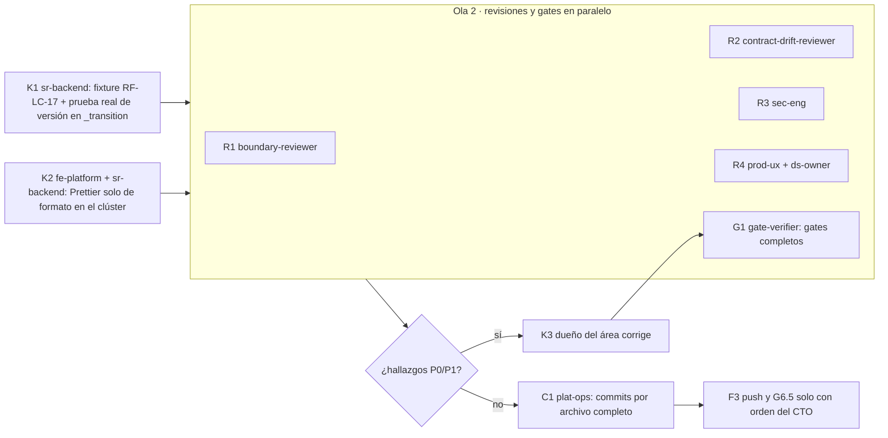

# MOD05 — Consolidación del clúster D + E + F + U · Plan de orquestación

**Fecha:** 2026-10-31 · **Versión:** 1.0 · **Estado:** Vigente · **Emisor:** AI-EM-ARCH (modo EM + Orchestrator)
**Prompt:** [PROMPT-MOD05-CONSOLIDACION-CLUSTER-v1.0.md](../prompts/PROMPT-MOD05-CONSOLIDACION-CLUSTER-v1.0.md) · **Launcher (Ola 1):** [PROMPT-MOD05-CONSOLIDACION-CLUSTER-LAUNCH-v1.0.md](../prompts/PROMPT-MOD05-CONSOLIDACION-CLUSTER-LAUNCH-v1.0.md)
**Olas que consolida:**

- **D:** Fase 09, ciclo de facturación ([plan](2026-10-30-mod05-ciclo-facturacion.md)).
- **E:** cambio de plan del contrato ([plan](2026-10-30-mod05-cambio-plan-contrato.md), [spec](../specs/2026-10-30-mod05-cambio-plan-contrato-ux.md)).
- **F:** contrato 360° en `@iwana/shared` ([prompt](../prompts/PROMPT-MOD05-SUBSCRIBERS-360-COTIZACIONES-REVISION-v1.0.md), [informe v1.2](../informes/INFORME-MOD05-360-COTIZACIONES-REVISION-v1.2.md)).
- **U:** ficha, confirmación tributaria y alias ([addendum](../specs/2026-10-31-mod05-ficha-suscriptor-addendum-u.md)).

**Base:** `main` = `origin/main` = `6dbdda8a`. Se trabaja en `main`, sin ramas.

## 0. Por qué este plan

Desde el checkpoint de commits (2026-10-31) hubo siete bloqueos seguidos en D. Tres investigaciones en paralelo dieron la causa común:

| Investigación                         | Resultado                                                                                                                                                                                                                                     |
| ------------------------------------- | --------------------------------------------------------------------------------------------------------------------------------------------------------------------------------------------------------------------------------------------- |
| `sr-backend` (`systematic-debugging`) | RF-LC-17 falla por un **fixture** sin `updatedAt`; el control de versión de E en `_transition` es correcto (plan E:32, spec E:56). Reproducido contra Postgres: 7/8, y 8/8 con el `updatedAt` real                                            |
| `sr-qa` (cadena de snapshots)         | **No hay más corrupción**: el desorden ocurrió en 84 s durante la verificación de G y solo afectó a `contracts.service.ts` y su spec, ya restaurados. 133 de 148 rutas idénticas a la referencia. Typechecks de shared, db, api y portal en 0 |
| `Explore` (mapa de hunks)             | D, E, F y un cuarto frente sin documento (**U**) están entretejidos **dentro de los mismos bloques**. Separarlos exige editar commits línea a línea en unos 10 puntos. **E no tiene ningún gate**                                             |

**Decisión del CTO (2026-10-31):**

- **consolidar sin partir:** se cierran los gates sobre el árbol tal cual y se commitea por archivos completos, sin staging parcial ni stash. Amplía D-CK-1 (b) a todo el clúster;
- **U se documenta** (addendum retroactivo) y se revisa antes del commit.

## 1. Bloques y dependencias

- **Ola 1:** K1 ∥ K2, sobre archivos disjuntos. K2 no toca los archivos de K1 hasta que K1 cierre.
- **Ola 2:** R1 ∥ R2 ∥ R3 ∥ R4 ∥ G1. Las revisiones son de solo lectura y G1 no corrige.
- **Regla 7, heredada del checkpoint:** mientras corre una ola nadie edita el árbol fuera de su encargo.

## 2. Matriz de dispatch (agente × skill)

Skills verificadas en disco el 2026-10-31 (`.agents/skills/<nombre>/SKILL.md`). Se leen como documentación.

| Bloque | Agente                                                   | Skills obligatorias                                                                                                   | De apoyo                                   | Descartadas y motivo                         |
| ------ | -------------------------------------------------------- | --------------------------------------------------------------------------------------------------------------------- | ------------------------------------------ | -------------------------------------------- |
| K1     | `sr-backend`                                             | `test-driven-development`, `systematic-debugging`, `iwana-test-evidence`, `postgresql`                                | `nestjs-expert`                            | `database-migration`: sin migraciones nuevas |
| K2     | `fe-platform` (portal) y `sr-backend` (api, shared y db) | `frontend-dev-guidelines` / `typescript-expert`                                                                       | `verification-before-completion`           | Cualquier skill de diseño: K2 solo formatea  |
| R1     | `boundary-reviewer`                                      | `architect-review`                                                                                                    | —                                          | —                                            |
| R2     | `contract-drift-reviewer`                                | `architect-review`                                                                                                    | `typescript-expert`                        | —                                            |
| R3     | `sec-eng`                                                | `security-auditor`, `backend-security-coder`, `frontend-security-coder`                                               | `auth-implementation-patterns`             | —                                            |
| R4     | `prod-ux` + `ds-owner`                                   | `iwana-identity-ui-review` (con `audit-ui.mjs`), `system-vocabulary-review`, `wcag-audit-patterns`, `core-components` | `senior-ui-systems-designer`               | `ui-ux-pro-max`: no hay rediseño nuevo       |
| G1     | `gate-verifier`                                          | `iwana-test-evidence`, `verification-before-completion`, `turborepo-caching`                                          | `e2e-testing-patterns`, `playwright-skill` | —                                            |
| K3     | dueño del hallazgo (`sr-backend` o `fe-platform`)        | según el hallazgo + `test-driven-development`                                                                         | `receiving-code-review`                    | —                                            |
| C1     | `plat-ops`                                               | `verification-before-completion`                                                                                      | `docs-architect`                           | —                                            |

## 3. Gates

| Gate | Condición                                                                                                                                                                                                                                                                                                                                                                                                                                                                                                               | Produce       | Aprueba                        |
| ---- | ----------------------------------------------------------------------------------------------------------------------------------------------------------------------------------------------------------------------------------------------------------------------------------------------------------------------------------------------------------------------------------------------------------------------------------------------------------------------------------------------------------------------- | ------------- | ------------------------------ |
| Q1   | K1: RF-LC-17 en verde y prueba real de `CONTRACT_CHANGED` en `_transition`                                                                                                                                                                                                                                                                                                                                                                                                                                              | sr-backend    | AI-EM-ARCH con evidencia de G1 |
| Q2   | R1–R4 sin hallazgos P0/P1 abiertos; CA-U-01 a CA-U-08 y gates de E (plan y spec E) verificados                                                                                                                                                                                                                                                                                                                                                                                                                          | revisores     | AI-EM-ARCH                     |
| Q3   | G1: typecheck y lint de los cuatro paquetes; suites completas sin caché de api, portal, shared y db; integraciones Postgres sin omisiones (contratos, cambio de plan, ciclo de vida, 360 cotizaciones, fecha de nacimiento, 167, 168); E2E de cambio de plan y de ciclo de facturación; `pnpm audit --prod --audit-level critical`; cobertura ≥80 % en `contracts.service.ts`, `subscribers.service.ts` y `subscriber-tax-profile.service.ts`; `pnpm audit:adr-citations` y `pnpm audit:doc-locations` en 0 bloqueantes | gate-verifier | AI-EM-ARCH                     |
| Q4   | C1: commits por archivos completos; el índice coincide con el árbol en cada archivo commiteado; lint-staged no cambia contenido (K2 ya formateó)                                                                                                                                                                                                                                                                                                                                                                        | plat-ops      | AI-EM-ARCH                     |
| G6.5 | Push y CI de `main` en verde por SHA                                                                                                                                                                                                                                                                                                                                                                                                                                                                                    | plat-ops      | CTO (orden previa)             |

## 4. Riesgos

| #   | Riesgo                                                                        | Mitigación                                                                                                       |
| --- | ----------------------------------------------------------------------------- | ---------------------------------------------------------------------------------------------------------------- |
| P1  | Volver a partir archivos por hunks                                            | **Prohibido** en este plan. Solo archivos completos                                                              |
| P2  | lint-staged reformatea al commitear y lo commiteado deja de ser lo verificado | K2 formatea antes de G1. C1 comprueba que el hook no cambie contenido; si cambia, para                           |
| P3  | Las E2E necesitan API y portal levantados                                     | G1 las corre con el entorno de desarrollo. Si no está disponible, `NOT_EXECUTED` con causa, no plantilla         |
| P4  | Hallazgos de R1–R4 que reabren alcance                                        | Se corrigen dentro del alcance documentado (planes D y E, informe F y addendum U); lo nuevo va a una spec aparte |
| P5  | Respaldos de R3-bis y R3-ter borrados antes del commit                        | Se conservan hasta G6.5                                                                                          |

## 5. Estado · 2026-11-02

| Bloque                                                       | Estado                                                                                                                                                                                                                                                                                                                                                                                                                                                                                                                                                 |
| ------------------------------------------------------------ | ------------------------------------------------------------------------------------------------------------------------------------------------------------------------------------------------------------------------------------------------------------------------------------------------------------------------------------------------------------------------------------------------------------------------------------------------------------------------------------------------------------------------------------------------------ |
| Investigaciones (3 agentes)                                  | Cerradas; resultados en §0                                                                                                                                                                                                                                                                                                                                                                                                                                                                                                                             |
| Addendum U                                                   | Emitido                                                                                                                                                                                                                                                                                                                                                                                                                                                                                                                                                |
| Ola 1 (K1 ∥ K2)                                              | ✅ Cerrada ([informe Ola 1](../informes/INFORME-MOD05-CONSOLIDACION-CLUSTER-OLA1-v1.0.md)); Q1 ✅                                                                                                                                                                                                                                                                                                                                                                                                                                                      |
| Ola 2 (R1–R4 ∥ G1)                                           | NO-GO: 3 P1 de R3 ([informe](../informes/INFORME-MOD05-CONSOLIDACION-CLUSTER-v1.0.md)); E2E `NOT_EXECUTED`                                                                                                                                                                                                                                                                                                                                                                                                                                             |
| Ola 2b (K3a → K3b ∥ K3c → K3d)                               | ✅ Cerrada; G1 reportó GO en los 7 gates                                                                                                                                                                                                                                                                                                                                                                                                                                                                                                               |
| Auditoría de K3 (AI-EM-ARCH, 2026-11-01)                     | GO condicionado: 3 P1 cerrados; quedan 4 P2 y 5 P3 → K4. Spec de ciclo y addendum U en v1.1                                                                                                                                                                                                                                                                                                                                                                                                                                                            |
| Ola 2c (K4a ∥ K4b ∥ K4c → K4d → K4e → G1)                    | ✅ Ejecutada; G1: 6 de 7 en PASS. Gate 4 abierto por entorno (sin worker)                                                                                                                                                                                                                                                                                                                                                                                                                                                                              |
| R-ER                                                         | Preexistente en `HEAD` (`079daf80`); sale del clúster como DT-3 de privacidad, prioridad alta                                                                                                                                                                                                                                                                                                                                                                                                                                                          |
| K4f (CA-CF-12 con worker)                                    | ✅ CA-CF-12 1/1; gate 4 4/4. **Q2 y Q3 en GO**                                                                                                                                                                                                                                                                                                                                                                                                                                                                                                         |
| DT-4 (aprovisionamiento sobre un tenant marcado para borrar) | Triage de `plat-ops` después de C1; no bloquea                                                                                                                                                                                                                                                                                                                                                                                                                                                                                                         |
| Ola 3 (C1a → aprobación → C1b)                               | C1a ✅ (221 rutas, 0 dudosas). El usuario confirmó el 2026-11-01 que autorizó la separación E7 de DT-3/B1. C1b aprobado, con las condiciones de §C1b                                                                                                                                                                                                                                                                                                                                                                                                   |
| C1b                                                          | Bloqueado por separación incompleta y cambio de boundary sin revisión. **Anulado:** el usuario eligió la opción A el 2026-11-01                                                                                                                                                                                                                                                                                                                                                                                                                        |
| Ola 4 (C4a → C4b ∥ C4c ∥ DT-3 Ola 2-R → C4d → G0 DT-3 → C4e) | Lista para lanzar C4a; requiere Docker y Postgres en marcha                                                                                                                                                                                                                                                                                                                                                                                                                                                                                            |
| C4a                                                          | Bloqueada: el patch B1 no aplica porque Prettier cambió el contexto. Se reemplaza por C4a-R (restauración por archivo completo con fusión a tres bandas resuelta y hash). C4b sin hallazgos; C4c: flaky de MOD11, ajeno                                                                                                                                                                                                                                                                                                                                |
| C4a-R                                                        | ✅ 9 archivos restaurados. AI-EM-ARCH verificó por hash 8 contra `mixed` y 1 contra el resuelto. API: 443 suites y 5.955 tests; DB: 77 y 423; 0 fallos. Se avisó a la sesión DT-3 para que reanude B3-R → B3 → B4                                                                                                                                                                                                                                                                                                                                      |
| DT-3 B1-F                                                    | AI-EM-ARCH lo autorizó el 2026-11-01: `allowAnonymized` solo en `POST /crm/contracts/:id/archive` (CA-RER-03). Cambia el hash de referencia de `contracts.service.ts`, que DT-3 registra en el informe. Pendientes para C4d: el fixture `portal-privacy-live.spec.ts:245` y la suite que exige base `test`/`iwana_it_*` (B3-R2)                                                                                                                                                                                                                        |
| DT-3 B4 / B1-G                                               | B4 sin P0/P1. El P2 abre B1-G, que AI-EM-ARCH autorizó el 2026-11-01: `assertActiveBillingCycle` va detrás del bloqueo del suscriptor en create y en la conversión. El titular anonimizado da 409; el titular sano conserva el 422 de D. Hash nuevo de `contracts.service.ts` en el informe                                                                                                                                                                                                                                                            |
| DT-3 B1-G / B3-H                                             | B1-G en verde (`contracts.service.ts` = `33E5CF71…`). 12 integraciones PG del clúster en rojo, sin regresión de producto: B1 y B1-R nunca las corrieron (guardas opt-in). AI-EM-ARCH aprobó el 2026-11-01 los tres ajustes de B3-H con condiciones: columnas del DDL de lifecycle; caso con suscriptor sano y caso 404 explícito; la prueba de entidad obsoleta pasa a 422 por relectura bajo bloqueo, y el resto de pruebas de `CONTRACT_CHANGED` queda intacto. Revisión previa de `test-change-reviewer`. C4d corre las integraciones sin omisiones |
| DT-3 B3-H2                                                   | B3-H: 66 PASS, 0 omitidas, 0 hallazgos C. AI-EM-ARCH aprobó B3-H2 el 2026-11-01. (A) 422 con expediente sano y caso explícito de 404. (B) Columnas del DDL a mano según su migración. (C) Decisión registrada: un PATCH sin versión del cliente, concurrente con changePlan, ya no da 409; con bloqueo y relectura aplica sobre el plan nuevo (200), lo que cumple spec E:56 y plan E:32. Se prueba con dos casos deterministas, uno por orden, estables 20/20. El esquema efímero `tenant_plan_change_f0f3…` sobrante lo decide el usuario            |
| DT-3 cierre previo a C4d                                     | B3-H2 cerrado a las 17:40: 13 suites PG con 116 PASS y 0 omitidas; C 20/20; 0 hallazgos C. El usuario autorizó dos ajustes de pruebas fuera del visto bueno de AI-EM-ARCH, que este revisó y acepta: (1) `subscribers.customer_segment` en el fixture de lifecycle; (2) en `contract-plan-change:126`, la prueba de `CONTRACT_CHANGED` pasa a usar `expectedUpdatedAt` obsoleto del cliente, que es el contrato real de E. `contracts.service.ts` = `33e5cf71…`                                                                                        |
| Esquema `tenant_plan_change_f0f3…`                           | El usuario decidió el 2026-11-01 borrarlo después de C4d, en el punto 0 de §C4e                                                                                                                                                                                                                                                                                                                                                                                                                                                                        |
| C4d                                                          | ✅ GO el 2026-11-02. La primera medición dio NO-GO por cobertura de ramas (subscribers 84,88 % y tributario 81,57 %); se repitió con 9 pruebas nuevas (0 hallazgos C): 86,64 % y 89,47 %. 13 integraciones PG: 116/0/0. E2E 8/8                                                                                                                                                                                                                                                                                                                        |
| G0 DT-3                                                      | ✅ El CTO aprobó la spec v1.2 el 2026-11-02                                                                                                                                                                                                                                                                                                                                                                                                                                                                                                            |
| C4e                                                          | ✅ 5 commits locales: `78d3e4fb`, `4cfeed5f`, `0175aca2`, `a8324a84` y `ee7f89f3`. Esquema efímero borrado. **Auditoría:** `HEAD` no compila solo porque el port de settings (`timezone`, K3b punto 4) quedó entre las ajenas                                                                                                                                                                                                                                                                                                                          |
| C4f                                                          | ✅ Commit 6 `50231284` (`timezone`). `HEAD` exportado y verificado en verde: typecheck y lint, y suites de los 4 paquetes. Las 26 ajenas, confirmadas                                                                                                                                                                                                                                                                                                                                                                                                  |
| F3                                                           | Push de `9e3956d7` hecho. **G6.5 NO cumplido:** el run `CI` 41439195912 está en `failure` (§F3 solo miró el smoke)                                                                                                                                                                                                                                                                                                                                                                                                                                     |
| Ola 5 H                                                      | Lista para lanzar ([lanzador v1.11](../prompts/PROMPT-MOD05-CONSOLIDACION-CLUSTER-LAUNCH-v1.11.md)): H1 triage de R4.1 ∥ H2 integraciones herméticas ∥ H3 runner ubuntu-24.04 → H4 push con orden del CTO                                                                                                                                                                                                                                                                                                                                              |
| H1–H3                                                        | ✅ H2: 55 suites en una base nueva, 0 FAIL. H3: runners en `ubuntu-24.04`. H1 reclasificado por AI-EM-ARCH: 2 fixtures sin ciclo (D) y el de privacidad sin confirmar → H5 ([lanzador v1.12](../prompts/PROMPT-MOD05-CONSOLIDACION-CLUSTER-LAUNCH-v1.12.md))                                                                                                                                                                                                                                                                                           |
| H4                                                           | **Autorizado por el CTO el 2026-11-02.** Tras el dictamen AI-EM-ARCH de H5 y la revisión con 0 hallazgos C, ejecutar los tres commits por archivo completo, push y G6.5 para todos los workflows del SHA. Estado de la ejecución en §H4 del informe.                                                                                                                                                                                                                                                                                                   |
| H5                                                           | Las 3 fallas de R4.1 quedaron corregidas; 0 hallazgos C. Las 7 fallas locales se clasifican como entorno: pasaron en CI con el mismo producto. **El CTO dio por cumplida la condición el 2026-11-02 y ordenó lanzar H4.** Conteo local preservado en el informe: 14 aprobados, 7 fallidos o con timeout y 1 omitido declarado.                                                                                                                                                                                                                         |

## Lanzamiento

Fuente: [PROMPT-MOD05-CONSOLIDACION-CLUSTER-LAUNCH-v1.12.md](../prompts/PROMPT-MOD05-CONSOLIDACION-CLUSTER-LAUNCH-v1.12.md) (H5 → H4). **Ese archivo prevalece si este espejo diverge.**

===== 1 · sr-qa (H5) =====
Actúa como `sr-qa`. Lee `AGENTS.md` y §H5 de `docs/prompts/PROMPT-MOD05-CONSOLIDACION-CLUSTER-v1.0.md`. Lee `e2e-testing-patterns`, `playwright-skill` e `iwana-test-evidence`. (1) En `portal-mod05-deuda-fiscal-live` y `portal-network-provisioning-live` la activación envía un `billingCycleDay` del catálogo activo, sin otro cambio. (2) Corre `portal-privacy.spec.ts` local con `--trace on`; si es el mock de 360°, alinéalo a `Subscriber360Response` de `@iwana/shared`; si es un selector cambiado por U, ajústalo citando el producto; si el producto rompe la suplantación, [BLOQUEO]. (3) Corre con conteo real los 5 specs que activan contratos (`ciclo-facturacion-live`, `mod05-deuda-fiscal-live`, `network-provisioning-live`, `privacy-fase-1b-live`, `privacy-live`) y `portal-privacy.spec.ts`, en tenant de pruebas. Escribe §H5. Sin stash ni commit.

===== 2 · test-change-reviewer (después de 1) =====
Actúa como `test-change-reviewer`. Lee `AGENTS.md` y §H2/§H5 del mismo prompt. Solo lectura: revisa los diffs de pruebas de H2 y H5 contra su regla (ADR-102, contrato 360° publicado, hermeticidad). Escribe la revisión en el informe. Un hallazgo C bloquea H4.

===== 3 · plat-ops (H4; el CTO ordenó el push el 2026-11-02, condicionado a que H5 y su revisión estén en verde sin hallazgos C) =====
Actúa como `plat-ops`. Lee `AGENTS.md`, §H4 del mismo prompt e `iwana-checkpoint-commit`. Commits por archivo completo: pruebas de H2 y H5 (uno), `ci.yml` de H3 (otro), informe/prompt/plan/lanzadores v1.11–v1.12 (otro). Push sin `--force`. G6.5: `gh run list --commit <sha>` con TODOS los workflows en `success`, citando id y conclusión de cada uno. Si alguno falla, [BLOQUEO] con el log. Escribe §H4 y corrige §F3. Sin stash ni staging parcial.
