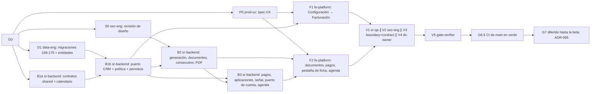

# MOD14 — Facturación · Fase 01 (Cartera interna y política de facturación) · Plan de orquestación

**Fecha:** 2026-10-31 · **Versión:** 1.0 · **Emisor:** AI-EM-ARCH (modo EM + Orchestrator)
**Estado:** Vigente — G0 aprobado el 2026-10-31; Ola 1 lista para lanzar
**Definición:** [PRD-MOD14-FACTURACION-FASE-01-v1.0.md](../prds/PRD-MOD14-FACTURACION-FASE-01-v1.0.md) (Propuesto) · [HLD-MOD14-FACTURACION-v1.0.md](../hlds/HLD-MOD14-FACTURACION-v1.0.md) (contrato; se congela en G0) · [ADR-103](../adrs/ADR-103-Modulo-Facturacion-MOD14.md)
**Prompt:** [PROMPT-MOD14-FACTURACION-FASE-01-v1.0.md](../prompts/PROMPT-MOD14-FACTURACION-FASE-01-v1.0.md) · **Launcher (Ola 1):** [PROMPT-MOD14-FACTURACION-FASE-01-LAUNCH-v1.0.md](../prompts/PROMPT-MOD14-FACTURACION-FASE-01-LAUNCH-v1.0.md)
**Base:** `main` en `1ce4f263`. Se trabaja en `main`, sin ramas. **El árbol tiene rutas sin commitear de MOD05 Fase 09, de cambio de plan y de privacidad.** Ningún agente las toca ni las añade a sus commits. Las migraciones 167 y 168 pertenecen a esa ola: MOD14 empieza en la 169 y debe confirmar antes de crearla que ese número sigue libre.

## 0. Alcance

PRD §3 «Dentro»:
- política de facturación configurable;
- generación de documentos de cobro por contrato y periodo;
- pagos con aplicación y saldo a favor;
- estado de cuenta;
- pestaña en la ficha;
- estado de pago en la agenda de corte;
- PDF, permisos y la señal de periodo pagado.

**Fuera de alcance:** PRD §3 «Fuera». En particular, **nada suspende ni reactiva servicios** y no hay factura electrónica.

## 1. Decisiones del CTO antes de lanzar (G0) — ✅ aprobadas el 2026-10-31

- Aprobar ADR-103, que incluye la excepción a ADR-080 y la enmienda de ADR-102 D2 y D5.
- Resolver D-BIL-1 a D-BIL-12 del PRD §9.

D-BIL-2 (nombre legal) y D-BIL-8 (redondeo) requieren fuente oficial o concepto del contador. Si no se resuelven en G0, se lanza con su valor provisional y quedan como bloqueo de G7, no de G5.

Decisiones ya tomadas por el usuario el 2026-10-31, que no se reabren:
- MOD14 por excepción;
- Fase 01 = cartera interna;
- tiempos de cobro y corte configurables como en UISP CRM;
- esta ronda entrega solo la definición.

## 2. Bloques y dependencias

- **Ruta crítica:** D1 → B1b → B2 → B3 → F2 → V1 → V5.
- **Paralelo:**
  - Ola 1: P0 ∥ S0 ∥ D1 ∥ B1a.
  - F1 corre en paralelo con B2 y B3, sobre archivos disjuntos.
  - V1 ∥ V2 ∥ V3 ∥ V4.
- **Sincronización:**
  - **S1:** D1 exporta las entidades desde `packages/database/src/entities/index.ts` y deja las migraciones aplicadas en local.
  - **S2:** B1a publica `packages/shared/src/contracts/billing/`, el calendario y la clave `BILLING_POLICY_MANAGE`. D1 la necesita para la 170, así que deja la 170 para el final de su bloque.
  - **S3:** P0 entrega `docs/specs/2026-10-31-mod14-facturacion-ux.md`.
  - **S4:** S0 cierra la Q2 del HLD y propone D-BIL-11.
- **D-BIL-7 (b), aprobada en G0:** D1 escribe la migración 171 en la Ola 1.
- **Dueño único de cada superficie compartida:**
  - `packages/database`: D1.
  - `packages/shared/src/contracts/billing` y `calendar/billing-calendar.ts`: B1a.
  - El enum de permisos y `access-control.constants.ts`: B1b.
  - `crm/contracts/billing-contract-read.adapter.ts` y su módulo: B1b.
  - `contracts.service.ts` `getCutoffAgenda` y `CutoffAgendaResponse`: B3.
  - El traslado de `pdf-branding.ts` a `common/pdf`: B2.
  - `apps/portal/src/app/dashboard/billing` y `components/billing`: F2.
  - Configuración → Facturación: F1.
  - `SubscriberDetailClient.tsx` (pestaña nueva): F2, coordinando con los cambios sin commitear de MOD05.

## 3. Matriz de dispatch (agente × skill)

Claude Code **lee** cada `SKILL.md` (`.agents/skills/<nombre>/SKILL.md`) como documentación antes de escribir código; no lo invoca como tool. Skills verificadas en disco el 2026-10-31.

| Bloque | Agente | Skills obligatorias | De apoyo (condición) | Descartadas y motivo |
| --- | --- | --- | --- | --- |
| P0 | `prod-ux` | `iwana-identity-ui-review`, `system-vocabulary-review`, `wcag-audit-patterns` | `senior-ui-systems-designer` (estado de cuenta y registro de pago); `ui-ux-pro-max`, subordinada | `core-components`: P0 no implementa |
| S0 | `sec-eng` | `security-auditor`, `backend-security-coder`, `auth-implementation-patterns` | `architect-review` (fronteras) | `frontend-security-coder`: todavía no hay UI |
| D1 | `data-eng` | `database-migration`, `postgresql`, `iwana-tenant-migration`, `test-driven-development` | `typescript-expert` | `bullmq-specialist`: D1 no tiene colas |
| B1a | `sr-backend` | `typescript-expert`, `test-driven-development` | `typescript-pro` (esquemas con refinamientos) | `nestjs-expert`: solo `@iwana/shared` |
| B1b | `sr-backend` | `nestjs-expert`, `architect-review`, `backend-security-coder`, `openapi-spec-generation`, `test-driven-development` | `postgresql` (consulta del adaptador de CRM) | `bullmq-specialist`: B1b no tiene colas |
| B2 | `sr-backend` | `nestjs-expert`, `bullmq-specialist`, `postgresql`, `openapi-spec-generation`, `test-driven-development` | `iwana-queue-inspect` (comprobar el job repetible), `observability-engineer` (resumen del job sin PII) | `iwana-matriz-motivos`: no toca consumo de inventario de OT |
| B3 | `sr-backend` | `nestjs-expert`, `backend-security-coder`, `postgresql`, `openapi-spec-generation`, `test-driven-development` | `architect-review` (puerto hacia CRM) | `bullmq-specialist`: B3 no tiene colas |
| F1 | `fe-platform` | `core-components`, `frontend-dev-guidelines`, `nextjs-app-router-patterns`, `iwana-identity-ui-review`, `tailwind-patterns`, `system-vocabulary-review` | `wcag-audit-patterns` | `senior-ui-systems-designer`: la dirección la fija P0 |
| F2 | `fe-platform` | Las de F1 + `frontend-security-coder` | `i18n-localization` (formato de moneda COP y fechas) | — |
| V1 | `sr-qa` | `testing-patterns`, `e2e-testing-patterns`, `playwright-skill`, `iwana-test-evidence`, `verification-before-completion` | `anthropic-skills:built-in-browser` (solo Claude Code) | — |
| V2 | `sec-eng` | `security-auditor`, `backend-security-coder`, `frontend-security-coder` | — | — |
| V3 | `boundary-reviewer` + `contract-drift-reviewer` | `architect-review` | — | — |
| V4 | `ds-owner` | `iwana-identity-ui-review` (con `audit-ui.mjs`), `core-components` | — | — |
| V5 | `gate-verifier` | `iwana-test-evidence`, `turborepo-caching`, `verification-before-completion` | — | — |
| G7 | AI-EM-ARCH | `iwana-cierre-fase` | `docs-architect` | — |

`sr-qa` **escribe tests y fixtures** (unitarios, de integración y E2E) y **nunca código de producto**. `data-eng` es de consulta en B2 y B3 si cambia el modelo.

## 4. Gates

Los gates G0–G7 de esta tabla son **gates del módulo**: cortes de ola con nombre propio, como en el plan de MOD13. No son las etapas del Protocolo multiagente §3. Ningún gate lo aprueba quien produce su entregable (Protocolo §3).

| Gate | Condición | Produce | Aprueba |
| --- | --- | --- | --- |
| G0 | ADR-103 aprobado. D-BIL-1 a D-BIL-12 resueltas o con valor provisional declarado. PRD en `Aprobado`; HLD congelado | AI-EM-ARCH | CTO |
| G1 | S1 a S4 | data-eng, sr-backend, prod-ux, sec-eng | AI-EM-ARCH, con la evidencia de `gate-verifier` para D1 y B1a |
| G2 | B1a + B1b: CA-FAC-01 y 02. Adaptador de CRM probado contra Postgres real | sr-backend | AI-EM-ARCH, con la evidencia de `gate-verifier` y la revisión de `boundary-reviewer` sobre el adaptador |
| G3 | B2 + B3: CA-FAC-03 a 10, 12 y 13. Pruebas de concurrencia contra Postgres real con conteo | sr-backend | AI-EM-ARCH, con la evidencia de `gate-verifier` y las pruebas de concurrencia de `sr-qa` |
| G4 | F1 + F2: CA-FAC-14 y el flujo E2E del HLD §10 contra la API real, no solo mocks | fe-platform (código), sr-qa (E2E) | AI-EM-ARCH, con la revisión de prod-ux sobre la spec y de ds-owner |
| G5 | V2 sin hallazgos P0/P1 (permisos, PII del adquirente, idempotencia). V3 sin violaciones de frontera ni deriva de contrato. V4 con `audit-ui.mjs` en 0 | sec-eng, reviewers, ds-owner (revisiones) | AI-EM-ARCH |
| G6 | Gates Before Merge en local, sin caché de turbo: cobertura ≥80 % en `billing`, lint, typecheck, migraciones reversibles, OpenAPI actualizado, `pnpm audit:adr-citations` y `pnpm audit:doc-locations` | gate-verifier (evidencia) | AI-EM-ARCH |
| G6.5 | CI de `main` en verde, identificado por SHA (ADR-069). Se mira `gh run` de `main`, no solo la corrida local | AI-EM-ARCH (commit y push) | CTO, sobre el artefacto de CI |
| G7 | **Diferido hasta la beta mínima** (ADR-095). Cuando se active: D-BIL-2 y D-BIL-8 resueltas con fuente; encender la generación automática por tenant; informe `docs/informes/INFORME-MOD14-FACTURACION-FASE-01-CIERRE-v1.0.md` | AI-EM-ARCH | CTO |

## 5. Riesgos

| # | Riesgo | Mitigación |
| --- | --- | --- |
| P1 | El árbol sucio de `main` contamina los commits | Cada bloque hace `git add` solo de sus rutas; AI-EM-ARCH commitea al cierre de cada ola |
| P2 | Una migración de otra ola ocupa el número 169 antes que D1 | D1 verifica `runner.ts` al empezar y toma el siguiente libre; el HLD se re-sincroniza solo en la numeración |
| P3 | `SubscriberDetailClient.tsx` tiene cambios sin commitear de MOD05 | F2 añade la pestaña con un cambio mínimo y lo informa; no reescribe la ficha |
| P4 | Un verde de tests que no corrió (caché de turbo, `--passWithNoTests`) | Conteo real obligatorio (`iwana-test-evidence`) |
| P5 | Se habilita un corte por error | Ninguna fase de MOD14 llama a `SubscriberLifecycleService`; V3 lo verifica |

## 6. Estado de ejecución · 2026-10-31

| Bloque | Estado |
| --- | --- |
| Definición (PRD, HLD, ADR-103, plan, prompts) | **G0 aprobado por el CTO el 2026-10-31**, con las recomendaciones del PRD §9. HLD congelado |
| Ola 1 (P0, S0, D1, B1a) | Lista para lanzar |

## Lanzamiento

Fuente: [PROMPT-MOD14-FACTURACION-FASE-01-LAUNCH-v1.0.md](../prompts/PROMPT-MOD14-FACTURACION-FASE-01-LAUNCH-v1.0.md), Ola 1. **Ese archivo es la fuente y prevalece si este espejo diverge.** Solo se lanza con G0 aprobado.

===== 1 · prod-ux =====
Actúa como `prod-ux`. Lee `AGENTS.md`, el plan `docs/plans/2026-10-31-mod14-facturacion-fase-01-orquestacion.md` y tu encargo §P0 de `docs/prompts/PROMPT-MOD14-FACTURACION-FASE-01-v1.0.md`. Antes de escribir, lee los `SKILL.md` de `iwana-identity-ui-review`, `system-vocabulary-review` y `wcag-audit-patterns`. Consumes el HLD congelado `docs/hlds/HLD-MOD14-FACTURACION-v1.0.md`; si falta un dato, emite `[BLOQUEO]` y para. Cierras al entregar `docs/specs/2026-10-31-mod14-facturacion-ux.md`.

===== 2 · sec-eng =====
Actúa como `sec-eng`. Lee `AGENTS.md`, el plan y tu encargo §S0. Lee `security-auditor`, `backend-security-coder` y `auth-implementation-patterns`. Revisas en solo lectura ADR-103 y el HLD; cierras la Q2 y propones D-BIL-11. Cierras al entregar `docs/informes/INFORME-MOD14-REVISION-SEGURIDAD-DISENO-v1.0.md` con hallazgos P0–P3.

===== 3 · data-eng =====
Actúa como `data-eng`. Lee `AGENTS.md`, el plan y tu encargo §D1. Lee `database-migration`, `postgresql`, `iwana-tenant-migration` y `test-driven-development`. Confirma la numeración libre en `runner.ts` e implementa el HLD §3 sin modificarlo. Solo tus rutas; no commitees. Cierras con las migraciones aplicadas y revertidas, con conteo real.

===== 4 · sr-backend =====
Actúa como `sr-backend`. Lee `AGENTS.md`, el plan y tu encargo §B1a. Lee `typescript-expert` y `test-driven-development`. Implementa el HLD §4 en `@iwana/shared` sin modificar el contrato. No commitees. Cierras con las pruebas en tabla del calendario y los esquemas en verde, con conteo real.
