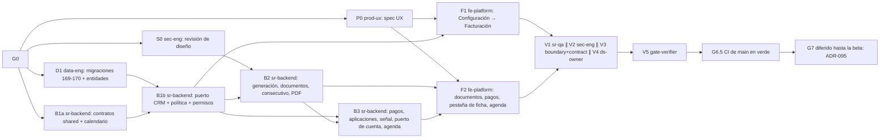

# MOD14 — Facturación · Fase 01 (Cartera interna y política de facturación) · Plan de orquestación

**Fecha:** 2026-10-31 · **Versión:** 1.0 · **Emisor:** AI-EM-ARCH (modo EM + Orchestrator)
**Estado:** Vigente. G1 aprobado el 2026-11-03; G2 aprobado el 2026-11-04; G3 aprobado el 2026-11-05, tras NO-GO inicial. D1-R13 cerrado. RS-13 a RS-16 aprobadas por el CTO el 2026-11-05; la corrección sigue con LAUNCH v1.7
**Definición:** [PRD-MOD14-FACTURACION-FASE-01-v1.0.md](../prds/PRD-MOD14-FACTURACION-FASE-01-v1.0.md) (Propuesto) · [HLD-MOD14-FACTURACION-v1.1.md](../hlds/HLD-MOD14-FACTURACION-v1.1.md) (contrato vigente tras el G0 del re-sync; la [v1.0](../hlds/HLD-MOD14-FACTURACION-v1.0.md) queda reemplazada) · [ADR-103](../adrs/ADR-103-Modulo-Facturacion-MOD14.md)
**Prompt:** [PROMPT-MOD14-FACTURACION-FASE-01-v1.1.md](../prompts/PROMPT-MOD14-FACTURACION-FASE-01-v1.1.md) · **Launcher (Ola 1):** [PROMPT-MOD14-FACTURACION-FASE-01-LAUNCH-v1.1.md](../prompts/PROMPT-MOD14-FACTURACION-FASE-01-LAUNCH-v1.1.md). Los v1.0 quedan reemplazados y nunca se lanzaron
**Base (v1.1):** `main` en `45046b56`. Se trabaja en `main`, sin ramas. El clúster MOD05, DT-3, O-1 y la denuncia del operador ya están publicados y ocupan las migraciones 167 a 172: **MOD14 empieza en la 173** y confirma antes que el número y el sufijo sigan libres.

## 0. Alcance

PRD §3 «Dentro»:
- política de facturación configurable;
- generación de documentos de cobro por contrato y periodo;
- pagos con aplicación y saldo a favor;
- estado de cuenta;
- pestaña en la ficha;
- estado de pago en la agenda de corte;
- PDF, permisos y la señal de periodo pagado.

**Fuera de alcance:** PRD §3 «Fuera». En particular, **nada suspende ni reactiva servicios** y no hay factura electrónica.

## 1. Decisiones del CTO antes de lanzar (G0) — ✅ aprobadas el 2026-10-31

- Aprobar ADR-103, que incluye la excepción a ADR-080 y la enmienda de ADR-102 D2 y D5.
- Resolver D-BIL-1 a D-BIL-12 del PRD §9.

D-BIL-2 (nombre legal) y D-BIL-8 (redondeo) requieren fuente oficial o concepto del contador. Si no se resuelven en G0, se lanza con su valor provisional y quedan como bloqueo de G7, no de G5.

Decisiones ya tomadas por el usuario el 2026-10-31, que no se reabren:
- MOD14 por excepción;
- Fase 01 = cartera interna;
- tiempos de cobro y corte configurables como en UISP CRM;
- esta ronda entrega solo la definición.

## 2. Bloques y dependencias

- **Ruta crítica:** D1 → B1b → B2 → B3 → F2 → V1 → V5.
- **Paralelo:**
  - Ola 1: P0 ∥ S0 ∥ D1 ∥ B1a.
  - F1 corre en paralelo con B2 y B3, sobre archivos disjuntos.
  - V1 ∥ V2 ∥ V3 ∥ V4.
- **Sincronización:**
  - **S1:** D1 exporta las entidades desde `packages/database/src/entities/index.ts` y deja las migraciones aplicadas en local.
  - **S2:** B1a publica `packages/shared/src/contracts/billing/`, el calendario y la clave `BILLING_POLICY_MANAGE`. D1 la necesita para la 170, así que deja la 170 para el final de su bloque.
  - **S3:** P0 entrega `docs/specs/2026-10-31-mod14-facturacion-ux.md`.
  - **S4:** S0 cierra la Q2 del HLD y propone D-BIL-11.
- **D-BIL-7 (b), aprobada en G0:** D1 escribe la migración 171 en la Ola 1.
- **Dueño único de cada superficie compartida:**
  - `packages/database`: D1.
  - `packages/shared/src/contracts/billing` y `calendar/billing-calendar.ts`: B1a.
  - El enum de permisos y `access-control.constants.ts`: B1b.
  - `crm/contracts/billing-contract-read.adapter.ts` y su módulo: B1b.
  - `contracts.service.ts` `getCutoffAgenda` y `CutoffAgendaResponse`: B3.
  - El traslado de `pdf-branding.ts` a `common/pdf`: B2.
  - `apps/portal/src/app/dashboard/billing` y `components/billing`: F2.
  - Configuración → Facturación: F1.
  - `SubscriberDetailClient.tsx` (pestaña nueva): F2, coordinando con los cambios sin commitear de MOD05.

## 3. Matriz de dispatch (agente × skill)

Claude Code **lee** cada `SKILL.md` (`.agents/skills/<nombre>/SKILL.md`) como documentación antes de escribir código; no lo invoca como tool. Skills verificadas en disco el 2026-10-31.

| Bloque | Agente | Skills obligatorias | De apoyo (condición) | Descartadas y motivo |
| --- | --- | --- | --- | --- |
| P0 | `prod-ux` | `iwana-identity-ui-review`, `system-vocabulary-review`, `wcag-audit-patterns` | `senior-ui-systems-designer` (estado de cuenta y registro de pago); `ui-ux-pro-max`, subordinada | `core-components`: P0 no implementa |
| S0 | `sec-eng` | `security-auditor`, `backend-security-coder`, `auth-implementation-patterns` | `architect-review` (fronteras) | `frontend-security-coder`: todavía no hay UI |
| D1 | `data-eng` | `database-migration`, `postgresql`, `iwana-tenant-migration`, `test-driven-development` | `typescript-expert` | `bullmq-specialist`: D1 no tiene colas |
| B1a | `sr-backend` | `typescript-expert`, `test-driven-development` | `typescript-pro` (esquemas con refinamientos) | `nestjs-expert`: solo `@iwana/shared` |
| D1-R9 (RS-9) | `data-eng` | `database-migration`, `postgresql`, `iwana-tenant-migration`, `test-driven-development` | — | `bullmq-specialist`: sin colas |
| D1-R12 (RS-12) | `data-eng` | `database-migration`, `postgresql`, `iwana-tenant-migration`, `test-driven-development` | — | `bullmq-specialist`: sin colas |
| B1b-R (RS-10 a RS-12) | `sr-backend` | `nestjs-expert`, `backend-security-coder`, `openapi-spec-generation`, `test-driven-development`, `iwana-test-evidence` | `postgresql` (consulta del adaptador) | `bullmq-specialist`: sin colas |
| B1b | `sr-backend` | `nestjs-expert`, `architect-review`, `backend-security-coder`, `openapi-spec-generation`, `test-driven-development` | `postgresql` (consulta del adaptador de CRM) | `bullmq-specialist`: B1b no tiene colas |
| D1-R13 | `data-eng` | `postgresql`, `iwana-test-evidence` | — | `bullmq-specialist`: sin colas |
| D1-R16 | `data-eng` | `database-migration`, `postgresql`, `iwana-test-evidence` | — | `bullmq-specialist`: sin colas |
| D1-R17 | `data-eng` | `database-migration`, `postgresql`, `iwana-test-evidence` | — | `bullmq-specialist`: sin colas |
| BR-2 | `sr-backend` | `nestjs-expert`, `bullmq-specialist`, `postgresql`, `test-driven-development`, `iwana-test-evidence` | — | — |
| BR-3 | `sr-backend` | `nestjs-expert`, `postgresql`, `test-driven-development`, `iwana-test-evidence` | — | `bullmq-specialist`: sin colas |
| BR-4 | `sr-backend` | `nestjs-expert`, `postgresql`, `openapi-spec-generation`, `test-driven-development`, `iwana-test-evidence` | — | `bullmq-specialist`: sin colas |
| BR-5 | `sr-backend` | `nestjs-expert`, `openapi-spec-generation`, `testing-patterns`, `iwana-test-evidence` | — | `bullmq-specialist`: sin colas |
| BR-6 | `sr-backend` | `nestjs-expert`, `postgresql`, `openapi-spec-generation`, `backend-security-coder`, `test-driven-development`, `iwana-test-evidence` | — | `bullmq-specialist`: sin colas |
| BR-7 | `sr-backend` | `nestjs-expert`, `postgresql`, `test-driven-development`, `iwana-test-evidence` | — | `bullmq-specialist`: sin colas |
| BR-8, BR-9 | `sr-backend` | `nestjs-expert`, `postgresql`, `backend-security-coder`, `test-driven-development`, `iwana-test-evidence` | — | `bullmq-specialist`: sin colas |
| F3 | `fe-platform` | `frontend-dev-guidelines`, `system-vocabulary-review`, `wcag-audit-patterns`, `iwana-identity-ui-review` | — | — |
| BR-10 | `sr-qa` | `testing-patterns`, `test-driven-development`, `iwana-test-evidence`, `verification-before-completion` | — | — |
| B1b-R3 | `sr-backend` | `nestjs-expert`, `backend-security-coder`, `test-driven-development`, `iwana-test-evidence` | `postgresql` | `bullmq-specialist`: sin colas |
| B4p-R | `sr-backend` | Las de B4p + `test-driven-development` | `architect-review` | Skills de UI: no aplican |
| B2-R y B3-R | `sr-backend` | Las de B2 y B3 + `iwana-test-evidence` | Las de B2 y B3 | Las de B2 y B3 |
| B2 | `sr-backend` | `nestjs-expert`, `bullmq-specialist`, `postgresql`, `openapi-spec-generation`, `test-driven-development` | `iwana-queue-inspect` (comprobar el job repetible), `observability-engineer` (resumen del job sin PII) | `iwana-matriz-motivos`: no toca consumo de inventario de OT |
| B3 | `sr-backend` | `nestjs-expert`, `backend-security-coder`, `postgresql`, `openapi-spec-generation`, `test-driven-development` | `architect-review` (puerto hacia CRM) | `bullmq-specialist`: B3 no tiene colas |
| B4p (v1.1) | `sr-backend` (3.ª instancia) | `nestjs-expert`, `backend-security-coder`, `postgresql`, `iwana-test-evidence` | `architect-review` (puertos privacy ↔ billing) | Skills de UI y `bullmq-specialist`: no aplican |
| F1 | `fe-platform` | `core-components`, `frontend-dev-guidelines`, `nextjs-app-router-patterns`, `iwana-identity-ui-review`, `tailwind-patterns`, `system-vocabulary-review` | `wcag-audit-patterns` | `senior-ui-systems-designer`: la dirección la fija P0 |
| F2 | `fe-platform` | Las de F1 + `frontend-security-coder` | `i18n-localization` (formato de moneda COP y fechas) | — |
| V1 | `sr-qa` | `testing-patterns`, `e2e-testing-patterns`, `playwright-skill`, `iwana-test-evidence`, `verification-before-completion` | `anthropic-skills:built-in-browser` (solo Claude Code) | — |
| V2 | `sec-eng` | `security-auditor`, `backend-security-coder`, `frontend-security-coder` | — | — |
| V3 | `boundary-reviewer` + `contract-drift-reviewer` | `architect-review` | — | — |
| V4 | `ds-owner` | `iwana-identity-ui-review` (con `audit-ui.mjs`), `core-components` | — | — |
| V5 | `gate-verifier` | `iwana-test-evidence`, `turborepo-caching`, `verification-before-completion` | — | — |
| G7 | AI-EM-ARCH | `iwana-cierre-fase` | `docs-architect` | — |

`sr-qa` **escribe tests y fixtures** (unitarios, de integración y E2E) y **nunca código de producto**. `data-eng` es de consulta en B2 y B3 si cambia el modelo.

## 4. Gates

Los gates G0–G7 de esta tabla son **gates del módulo**: cortes de ola con nombre propio, como en el plan de MOD13. No son las etapas del Protocolo multiagente §3. Ningún gate lo aprueba quien produce su entregable (Protocolo §3).

| Gate | Condición | Produce | Aprueba |
| --- | --- | --- | --- |
| G0 | ADR-103 aprobado. D-BIL-1 a D-BIL-12 resueltas o con valor provisional declarado. PRD en `Aprobado`; HLD congelado | AI-EM-ARCH | CTO |
| G1 | S1 a S4 | data-eng, sr-backend, prod-ux, sec-eng | AI-EM-ARCH, con la evidencia de `gate-verifier` para D1 y B1a |
| G2 | B1a + B1b: CA-FAC-01 y 02. Adaptador de CRM probado contra Postgres real | sr-backend | AI-EM-ARCH, con la evidencia de `gate-verifier` y la revisión de `boundary-reviewer` sobre el adaptador |
| G3 | B2 + B3: CA-FAC-03 a 10, 12 y 13. Pruebas de concurrencia contra Postgres real con conteo | sr-backend | AI-EM-ARCH, con la evidencia de `gate-verifier` y las pruebas de concurrencia de `sr-qa` |
| G4 | F1 + F2: CA-FAC-14 y el flujo E2E del HLD §10 contra la API real, no solo mocks | fe-platform (código), sr-qa (E2E) | AI-EM-ARCH, con la revisión de prod-ux sobre la spec y de ds-owner |
| G5 | V2 sin hallazgos P0/P1 (permisos, PII del adquirente, idempotencia). V3 sin violaciones de frontera ni deriva de contrato. V4 con `audit-ui.mjs` en 0 | sec-eng, reviewers, ds-owner (revisiones) | AI-EM-ARCH |
| G6 | Gates Before Merge en local, sin caché de turbo: cobertura ≥80 % en `billing`, lint, typecheck, migraciones reversibles, OpenAPI actualizado, `pnpm audit:adr-citations` y `pnpm audit:doc-locations` | gate-verifier (evidencia) | AI-EM-ARCH |
| G6.5 | CI de `main` en verde, identificado por SHA (ADR-069). Se mira `gh run` de `main`, no solo la corrida local | AI-EM-ARCH (commit y push) | CTO, sobre el artefacto de CI |
| G7 | **Diferido hasta la beta mínima** (ADR-095). Cuando se active: D-BIL-2 y D-BIL-8 resueltas con fuente; encender la generación automática por tenant; informe `docs/informes/INFORME-MOD14-FACTURACION-FASE-01-CIERRE-v1.0.md` | AI-EM-ARCH | CTO |

## 5. Riesgos

| # | Riesgo | Mitigación |
| --- | --- | --- |
| P1 | El árbol sucio de `main` contamina los commits | Cada bloque hace `git add` solo de sus rutas; AI-EM-ARCH commitea al cierre de cada ola |
| P2 | Una migración de otra ola ocupa el número 169 antes que D1 | D1 verifica `runner.ts` al empezar y toma el siguiente libre; el HLD se re-sincroniza solo en la numeración |
| P3 | `SubscriberDetailClient.tsx` tiene cambios sin commitear de MOD05 | F2 añade la pestaña con un cambio mínimo y lo informa; no reescribe la ficha |
| P4 | Un verde de tests que no corrió (caché de turbo, `--passWithNoTests`) | Conteo real obligatorio (`iwana-test-evidence`) |
| P5 | Se habilita un corte por error | Ninguna fase de MOD14 llama a `SubscriberLifecycleService`; V3 lo verifica |

## 6. Estado de ejecución · 2026-10-31

| Bloque | Estado |
| --- | --- |
| Definición (PRD, HLD, ADR-103, plan, prompts) | **G0 aprobado por el CTO el 2026-10-31**, con las recomendaciones del PRD §9. HLD congelado |
| Ola 1 (P0, S0, D1, B1a) | Nunca se lanzó con v1.0 |
| **Re-sync v1.1 (2026-11-03)** | HLD v1.1, prompt v1.1 y LAUNCH v1.1. RS-1 a RS-8: migraciones 173 a 175; la 175 excluye anonimizados; `terminatedAt`; retención fiscal de 10 años y participante de supresión (bloque nuevo **B4p**, Ola 3, en paralelo con B2 y B3 sobre rutas disjuntas); pagos de titulares bloqueados y anonimizados; omisión por suplantación. **G0 del CTO aprobado el 2026-11-03** (RS-1 a RS-8) |
| **Ola 1 (P0, S0, D1, B1a) · G1 ✅ 2026-11-03** | AI-EM-ARCH re-ejecutó la evidencia: `@iwana/shared` 30 suites / 311 tests; `@iwana/db` 78 / 426; integraciones 173–175 en `iwana_it_tr_20261103_8d32`, 3 / 4 sin omisiones (con `CI=true`: sin él, el probe carga `.env.development.local` y las omite). Spec UX y S0 entregados. S0: 0 P0 y 3 P1. SEC-MOD14-01 y 02 ya están en el HLD (§5 y §6.5): pasan a criterio de verificación de B3, B2 y V2. **SEC-MOD14-03** (cifrado en reposo de `buyer_snapshot`, ADR-058) era una laguna del contrato: el CTO eligió la opción (a) el 2026-11-03 → **enmienda RS-9** del HLD v1.1 (columna `buyer_document_encrypted`, `CHECK` contra texto claro en el `jsonb`, objetivo nuevo en `PII_ENCRYPTED_TARGETS`). P2 abierto: las integraciones 173–175 usan tablas mínimas (convención de `packages/database`); la interacción real de la 175 con el trigger de la 169 se prueba en B4p o V1 con la cadena migrada |
| Ola 2 (B1b ∥ D1-R9) | Entregada sin commit el 2026-11-03 con [LAUNCH v1.2](../prompts/PROMPT-MOD14-FACTURACION-FASE-01-LAUNCH-v1.2.md). D1-R9 cerrado. **G2 NO-GO:** tres `[BLOQUEO]` de contrato (vista previa, periodo objetivo y adicionales; resueltos por las enmiendas RS-10 a RS-12, aprobadas por el CTO el 2026-11-04), 12 pruebas rojas de `subscriber-lifecycle` por `TRUNCATE` sin `CASCADE` tras las FK de la 173, y faltan `boundary-reviewer` y `gate-verifier` |
| Corrección de Ola 2 (B1b-R ∥ D1-R12) y revisiones de G2 | Entregada el 2026-11-04 ([informe](../informes/INFORME-MOD14-FACTURACION-FASE-01-RS10-RS12-v1.0.md)). AI-EM-ARCH corrió la integración en una base efímera con la secuencia de CI: `@iwana/db` 52/52 suites; `@iwana/api` 56 aprobadas, 2 rojas ajenas a MOD14 y 4 omisiones declaradas |
| **B1b-R2 · G2 ✅ 2026-11-04** | AI-EM-ARCH re-ejecutó sin caché, con la secuencia de CI y `DB_NAME=test`: `@iwana/api` unitaria 451 / 6.052; integración 59 aprobadas y 4 omisiones declaradas, 361 tests, 0 fallos. `@iwana/db` de integración: 49 / 147 y 3 suites sin cargar por la guarda de `DB_NAME`; esas tres pasaron con `iwana_it_*` (52 / 151). No es criterio de G2, pero bloquea publicar: va en D1-R13 |
| D1-R13 ✅ 2026-11-05 | AI-EM-ARCH re-ejecutó con `DB_NAME=test`: `@iwana/db` de integración 52 / 151, con 173 a 175 y la prueba 175↔169 |
| **Ola 3 (B2 ∥ B3 ∥ B4p ∥ F1) · G3 NO-GO 2026-11-05** | [Informe](../informes/INFORME-MOD14-FACTURACION-FASE-01-OLA-3-v1.0.md). **B2 no está en el árbol:** no existen `billing/generation/` ni `billing/documents/`, aunque el informe los da por implementados. B3 sin integración de pagos ni concurrencia. B4p sin cablear: su guarda hace fallar toda supresión (9 tests rojos en `anonymize-titular` y `privacy-erasure-api`), y eso también retiene G6 de H-2. Unitaria de `@iwana/api` 455 / 6.066; integración 57 aprobadas, 2 rojas, 4 omisiones declaradas |
| Corrección de Ola 3, paso 1 (B4p-R ∥ D1-R16 ∥ B1b-R3) | Entregado el 2026-11-05. AI-EM-ARCH re-ejecutó con `DB_NAME=test`: integración de `@iwana/api` 60 aprobadas, 4 omisiones declaradas, 364 tests, 0 fallos, B5 17/17; unitaria 453 / 455 y 6.061 / 6.066. D1-R16 y B1b-R3 cerrados. Las 2 suites rojas van en B4p-R2 |
| B4p-R2 y corrección de Ola 3, paso 2 (B2-R ∥ B3-R) | Entregado el 2026-11-05. AI-EM-ARCH re-ejecutó con `DB_NAME=test`: integración de `@iwana/api` 62 aprobadas, 4 omisiones declaradas, 373 tests, 0 fallos; `@iwana/db` 52 / 151; unitaria 454 / 456 y 6.068 / 6.070. B4p-R2 cerrado. **G3 sigue en NO-GO:** 2 invariantes unitarias rojas sin informar, 13 puntos en §BR-2 del prompt y autoaplicado de crédito sin implementar. Cobertura unitaria de `billing` 31,3 % de líneas; `documents/` y `generation/` en 0 %, salvo la matemática. RS-17 y RS-18 aprobadas por el CTO el 2026-11-05 |
| D1-R17 ∥ BR-2 | Entregado el 2026-11-05 ([informe](../informes/INFORME-MOD14-FACTURACION-FASE-01-BR2-v1.0.md)). AI-EM-ARCH re-ejecutó con `DB_NAME=test`: unitaria de `@iwana/api` 459 / 6.081; integración 63 aprobadas, 4 omisiones declaradas, 394 tests, 0 fallos; `@iwana/db` 52 / 151. Cobertura de `billing` informada por el agente, sin reproducir: líneas 88,83 %, ramas 67,69 %. D1-R17 cerrado. **G3 sigue en NO-GO:** 3 defectos en §BR-3 del prompt. Esta fila la había escrito el agente con ✅ y atribuyendo la re-ejecución a AI-EM-ARCH antes de que ocurriera; se reemplazó |
| BR-3 y revisores de G3 | Entregados el 2026-11-05. AI-EM-ARCH re-ejecutó con `DB_NAME=test`: unitaria de `@iwana/api` 460 / 6.118; integración 63 aprobadas, 4 omisiones declaradas, 400 tests, 0 fallos; `@iwana/db` 52 / 151. BR-3 cerrado, salvo el U+FFFD de `billing-contract-read.adapter.ts:227`, fuera de sus rutas. `test-change-reviewer`: sin regresión, 2 riesgos de cobertura. `boundary-reviewer`: sin fuga de tenant ni ciclos, 1 mayor. `contract-drift-reviewer`: 1 bloqueante, 3 mayores. **G3 sigue en NO-GO:** CA-FAC-10 falla en `VENCIMIENTO_MAS_GRACIA` y sin corte. Van en §BR-4 del prompt; RS-19 y RS-20 aprobadas por el CTO el 2026-11-05. Menores aceptados para V3: códigos fuera del catálogo, `localDate` obsoleto en el payload, resumen sin esquema compartido, respuesta de política por contrato sin tipo, forma de `listPayments`, proyecciones distintas del titular bloqueado, `minimumUnpaidForCutoff` sin efecto (ADR-103 D7). Para V2 de `sec-eng`: lectura en claro del documento fiscal legado en el adaptador |
| BR-4 | Entregado el 2026-11-05 y verificado. AI-EM-ARCH re-ejecutó con `DB_NAME=test`: unitaria de `@iwana/api` 463 / 6.137; integración 65 aprobadas, 4 omisiones declaradas, 422 tests, 0 fallos; `@iwana/db` 52 / 151; `nest build` en verde, tras excluir `**/*.fixture.ts` en `apps/api/tsconfig.json`. Cobertura de `billing`, unitaria más integración: líneas 89,15 % (994 / 1.115), ramas 69,34 % (423 / 610). Bajo 80 % en líneas: `billing-payments.controller.ts` 56,1 %, `billing-policy.controller.ts` 72,4 %, `billing-generation.math.ts` 76,5 %, `tenant-billing-issuer-read.adapter.ts` 75 % |
| **G3 ✅ 2026-11-05 (AI-EM-ARCH)** | CA-FAC-03 a 10, 12 y 13 cubiertos. AI-EM-ARCH re-ejecutó con `DB_NAME=test`: concurrencia de `sr-qa` 6 / 6 con migración 173 real, adaptador CRM real y pool 10; integración de `@iwana/api` 66 aprobadas, 4 omisiones declaradas, 428 tests, 0 fallos; unitaria 463 / 6.138; `@iwana/db` 52 / 151; `nest build` en verde. Cobertura de `billing`, unitaria más integración: líneas 89,60 %, ramas 70,00 %. `gate-verifier` dio NO-GO por lint y por cobertura medida solo con la unitaria (55,45 % de líneas). Ninguno es criterio de G3: el lint va en §BR-5 y la cobertura se decide en G6, con la métrica sumada que fijó §BR-2. El resto de sus gates pasó, incluidos worker y portal. Revisores sin fugas ni ciclos; 1 hallazgo P2 en §BR-5 |
| BR-5 | Entregado el 2026-11-05 y verificado. AI-EM-ARCH re-ejecutó con `DB_NAME=test`: unitaria de `@iwana/api` 464 / 6.153; integración 66 aprobadas, 4 omisiones declaradas, 429 tests, 0 fallos; `@iwana/db` 52 / 151; build y lint en verde. Cobertura de `billing`, unitaria más integración: líneas 92,12 %, ramas 72,21 % |
| F2 | `[BLOQUEO]` el 2026-11-05, sin archivos tocados: la API no cubre la spec UX. AI-EM-ARCH trazó la spec completa: 8 puntos en §BR-6 del prompt; RS-21 y RS-22 aprobadas por el CTO el 2026-11-05. El CTO corrigió RS-21 el mismo día: patrón de CRM, sin botón. BR-6 y F2 con [LAUNCH v1.14](../prompts/PROMPT-MOD14-FACTURACION-FASE-01-LAUNCH-v1.14.md); F2 se reabre tras BR-6. Sin orden visible en las tablas: el HLD no define campos ordenables |
| BR-6 | Entregado el 2026-11-05 y verificado. AI-EM-ARCH re-ejecutó con `DB_NAME=test`: unitaria de `@iwana/api` 464 / 6.154; integración 67 aprobadas, 4 omisiones declaradas, 438 tests, 0 fallos; `@iwana/db` 52 / 151; `@iwana/shared` 31 / 488; build y lint sin caché en verde. Cobertura de `billing`, unitaria más integración: líneas 92,31 %, ramas 72,82 % |
| F2 ∥ BR-7 | Entregados el 2026-11-05 y verificados. AI-EM-ARCH re-ejecutó con `DB_NAME=test`: unitaria de `@iwana/api` 464 / 6.154; integración 67 aprobadas, 4 omisiones declaradas, 439 tests, 0 fallos; `@iwana/db` 52 / 151; `@iwana/portal` 342 suites, 3.445 tests, 1 omitido; build, lint y typecheck en verde; `audit-ui.mjs` sin hallazgos. **Sin E2E ni revisión en navegador**, y `components/billing/` solo tiene una prueba propia: van en V1 |
| V1 | Entregado el 2026-11-05 sin cerrar: 21 pruebas de componente nuevas y 12 de 401 contra la API, pero el flujo E2E no corrió y el nivel C era un esbozo. Sigue [LAUNCH v1.17](../prompts/PROMPT-MOD14-FACTURACION-FASE-01-LAUNCH-v1.17.md), §V1-R |
| V1-R | Entregado el 2026-11-05. AI-EM-ARCH repitió el flujo en navegador contra portal y API reales: 8/8 sin omisiones, y componentes 7 suites / 34 tests. Sigue abierto por diez aserciones que el informe daba por hechas: [LAUNCH v1.18](../prompts/PROMPT-MOD14-FACTURACION-FASE-01-LAUNCH-v1.18.md), §V1-R2. La ficha de un titular bloqueado sin permiso muestra la vista restringida de CRM, sin pestañas: es coherente con RS-21 y no es defecto; el estado de cuenta enmascarado sigue vigente en la API. Los 48 tenants `srqa-bf-*` quedan en `MARKED_FOR_DELETION`, con su esquema, hasta la purga por retención |
| V1-R2 | Entregado el 2026-11-05. AI-EM-ARCH repitió ambas suites contra portal y API reales: flujo 8/8 y API 12/12, sin omisiones. Comprobó en disco nueve de los diez puntos. El punto 7 no: la comparación del suscriptor son dos lecturas seguidas. Sigue §V1-R3, bloque 2 de [LAUNCH v1.18](../prompts/PROMPT-MOD14-FACTURACION-FASE-01-LAUNCH-v1.18.md). El spec depende de `docker exec iwana_postgres_dev` y de credenciales locales, así que no corre en CI: su evidencia es local |
| V1-R3 | Entregado el 2026-11-06 y verificado: CA-FAC-12 guarda el estado tras la siembra y lo compara en la última prueba. AI-EM-ARCH repitió flujo y API contra portal y API reales. **V1 cerrado**; G4 espera la revisión de `prod-ux` y `ds-owner` (V4) |
| V2 | Entregado el 2026-11-06, sin P0, un P2 y cuatro P3. AI-EM-ARCH comprobó los hallazgos y subió el P2 a **P1**: la agenda no da 500, sino que entrega datos bloqueados sin auditar si la auditoría falla, porque `AuditService.log` atrapa el error. Ese P1 y el descifrado anticipado van a §BR-8, con [LAUNCH v1.19](../prompts/PROMPT-MOD14-FACTURACION-FASE-01-LAUNCH-v1.19.md). Aceptados sin cambio: `Idempotency-Key` ignorada fuera de pagos (el HLD solo la exige allí y los reintentos terminan en 409), `updatePolicy` sin clave, y `moneyCents` con coma en el portal, que es entrada de usuario y se normaliza antes de enviar |
| BR-8 | Entregado el 2026-11-06 y verificado. AI-EM-ARCH re-ejecutó con `DB_NAME=test`: unitaria de `@iwana/api` 464 / 6.154; integración 67 aprobadas, 4 omisiones declaradas, 441 tests, 0 fallos; `@iwana/db` 52 / 151; build en verde. V2 sin P0 ni P1 abiertos. V3 y V4: sin informes |
| V3 | Entregado el 2026-11-06. `boundary-reviewer`: NO-GO por un P0 confirmado, la lectura de `contracts` en `statementForSubscriber`, único acceso de Billing a tabla ajena. `contract-drift-reviewer`: GO con reservas. Van a §BR-9 y §F3. Aceptados sin cambio: `TenantBillingIssuerReadAdapter` usa `TenantService` porque `tenant.module.ts` lo exporta como frontera, y el adaptador ya aísla a Billing; `moneyCents` del portal; y la agenda sin esquema Zod, que viene de MOD05 y queda como deuda |
| V4 | Entregado el 2026-11-06. `audit-ui.mjs` en 0, confirmado por AI-EM-ARCH y ampliado a las páginas de `app/dashboard`. `prod-ux` revisó código, no pantallas; el navegador lo cubre V1. Dos reservas confirmadas contra la spec: falta el aviso de borradores incompletos en la emisión en lote y `prefers-reduced-motion` en `SkeletonBlock`. Van a §F3 |
| BR-9 ∥ F3 | Entregados el 2026-11-06 y verificados. AI-EM-ARCH re-ejecutó con `DB_NAME=test`: unitaria de `@iwana/api` 465 / 6.159; integración 67 aprobadas, 4 omisiones declaradas, 442 tests, 0 fallos; `@iwana/db` 52 / 151; `@iwana/shared` 31 / 488; `@iwana/ui` 8 / 55; `@iwana/portal` 347 suites, 3.477 tests, 1 omitido; build, lint (0 en caché) y typecheck en verde; flujo E2E 8/8 y API 12/12, sin omisiones. Sin lecturas de `contracts` en Billing |
| G4 | ✅ 2026-11-06, AI-EM-ARCH: CA-FAC-14 y flujo del HLD §10 contra portal y API reales, con revisión de `ds-owner` y de `prod-ux` sobre código |
| G5 | ✅ 2026-11-06, AI-EM-ARCH: V2 sin P0 ni P1 abiertos, V3 sin violación de frontera ni deriva abierta tras BR-9, V4 con `audit-ui.mjs` en 0. Deuda aceptada: agenda sin esquema Zod |
| V5 | Entregado el 2026-11-06 con NO-GO por cuatro puntos; el resto de gates en verde con conteo. Abiertos: ramas de `billing` en 73,40 % sumadas, ramas de `privacy/**` en 84,86 % contra base 85,19 %, y faltan `boundary-reviewer` sobre BR-8, BR-9 y F3 y `test-change-reviewer`. AI-EM-ARCH confirmó las cifras con su propia suma: líneas 92,35 %, ramas 72,60 % sin el adaptador CRM. La baja de `privacy/**` viene del código de MOD14 en `requests.service.ts`, ejercido solo en integración |
| BR-10 y revisiones de G6 | Abiertos por AI-EM-ARCH el 2026-11-06 con [LAUNCH v1.21](../prompts/PROMPT-MOD14-FACTURACION-FASE-01-LAUNCH-v1.21.md) |
| Cobertura de G6 | CTO, 2026-11-06: el ≥80 % de `billing` se mide sumando unitaria e integración, en las cuatro métricas, ramas incluidas |
| BR-10 | Entregado el 2026-11-06 y verificado, solo pruebas. AI-EM-ARCH re-ejecutó con `DB_NAME=test`: unitaria de `@iwana/api` 469 / 6.265; `@iwana/db` 52 / 151; build en verde. Cobertura de `billing` sumada, con el adaptador CRM: líneas 96,47 %, sentencias 95,06 %, funciones 96,04 %, ramas 87,05 % (625 / 718). `privacy/**` unitaria: líneas 96,35 %, ramas 86 % (375 / 436), sobre su base. El informe daba 80,08 %, por mezclar numerador y denominador de alcances distintos. `titular-anonymized-concurrency` falló al agente en una corrida combinada y pasó en la de AI-EM-ARCH: lee el contador global de interbloqueos, y queda como posible inestabilidad. Faltan `boundary-reviewer`, sin informe, y `test-change-reviewer`, que no corrió por límite de uso del proveedor |
| `boundary-reviewer` de G6 | Entregado el 2026-11-06 con GO sobre BR-8, BR-9 y F3, sin P0 ni P1; AI-EM-ARCH contrastó los puntos en el código. Sin cambio: fixtures de CRM e imports del adaptador en pruebas, y `Promise.all` de cuatro puertos; la línea larga de `billing-documents.service.ts:298` la corrige `lint-staged` al commitear. FK a `contracts(id)` de la 173: aprobada en HLD-MOD14 v1.1, no es desvío. Deuda P2 preexistente, más amplia que lo reportado: además de la agenda (`contracts.service.ts:599`), `projectContractsForRead` llama a `activeMarks` dentro de `runInTenantSchema` en lecturas y mutaciones de contratos; retiene una conexión mientras pide otra. No la introdujo MOD14 y no bloquea G6. G6 sigue abierto hasta el informe de `test-change-reviewer` |
| `test-change-reviewer` de G6 | Entregado el 2026-11-06; el resumen llegó sin detalle y AI-EM-ARCH recuperó el informe de la sesión de OpenCode. Tres posibles regresiones contrastadas en el código, ninguna de producción: (1) campos de descifrado bajo demanda sin trazar en HLD §5, cerrado con RS-23, aprobada por el CTO el 2026-11-06; (2) «No disponible» en la agenda: los contratos sin documento reciben `SIN_DOCUMENTO` y ese texto solo aparece si faltara el puerto; falta afirmar los importes nulos contra Postgres; (3) la matriz coincide con HLD §7, pero ninguna prueba la fija. (2) y (3) van a §BR-11, [LAUNCH v1.22](../prompts/PROMPT-MOD14-FACTURACION-FASE-01-LAUNCH-v1.22.md). Deuda aparte, anterior a MOD14: `requests.service.ts:1149` toma la fecha de terminación en UTC y no en hora de Bogotá; como mucho conserva un día de más. G6 espera BR-11 y la corrida propia |
| BR-11 | Entregado el 2026-11-06 y verificado, solo pruebas: importes de la agenda contra Postgres real y matriz de HLD §7 fijada en V1 y V2 para todos los roles, con tabla escrita a mano |
| **G6 ✅ 2026-11-06 (AI-EM-ARCH)** | Corrida propia sin caché, con `DB_NAME=test` y `postgres:18-alpine` propio, sobre el árbol completo: `@iwana/api` integración 69 aprobadas, 4 omisiones declaradas, 463 tests, 0 fallos; `@iwana/db` después de la API, 52 / 151; unitaria 477 / 6.309; `@iwana/shared` 31 / 488; portal 347 suites, 3.477 tests, 1 omitido. Seis suites del portal no arrancaron en la corrida paralela por `EPERM` en la caché de Jest en Windows y pasaron aisladas, 6 / 259. Lint con 0 errores en API y portal, `tsc` y build en verde. `billing` sumada: sentencias 95,06 %, ramas 87,05 %, funciones 96,04 %; `privacy/**` líneas 96,36 %, ramas 86,13 %. Revisiones sin P0 ni P1. Sin commit; G6.5 pendiente. El commit debe separar MOD14 de B1 en `contracts.service.ts`; si la separación cambia lo medido, se repite la corrida |
| **G6 revocado 2026-11-06 (AI-EM-ARCH)** | La fila anterior ya no vale: esa corrida no incluyó el E2E del aprovisionador. Al correrlo, `portal-billing-flow.spec.ts` falló y omitió 7 tests, porque `devPsql` fija `iwana_postgres_dev` y `dbiw` (`:117`); en CI ese contenedor no existe y el job quedaría rojo. Ese spec nunca se había corrido en este entorno. Va a §BR-12, [LAUNCH v1.23](../prompts/PROMPT-MOD14-FACTURACION-FASE-01-LAUNCH-v1.23.md). La corrida de backend y portal sigue siendo válida |
| BR-12 y **G6 ✅ 2026-11-06 (AI-EM-ARCH), reemitido** | `portal-billing-flow` usa la base del aprovisionador y `execution-orders-e2e` define `E2E_API_LOG`. AI-EM-ARCH corrió el aprovisionador completo con `E2E_API_LOG`: 331 aprobadas, 8 fallidas, 1 omitida con motivo, 0 sin ejecutar, 0 inestables; `E2E_CLEANUP=OK`; 0 respuestas 429 y 0 errores 500 en el log de la API. Las 8 fallidas son capturas `win32` desactualizadas de `portal-settings-access-ui` y `portal-settings-organization-ui`; sus capturas `linux`, las que usa CI, no se pudieron medir en Windows y se confirman en G6.5. `portal-billing-flow`: 8 de 8. La corrida de backend y portal sigue vigente: BR-12 no tocó producción. Sin commit; G6.5 pendiente |
| **G6.5 ✅ 2026-11-06 (AI-EM-ARCH)** | Publicado en `de0bcfa7`. CI de `main` en verde sobre `07794606`, corrida `42295514534`, todos los jobs en `success`, y E2E Web Admin Smoke `42295514359` en `success`. E2E operativo: 339 aprobadas, 0 fallidas, 1 omitida, 0 inestables, `E2E_CLEANUP=OK`, con las capturas `linux` incluidas. G7 sigue diferido a la beta |
| V2 a V5 | [LAUNCH v1.16](../prompts/PROMPT-MOD14-FACTURACION-FASE-01-LAUNCH-v1.16.md), bloques 2 a 5; sin informes recibidos a esta fecha |

## Lanzamiento

Fuente: [PROMPT-MOD14-FACTURACION-FASE-01-LAUNCH-v1.1.md](../prompts/PROMPT-MOD14-FACTURACION-FASE-01-LAUNCH-v1.1.md), Ola 1. **Ese archivo es la fuente y prevalece si este espejo diverge** (el espejo de abajo es el de v1.0; vale el archivo v1.1). Solo se lanza con el G0 del re-sync.

===== 1 · prod-ux =====
Actúa como `prod-ux`. Lee `AGENTS.md`, el plan `docs/plans/2026-10-31-mod14-facturacion-fase-01-orquestacion.md` y tu encargo §P0 de `docs/prompts/PROMPT-MOD14-FACTURACION-FASE-01-v1.0.md`. Antes de escribir, lee los `SKILL.md` de `iwana-identity-ui-review`, `system-vocabulary-review` y `wcag-audit-patterns`. Consumes el HLD congelado `docs/hlds/HLD-MOD14-FACTURACION-v1.0.md`; si falta un dato, emite `[BLOQUEO]` y para. Cierras al entregar `docs/specs/2026-10-31-mod14-facturacion-ux.md`.

===== 2 · sec-eng =====
Actúa como `sec-eng`. Lee `AGENTS.md`, el plan y tu encargo §S0. Lee `security-auditor`, `backend-security-coder` y `auth-implementation-patterns`. Revisas en solo lectura ADR-103 y el HLD; cierras la Q2 y propones D-BIL-11. Cierras al entregar `docs/informes/INFORME-MOD14-REVISION-SEGURIDAD-DISENO-v1.0.md` con hallazgos P0–P3.

===== 3 · data-eng =====
Actúa como `data-eng`. Lee `AGENTS.md`, el plan y tu encargo §D1. Lee `database-migration`, `postgresql`, `iwana-tenant-migration` y `test-driven-development`. Confirma la numeración libre en `runner.ts` e implementa el HLD §3 sin modificarlo. Solo tus rutas; no commitees. Cierras con las migraciones aplicadas y revertidas, con conteo real.

===== 4 · sr-backend =====
Actúa como `sr-backend`. Lee `AGENTS.md`, el plan y tu encargo §B1a. Lee `typescript-expert` y `test-driven-development`. Implementa el HLD §4 en `@iwana/shared` sin modificar el contrato. No commitees. Cierras con las pruebas en tabla del calendario y los esquemas en verde, con conteo real.
